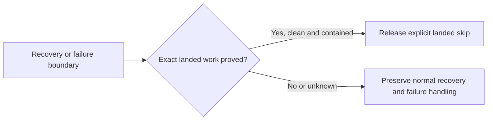

## Summary

Closes #3977.

An active run now reconciles its exact merged implementation before completion
recovery and failure bookkeeping. Proved already-landed work releases with the
existing `claim_stale:work_already_merged` outcome, skips redundant recovery and
PR creation, and consumes no coding-failure attempt. Distinct local work and
explicit partial scope stay on the normal path.

## Spec

### Intent and Rationale

- Stop the remaining squash-merge recurrence without replacing branch management,
  inventing a failure taxonomy or discarding unpublished changes.
- Keep integration into a milestone separate from delivery to the default branch.

### Essential Design Decisions

- Reuse claim freshness, exact branch provenance, the existing branch-PR lookup
  and merged-commit ancestry. The shared bounded branch query finds milestone
  PRs even when GitHub's issue-closing connection is empty.
- Require repository, issue-closing contract, run branch, intended target and
  immutable merged/head commit identity. Fetch the pull ref without moving a
  branch; prove that local HEAD and the branch contain no work outside that
  merged PR, then repeat the local identity and clean-tree observations.
- Preserve explicit partial/missing or unassessed criteria, unrelated PRs,
  reapproved scope, dirty work, extra commits and unavailable evidence. A plain
  historical summary still needs the closing contract and commit proofs.
- Use shared Markdown logical units and code segments; code examples cannot
  manufacture the closing contract. Supported unrequested extras remain valid.
- Guard quality-phase failure recording, worker outcome derivation and the final
  production failure plan. Preserve a genuine failure already booked by a phase.
- Production stops the heartbeat timer but publishes the terminal marker only
  after the final decision, preventing provisional failure tallies and duplicate
  landed releases. Standalone cleanup keeps its existing behaviour.
- Both serial and pooled claim release retain target/default/merge provenance.
  These skips earn no success/failure callback or default-delivery credit. No
  historical failure labels or attempt records are stripped.

### Undiscoverable Facts

- The public milestone examples have no closing-PR nodes in the issue connection.
  PR #3959 supplies the exact #3740 branch and squash; PR #3618's own summary
  explicitly reports partial #3534 scope, so that historical example remains a
  negative control rather than being declared complete.

## Evidence

- Replayed the public #3740 squash timeline from PR #3959 with its real branch,
  target, head, first replayed commit and squash identity. Replayed PR #3618
  for #3534 as a negative because its full historical summary reports partial
  criteria. Public snapshots are retained in
  `worker/deno/tests/fixtures/already_landed_3977.json`.
- Those two selected public records give one known positive and one partial-scope
  negative, both correctly classified. Synthetic refusal cases cover malformed
  metadata and unavailable evidence. This small selected corpus establishes no
  general recall estimate; unobserved false negatives remain unknown.
- 23 individual mutations produced assertion failures in the named regressions,
  including actual production worker dispatch, every new bookkeeping caller,
  both core release arms and deferred heartbeat publication. The facts companion
  records the source anchors and tests. No type failure counts as a red test.
- Twelve focused suites passed: 325 tests, no failures. The repository quality
  gate is recorded separately when complete. No deployed-worker or fleet-wide
  recurrence improvement is claimed from these fixtures.
- Docs sweep — grep: "claim freshness", "already-landed", "Preservation runs
  before the existing-PR lookup"; section:
  `docs/workflows/issue-processing.md` → "Decision points and exceptions"; siblings:
  none — extends existing freshness and release owners rather than adding a
  parallel branch-management or telemetry subsystem.

## Acceptance Criteria

<!-- vibe-spec-review inputs="diff+issue-body" -->

- **met** — A fixture reproduces another worker merging the exact implementation between this run's work and its final push; no failure label, failure attempt, duplicate PR or unnecessary recovery is produced. — evidence: production completion fixtures cover merges before recovery and during push; screenshot and summary recovery fixtures assert zero agent turns after a merge during gate checks. — reviewer: met
- **met** — The same holds when the state changes just before failure recording. — evidence: quality-handler and final production checks precede bookkeeping; deferred heartbeat publication avoids a provisional failure tally, while already-booked genuine failures remain failures. — reviewer: met
- **met** — Partial/unrelated merges, extra local work and unavailable GitHub state do not falsely succeed or lose changes. — evidence: provenance, partial-scope, dirty-work, extra-commit and unavailable-evidence controls; public #3740 is positive and #3534 remains negative because its PR explicitly reports partial scope. — reviewer: met
- **met** — Milestone-landed and default-branch-delivered outcomes remain distinguishable. — evidence: target/default/merge identity survives both serial and pool claim-release paths, without success/failure callback or throughput credit. — reviewer: met
- **met** — Tests cover the full completion → failure-handler path, not just PR lookup. — evidence: fixtures invoke real production processIssue wiring, completion, final reconciliation and failure handling; additional tests cover actual production worker publication, quality bookkeeping and both core release paths. — reviewer: met

## Standards Review

<!-- vibe-standards-review inputs="diff+CODING-STANDARDS.md" -->

- **violation** — Earlier guards missed quality bookkeeping and production discarded skip outcomes. — evidence: `worker/deno/lib/phases/quality_gate_remediation_phase.ts:214` and `worker/deno/lib/run_core_production_deps.ts:4926`. — reason: fixed with pre-write reconciliation and explicit outcome propagation through both core release paths.
- **violation** — A provisional heartbeat failure could remain in the tally after late reconciliation. — evidence: `worker/deno/lib/issue_worker.ts:237` and `worker/deno/lib/heartbeat.ts:288`. — reason: fixed by deferring the first terminal publication to the final production release, without rewriting history.
- **violation** — Code examples or an unassessed criteria block could falsely establish delivery. — evidence: `worker/deno/lib/claim_freshness.ts:425`. — reason: fixed using shared code segments, conservative indentation eligibility and the existing criteria extractor; refusal and legal controls pass.
- **violation** — The production release-ownership test only asserted an internal flag. — evidence: `worker/deno/tests/run_core_production_deps_test.ts:721`. — reason: fixed with actual workOnIssue dispatch through production and observable heartbeat-clear, interval and failure-handler assertions.

## Test Plan

- `worker/deno/tests/claim_freshness_test.ts`: exact merge proof, legacy and current
  summaries, code/indentation refusal controls, partial/unassessed scope,
  malformed/unavailable evidence, local preservation and public timeline replay.
- `worker/deno/tests/completion_phase_pre_push_gate_3689_test.ts`: actual completion
  through production's final failure handler; merge-before-recovery, during-push
  and before-bookkeeping races, preserved work, milestone targets and repeated
  notifications. The real content-integrity snapshot remains enabled.
- `worker/deno/tests/completion_phase_screenshot_retry_test.ts` and
  `worker/deno/tests/completion_phase_summary_rule_retry_test.ts`: no recovery
  agent turn when exact work merges during gate checks.
- `worker/deno/tests/issue_worker_test.ts`,
  `worker/deno/tests/issue_worker_infra_retry_test.ts`,
  `worker/deno/tests/run_core_production_deps_test.ts` and
  `worker/deno/tests/heartbeat_test.ts`: actual worker/production publication,
  quality failure-write boundary and preservation of an already-booked failure.
- `worker/deno/tests/run_core_callbacks_test.ts`: serial and pooled release retain
  the landed target while awarding no failure or delivery credit.
- Existing dependency, lineage, security-recovery and production-wiring suites
  remain in the broader validation. Existing assertions are preserved; the
  zero-ahead fixture's PR-creation spy now recognises the actual create command
  when the added read-only provenance query runs.

<!-- vibe-branch-outcomes -->
