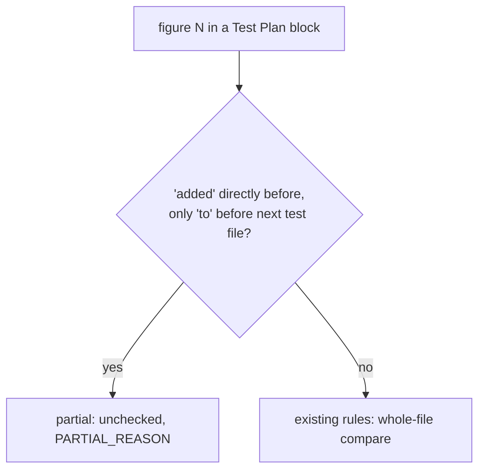

# PR Summary: Test Plan recount treats a single "Added N tests to `<file>`" figure as partial (#3983)

## Summary

Closes #3983

- `classifyBlockClaims` (`worker/deno/lib/test_plan_recount.ts`) now reads a figure as a partial addition when "added" directly precedes it (`ADDED_BEFORE_RE`) and only "to" sits between it and the next test-file token (`ADDED_TO_GAP_RE`), as "N tests added to" already was. "Added 5 tests to `tests/a_test.ts`." at head 6 is reported unchecked with `PARTIAL_REASON` and no longer as a 5-vs-6 mismatch. An unchecked figure still counts as a hit in the review-fix drift check, so the one recovery turn still runs; the figure is listed under "Test Plan figures the recount could not check:" and stays out of "Test Plan mismatches:".
- `worker/deno/lib/pr_feedback_drift_check.ts` changes a doc comment only, to name this form among the figures reported unchecked.
- `docs/workflows/pr-feedback.md` lists the new form among the partial figures.

## Spec

### Intent and Rationale

A correct partial-addition figure was compared with the file's whole count, so a review-fix summary saying "Added 5 tests to `tests/a_test.ts`" on a 6-test file was told it was stale.

### Essential Design Decisions

- The figure must have "added" directly before it and only "to" (plus markdown and whitespace) before the file token. "Added 5 tests for `file` to be kept" and "Fixed the retry; 5 tests to `file`" stay whole-file claims.
- A mixed block (a partial figure and a whole-file count on the same file) stays reported unchecked as ambiguous, not compared. The issue does not ask for more.

## Evidence

- Backend-only change: no visual surface, so no screenshot.
- Issue numbers cited: #3983: Test Plan recount compares a single "Added N tests to `<file>`" figure with the file's whole count.

**Docs sweep** — grep: `partial addition`, `Added to`, `added to \``, `PARTIAL_REASON`, `ADDED_TO_FOLLOW_RE`; section: "Test Plan recount" in `docs/workflows/pr-feedback.md`; siblings: "3 tests added to `a_test.ts`", "+N tests", "Added to `x_test.ts` (N tests" — the partial-figure list in that section, which now names "Added N tests to `a_test.ts`"; updated: `docs/workflows/pr-feedback.md`; docs/INTERNALS.md, docs/PRIVATE-EXTENSIONS.md, docs/IDLE-TASK-FRAMEWORK.md, README.md, CODING-STANDARDS.md, DESIGN-PRINCIPLES.md, prompts/pr_feedback/prompt.md — read each "added to" hit and none concerns Test Plan figures, so still true.

## Test Plan

- New `worker/deno/tests/test_plan_recount_added_n_to_3983_test.ts` (7 tests at head): "Added N tests to" reads partial under varied markup and wrap at head N+1 and N; regression controls for the existing whole and partial forms; the mixed same-file block stays unchecked; "for ... to be kept" and "5 tests to" without "added" stay whole; growth guards; in the `runPrFeedbackDriftCheck` test, the "Added 5 tests to" line at head 6 stays out of the "Test Plan mismatches:" section of the recovery prompt and is listed under "Test Plan figures the recount could not check:".
- No assertion was removed from an existing test: the diff adds that test file and edits comments in `worker/deno/lib/test_plan_recount.ts`, with no changed assertion in any existing test.

**Branch outcomes:**
- `worker/deno/lib/test_plan_recount.ts:689` — partial ("added" before the figure and "to" in the gap) — `worker/deno/tests/test_plan_recount_added_n_to_3983_test.ts::'Added N tests to `file`' is partial whatever the markup or wrap, at head N+1 and N (Issue #3983)` — flipped the new arm to `false`, test went red
- `worker/deno/lib/test_plan_recount.ts:692` — whole-file (gap reads "for", not "to") — `worker/deno/tests/test_plan_recount_added_n_to_3983_test.ts::'Added N tests for `file` to be kept' stays whole: the gap must read 'to' (Issue #3983)` — flipped the gap check to always true, test went red
- `worker/deno/lib/test_plan_recount.ts:692` — whole-file ("to" follows but "added" is not directly before the figure) — `worker/deno/tests/test_plan_recount_added_n_to_3983_test.ts::a figure not directly after 'added' stays whole even when 'to' follows (Issue #3983)` — flipped the "added before" check to always true, test went red
- `worker/deno/lib/pr_feedback_drift_check.ts:71` — none added (comment-only change)

