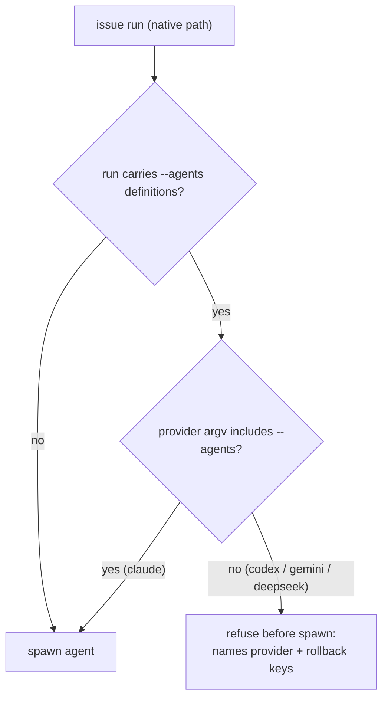

# PR Summary — Issue #4010

## Summary

Finishes the one criterion #3933 left `partial`. #3933's run documented the rollout, compatibility matrix and rollback, but on the default native `issue_executor_split` path Codex and Gemini still dropped `--agents` silently. In that state the advisor was told to dispatch executor and reviewer sub-agents that the CLI never defined.

`runClaudeWithTimeoutBody` (`worker/deno/lib/claude_runner.ts`) now refuses the run before spawn when the run carries `--agents` definitions and the provider's own argv lacks `--agents`. That covers `codex`, `gemini` and `deepseek`. The error names the provider and the rollback: `issue_executor_split: false`, `issue_reviewer_agents: false` and `issue_sub_agent_tier: "sonnet"`, or running the `issue` phase on `claude`.

This PR also updates the compatibility matrix, rollout and rollback text in `docs/MANAGER-WORKER-CONTRACT.md`, `docs/CONFIGURATION.md` and `docs/PROVIDER-FEASIBILITY.md`.

Closes #4010

## Spec

### Intent and Rationale

- The criterion is "no unsupported provider silently gets Claude `--agents`". Section 9 step 4 of the contract already set the shape of the fix: "Refuse unsupported providers loudly when the split is on … behind the existing flags". This PR delivers that refusal on the native path.
- A refusal was chosen over quietly dropping the definitions with a warning. A quiet drop would still leave the prompt's **Advisor and Executors** block telling the advisor to dispatch sub-agents that do not exist.

### Essential Design Decisions

- The check reads the provider's own argv (`!args.includes("--agents")`), not a list of provider ids. A provider that gains `--agents` support passes without a code change.
- The check fires whenever the run carries any definition (executor, reviewers or the Haiku-tier explorer), not only the executor. The error and the docs therefore name all three keys as the rollback.
- The refusal sits behind the existing flags and adds no new one. With the defaults, a native `issue` run on a non-Claude provider is refused until the host applies the full rollback or opts into `external_orchestration`. `docs/MANAGER-WORKER-CONTRACT.md` section 8 states this.
- The descriptor layer is unchanged. `buildInvocation` still drops `agents` (Codex and Gemini silently, DeepSeek with a warning), and `manager_worker_contract_3641_test.ts` still pins that drop.

### Undiscoverable Facts

- The issue phase maps every runner error to `category: "internal_error"` (`worker/deno/lib/phases/execute_phase.ts:1361`).
- `runClaudeWithRetry` returns the refusal at once, so the refused spawn is never retried or billed. This is the Standards reviewer's reading of `claude_runner.ts`, not a test.
- The refusal is checked before the agent is spawned, but the prompt has already been built by then.

## Evidence

Backend/CLI change only. No UI file is touched.

- `worker/deno/tests/claude_runner_test.ts::runClaudeWithTimeout - refuses providers that drop --agents on the split (Issue #4010)` checks codex, gemini and deepseek. Each is refused, and the error contains `cannot carry` and `Issue #4010`.
- `worker/deno/tests/claude_runner_test.ts::runClaudeWithTimeout - Claude carrying --agents is not refused (Issue #4010)` asserts that the stub recorded its own spawn.
- `worker/deno/tests/claude_runner_test.ts::runClaudeWithTimeout - a non-Claude provider with no agents is not refused (Issue #4010)` runs codex with no agents and asserts that the stub recorded its own spawn.
- The stubs use the file's existing `withAgentStub` helper (`worker/deno/tests/support/agent_stub.ts`). The assertions do not depend on what the stub prints or its exit code, only on whether the runner reached the spawn. The stub writes a `spawned` marker beside itself, so no callee contract is relied on.
- Real-tool observation: the argv property relied on comes from each descriptor's own `buildInvocation` in `worker/deno/lib/agent_provider.ts`. The existing `worker/deno/tests/manager_worker_contract_3641_test.ts` pins it: Codex and Gemini emit no `--agents`, and DeepSeek strips it.

**Docs sweep** — grep: "single-model routing", "never built into an argument", "drop\w* silently", "silently drop\w*", `--agents`, `issue_executor_split`, `issue_reviewer_agents`; section: `docs/MANAGER-WORKER-CONTRACT.md#7-compatibility-matrix`, `docs/MANAGER-WORKER-CONTRACT.md#8-rollout-and-safeguards`, `docs/CONFIGURATION.md` (`issue_executor_split` and `issue_reviewer_agents` rows), `docs/PROVIDER-FEASIBILITY.md#3-provider-capability-matrix`; siblings: `issue_sub_agent_tier`, `external_orchestration` — no existing set gained a member, but both keys' docs were read for the rollback wording; updated: `docs/MANAGER-WORKER-CONTRACT.md`, `docs/CONFIGURATION.md`, `docs/PROVIDER-FEASIBILITY.md`. Hits left in place: `docs/PROVIDER-FEASIBILITY.md:46` is still true because "dropped silently" describes the descriptor's `buildInvocation`, and the same cell now records the refusal; `docs/MANAGER-WORKER-CONTRACT.md:349` is still true because it describes the descriptor layer and goes on to name the refusal; `docs/MANAGER-WORKER-CONTRACT.md:92` is still true because DeepSeek still drops `settingsJson` at `buildInvocation`. The other "silently dropped" hits (`docs/ADD-REPO.md`, the scan docs, `docs/INTERNALS.md` and others) are about unrelated subsystems.

Issue numbers the diff adds as provenance: #4010: Finish #3933: Finish #3641: Document provider-neutral manager–worker contract and migration safeguards.

**Pre-PR security self-check.** No secrets, hidden files or dependency changes. `deno.json` and `deno.lock` are untouched. The refusal message contains only the provider's display name and configuration key names, with no paths or internal state.

## Acceptance Criteria

<!-- vibe-spec-review inputs="diff+issue-body" -->

- **met** — Define feature-flagged rollout, compatibility matrix and rollback; no unsupported provider silently gets Claude `--agents`. — evidence: `worker/deno/lib/claude_runner.ts:1263` (refusal before spawn); `worker/deno/tests/claude_runner_test.ts::runClaudeWithTimeout - refuses providers that drop --agents on the split (Issue #4010)`; `docs/MANAGER-WORKER-CONTRACT.md` section 7 (matrix rows now say "refused before spawn") and section 8 (flags, no default change and its effect on non-Claude hosts, full rollback); `docs/CONFIGURATION.md` rows `issue_executor_split` and `issue_reviewer_agents` — reviewer: partial — reason: the reviewer judged the matrix, rollback and "no silent `--agents`" parts `met` and the "feature-flagged rollout" part partial because the refusal has no flag of its own. I depart from that verdict: the contract's own rollout (section 9 step 4, merged with #3641) puts this refusal "behind the existing flags", and section 8 documents those flags, the unchanged defaults and the rollback. A separate switch to keep the silent drop would restore exactly what the criterion forbids.
- **unrequested** — `worker/deno/tests/manager_worker_contract_3641_test.ts`: the "known gap" test is renamed and its comment rewritten to say the drop is now scoped to the descriptor layer — reviewer: unrequested — reason: the refusal changes what that gap means; the test body is unchanged and still pins `buildInvocation`.

## Standards Review

<!-- vibe-standards-review inputs="diff+CODING-STANDARDS.md" -->

- **violation** — Stub mirrors the callee's contract: the positive-control tests used a `printf` stub that always exits 0 and asserted only that the error was absent — evidence: `worker/deno/tests/claude_runner_test.ts:999`, `worker/deno/tests/claude_runner_test.ts:1032` — reason: fixed in this diff — both tests now have the stub write a `spawned` marker and assert that the runner reached the spawn, so no callee contract is relied on.
- **clean** — Worker failure causes: the reviewer flagged the refusal for declaring no `FailureCategory`. The issue phase declares `category: "internal_error"` for every runner error at `worker/deno/lib/phases/execute_phase.ts:1361`, so the category is set at the source and not derived from the text. The sibling `Refused to start the agent:` refusals in the same function have the same shape.
- **clean** — Checked and compliant: named tests exist; the compound condition has a test per operand; no assertion is removed from an existing test (the `manager_worker_contract_3641_test.ts` change is a title and comment only, and its body still pins the descriptor drop); fail loud with the cause and rollback named; no billed retry (`runClaudeWithRetry` returns the refusal at once); Australian English; nothing exists only for a test; no persisted shape changed; no workflow file changed. Optional and fixed in this diff: the stale `claude_runner.ts:1391` citation now reads `:1424`.

## Test Plan

- `timeout 600 deno task test:unit tests/claude_runner_test.ts tests/manager_worker_contract_3641_test.ts tests/config_docs_consistency_test.ts tests/readme_docs_reachability_test.ts tests/agent_provider_readme_docs_test.ts` (from `worker/deno`) passed on the final head.
- Added to `worker/deno/tests/claude_runner_test.ts`: the three Issue #4010 tests named under Evidence. Red checks were run with `deno test -A --filter "Issue #4010"`, mutating `worker/deno/lib/claude_runner.ts:1263` and then restoring it:
  - refusal test: condition replaced with `false` → red (the error no longer contained `cannot carry`).
  - Claude test: operand `!args.includes("--agents")` forced to `true` → red ("the runner must reach the spawn").
  - codex no-agents test: operand `invocationRequest.agents` deleted → red (codex without agents was refused).
- Edited `worker/deno/tests/manager_worker_contract_3641_test.ts`: title and comment only. No assertion was removed or changed.
- `./quality.sh`: every stage passed except `deno tests`, which had 3 failures out of 29,355. Those failures do not involve this change: `tests/completion_phase_repo_formatters_test.ts` (2, "formatter should commit the Rust fix") and `tests/external_orchestration_3642_config_test.ts` (1, "The running container image did not install the \"codex\" coding-agent provider"). All 3 fail the same way on an unmodified checkout of `origin/milestone/manager-worker-orchestration-and-fleet-experiments`, run in a temporary worktree. They depend on the container image, not on this diff.

<!-- vibe-branch-outcomes -->

🤖 Generated with [Claude Code](https://claude.com/claude-code)
