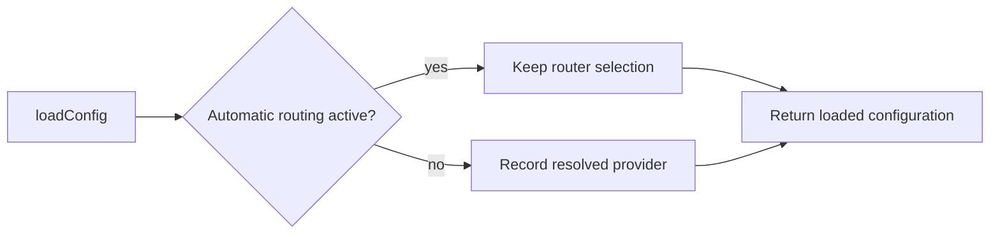

# Preserve automatic provider selection across config reloads

Closes #4024.

## Summary

Auxiliary configuration readers call `loadConfig` to refresh monitored
repositories or trusted authors. Recording the file's provider preference on
each reload used to overwrite the automatic router's process-wide selection.
The loader now preserves that selection while automatic routing is active.
Pinned routing and the existing per-run override retain their behaviour.

The provider manual and loader comment describe this ownership boundary.
This summary is the canonical record required by the coding standards.

## Spec

### Intent and Rationale

- A maintenance reload must not undo the provider the automatic router chose.
- Returning the file's preference and selecting the provider for work are
  separate responsibilities while automatic routing is active.

### Essential Design Decisions

- Reuse `isAutomaticProviderRoutingActive`; add no configuration or state.
- Guard only the process-wide provider write, preserving config validation,
  enabled providers and the per-run override.
- Keep the existing exact regression and every earlier assertion.

### Undiscoverable Facts

- Issue #4024 reports a host switching to Claude, then running a maintenance
  phase through Codex after an auxiliary reload. The local regression proves
  the overwrite mechanism; no live host change is claimed.

## Evidence

- #4024: config reloads must not clobber the auto router's provider selection.
- The targeted unit runner passed 141 tests across `config_test.ts`,
  `provider_auto_state_test.ts` and `provider_auto_runtime_test.ts`.
- Removing only the routing guard made the existing reload regression fail:
  the active provider was `codex` instead of `claude`. The guard was restored.
- Quality [39360312138](https://github.com/stSoftwareAU/VibeCoder/actions/runs/39360312138)
  and Dependency Review passed on source head `788ccdeb`; checks after this
  documentation correction remain required.

Docs sweep — grep: "loadConfig", "automatic routing", "configuration reload"; updated `docs/PROVIDER-PARITY.md` and the loader comment; section: Routing and fallback; siblings: none — no provider, state or configuration member added.
The configuration table's `agent_provider_mode` description remains true:
the file supplies a preference in automatic mode, not an instruction to undo
the router's choice on an auxiliary reload.

## Test Plan

- `config - a reload under automatic routing keeps the auto-selected provider (Issue #4024)` asserts both the returned file preference and the preserved active provider.
- Existing injected-provider and #2062 per-run override tests remain intact.
- No existing test assertion was removed or weakened.

Branch outcomes:

- Automatic routing active: reload returns the file preference and preserves
  the router's active selection; covered by the #4024 config regression.
- Automatic routing inactive: the loader records its resolved provider;
  covered by the existing injected-provider config regression.
- Per-run override: the loaded and active provider retain the override;
  covered by the existing #2062 config regression.

## Merge verification

Final-head hosted checks and independent GitHub approval remain required.
No live provider, host configuration or subscription turn was changed or run.
