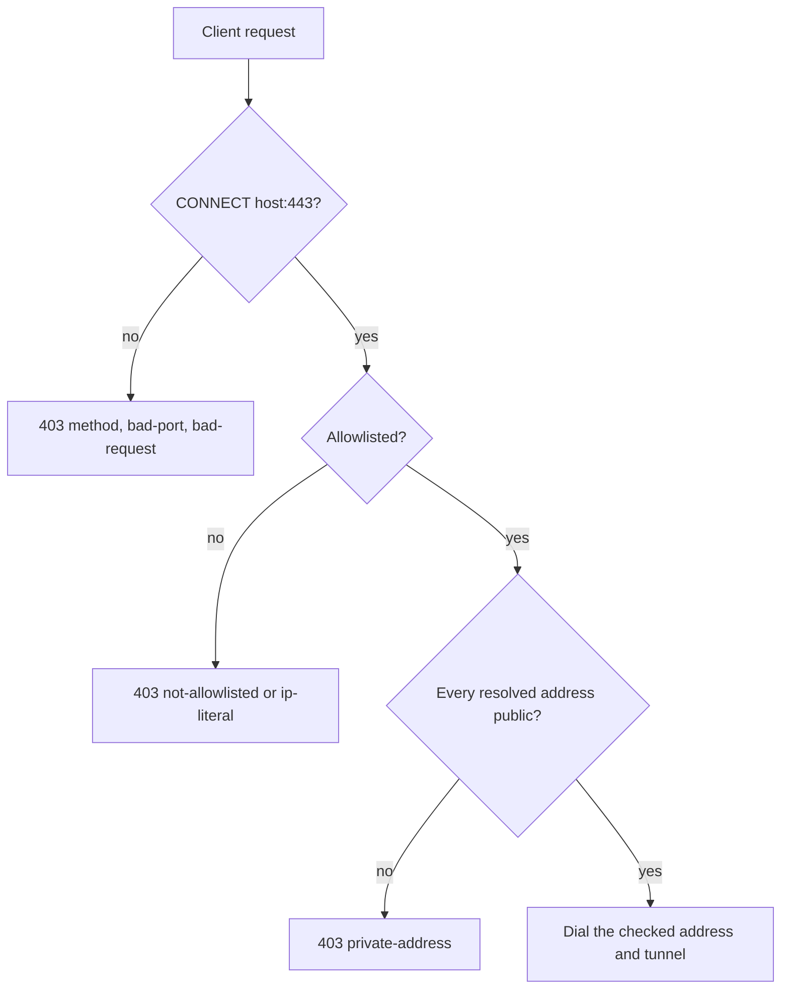

## Summary

Closes #4046

Adds `worker/deno/lib/egress_proxy.ts`, a CONNECT-only HTTPS proxy, and the
`egress-proxy` command (`worker/deno/commands/egress_proxy.ts`, registered in
`worker/deno/mod.ts`) that starts it. The proxy forwards only to hosts on the
egress allowlist, refuses every other request with a `403` whose body opens
`[EGRESS_DENIED]`, and writes one stderr line per refusal. It is the single
outbound proxy that #3699's credential broker is planned to extend rather than
replace. `docs/CONTAINMENT.md` gains the proxy interface section. Routing the
container through the proxy is #4047 and is not part of this change.

Version bump: no `VERSION` change is made here; the merged commit records the
final version.

## Spec

### Intent and Rationale

- Every container request is HTTPS. `gh_credential_stage.ts` rewrites
  `git@github.com:` to `https://github.com/`, so a CONNECT-only proxy covers
  git, `gh`, the provider CLIs, Deno and the package managers without a new
  third-party binary or image.
- The refusal names the host and the reason class in the 403 body, so a refused
  tool shows why in its own output rather than an opaque timeout.

### Essential Design Decisions

- The allowlist comes from `--allow` or `VIBE_EGRESS_ALLOW_HOSTS`, never from a
  writable mount. `--allow` wins when both are set. An empty or missing
  allowlist exits 2 and never starts the proxy.
- Only `CONNECT host:443` is accepted; policy order is method, request shape,
  port, IP literal, allowlist, route, resolve, address check, dial. The name is
  resolved once, every address is checked with `isPrivateAddress`
  (`lib/public_url_guard.ts`), and the proxy dials only the first address it
  checked, so DNS rebinding cannot move the connection after the check.
- The per-host `routes` option is the seam for #3699: a route owns the client
  after `200 Connection Established`, and the proxy's idle guard stops there.
- The denial line is sanitised (control and format characters stripped, host
  capped at 64 code points) and then passed through `redactSecrets`, so a
  crafted or token-bearing hostname cannot forge or leak through the log. The
  tunnel payload is never logged.

### Undiscoverable Facts

- Started through `mod.ts`, the command needs `--allow-read` as well as
  `--allow-env --allow-net`, because `mod.ts` reads `deno.json` when it loads.
  It was run with `--cached-only` against a read-only copy of the Deno cache
  directory, and it listened and answered `CONNECT 127.0.0.1:443` with
  `403 [EGRESS_DENIED] host=127.0.0.1 reason=ip-literal`. This confirms the
  issue's read-only-cache assumption; the root filesystem itself was not made
  read-only, which was not observed.
- Five unrelated unit tests fail in this container with and without this change
  (see Test Plan): the image installs only the `claude` provider and has no
  `rustfmt`.

## Evidence

Run command and observation (the real tool, not a fake):
`DENO_DIR=<read-only copy> deno run --no-lock --cached-only --allow-read --allow-env --allow-net mod.ts egress-proxy --allow github.com --listen 127.0.0.1:38128`,
then a raw `CONNECT 127.0.0.1:443` returned `HTTP/1.1 403 Forbidden` with body
`[EGRESS_DENIED] host=127.0.0.1 reason=ip-literal`, and stderr showed
`[EGRESS_PROXY] listening on 127.0.0.1:38128 hosts=1` then
`[EGRESS_DENIED] host=127.0.0.1 port=443 reason=ip-literal`.

Issue numbers cited as provenance (each looked up with `gh issue view`): #3699:
Remove readable provider and gh credentials from the agent subprocess (open);
#4047: Docker/Podman: run the agent container on an internal network behind the
egress proxy (open).

Fakes: tests use an injectable resolver and connector with real localhost
sockets and a local echo upstream. The production resolver (`Deno.resolveDns`)
and connector (`Deno.connect`) are the defaults the fakes replace; the property
the change relies on is that the proxy dials exactly the address it was given,
which `egress proxy tunnels an allowlisted CONNECT byte-for-byte` asserts on the
recorded dial.

Regex vetting: the new patterns (`IPV4_PATTERN`, `HTTP_VERSION_PATTERN`,
`DIGITS_PATTERN`, `WHITESPACE_OR_CONTROL`, `CONTROL_OR_FORMAT`, and the two in
the command) are anchored single-quantifier or single-class patterns with no two
quantifiers over the same characters, and the request head is capped at
`maxHeaderBytes` before any of them runs, so none can backtrack super-linearly.

**Docs sweep** — grep: `egress proxy`, `egress-proxy`, `EGRESS_DENIED`, `#4046`,
`nothing enforces`, `read-only root`, `reads no files`; section:
`docs/CONTAINMENT.md#egress-proxy`; siblings: `egress_allow_hosts`,
`toolchain-selfcheck`; updated: `docs/CONTAINMENT.md`, `docs/CONFIGURATION.md`,
`worker/deno/lib/egress_allowlist.ts`, `worker/deno/lib/config.ts`,
`worker/deno/lib/vibe_env_registry.ts`; `docs/CONTAINMENT.md:335` and
`docs/CONTAINMENT.md:345` — still true because they say the container is not
routed through the proxy until #4047.

Security fix, original trigger: the container's outbound traffic is unfiltered
and a name on the allowlist could be made to resolve to a private, loopback or
metadata address (DNS rebinding), reaching internal services.

Test:
`worker/deno/tests/egress_proxy_test.ts::egress proxy refuses allowlisted names resolving to private addresses`
(also
`worker/deno/tests/egress_proxy_test.ts::egress proxy refuses a non-allowlisted host with 403 and opens no upstream connection`).
It fails against the base branch's non-test files, where
`worker/deno/lib/egress_proxy.ts` does not exist, and passes at head.

Static reasoning: the original trigger is closed with no trivial bypass. A
CONNECT can reach upstream only after `isAllowlisted` passes, so an unlisted
name, an IP literal (refused as `ip-literal` before the allowlist), another
method, another port, and a trailing-dot host variant are all refused before any
lookup. For a listed name, the single resolver result is checked address by
address with `isPrivateAddress`, which fails closed on anything it cannot parse
and covers loopback, RFC 1918, 169.254/16, CGNAT 100.64/10, IPv6 ULA, IPv6
link-local and IPv4-mapped IPv6; one private answer refuses the whole
connection. The dial then uses the same checked address string, never the
hostname, so a second lookup cannot return a different answer (rebinding). The
residual that this PR does not close is that the container is not yet forced
through the proxy, which is #4047.

## Acceptance Criteria

<!-- vibe-spec-review inputs="diff+issue-body" -->

- **met** — Real-socket tests on localhost, with an injectable resolver and a
  local upstream, prove: an allowlisted CONNECT is tunnelled byte-for-byte —
  evidence:
  `worker/deno/tests/egress_proxy_test.ts::egress proxy tunnels an allowlisted CONNECT byte-for-byte`
  — reviewer: met
- **met** — a non-allowlisted host gets `403` and no upstream connection is
  opened — evidence:
  `worker/deno/tests/egress_proxy_test.ts::egress proxy refuses a non-allowlisted host with 403 and opens no upstream connection`
  — reviewer: met
- **met** — an IP-literal target is refused — evidence:
  `worker/deno/tests/egress_proxy_test.ts::egress proxy refuses an IP-literal target`
  — reviewer: met
- **met** — a host resolving to `127.0.0.1`, `10.0.0.1` or `169.254.169.254` is
  refused — evidence:
  `worker/deno/tests/egress_proxy_test.ts::egress proxy refuses allowlisted names resolving to private addresses`
  — reviewer: met
- **met** — a non-CONNECT request is refused — evidence:
  `worker/deno/tests/egress_proxy_test.ts::egress proxy refuses a non-CONNECT request`
  — reviewer: met
- **met** — each refusal writes exactly one `[EGRESS_DENIED]` stderr line —
  evidence:
  `worker/deno/tests/egress_proxy_test.ts::egress proxy writes exactly one denial line per refusal`
  — reviewer: met
- **met** — A hostname carrying a newline or control characters is refused and
  appears sanitised in the log line (test) — evidence:
  `worker/deno/tests/egress_proxy_test.ts::egress proxy refuses and sanitises a hostname carrying control characters`
  — reviewer: met
- **met** — An over-long request header and an idle client are cut off within
  their bounds (test) — evidence:
  `worker/deno/tests/egress_proxy_test.ts::egress proxy cuts off an over-long request header`
  and
  `worker/deno/tests/egress_proxy_test.ts::egress proxy cuts off an idle client`
  — reviewer: met
- **met** — The interface section exists in `docs/CONTAINMENT.md` and names
  #3699 as the extension point — evidence:
  `worker/deno/tests/containment_docs_test.ts::CONTAINMENT.md documents the egress proxy as the one outbound proxy #3699 will extend`
  — reviewer: met
- **partial** — The repository quality gate passes — evidence: `./quality.sh`
  run on the final head; every stage passed except `deno tests`, where the only
  5 failures are `claude_runner_provider_fallback_4034_test.ts`,
  `completion_phase_repo_formatters_test.ts` and
  `external_orchestration_3642_config_test.ts`, which fail identically on the
  base branch in this container — reviewer: partial — reason: CI not yet
  verified — remaining: merge-verification-only
- **unrequested** — a `detail=<text>` suffix on the denial line for
  `resolve-failed` and `connect-failed` — reviewer: unrequested — reason: the
  issue asks for the refused tool and the log to show why; the detail names the
  resolver or connector cause, is sanitised, capped and redacted, and never
  enters the 403 body
- **unrequested** — a `[EGRESS_PROXY] listening on … hosts=N` startup line —
  reviewer: unrequested — reason: an operator needs the bound address, and the
  command logs it so a started proxy is observable
- **unrequested** — references to #4047 in `docs/CONTAINMENT.md`,
  `docs/CONFIGURATION.md`, three source comments (`worker/deno/lib/config.ts`,
  `worker/deno/lib/egress_allowlist.ts`, `worker/deno/lib/egress_proxy.ts`), the
  note string in `worker/deno/lib/vibe_env_registry.ts` and the renamed docs
  test — reviewer: unrequested — reason: the existing docs said #4046 would
  enforce the allowlist; this PR adds the proxy but not the routing, so those
  sentences had to stop being true-by-promise
- **unrequested** — `docs/audits/lib-sweep-coverage/top-up-4046.json` —
  reviewer: unrequested — reason: the lib-sweep ledger needs an entry for a new
  `lib/` module
- **unrequested** — trailing-dot host refusal, `bad-request` class for malformed
  heads, and a docs test pinning the footprint wording — reviewer: unrequested —
  reason: each follows from the stated policy (strict allowlist match, sanitised
  hostname) and from the issue's assumption to confirm the read-only footprint

## Standards Review

<!-- vibe-standards-review inputs="diff+CODING-STANDARDS.md" -->

- **violation** — Secret Redaction, every outbound sink: the denial line went to
  stderr without `redactSecrets` — evidence:
  `worker/deno/lib/egress_proxy.ts:184` — reason: fixed in this diff
  (`formatEgressDenial` now returns `redactSecrets(...)`; test
  `egress proxy redacts a token carried in the hostname from the denial line`)
- **violation** — docs claimed `idle-timeout` happens while tunnelling and that
  every refusal gets a 403 — evidence: `docs/CONTAINMENT.md:455` — reason: fixed
  in this diff (Refusals, reason table and Bounds reworded; table gained a
  `403 sent?` column)
- **violation** — #3699 described as already extending the proxy — evidence:
  `docs/CONTAINMENT.md:476` and `worker/deno/lib/egress_proxy.ts:10` — reason:
  fixed in this diff (reworded to "will extend … not yet delivered")
- **violation** — drift-test pins typed in values the modules hold — evidence:
  `worker/deno/tests/containment_docs_test.ts:307` — reason: fixed in this diff
  (pins built from `EGRESS_ALLOW_HOSTS_ENV` and `formatEgressDenial`)
- **violation** — a wall-clock `setTimeout` in the idle-race scenario —
  evidence: `worker/deno/tests/support/egress_proxy_socket_scenarios.ts:798` —
  reason: fixed in this diff (the resolver is gated on a promise released after
  the cut-off is observed)
- **violation** — no test covered the no-config entry for `egress-proxy` —
  evidence: `worker/deno/mod.ts:775` — reason: fixed in this diff (two
  subprocess tests in `worker/deno/tests/mod_test.ts`; the try-path list at
  `worker/deno/mod.ts:641` has no observable effect and is recorded as
  `exempt (untestable)`)
- **clean** — Australian English, no hidden paths staged, no `git add -f`,
  `isPrivateAddress` and `validateEgressHost` reused rather than rewritten, both
  config-optional lists in `mod.ts` updated, removed assertion
  `body.includes("#4046")` in `worker/deno/tests/containment_docs_test.ts` is
  replaced by `#4047` because the issue split enforcement across #4046 and
  #4047, review-enforced rules checked: drift-test scoping (`section()` in use)
  and named-test existence

## Merge verification

- Required CI and the routine code review are pending until observed.

## Test Plan

- Added: `worker/deno/tests/egress_proxy_test.ts` (30 tests, 22 of them real
  sockets with an injected resolver and connector via
  `worker/deno/tests/support/egress_proxy_socket_scenarios.ts`),
  `worker/deno/tests/egress_proxy_command_test.ts` (22 tests), two `main()`
  subprocess tests in `worker/deno/tests/mod_test.ts`, and six egress-proxy docs
  tests in `worker/deno/tests/containment_docs_test.ts`:
  - `CONTAINMENT.md documents the egress proxy as the one outbound proxy #3699 will extend`
  - `CONTAINMENT.md's egress proxy section does not claim the container is routed through it yet`
  - `CONTAINMENT.md's egress proxy section states the proxy opens no files, keeps no cache and needs --allow-read --allow-env --allow-net`
  - `CONTAINMENT.md's egress proxy section names a module that exists`
  - `CONTAINMENT.md describes #3699 as planned, not delivered`
  - `CONTAINMENT.md's egress proxy section says which refusals get a 403 and how idle connections close`
- Added to close the pre-PR verifier and mutation findings, in
  `egress_proxy_test.ts`:
  - `egress proxy cuts off a request header whose blank line arrives past the cap in a later read`
    (a head split across two writes: 403 `header-too-large`, one denial line, no
    dial)
  - `egress proxy forwards bytes pipelined after the CONNECT head to the upstream`
    (head and payload in one write; the echo returns exactly the payload)
  - `egress proxy refuses bytes pipelined after the CONNECT head of a routed host`
    (403 `bad-request`, one denial line, route not called)
- Added to close the mutation findings, in `egress_proxy_command_test.ts`: the
  `--allow` type check, the plain-digits port check, the registered command
  name, the bare message for an `Error` and for a non-`Error` throw on both the
  argument path and the start path, and the default signal wait (stops on
  `SIGTERM` and on `SIGINT`, and removes both listeners it registered).
  `parseListen` no longer tests `Number.isInteger(port)`: the preceding
  `/^\d+$/` check already guarantees an integer, so it was dead.
- Edited: `worker/deno/tests/mod_test.ts` command count 156 to 157 (still red
  without the registration: the count and the `includes("egress-proxy")` check
  both fail); `worker/deno/tests/containment_docs_test.ts` renamed the existing
  test `CONTAINMENT.md says the egress allowlist is not enforced until #4046` to
  `CONTAINMENT.md says the egress allowlist is not enforced for the container until #4047`.
- Removed from `worker/deno/tests/mod_test.ts`:
  `assertEquals(commands.length, 156);`
  - Required by: "a `mod.ts` command (working name `egress-proxy`)" —
    registering the command makes the count 157
  - Replaced by: `assertEquals(commands.length, 157);`
- Removed from `worker/deno/tests/containment_docs_test.ts`:
  `assert( body.includes("#4046"), "the egress-allowlist section must name #4046 as the issue that enforces the list", );`
  - Required by: "Enforce at the network layer through one proxy interface" —
    this PR adds the proxy only, so enforcement for the container is #4047 and
    the section must name #4047
  - Replaced by:
    `assert( body.includes("#4047"), "the egress-allowlist section must name #4047 as the issue that routes the container through the proxy", );`
- Results on the final head: `deno test --allow-all` on `egress_proxy_test.ts`,
  `egress_proxy_command_test.ts`, `containment_docs_test.ts`, `mod_test.ts` and
  `vibe_env_registry_test.ts`: 93 passed, 0 failed; fmt, lint and type check
  pass. `./quality.sh`: every stage passed except `deno tests`, which reports 5
  failures in `claude_runner_provider_fallback_4034_test.ts`,
  `completion_phase_repo_formatters_test.ts` and
  `external_orchestration_3642_config_test.ts`; run on a clean checkout of the
  base branch they fail the same way (5 failed, 20 passed), because the image
  has only the `claude` provider and no `rustfmt`.
- Red-checks (each break made on purpose, test seen red, change restored) are
  listed per outcome in the facts file. Drift pins: the pinned phrases are new
  with the section, so they are absent from the base section;
  `EGRESS_ALLOW_HOSTS_ENV` changed at its source turned the docs test red, and
  the `[EGRESS_DENIED]` marker changed in a copy of the module turned it red.
- Callers and siblings checked: the `routes`, `resolve`, `connect` and
  `logDenied` seams are each passed by a test; `formatEgressDenial` is the only
  producer of the log line, called from `refuse` and the idle callback and
  `refuseAtCapacity`, all of which go through `redactSecrets`.
- Entry points checked: the `egress-proxy` command
  (`egress_proxy_command_test.ts`, `mod_test.ts` subprocess tests), the
  registration in `worker/deno/mod.ts`, and the proxy listener (socket
  scenarios).
- Not checked: the full `./quality.sh` deno-test stage on an image with the
  `codex` provider and `rustfmt`; a read-only root filesystem (only a read-only
  Deno cache was exercised).

<!-- vibe-branch-outcomes -->
