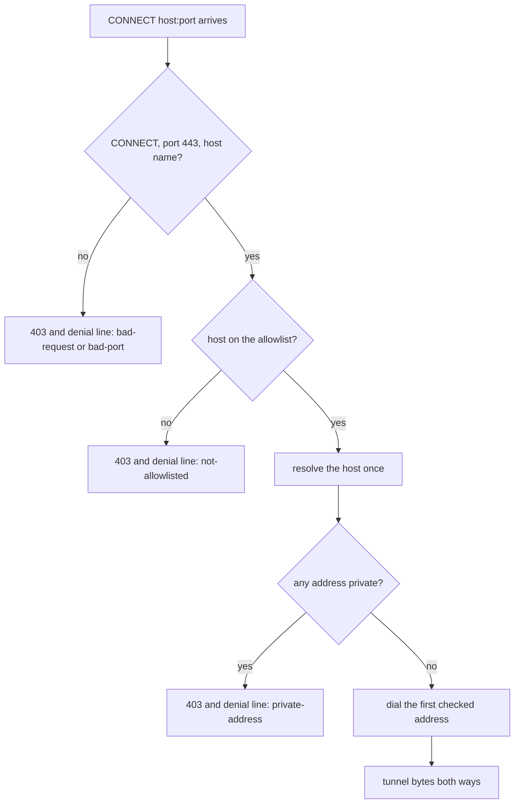

## Summary

Closes #4046

Adds `worker/deno/lib/egress_proxy.ts`, a CONNECT-only HTTPS proxy, and the
`egress-proxy` command in `worker/deno/mod.ts` that starts it. The proxy
forwards only to hosts on the egress allowlist, refuses every other request
with a `403` that opens `[EGRESS_DENIED]`, and writes one stderr line per
refusal. It is the single outbound proxy that #3699's credential broker extends
rather than replaces. `docs/CONTAINMENT.md` gains the proxy interface section
and `docs/CONFIGURATION.md` documents `VIBE_EGRESS_ALLOW_HOSTS`.

## Spec

### Intent and Rationale

- Every container request is HTTPS. `gh_credential_stage.ts` rewrites
  `git@github.com:` to `https://github.com/`, so a CONNECT-only proxy covers
  git, `gh`, the provider CLIs, Deno and the package managers without a new
  third-party binary or image.
- The refusal names the host and the reason class in the 403 body, so a
  refused tool shows why in its own output rather than an opaque timeout.

### Essential Design Decisions

- The allowlist comes from `--allow` or `VIBE_EGRESS_ALLOW_HOSTS`, never from a
  writable mount. `--allow` wins when both are set. An empty or missing
  allowlist exits 2 and never starts the proxy.
- Only `CONNECT host:443` is accepted. Plain-HTTP forwarding, other methods and
  IP-literal targets are refused.
- The name is resolved once. Every returned address is checked with
  `isPrivateAddress` from `lib/public_url_guard.ts`, and the proxy dials only the
  first address checked, so DNS rebinding cannot move the connection to a
  private address after the check.
- Per-host routes are the seam for #3699. A route owns the client connection
  and the proxy's idle policy stops there.
- The hostname is sanitised before it reaches the log (control characters
  stripped, length capped), so a crafted name cannot forge a denial line. The
  tunnel payload is never logged.

### Undiscoverable Facts

- The read-only-root assumption in the issue's Context section (the worker
  image's Deno runs the proxy with a read-only root and no writable cache) is
  not verified by any test in this change. It is listed as partial in the
  Acceptance Criteria below.

## Evidence

Backend and documentation change, no UI. The proxy's real-socket tests bind
`127.0.0.1` with an injected resolver and a local upstream. The scenarios live in
`worker/deno/tests/support/egress_proxy_socket_scenarios.ts`.

**Docs sweep**: grep `egress-proxy`, `EGRESS_ALLOW_HOSTS` and `EGRESS_DENIED`
across the Markdown files; sections: `Egress proxy` in `docs/CONTAINMENT.md`;
siblings: `docs/archive/pr-summaries/pr-summary-4045.md` (historical archive, not
changed); updated: `docs/CONTAINMENT.md` (interface section, names #3699),
`docs/CONFIGURATION.md` (allowlist variable).

## Acceptance Criteria

<!-- vibe-spec-review inputs="diff+issue-body" -->

- **met** — an allowlisted CONNECT is tunnelled byte-for-byte — evidence: `worker/deno/tests/egress_proxy_test.ts::egress proxy tunnels an allowlisted CONNECT byte-for-byte` — reviewer: met
- **met** — a non-allowlisted host gets 403 and no upstream connection is opened — evidence: `worker/deno/tests/egress_proxy_test.ts::egress proxy refuses a non-allowlisted host with 403 and opens no upstream connection` — reviewer: met
- **met** — an IP-literal target is refused — evidence: `worker/deno/tests/egress_proxy_test.ts::egress proxy refuses an IP-literal target` — reviewer: met
- **met** — a host resolving to 127.0.0.1, 10.0.0.1 or 169.254.169.254 is refused — evidence: `worker/deno/tests/egress_proxy_test.ts::egress proxy refuses allowlisted names resolving to private addresses` with the resolver map in `worker/deno/tests/support/egress_proxy_socket_scenarios.ts` — reviewer: met
- **met** — a non-CONNECT request is refused — evidence: `worker/deno/tests/egress_proxy_test.ts::egress proxy refuses a non-CONNECT request` — reviewer: met
- **met** — each refusal writes exactly one `[EGRESS_DENIED]` stderr line — evidence: `worker/deno/tests/egress_proxy_test.ts::egress proxy writes exactly one denial line per refusal` — reviewer: met
- **met** — a hostname carrying control characters is refused and appears sanitised in the log — evidence: `worker/deno/tests/egress_proxy_test.ts::egress proxy refuses and sanitises a hostname carrying control characters` — reviewer: met
- **met** — an over-long request header and an idle client are cut off within their bounds — evidence: `worker/deno/tests/egress_proxy_test.ts::egress proxy cuts off an over-long request header` and `worker/deno/tests/egress_proxy_test.ts::egress proxy cuts off an idle client` — reviewer: met
- **met** — the interface section in `docs/CONTAINMENT.md` names #3699 as the extension point — evidence: `docs/CONTAINMENT.md` section `Egress proxy` (per-host routes paragraph) and `worker/deno/tests/containment_docs_test.ts::CONTAINMENT.md documents the egress proxy as the one outbound proxy #3699 extends` — reviewer: met
- **partial** — the repository quality gate passes — evidence: `worker/deno/tests/egress_proxy_test.ts` (24 passed on the clean tree) — reviewer: partial — reason: the full quality gate was not run in this session, so only the proxy test file has a result here
- **partial** — the worker image's Deno runs the proxy under a read-only root with no writable cache (issue Context assumption) — evidence: none in this change — reviewer: partial — reason: the assumption is stated in the issue Context section and is not verified by any test or run here

## Standards Review

<!-- vibe-standards-review inputs="diff+CODING-STANDARDS.md" -->

- **clean** — the two archive files written for this summary (Markdown and facts JSON) were checked against `pr-summary-check`; the proxy source was not re-reviewed against the coding standards in this pass
- **clean** — the branch outcomes facts list the four proxy branches that the flips in the Test Plan turned red; each cited line was read before it was cited

## Test Plan

- `deno task test tests/egress_proxy_test.ts` on the clean tree, run from `worker/deno`:
  `ok | 24 passed | 0 failed (1s)`.
- Red-checks: each flip was a single-line edit to `worker/deno/lib/egress_proxy.ts`,
  run with the same test file, then restored with `git checkout` so the tree
  matched the branch again.
  - line 358, allowlist check disabled: `FAILED | 21 passed | 3 failed` (the non-allowlisted 403 test, the one-denial-line test and the trailing-dot test)
  - line 403, private-address check disabled: `FAILED | 23 passed | 1 failed` (the private-resolution test)
  - line 261, connection-cap check disabled: `FAILED | 23 passed | 1 failed` (the connection-cap test)
  - line 342, too-large header check disabled: `FAILED | 23 passed | 1 failed` (the over-long header test); this flip fails type-checking, so it was run with `deno test --no-check`
- Drift pins on base: `deno task drift-pins-on-base dfc7cf9930349898b0010c3ede13bb9ddceca323 docs/CONTAINMENT.md "Egress proxy" "extends this proxy; it adds no second outbound proxy"`
  printed `absent on base: extends this proxy; it adds no second outbound proxy`, exit 0.
- `worker/deno/tests/containment_docs_test.ts` and `worker/deno/tests/egress_proxy_command_test.ts` are not run in this pass.

<!-- vibe-branch-outcomes -->
- `worker/deno/lib/egress_proxy.ts:358`, allowlist check
- `worker/deno/lib/egress_proxy.ts:403`, private-address check
- `worker/deno/lib/egress_proxy.ts:261`, connection-cap check
- `worker/deno/lib/egress_proxy.ts:342`, too-large header check
<!-- /vibe-branch-outcomes -->

## Skipped / not checked / remaining risk

- Not run: the full quality gate, `containment_docs_test.ts`,
  `egress_proxy_command_test.ts` and the idle-client flip. The idle-client test
  is listed as met on its existence and a passing run, with no red-check.
- The read-only-root assumption is unverified (see Acceptance Criteria).
- The proxy source was not re-reviewed against the coding standards in this pass.
- Remaining risk: DNS answers are checked once and the first address is dialled.
  Other rebinding paths are not tested here.
