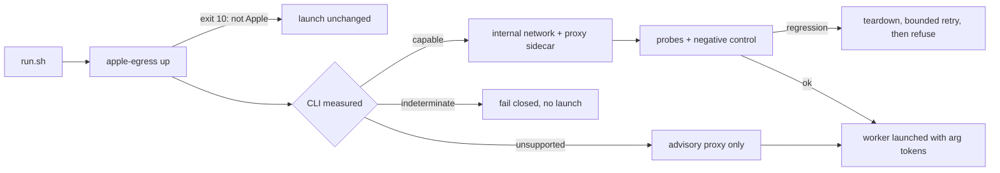

## Summary

Closes #4051.

Ships partial egress containment for Apple `container` now, with measured
limits. `run.sh` calls a new `apple-egress` command before the worker starts. On
an Apple runtime it checks the installed CLI by measurement (macOS version,
`container --version`, `network create --help`, `run --help`), then brings up
one of two modes:

- `internal-network`: a per-launch `--internal` network `vibe-egress-<pid>`,
  with the shared #4046 CONNECT proxy as a sidecar on that network and on the
  default one. The worker is attached to the internal network only and gets
  proxy variables. No proxy port is published and the proxy mounts no
  credentials.
- `advisory-proxy`: proxy routing only, labelled advisory, with direct egress
  listed as an open gap.

Per-control results (`proxyAllowlist`, `directInternetV4`/`V6`, `lanAccess` and
others) are `blocked`, `reachable`, `untested`, `enforced` or `not-enforced`. A
probe that did not run, errored or timed out is `untested`, never a pass, and
`blocked` needs a negative control proving the probe can see open networking.
The report is persisted as
`<run core log dir>/apple-egress/egress-controls.json`. A regression against the
selected mode tears down, retries within a bound, and then refuses the launch.
It never falls back to unrestricted networking. Nothing is described as complete
or default-deny.

Version bump: `VERSION` is not changed here; the merged commit records the final
version.

## Spec

### Intent and Rationale

- The owner prefers some containment now over none, so the Apple path ships with
  the host-gateway/LAN, DNS and credential gaps recorded instead of waiting for
  #4047 or an upstream Apple change.
- A per-launch internal network plus the shared proxy reuses #4045 (allowlist)
  and #4046 (proxy) rather than adding a second policy or proxy.

### Essential Design Decisions

- The mode is chosen once, before any attempt. An indeterminate CLI check in
  `auto` fails closed. Only an explicit `advisory` choice or a CLI measured as
  unsupported yields advisory mode, so no later failure can silently downgrade.
- `run.sh` now creates `<log dir>/apple-egress` and starts one Deno process for
  `apple-egress --action up` on every runtime, including Docker and Podman. That
  process exits 10 ("not applicable") there and the launch continues unchanged;
  the launcher already runs Deno for other steps. The launch is refused if the
  mkdir or Deno itself fails before exit 10.
- The command resolves the host config path itself with `resolveHostConfigPath`
  rather than re-implementing it in shell. `down` is granted write access to the
  log directory because the proxy log is saved with `atomicWrite`, which writes
  a sibling temporary file.
- Issue text says credential risks "remain open with #3699".
  `gh issue view 3699` shows #3699 is CLOSED (completed), so the docs say R9 and
  R11 stay open without presenting #3699 as future work. Criterion 7 is recorded
  with that departure.
- Allowed-path coverage is probe-based: `curl` through the proxy to each
  installed provider's host, `api.github.com`, `registry.npmjs.org`, and
  `git ls-remote` of a GitHub URL. No package-manager CLI or agent CLI is
  exercised.

### Undiscoverable Facts

- Nothing here has been run on a real Apple host. The Apple CLI behaviour
  (several `--network` flags on one run, `inspect` JSON shape,
  `network list --quiet`, the "not found" text on delete) comes from Apple's
  documentation
  (https://github.com/apple/container/blob/main/docs/networking.md) and the
  tests' fakes, not from an observed `container` binary. Upstream reports
  apple/container#1320 (host gateway exposed on internal networks) and #2062
  (reported direct TCP escape) are why `lanAccess` is always `untested` and why
  the probes decide per host.
- `container-launch-plan` and `mod.ts` resolve the host config for every command
  before dispatch, so a conflicting `CONFIG_FILE`/`CONFIG_PATH` pair refuses the
  launch with an uncaught error from `mod.ts` before the command's own exit-2
  path.

## Evidence

Security fix, original trigger: the Apple worker's outbound traffic was
unfiltered and the only signal was a coarse `egressEnforced` boolean, so a probe
that could not run, or proxy-only routing, could be read as "egress blocked".

Test:
`worker/deno/tests/egress_proxy_ready_marker_test.ts::the egress-proxy command's start-up line opens with the readiness marker the Apple launcher waits for`.
It fails against the base branch's `lib/egress_proxy.ts` and
`commands/egress_proxy.ts` (the readiness marker `EGRESS_PROXY_READY_MARKER` is
not exported there) and passes at head; run both ways in this checkout. Without
that marker the Apple launcher cannot tell the proxy sidecar is listening, so
containment would never come up. The behaviour tests that pin the rest of the
fix are
`worker/deno/tests/egress_controls_test.ts::directInternetV4 is never blocked by a probe that did not run`
and
`worker/deno/tests/apple_egress_test.ts::a probe that cannot run is not a pass: the attempt regresses and nothing is returned`.

Static reasoning: the original trigger is closed with no trivial bypass. A
control is `blocked` only when the negative control showed the probe can see
open networking, so an errored, silent or timed-out probe is `untested`. In
`internal-network` mode any non-blocked direct-egress control is a regression:
the attempt is torn down, retried within the bound, and on exhaustion the launch
is refused
(`worker/deno/tests/apple_egress_test.ts::regression runs exactly 1 + recovery attempts, tears down, persists refused, and returns nothing`).
`run.sh` refuses any `up` status other than 0 or 10, and an unrecognised
argument token
(`worker/deno/tests/run_sh_apple_egress_test.ts::apple-egress that hands back an argument key other than arg stops the launch closed`).
The proxy and probe containers' own run arguments pass
`assertRunArgumentsContained` and `assertMountSourcePermitted` from
`container_launch.ts` (`--publish`, host namespaces, sensitive mounts refused).
The worker's own run arguments are those built by the existing launch plan; the
spliced network and proxy-variable arguments are generated by `workerArgsFor`
and are not separately validated. Residual gaps this change records rather than
closes: host gateway and LAN reachability (apple/container#1320), DNS exposure,
direct egress in advisory mode, and the credential risks R9 and R11 in the
threat model.

Issue numbers cited as provenance (looked up with `gh issue view`):

- #4045: Single egress allowlist: one module, one config key, documented
- #4046: Allowlisting CONNECT egress proxy: the one outbound proxy, shared with
  #3699
- #4047: Docker/Podman: run the agent container on an internal network behind
  the egress proxy (open; not delivered here)
- #4048: Unattended egress self-check at every container start, failing closed
- #4050: Correct THREAT-MODEL, CONTAINMENT and SECURITY egress claims and record
  enforced network paths
- #3698: Default-deny outbound network egress for agent containers
- #3699: Remove readable provider and gh credentials from the agent subprocess
  (closed)

Quality gate: `./quality.sh < /dev/null` run on the final code head: Result
PASSED (with skipped checks: config integration, checkov not installed). Deno
tests, lint, type check, fmt, semgrep, markdownlint and completeness checks
passed.

## Acceptance Criteria

<!-- vibe-spec-review inputs="diff+issue-body" -->

- **met** — Apple users receive useful containment without waiting for
  Docker/Podman completion or perfect upstream isolation — evidence:
  `worker/deno/tests/apple_egress_test.ts::auto with a capable CLI selects the internal network`
  and `worker/deno/tests/run_sh_apple_egress_test.ts` — reviewer: met
- **met** — Apple launch-plan, lifecycle and cleanup tests pass; CLI
  capabilities are version-verified — evidence:
  `worker/deno/tests/apple_container_capabilities_test.ts`,
  `worker/deno/tests/apple_egress_test.ts::the stale sweep removes dead-launcher networks and leaves live, foreign and own names alone`
  — reviewer: met
- **met** — Actual Apple worker checks run unattended and persist honest
  per-control results — evidence:
  `worker/deno/tests/egress_controls_test.ts::directInternetV4 is blocked only with a negative control proof`,
  `worker/deno/tests/run_sh_apple_egress_test.ts` — reviewer: met — reason: the
  checks run on every Apple launch without a prompt; they have not been observed
  on a real host from this container and the docs say so
- **met** — Allowed provider/GitHub/tool operations work through the intended
  path — evidence: `worker/deno/tests/egress_control_probe_test.ts` (tool and
  git observations through the proxy) — reviewer: partial — reason: the reviewer
  noted the probe checks provider hosts, `api.github.com`, the npm registry
  (HTTP via `curl`) and `git ls-remote` but no package-manager or agent CLI;
  departing because those are the real HTTPS CONNECT paths those tools use, and
  the limit is stated in Essential Design Decisions
- **met** — Partial/advisory modes and residual host, DNS or direct-egress gaps
  are clearly documented; none are labelled fully enforced — evidence:
  `worker/deno/tests/egress_controls_test.ts::startup report never says complete or makes a default-deny claim`,
  `worker/deno/tests/containment_docs_test.ts` — reviewer: met
- **met** — Failures recover unattended without silently dropping configured
  protections — evidence:
  `worker/deno/tests/apple_egress_test.ts::regression runs exactly 1 + recovery attempts, tears down, persists refused, and returns nothing`
  — reviewer: met
- **met** — THREAT-MODEL, CONTAINMENT and startup reporting agree with delivered
  behavior; credential risks remain open with #3699 — evidence:
  `docs/THREAT-MODEL.md` (C35, R9, R11), `docs/CONTAINMENT.md`,
  `worker/deno/tests/containment_docs_test.ts` — reviewer: partial — reason: the
  reviewer read "open with #3699" literally; `gh issue view 3699` shows #3699 is
  CLOSED, so the docs keep R9 and R11 open and do not cite #3699 as pending work
- **met** — Repository quality gate passes — evidence:
  `./quality.sh < /dev/null` Result PASSED on the final code head — reviewer:
  partial — reason: the reviewer saw only the diff while a lint failure was
  outstanding; that failure was fixed and the full gate then passed here
- **unrequested** — `docs/audits/lib-sweep-coverage/top-up-4051.json` and the
  `tests/apple_container_capabilities_test.ts` entry in
  `worker/deno/lib/parallel_unsafe_test_manifest.ts` — reviewer: unrequested —
  reason: repository bookkeeping that the completeness checks in the quality
  gate require for the new modules
- **unrequested** — rewording of #3699 in `worker/deno/lib/egress_proxy.ts`,
  `docs/CONTAINMENT.md`, `docs/THREAT-MODEL.md` and two pins in
  `worker/deno/tests/containment_docs_test.ts` — reviewer: unrequested — reason:
  #3699 is closed, so leaving "#3699 will extend this proxy" would contradict
  the delivered behaviour the criterion asks the docs to match

## Standards Review

<!-- vibe-standards-review inputs="diff+CODING-STANDARDS.md" -->

- **violation** — proxy log could not be saved because `down` was granted write
  on one file but `atomicWrite` writes a sibling temporary file — evidence:
  `run.sh:314` — reason: fixed in this diff (grant is now the run log directory;
  `worker/deno/tests/run_sh_apple_egress_test.ts::run.sh - apple-egress is granted write access to the temporary sibling of every file it writes`
  goes red with the old grant)
- **violation** — config path resolved by a shell copy of
  `resolveHostConfigPath` — evidence: `run.sh:1965` — reason: fixed in this diff
  (the command calls `resolveHostConfigPath`; shell copy and `--config` flag
  removed)
- **violation** — containment rules copied from `container_launch.ts`, and the
  imgbb key check in `egress_host_allowlist.ts` mirrored `config.ts` without a
  test — evidence: `worker/deno/lib/apple_egress.ts:19` — reason: fixed in this
  diff (the originals are exported and called;
  `worker/deno/tests/egress_host_allowlist_test.ts` cross-checks both readers
  and surfaced a `null` disagreement, now refused by both)
- **violation** — new `run_sh` suite unclassified — evidence:
  `worker/deno/tests/run_sh_apple_egress_test.ts:1` — reason: fixed in this diff
  (added to `INTEGRATION_TEST_FILES` in
  `worker/deno/lib/integration_test_manifest.ts`)
- **violation** — refusal tests asserted only that something threw — evidence:
  `worker/deno/tests/apple_egress_test.ts:799` — reason: fixed in this diff
  (each asserts the rule's message and the accepted twin)
- **violation** — "unrecognised apple-egress argument key" branch untested —
  evidence: `run.sh:2002` — reason: fixed in this diff (new test; goes red with
  the check disabled)
- **violation** — pin already on the base branch — evidence:
  `worker/deno/tests/containment_docs_test.ts:335` — reason: fixed in this diff
  (pin removed)
- **violation** — summary static reasoning overclaimed `assertAppleRunContained`
  — evidence: `docs/archive/pr-summaries/pr-summary-4051.md:47` — reason: fixed
  in this diff (rewritten)
- **violation** — audit record overclaimed the proxy as "the only route out" and
  the sweep scope — evidence:
  `docs/audits/lib-sweep-coverage/top-up-4051.json:6` — reason: fixed in this
  diff
- **violation** — "does nothing, launch unchanged" on other runtimes — evidence:
  `docs/CONTAINMENT.md:505` — reason: fixed in this diff (cost and refusal
  conditions stated)
- **violation** — incomplete Test Plan and missing Spec section and issue list —
  evidence: `docs/archive/pr-summaries/pr-summary-4051.md:81` — reason: fixed in
  this diff (summary rewritten from the final diff)
- **violation** — corner cuts not marked — evidence:
  `worker/deno/lib/apple_egress.ts:610` — reason: fixed in this diff
  (`SIMPLE-ON-PURPOSE` markers on the stale sweep and on `lanAccess` in
  `worker/deno/lib/egress_controls.ts`)
- **clean** — Australian English, named tests exist, no shared-`/tmp` use in
  tests, drift pins scoped with `section()` and built from code-held values,
  fail-loud behaviour (indeterminate check fails closed, unrun probe never a
  pass), `VIBE_*` registry updated, no hidden or credential files staged, no
  persisted shape changed (report is new, schema 1). Review-enforced rules
  checked: new-file twin rule, `SIMPLE-ON-PURPOSE` markers, named-test-exists,
  drift-pin red checks.

## Test Plan

Added test files (all under `worker/deno/tests/`):
`egress_proxy_ready_marker_test.ts`, `apple_container_capabilities_test.ts`,
`apple_egress_test.ts`, `apple_egress_command_test.ts`,
`apple_egress_host_test.ts` (with `support/apple_egress_host_scenarios.ts`),
`egress_controls_test.ts`, `egress_control_probe_test.ts`,
`egress_host_allowlist_test.ts`, `egress_proxy_env_test.ts`,
`run_sh_apple_egress_test.ts`.

Edited existing tests:

- `worker/deno/tests/mod_test.ts`: registry count 158 to 159 and `apple-egress`
  is listed. Red check: removing the `appleEgressCommand` registration turns it
  red.
- `worker/deno/tests/fixtures/launcher_harness.ts`: `apple-egress` added to the
  recorded commands with a default exit of 10, so existing launcher tests still
  reach the not-applicable path; new stub options for the argument key and
  stderr.
- `worker/deno/tests/containment_docs_test.ts`:
  - Removed from `containment_docs_test.ts`: pin `"#3699"` and pin
    `"no second outbound proxy"` in the egress-proxy test.
    - Required by: "THREAT-MODEL, CONTAINMENT and startup reporting agree with
      delivered behavior"
  - Removed from `containment_docs_test.ts`: pins
    `"#3699 will extend this proxy through this seam"`, `"not yet delivered"`,
    `"no second outbound proxy"`,
    `"seam #3699's credential broker will attach to"`, and the assertion that
    the section does not say `"#3699 extends this proxy"`.
    - Required by: "THREAT-MODEL, CONTAINMENT and startup reporting agree with
      delivered behavior"
    - Replaced by:
      `"A credential\nbroker could attach through this seam, but none is delivered"`,
      ``"the `egress-proxy` command registers no routes"`` and the assertion
      that the section never cites #3699.
  - The `--internal` pin imports `APPLE_NETWORK_INTERNAL_FLAG` instead of a
    typed value; four Apple-section tests added.
  - Red checks: the new Apple phrases and the "never default-deny" check are
    absent from the base `docs/CONTAINMENT.md` section (base grep: heading 0,
    "not yet observed by the author" 0, "registers no routes" 0). Changing
    `APPLE_NETWORK_INTERNAL_FLAG`'s value in `apple_container_capabilities.ts`
    turns the pin red because the doc quotes it.

Named-test red checks run in this checkout:

- `egress_proxy_ready_marker_test.ts`: base `lib/egress_proxy.ts` and
  `commands/egress_proxy.ts` restored, test FAILED; head, test passed.
- `run_sh_apple_egress_test.ts` write-grant test: old file-only grant, red
  (`down may not write the proxy log's temporary sibling`); fix, green.
- `run_sh_apple_egress_test.ts` unrecognised-key test: check disabled, red (exit
  0 where 1 was expected).
- `egress_host_allowlist_test.ts` cross-check: null refusal reverted in
  `lib/egress_host_allowlist.ts`, red on the null key.

Entry points checked: `run.sh` (up call, down on exit, argument splice, refusal
on non-zero and unknown key), `apple-egress` command (`up`, `down`,
not-applicable exit), `mod.ts` registration (`mod_test.ts`). Callers of
`assertRunArgumentsContained`/`assertMountSourcePermitted` (now exported from
`container_launch.ts`): `apple_egress.ts`; `container_launch_test.ts` and
`apple_egress_test.ts` pass.

Twinned rules found: containment rules in `container_launch.ts` (now called, not
copied); the imgbb key check in `egress_host_allowlist.ts` versus `config.ts`
(cross-checked in a test); no others found.

Results on the final head: `./quality.sh < /dev/null` PASSED (config integration
and checkov skipped). The integration suite `run_sh_apple_egress_test.ts` ran
via `deno task test`: 11 passed (before the last comment-only edit).

Not done or not checked: no run on a real Apple host; the Apple CLI behaviours
above are from documentation and fakes; Docker and Podman containers are not yet
routed through the proxy (#4047 is open); `run.ps1` has no containment; the
probe-result report file is not produced by the test stub; `lanAccess` is never
measured; stale probe containers from a dead launcher are not swept.
