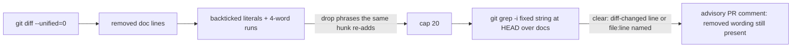

## Summary

The Docs sweep re-run now also searches for the wording the branch's diff removed from the docs, so a doc sentence or value a PR rewrote cannot survive unreported in another manual, the README or a table row. Hits are advisory (Issue #3237), like the other stale hits. Closes #4105.

Version bump: not applicable; no `VERSION` file is touched.

## Spec

### Intent and Rationale

- Agents grep for the new thing, not the old sentence they rewrote; deriving terms from the removed lines needs no judgement from the agent.
- Extends `checkDocsSweepTerms` rather than adding a gate or prompt rule, as the issue asked.

### Essential Design Decisions

- Advisory only: phrase matching on prose has an unmeasured false-positive rate.
- Phrases are searched as fixed strings over doc surfaces only (`stems=false`; no source comments), and use the same clearing rules and per-surface broad-term cap as term hits.
- The diff is now always read (one extra `git diff`); a line with no terms and no removed doc wording is still `skipped`. Phrases beyond `MAX_REMOVED_PHRASES` (20) are counted in `removedPhrasesOverCap` and logged at WARN, never dropped silently.
- `docs/archive/` is excluded even for a `README.md` under it, matching `DOCS_SWEEP_PATHSPECS`.

### Undiscoverable Facts

- None.

## Evidence

Backend/CLI change; no UI files touched. `cd worker/deno && deno task test:unit tests/docs_sweep_hits_test.ts tests/completion_phase_docs_sweep_test.ts` passed on the final head (90 and 16 tests); `deno check lib/phases/completion_phase.ts` passed.

**Docs sweep** — grep: `re-run`, "still hit", `quotes no`; section: `docs/workflows/issue-processing.md#the-lines-own-terms-are-re-run-at-the-head-issue-3172`; siblings: `extractSiblingTerms`, `SOURCE_COMMENT_PATHSPECS`; updated: `docs/workflows/issue-processing.md`; the module and function doc comments in `worker/deno/lib/docs_sweep_hits.ts` were updated in the same diff; no other hits.

## Test Plan

Tests added in `worker/deno/tests/docs_sweep_hits_test.ts`: extraction (clause, backticked old value, kept wording dropped, non-doc/archive/deleted files, short runs, `-- ` body line, punctuation, dedupe, hostile input), end-to-end `checkDocsSweepTerms` (surviving phrase in README and a manual, no declared terms, table-row literal, changed-line and named-line clearing, cap, fixed-string/docs-only pattern, kept phrase not grepped, single report), and comment/describe labelling.

- Removed from `worker/deno/tests/docs_sweep_hits_test.ts`: `assertEquals(calls.some((c) => c.args.includes("diff")), false);`
  - Required by: "From the branch diff (the same diff `parseChangedLines` already reads), take each line *removed* from a file"
- Removed from `worker/deno/tests/docs_sweep_hits_test.ts`: `assertEquals(calls.length, 0);`
  - Replaced by: `assertEquals(calls.some((c) => c.args.includes("grep")), false)` and the assertion that a diff call was made, in "no grep terms is skipped when the diff removes no doc wording" (the status `skipped` assertion is kept).
  - Required by: "From the branch diff (the same diff `parseChangedLines` already reads), take each line *removed* from a file"
- Red checks (break the guard, run `deno test tests/docs_sweep_hits_test.ts`, restore): drop the same-hunk added-line filter → 2 failed; remove changed-line clearing for removed hits → 1 failed; remove `slice(0, MAX_REMOVED_PHRASES)` → 1 failed; skip only when no declared terms (ignore removed phrases) → 3 failed; stems enabled for phrases → 1 failed; archive exclusion removed → 2 failed; no minimum literal length → 1 failed.
- Reproduction replay on the private heads named in the issue was not run (private evidence is not available in this container).

<!-- vibe-branch-outcomes -->
