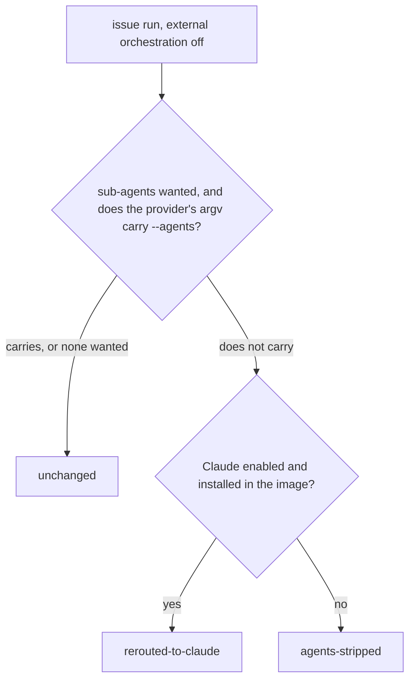

# PR Summary — Issue #4109

## Summary

Runs were releasing with no PR because an `issue` run on a provider that cannot
carry `--agents` (Codex, Gemini, DeepSeek) with the executor split or reviewer
sub-agents on was refused before spawn by the Issue #4010 guard in
`runClaudeWithTimeoutBody`. The worker now settles the provider before spawn
through a new planner, `planIssueRunProvider`
(`worker/deno/lib/issue_run_provider_agents.ts`):

- the provider's own argv decides whether it carries sub-agents
  (`probeDescriptorInvocationCapabilities`), so no provider-id table;
- **rerouted-to-claude** — Claude is enabled and installed: the run itself uses
  Claude in both call sites (each passes the rerouted provider to the runner).
  Only `lib/phases/execute_phase.ts` records a run assignment, and it records
  the planned provider (`recordRunAssignment` takes `issueRunPlan?.provider`).
  Only `lib/execute_claude_phase.ts` hands the rerouted provider to its
  CodeGraph / RTK / graft sinks. In `lib/phases/execute_phase.ts` the sinks
  (`prepareCodegraphRun`, `bindGraftRun`, `rtkProviderId(undefined, logger)`)
  pass no planned provider and still follow the active provider;
- **agents-stripped** — Claude is not usable: the run starts on its own provider
  with the split and reviewers off and the sub-agent tier set to `sonnet`, and a
  warning says so;
- **unchanged** — no sub-agents wanted, or the provider carries them.

Both issue-run call sites use it (`lib/phases/execute_phase.ts`,
`lib/execute_claude_phase.ts`). External orchestration is decided first, by
`resolveIssueOrchestration`, and the planner is not called when it is on
(`externalOrchestration ? undefined : planIssueRunProvider(…)`). So the external
path (Issue #3642, no native split and no `--agents`) and this planner never
both apply to one run; automatic Codex routing forces external orchestration
(`orchestration/role_config.ts:370`), so a Codex run on automatic routing is
neither rerouted nor stripped. The #4010 refusal stays as a backstop: it still
fires for a caller that bypasses the planner and when the retry ladder switches
to `agent_provider_fallback` with `agents` kept (Issue #4034). Docs that said
such a run "is refused before spawn" now say it is rerouted or stripped.

Closes #4109.

Version bump: `VERSION` untouched by this change; the merged commit records the
final version.

## Spec

### Intent and Rationale

- The failure that filed this issue was the #4010 refusal on Codex: the run was
  charged after 701 seconds in the `execute` phase and released its claim with
  no PR. Deciding the provider before spawn lets the run proceed on Claude, or
  without sub-agents, instead of failing after the claim.
- Carriage is read from the provider's own argv, so a provider that gains
  `--agents` later is picked up without a table change.

### Essential Design Decisions

- Carriage is decided by probing the descriptor's argv quietly
  (`probeDescriptorInvocationCapabilities`), not by a provider-id table.
- Reroute to Claude only when Claude is both enabled and installed in the image.
  The image stamp is checked first: when it lacks Claude, the run is stripped.
  When the stamp lists Claude, `claudeUsable` calls
  `resolveEnabledAgentProviderIds`, which asserts every enabled id is installed
  in the image (`assertImageInstalledProvider`) and throws if the enabled set
  names an uninstalled provider (`lib/issue_run_provider_agents.ts`).
- External orchestration is decided first (`resolveIssueOrchestration`) and is
  never planned; automatic Codex routing forces it.
- The #4010 guard in `runClaudeWithTimeoutBody` stays as a backstop and is not
  removed.

### Undiscoverable Facts

- The issue's owner comment suggested Codex native agent roles (`multi_agent`,
  `[agents.<role>]`) as a better long-term fix. That was deliberately not done
  here: this change reroutes or strips, and the #4010 guard remains as the
  backstop.
- PR #4142's Codex role mapping (the sub-agent role models per tier) is
  unaffected by this change.

## Evidence

Bug / CLI evidence is the tests named in the Test Plan and the reproduction
below. The regression test is `worker/deno/tests/issue_4109_callsite_test.ts`;
the planner's own cases are in
`worker/deno/tests/issue_run_provider_agents_test.ts`, the uninstalled-provider
case in `worker/deno/tests/agent_provider_test.ts`, and the
external-orchestration no-`--agents` case in
`worker/deno/tests/external_orchestration_3642_phase_test.ts`.

**Docs sweep** — grep: `omitting it reproduces`, `forwards`,
`refused before spawn`, `refuses loudly before spawn`, `Issue #4010`,
`planIssueRunProvider`, `plannedActiveAgentProvider`, `externalOrchestration`;
section: `docs/MANAGER-WORKER-CONTRACT.md` (provider table, "Two paths now",
rollback), `docs/MODEL-AND-CACHING.md` (advisor/executor split, reviewer
sub-agents, Haiku tier, pilot counters), `docs/PROVIDER-FEASIBILITY.md`
(`--agents` carried row, fail-loud refusal), `docs/CONFIGURATION.md`
(`agent_provider`, `issue_executor_split`, `issue_sub_agent_tier`,
`issue_reviewer_agents`); siblings: `Gemini CLI`, `DeepSeek`,
`issue_reviewer_agents`, `issue_sub_agent_tier` (the Codex, Gemini and DeepSeek
rows of each provider table, all three updated together, and the three sub-agent
feature rows, split, reviewers and tier, each re-read); updated:
`docs/MANAGER-WORKER-CONTRACT.md`, `docs/MODEL-AND-CACHING.md`,
`docs/PROVIDER-FEASIBILITY.md`, `docs/CONFIGURATION.md`; remaining `#4010` hits
re-read and kept (they describe the runner refusal as the backstop, for a caller
that bypasses the planner and for the retry ladder's fallback provider); also
corrected the `file:line` cites in `docs/MANAGER-WORKER-CONTRACT.md` for the
external-orchestration test (`execute_claude_phase.ts:1279-1289`,
`execute_phase.ts:800-815`), the `isIssueExecutorSplitEnabled` calls
(`execute_claude_phase.ts:1290-1295`, `execute_phase.ts:817-822`), the planner's
`executorSplit` and `buildPrompt` inputs (`execute_claude_phase.ts:1317-1319`,
`:1447`; `execute_phase.ts:851-853`, `:906`) and the "Phase wiring" row and its
mermaid label (`execute_claude_phase.ts:1275-1325`: split `:1290-1295`, tier
`:1296-1301`, planner `:1307`, `buildIssueRunAgents` `:1321`), which the branch
moved; also corrected three sentences in `docs/CONTAINER.md` (per-invocation
selection: the `agentProvider` forwarding and `selectAgentProvider` as the only
resolution point) and `docs/MANAGER-WORKER-CONTRACT.md` ("No default change": a
Codex run on automatic routing is neither rerouted nor stripped)

The planner outcomes, for the native split path only:

Provenance: the issue numbers this diff cites.

- #4109: fix(worker): worker-crash — runs releasing with no PR
- #4010: Finish #3933: Finish #3641: Document provider-neutral manager–worker
  contract and migration safeguards
- #4034: Fall back to agent_provider_fallback when a phase run's model is
  refused
- #3642: Implement external provider-neutral orchestration behind an opt-in
  feature flag
- #3603: Issue-run cost estimate omits sub-agent (executor/reviewer) spend, so
  the Haiku vs Sonnet trial compares only the Opus manager
- #3473: Make Haiku the default issue_sub_agent_tier if the Haiku vs Sonnet
  trial meets #3385's decision rule
- #3404: Per-tier PR outcomes and cost per merged PR in fleet telemetry
- #3403: Per-tier issue-run telemetry and PR-body sub-agent tier marker
- #3402: Tier-aware issue-run sub-agents: Haiku executors/standards reviewer and
  read-only explorer
- #2812: Sonnet 5.5: Opus plans, Sonnet executors implement; refresh cost
  estimates
- #2575: Run the Spec/Standards review sub-agents as defined cheaper agents, not
  on the advisor's Opus-high, and cap sub-agent spawning
- #2346: Run-stats comment: split on/off, executor counts and executor Sonnet
  spend in the run cost
- #2344: Keep every Edit/Write in a split run inside an executor, with advisor
  edit calls denied or counted
- #2343: Advisor/executor instructions in the `issue` prompt, gated by the split
  key
- #2048: Per-repo agent_provider pin in repo_config
- #1032: config: three modules resolve config-versus-environment and two
  contradict the stated rule — reconcile in 2.0.0
- #880: quality gate: the deno test stage runs sequentially, putting the suite
  at 42+ min against a 45-min phase budget

## Reproduction

- **symptom** — an `issue` run on `codex` (also `gemini`, `deepseek`) with
  sub-agents on is refused before spawn with "Refused to start the agent: Codex
  CLI cannot carry the issue run's sub-agent definitions (--agents)…" and
  releases its claim with no PR
- **status** — `verified` — at HEAD `c8e7954c`, with
  `lib/phases/execute_phase.ts` and `lib/execute_claude_phase.ts` replaced by
  their `origin/main` versions, `tests/issue_4109_callsite_test.ts` gave
  `FAILED | 2 passed | 8 failed`: the 8 failing were the execute_phase reroute,
  assignment and strip tests and the five execute_claude_phase tests, including
  the regression test and
  `execute_claude_phase - claude not enabled strips agents and disables the split (Issue #4109)`;
  the 2 passing were
  `execute_phase - a non-external allocation plans the claude provider (Issue #4109)`
  and
  `execute_phase - an external-orchestration run is not planned, so nothing is rerouted (Issue #4109)`.
  That file does not type-check against `origin/main` (`TS2353`: `env` is not a
  member of `ExecuteClaudePhaseDeps`), so this observation used
  `deno test --no-check`. On the branch the same file gives
  `ok | 10 passed | 0 failed`
- **regression test** —
  `worker/deno/tests/issue_4109_callsite_test.ts::execute_phase - a run asked for sub-agents on codex is rerouted to claude at the runner (Issue #4109)`

## Test Plan

No assertion was removed from any existing test. The diff to existing test files
is additive (`worker/deno/tests/agent_provider_test.ts` gains one test) plus one
comment re-worded in `worker/deno/tests/manager_worker_contract_3641_test.ts`
(it now says the planner reroutes or strips, with the #4010 refusal a backstop).
`worker/deno/tests/issue_4109_callsite_test.ts` and
`worker/deno/tests/issue_run_provider_agents_test.ts` are new files.

Red check (HEAD `c8e7954c`): `lib/phases/execute_phase.ts` and
`lib/execute_claude_phase.ts` were overwritten with
`git show origin/main:<path>` and `tests/issue_4109_callsite_test.ts` was run
with `env -u VIBE_IMAGE_AGENT_PROVIDERS deno test -A --no-check`:
`FAILED | 2 passed | 8 failed` (the failing and passing names are in
Reproduction). Both files were then restored with `git checkout HEAD --` and the
file re-run with type-checking on: `ok | 10 passed | 0 failed (69ms)`.

Tests added on this branch, all passing at the head:

- `worker/deno/tests/issue_4109_callsite_test.ts` (10 tests):
  - `execute_phase - a run asked for sub-agents on codex is rerouted to claude at the runner (Issue #4109)`
  - `execute_phase - the rerouted provider is recorded on the run assignment (Issue #4109)`
  - `execute_phase - a non-external allocation plans the claude provider (Issue #4109)`
  - `execute_phase - with claude not enabled the run starts on codex without sub-agents (Issue #4109)`
  - `execute_phase - an external-orchestration run is not planned, so nothing is rerouted (Issue #4109)`
  - `execute_claude_phase - the rtk sink receives the rerouted provider (Issue #4109)`
  - `execute_claude_phase - the codegraph sink receives the rerouted provider (Issue #4109)`
  - `execute_claude_phase - the graft sink receives the rerouted provider (Issue #4109)`
  - `execute_claude_phase - the runner receives the rerouted provider (Issue #4109)`
  - `execute_claude_phase - claude not enabled strips agents and disables the split (Issue #4109)`
- `worker/deno/tests/issue_run_provider_agents_test.ts` (12 tests):
  - `issue run provider - Claude with sub-agents is left unchanged (Issue #4109)`
  - `issue run provider - a non-Claude provider with Claude enabled is rerouted to Claude (Issue #4109)`
  - `issue run provider - a non-Claude provider with Claude not enabled has its sub-agents stripped (Issue #4109)`
  - `issue run provider - a stripped codex run carries no --agents, so the #4010 guard has nothing to refuse (Issue #4109)`
  - `issue run provider - a run asking for no sub-agent switches is left unchanged (Issue #4109)`
  - `issue run provider - a provider whose argv carries --agents is left unchanged even without Claude (Issue #4109)`
  - `issue run provider - Claude not enabled strips sub-agents with no image stamp (Issue #4109)`
  - `issue run provider - Claude enabled with no image stamp reroutes the run (Issue #4109)`
  - `issue run provider - Claude enabled but the image stamp lacks Claude strips the run (Issue #4109)`
  - `issue run provider - the same run reroutes to Claude when the image stamp lists Claude (Issue #4109)`
  - `issue run provider - Claude installed but not enabled strips the run; enabled operand decides (Issue #4109)`
  - `issue run provider - planning probes the argv without printing the provider's own warning (Issue #4109)`
- `worker/deno/tests/agent_provider_test.ts` (1 new test):
  - `agent provider - pre-spawn planning reads an uninstalled provider without the install assert (Issue #4109)`

The call-site tests are hermetic against the image stamp (the pre-PR verifier
found 10 of them failing with `VIBE_IMAGE_AGENT_PROVIDERS=claude`, this
container's value). The injected env lookup now also reaches the two
pre-existing `selectAgentProvider` calls that decide external orchestration
(`lib/execute_claude_phase.ts:1287` with `deps.env`,
`lib/phases/execute_phase.ts:809` with `deps.claude.env`); with no lookup
injected they read the process environment as before.
`tests/issue_4109_callsite_test.ts` alone gives `ok | 10 passed | 0 failed` with
the container's `VIBE_IMAGE_AGENT_PROVIDERS=claude` set.

Head run, with the five named files
(`env -u VIBE_IMAGE_AGENT_PROVIDERS deno test -A` from `worker/deno`,
`< /dev/null`):
`tests/issue_4109_callsite_test.ts tests/issue_run_provider_agents_test.ts tests/agent_provider_test.ts tests/external_orchestration_3642_phase_test.ts tests/manager_worker_contract_3641_test.ts`
gives `ok | 76 passed | 0 failed`. With the stamp set to `claude`, the same five
files give `75 passed | 1 failed`: the failure is the existing
`automatic Codex issue phase keeps all roles on Codex without native sub-agent definitions`,
which also fails on the base without this change when the stamp is `claude`.

The full `./quality.sh` deno-tests stage fails in this container for reasons not
from this change, as reported by the container run (not re-run for this
summary): 23 failures happen only because the container sets
`VIBE_IMAGE_AGENT_PROVIDERS=claude`, and they all pass with it unset, including
this issue's tests; 2 are in `tests/completion_phase_repo_formatters_test.ts`,
which fail because `cargo fmt` errors here (rustup has no default toolchain) and
the test asserts that the formatter should commit the Rust fix.

<!-- vibe-branch-outcomes -->
