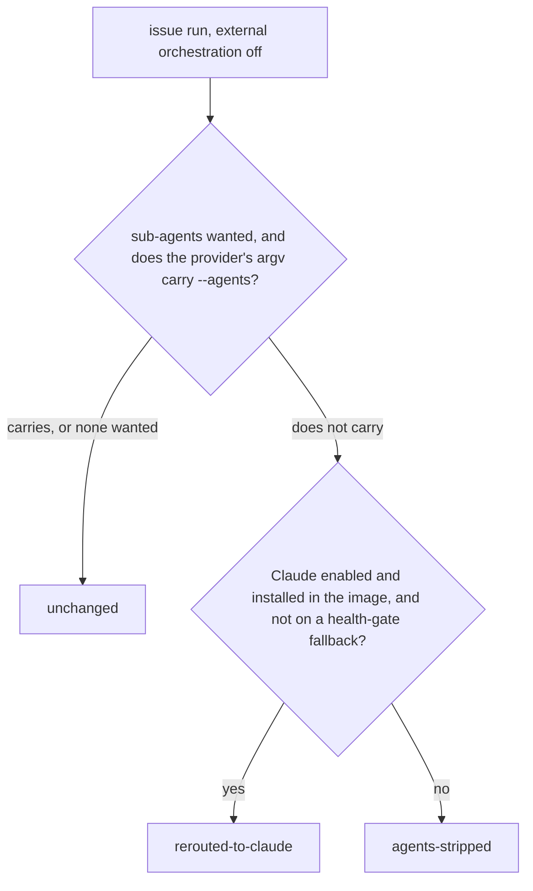

# PR Summary — Issue #4109

## Summary

Runs were releasing with no PR because an `issue` run on a provider that cannot
carry `--agents` (Codex, Gemini, DeepSeek) with the executor split or reviewer
sub-agents on was refused before spawn by the Issue #4010 guard in
`runClaudeWithTimeoutBody`. The worker now settles the provider before spawn
through a new planner, `planIssueRunProvider`
(`worker/deno/lib/issue_run_provider_agents.ts`):

- the provider's own argv decides whether it carries sub-agents
  (`probeDescriptorInvocationCapabilities`), so no provider-id table;
- **rerouted-to-claude** — Claude is enabled and installed, and the health gate
  has not moved the run to a fallback provider: the run itself uses Claude in
  both call sites (each passes the rerouted provider to the runner). Only
  `lib/phases/execute_phase.ts` records a run assignment, and it records the
  planned provider (`recordRunAssignment` takes `issueRunPlan?.provider`). Both
  call sites hand the rerouted provider to their CodeGraph / RTK / graft sinks:
  `lib/execute_claude_phase.ts` through `effectiveAgentProvider`, and
  `lib/phases/execute_phase.ts` through `reroutedProviderId`
  (`prepareCodegraphRun`, `bindGraftRun` and `rtkProviderId` all receive it). A
  Gemini host therefore keeps Graft and RTK on its rerouted Claude run.
  `lib/phases/execute_phase.ts` also classifies the run's auth failure with the
  rerouted provider: `deps.claude.isClaudeAuthError(output, providerId?)` takes
  an optional provider id, and `createDefaultDeps` resolves it with
  `agentProviderById`, falling back to the active provider when none is named,
  so the one other caller shape (no id) keeps its old result;
- **agents-stripped** — Claude is not usable, or the health gate has moved the
  run to a non-Claude fallback provider: the run starts on its own provider with
  the split and reviewers off and the sub-agent tier set to `sonnet`, and a
  warning says so;
- **unchanged** — no sub-agents wanted, or the provider carries them.

Both issue-run call sites use it (`lib/phases/execute_phase.ts`,
`lib/execute_claude_phase.ts`). External orchestration is decided first, by
`resolveIssueOrchestration`, and the planner is not called when it is on
(`externalOrchestration ? undefined : planIssueRunProvider(…)`). So the external
path (Issue #3642, no native split and no `--agents`) and this planner never
both apply to one run; automatic Codex routing forces external orchestration
(`orchestration/role_config.ts:370`), so a Codex run on automatic routing is
neither rerouted nor stripped. The #4010 refusal stays as a backstop: it still
fires for a caller that bypasses the planner and when the retry ladder switches
to `agent_provider_fallback` with `agents` kept (Issue #4034). Docs that said
such a run "is refused before spawn" now say it is rerouted or stripped.

Closes #4109.

Version bump: `VERSION` untouched by this change; the merged commit records the
final version.

## Spec

### Intent and Rationale

- The failure that filed this issue was the #4010 refusal on Codex: the run was
  charged after 701 seconds in the `execute` phase and released its claim with
  no PR. Deciding the provider before spawn lets the run proceed on Claude, or
  without sub-agents, instead of failing after the claim.
- Carriage is read from the provider's own argv, so a provider that gains
  `--agents` later is picked up without a table change.

### Essential Design Decisions

- Carriage is decided by probing the descriptor's argv quietly
  (`probeDescriptorInvocationCapabilities`), not by a provider-id table.
- Reroute to Claude only when Claude is both enabled and installed in the image
  and no non-Claude health-gate override is set (`runProviderOverrideId()`). The
  image stamp is checked first: when it lacks Claude, the run is stripped. When
  the stamp lists Claude, `claudeUsable` calls `resolveEnabledAgentProviderIds`,
  which asserts every enabled id is installed in the image
  (`assertImageInstalledProvider`) and throws if the enabled set names an
  uninstalled provider (`lib/issue_run_provider_agents.ts`).
- External orchestration is decided first (`resolveIssueOrchestration`) and is
  never planned; automatic Codex routing forces it.
- The #4010 guard in `runClaudeWithTimeoutBody` stays as a backstop and is not
  removed.

### Undiscoverable Facts

- The issue's owner comment suggested Codex native agent roles (`multi_agent`,
  `[agents.<role>]`) as a better long-term fix. That was deliberately not done
  here: this change reroutes or strips, and the #4010 guard remains as the
  backstop.
- PR #4142's Codex role mapping (the sub-agent role models per tier) is
  unaffected by this change.

## Evidence

Bug / CLI evidence is the tests named in the Test Plan and the reproduction
below. The regression test is `worker/deno/tests/issue_4109_callsite_test.ts`;
the planner's own cases are in
`worker/deno/tests/issue_run_provider_agents_test.ts`, the uninstalled-provider
case in `worker/deno/tests/agent_provider_test.ts`, and the
external-orchestration no-`--agents` case in
`worker/deno/tests/external_orchestration_3642_phase_test.ts`.

**Docs sweep** — grep: `omitting it reproduces`, `forwards`,
`refused before spawn`, `refuses loudly before spawn`, `Issue #4010`,
`planIssueRunProvider`, `plannedActiveAgentProvider`, `externalOrchestration`;
section: `docs/MANAGER-WORKER-CONTRACT.md` (provider table, "Two paths now",
rollback), `docs/MODEL-AND-CACHING.md` (advisor/executor split, reviewer
sub-agents, Haiku tier, pilot counters), `docs/PROVIDER-FEASIBILITY.md`
(`--agents` carried row, fail-loud refusal), `docs/CONFIGURATION.md`
(`agent_provider`, `issue_executor_split`, `issue_sub_agent_tier`,
`issue_reviewer_agents`); siblings: `Gemini CLI`, `DeepSeek`,
`issue_reviewer_agents`, `issue_sub_agent_tier` (the Codex, Gemini and DeepSeek
rows of each provider table, all three updated together, and the three sub-agent
feature rows, split, reviewers and tier, each re-read); updated:
`docs/MANAGER-WORKER-CONTRACT.md`, `docs/MODEL-AND-CACHING.md`,
`docs/PROVIDER-FEASIBILITY.md`, `docs/CONFIGURATION.md`; remaining `#4010` hits
re-read and kept (they describe the runner refusal as the backstop, for a caller
that bypasses the planner and for the retry ladder's fallback provider); also
re-pointed the `file:line` cites in `docs/MANAGER-WORKER-CONTRACT.md` and
`docs/PROVIDER-FEASIBILITY.md` after the merge of `origin/main` moved the code:
the external-orchestration test (`execute_claude_phase.ts:1298-1307`,
`execute_phase.ts:799-815`), the `isIssueExecutorSplitEnabled` calls
(`execute_claude_phase.ts:1308-1313`, `execute_phase.ts:816-821`), the planner's
`executorSplit` and `buildPrompt` inputs (`execute_claude_phase.ts:1335-1337`,
`:1468`; `execute_phase.ts:850-852`, `:918`), the planner and its strip return
(`issue_run_provider_agents.ts:77-136`, `:129-135`), the retry ladder
(`claude_runner.ts:2938`, `:3496-3516`), the provider-table cites
(`agent_provider.ts:646-648`, `:653-655`, `:737`, `:861`, `:900`, `:926`,
`:1005`, `:1099`, `:1154-1155`, `:1166`) and the "Phase wiring" row and its
mermaid label (`execute_claude_phase.ts:1297-1344`: split `:1308-1313`, tier
`:1314-1318`, planner `:1323`, `buildIssueRunAgents` `:1339`), which the branch
moved; also corrected three sentences in `docs/CONTAINER.md` (per-invocation
selection: the `agentProvider` forwarding and `selectAgentProvider` as the only
resolution point) and `docs/MANAGER-WORKER-CONTRACT.md` ("No default change": a
Codex run on automatic routing is neither rerouted nor stripped)

The planner outcomes, for the native split path only:

Provenance: the issue numbers this diff cites.

- #4109: fix(worker): worker-crash — runs releasing with no PR
- #4010: Finish #3933: Finish #3641: Document provider-neutral manager–worker
  contract and migration safeguards
- #4034: Fall back to agent_provider_fallback when a phase run's model is
  refused
- #3642: Implement external provider-neutral orchestration behind an opt-in
  feature flag
- #3603: Issue-run cost estimate omits sub-agent (executor/reviewer) spend, so
  the Haiku vs Sonnet trial compares only the Opus manager
- #3473: Make Haiku the default issue_sub_agent_tier if the Haiku vs Sonnet
  trial meets #3385's decision rule
- #3404: Per-tier PR outcomes and cost per merged PR in fleet telemetry
- #3403: Per-tier issue-run telemetry and PR-body sub-agent tier marker
- #3402: Tier-aware issue-run sub-agents: Haiku executors/standards reviewer and
  read-only explorer
- #2812: Sonnet 5.5: Opus plans, Sonnet executors implement; refresh cost
  estimates
- #2575: Run the Spec/Standards review sub-agents as defined cheaper agents, not
  on the advisor's Opus-high, and cap sub-agent spawning
- #2346: Run-stats comment: split on/off, executor counts and executor Sonnet
  spend in the run cost
- #2344: Keep every Edit/Write in a split run inside an executor, with advisor
  edit calls denied or counted
- #2343: Advisor/executor instructions in the `issue` prompt, gated by the split
  key
- #2048: Per-repo agent_provider pin in repo_config
- #1032: config: three modules resolve config-versus-environment and two
  contradict the stated rule — reconcile in 2.0.0
- #880: quality gate: the deno test stage runs sequentially, putting the suite
  at 42+ min against a 45-min phase budget

## Reproduction

- **symptom** — an `issue` run on `codex` (also `gemini`, `deepseek`) with
  sub-agents on is refused before spawn with "Refused to start the agent: Codex
  CLI cannot carry the issue run's sub-agent definitions (--agents)…" and
  releases its claim with no PR
- **status** — `verified` — at HEAD `e6f9187b` (the merge of `origin/main`;
  re-observed after the merge), with `lib/phases/execute_phase.ts` and
  `lib/execute_claude_phase.ts` replaced by their `origin/main` versions,
  `worker/deno/tests/issue_4109_callsite_test.ts` (16 tests at head) gave
  `FAILED | 3 passed | 13 failed`: the 13 failing were the execute_phase
  reroute, assignment, sink, auth, strip and health-gate tests and the six
  execute_claude_phase tests, including the regression test and
  `execute_claude_phase - claude not enabled strips agents and disables the split (Issue #4109)`;
  the 3 passing were
  `execute_phase - a non-external allocation plans the claude provider (Issue #4109)`,
  `createDefaultDeps - isClaudeAuthError classifies with the named provider (Issue #4109)`
  and
  `execute_phase - an external-orchestration run is not planned, so nothing is rerouted (Issue #4109)`.
  That file does not type-check against `origin/main` (`TS2353`: `env` is not a
  member of `ExecuteClaudePhaseDeps`), so this observation used
  `deno test --no-check`. On the branch the same file gives
  `ok | 16 passed | 0 failed`
- **regression test** —
  `worker/deno/tests/issue_4109_callsite_test.ts::execute_phase - a run asked for sub-agents on codex is rerouted to claude at the runner (Issue #4109)`

## Test Plan

No assertion was removed from any existing test. The diff to existing test files
is additive (`worker/deno/tests/agent_provider_test.ts` gains one test) plus one
comment re-worded in `worker/deno/tests/manager_worker_contract_3641_test.ts`
(it now says the planner reroutes or strips, with the #4010 refusal a backstop).
`worker/deno/tests/issue_4109_callsite_test.ts` and
`worker/deno/tests/issue_run_provider_agents_test.ts` are new files.

Red check (HEAD `e6f9187b` (the merge of `origin/main`; re-observed after the
merge)): `lib/phases/execute_phase.ts` and `lib/execute_claude_phase.ts` were
overwritten with `git show origin/main:<path>` and
`worker/deno/tests/issue_4109_callsite_test.ts` (16 tests at head) was run with
`env -u VIBE_IMAGE_AGENT_PROVIDERS deno test -A --no-check`, re-run on the
review-fix head `4088a3a6`: `FAILED | 3 passed | 13 failed` (the failing and
passing names are in Reproduction). Both files were then restored with
`git checkout HEAD --` and the file re-run with type-checking on:
`ok | 16 passed | 0 failed`.

Mutation-gate follow-up: the facts flip verifier found no flip of the last
statement of `claudeUsable` (`return enabled.includes(claude)`), because its
only mutant, `return undefined`, behaves as `false`. The statement is now
`if (!resolveEnabledAgentProviderIds(selection).includes(CLAUDE_PROVIDER_ID)) { return false; } return true;`
(`worker/deno/lib/issue_run_provider_agents.ts:71-74`, behaviour unchanged). Red
checks, each on the named test with only that edit made: removing the `!` at
line 71 turns
`issue run provider - Claude not enabled strips sub-agents with no image stamp (Issue #4109)`
red; returning `false` at line 74 turns
`issue run provider - a non-Claude provider with Claude enabled is rerouted to Claude (Issue #4109)`
red.

Red check for the `execute_phase.ts` sink and auth fixes (verifier finding on
`execute_phase.ts:985`): with the `agentProvider` spreads on
`prepareCodegraphRun` and `bindGraftRun`, the
`rtkProviderId(reroutedProviderId, …)` argument and the
`isClaudeAuthError(authSurface, reroutedProviderId)` argument reverted to the
earlier shape (no provider), the graft, rtk-and-codegraph and
auth-classification `execute_phase` tests above in
`worker/deno/tests/issue_4109_callsite_test.ts` (16 tests at head) went red; the
same three also fail against the `origin/main` production files (the base run
above), and they pass on the head (`ok | 16 passed | 0 failed`).

Tests added on this branch, all passing at the head:

- `worker/deno/tests/issue_4109_callsite_test.ts` (16 tests):
  - `execute_phase - a run asked for sub-agents on codex is rerouted to claude at the runner (Issue #4109)`
  - `execute_phase - the rerouted provider is recorded on the run assignment (Issue #4109)`
  - `execute_phase - a non-external allocation plans the claude provider (Issue #4109)`
  - `execute_phase - the graft sink receives the rerouted provider on a gemini host (Issue #4109)`
  - `execute_phase - the rtk and codegraph sinks receive the rerouted provider (Issue #4109)`
  - `execute_phase - auth errors are classified with the rerouted provider (Issue #4109)`
  - `createDefaultDeps - isClaudeAuthError classifies with the named provider (Issue #4109)`
  - `execute_phase - with claude not enabled the run starts on codex without sub-agents (Issue #4109)`
  - `execute_phase - a health-gate fallback run is stripped on codex, not rerouted to the exhausted claude pool (Issue #4109)`
  - `execute_phase - an external-orchestration run is not planned, so nothing is rerouted (Issue #4109)`
  - `execute_claude_phase - the rtk sink receives the rerouted provider (Issue #4109)`
  - `execute_claude_phase - the codegraph sink receives the rerouted provider (Issue #4109)`
  - `execute_claude_phase - the graft sink receives the rerouted provider (Issue #4109)`
  - `execute_claude_phase - the runner receives the rerouted provider (Issue #4109)`
  - `execute_claude_phase - a health-gate fallback run reaches the runner stripped, not as claude (Issue #4109)`
  - `execute_claude_phase - claude not enabled strips agents and disables the split (Issue #4109)`
- `worker/deno/tests/issue_run_provider_agents_test.ts` (14 tests):
  - `issue run provider - Claude with sub-agents is left unchanged (Issue #4109)`
  - `issue run provider - a non-Claude provider with Claude enabled is rerouted to Claude (Issue #4109)`
  - `issue run provider - a non-Claude provider with Claude not enabled has its sub-agents stripped (Issue #4109)`
  - `issue run provider - a stripped codex run carries no --agents, so the #4010 guard has nothing to refuse (Issue #4109)`
  - `issue run provider - a run asking for no sub-agent switches is left unchanged (Issue #4109)`
  - `issue run provider - a provider whose argv carries --agents is left unchanged even without Claude (Issue #4109)`
  - `issue run provider - Claude not enabled strips sub-agents with no image stamp (Issue #4109)`
  - `issue run provider - Claude enabled with no image stamp reroutes the run (Issue #4109)`
  - `issue run provider - Claude enabled but the image stamp lacks Claude strips the run (Issue #4109)`
  - `issue run provider - the same run reroutes to Claude when the image stamp lists Claude (Issue #4109)`
  - `issue run provider - Claude installed but not enabled strips the run; enabled operand decides (Issue #4109)`
  - `issue run provider - planning probes the argv without printing the provider's own warning (Issue #4109)`
  - `issue run provider - a health-gate fallback run is stripped, never rerouted back to Claude (Issue #4109)`
  - `issue run provider - the same Claude-enabled run reroutes once the override is cleared (Issue #4109)`
- `worker/deno/tests/agent_provider_test.ts` (1 new test):
  - `agent provider - pre-spawn planning reads an uninstalled provider without the install assert (Issue #4109)`

Callers of changed functions (the pre-PR verifier lists the 46-56 callers of
`buildInvocation` and `buildClaudeCliArgs` because the diff touches comments
beside them):

- `worker/deno/lib/agent_provider.ts`: comment-only edits next to the
  `AgentInvocationRequest.agents` field and the DeepSeek `buildInvocation`, plus
  one new function, `plannedActiveAgentProvider`, whose only callers are the two
  new planner call sites. Every `buildInvocation` and `buildClaudeCliArgs`
  caller is unchanged, because no body or signature changed.
- `worker/deno/lib/claude_runner.ts`: comment-only edit above the #4010 guard;
  unchanged.
- `worker/deno/lib/deepseek_executor.ts`: `warnDeepSeekAgentsUnsupported`
  changed its warning text and doc comment only; its one caller in
  `agent_provider.ts` is unchanged.
- `worker/deno/lib/provider_feasibility.ts`: `probeInvocationCapabilities` now
  delegates to the new `probeDescriptorInvocationCapabilities`; same return
  value, same caller behaviour (`tests/provider_feasibility_test.ts` is
  untouched and covers the callers).

The call-site tests are hermetic against the image stamp (the pre-PR verifier
found 10 of them failing with `VIBE_IMAGE_AGENT_PROVIDERS=claude`, this
container's value). The injected env lookup now also reaches the two
pre-existing `selectAgentProvider` calls that decide external orchestration
(`lib/execute_claude_phase.ts:1305` with `deps.env`,
`lib/phases/execute_phase.ts:806-809` with `deps.claude.env`); with no lookup
injected they read the process environment as before.
`tests/issue_4109_callsite_test.ts` alone gives `ok | 16 passed | 0 failed` with
the container's `VIBE_IMAGE_AGENT_PROVIDERS=claude` set.

Head run, with the five named files
(`env -u VIBE_IMAGE_AGENT_PROVIDERS deno test -A` from `worker/deno`,
`< /dev/null`):
`worker/deno/tests/issue_4109_callsite_test.ts worker/deno/tests/issue_run_provider_agents_test.ts worker/deno/tests/agent_provider_test.ts worker/deno/tests/external_orchestration_3642_phase_test.ts worker/deno/tests/manager_worker_contract_3641_test.ts`
gives `ok | 85 passed | 0 failed` (16 + 15 + 37 + 7 + 10 tests at head; the last
three files are unchanged existing tests, run as regression checks). With the
stamp set to `claude`, the same five files give one failure, the existing
`automatic Codex issue phase keeps all roles on Codex without native sub-agent definitions`,
which also fails on the base without this change when the stamp is `claude`.

`./quality.sh` run on the final head (this container, `< /dev/null`): every
stage passed (lint, type check, fmt, semgrep, markdownlint, mermaid and the
chokepoint checks) except the deno-tests parallel pass, which reported
`FAILED | 29749 passed | 13 failed`. All 13 failures happen only because the
container sets `VIBE_IMAGE_AGENT_PROVIDERS=claude`: the eight files that hold
them (`tests/external_orchestration_3642_phase_test.ts`,
`tests/execute_phase_assignment_3718_test.ts`,
`tests/external_orchestration_3642_config_test.ts`,
`tests/execute_claude_phase_rtk_test.ts`,
`tests/run_core_production_deps_test.ts`,
`tests/codex_model_adaptation_test.ts`,
`tests/claude_runner_provider_fallback_4034_test.ts`,
`tests/execute_claude_phase_test.ts`) give `ok | 137 passed | 0 failed` with
`env -u VIBE_IMAGE_AGENT_PROVIDERS`. The serial pass did not run because the
parallel pass failed; the config-integration and checkov stages were skipped by
the gate itself. CI runs the same checks without that variable.

Health-gate fallback (PR #4345 review): `planIssueRunProvider` no longer
reroutes to Claude when `runProviderOverrideId()` names a provider other than
Claude, because the gate sets that override only after every Claude credential
is exhausted (`lib/run_core.ts:6629`). The run takes the `agents-stripped` path
and runs on the fallback. Red check: dropping the `!onHealthGateFallback &&`
operand turned three tests red (the planner test in
`worker/deno/tests/issue_run_provider_agents_test.ts` and the two call-site
tests named `a health-gate fallback run ...` in
`worker/deno/tests/issue_4109_callsite_test.ts`). Mutation follow-up: the
`fallbackOverride !== CLAUDE_PROVIDER_ID` operand
(`issue_run_provider_agents.ts:108`) survived, so
`issue run provider - an override that names Claude is not a fallback, so the run reroutes (Issue #4109)`
(`worker/deno/tests/issue_run_provider_agents_test.ts`, 15 tests at head) sets
the override to `claude` and asserts `rerouted-to-claude`; replacing that
operand with `true` turned it red (`14 passed | 1 failed`), restored
`ok | 15 passed | 0 failed`. Docs updated: `docs/CONFIGURATION.md` and
`docs/MODEL-AND-CACHING.md` reroute sentences.

<!-- vibe-branch-outcomes -->
