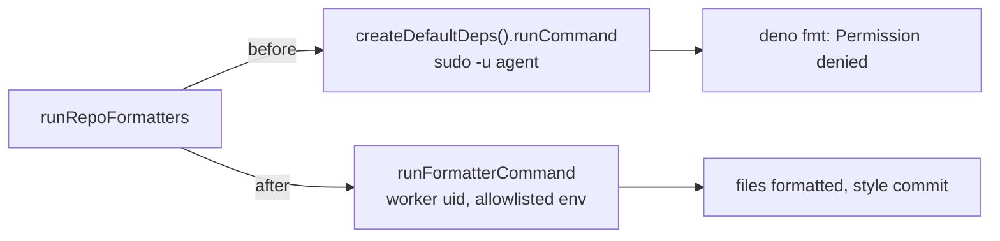

## Summary

The repository formatters (`deno fmt`, `cargo fmt --all`, run by `runRepoFormatters`) now run as the **worker account** instead of the untrusted `agent` account, so they can write the worker-owned worktree and a formatting miss is fixed rather than failing the pre-push gate. A failing formatter's log line and `FormatterRun.excerpt` now keep the head and the tail of its output, so the `Permission denied` cause is no longer hidden behind `cargo fmt`'s usage text. Closes #4113.

Version bump: `VERSION` is untouched by this change; the merged commit records the final version.

## Spec

### Intent and Rationale

- `createRepoFormatterDeps()` reused `createDefaultDeps().runCommand`, which drops to `agent` via `sudo -n -u agent` (#571). `agent` cannot write the worker-owned (`vibe`, 644/755) worktree, so a formatter that writes always failed.
- Chosen option: run them as the worker (the issue's first option) rather than make worktrees group-writable. The pre-push gate already runs the same `deno fmt --check` / `cargo fmt --all --check` over the same files as the worker, via `defaultPreFlightRunner` with `buildUntrustedCommandEnv` (`clearEnv: true`), so this adds no exposure beyond that gate. A group-writable `worktrees/` would widen the grant to `agent` (the entrypoint deliberately keeps `worktrees/` `g-w`).

### Essential Design Decisions

- `runFormatterCommand` is a small argv-based runner, not `defaultPreFlightRunner`: that one tokenises a command string (breaks on paths with spaces or quotes) and adds a timeout and build-cache overrides a formatter does not need.
- Quality script, tests and installs still run through `createDefaultDeps` as `agent`; #571 and #572 isolation of those is unchanged.
- Excerpt is `redactedHeadTail(output, 400, 300)`: redaction still runs over the whole text before the cut.

### Undiscoverable Facts

- The old defect only exists on hosts where `sudo -n -u agent` works (the fleet containers). Elsewhere `untrustedSpawn` falls back to the worker, so the real-formatter test is green on base there; it was observed red on base in this container (`agent` exists).

## Evidence

Observed in this container (`sudo -n -u agent true` succeeds): with `createRepoFormatterDeps` pointed back at `createDefaultDeps().runCommand`, the real-formatter test fails with `excerpt: "...error: Permission denied (os error 13)"`, and the uid test fails with `-1001 +1000`. With the change both pass.

**Docs sweep** — grep: `repo_formatters`, `runRepoFormatters`, `formatBeforeGate`, `apply repository formatters`, `sudo -n -u agent`, "run as `agent`", "untrusted account", `redactedTail(text, 500)`; section: `docs/INTERNALS.md#quality-gate` (formatter paragraph) and `docs/CONFIGURATION.md` (the `style: apply repository formatters` section); siblings: none — no existing set gained a member; updated: `docs/INTERNALS.md`, `docs/CONFIGURATION.md`, `docs/CONTAINER.md`, `docs/audits/security-sweep-2967-repo-formatters.md`; `SECURITY.md:1859` — still true because it lists sibling spawns that use `buildUntrustedCommandEnv` and makes no claim the formatters run as `agent`; `docs/THREAT-MODEL.md:240` — still true because the agent's `quality.sh` and tests still run as `agent`; `docs/CONTAINER.md:1482-1485` — still true because it describes the quality-gate `sudo -n -u agent` argv, which is unchanged.

## Acceptance Criteria

<!-- vibe-spec-review inputs="diff+issue-body" -->

- **met** — The repo formatters can write the files they format. Either run them as the worker account (they are the repo's pinned toolchains, run on files the agent already controls), or make the worktree group-writable for `vibework`. Pick the option that keeps #571's credential isolation. Say which in the PR. — evidence: `worker/deno/lib/repo_formatters.ts` (`runFormatterCommand`, `createRepoFormatterDeps`), `worker/deno/tests/repo_formatters_real_test.ts::runRepoFormatters - real deno fmt with the production deps fixes and commits a badly formatted file (Issue #4113)`; option chosen is "run as the worker account", stated in Spec above — reviewer: met
- **met** — A test that runs a real `deno fmt` through `runRepoFormatters` on a badly formatted file, with the production runner, and asserts the file changed and the commit was made. The test must fail on today's code. — evidence: `worker/deno/tests/repo_formatters_real_test.ts::runRepoFormatters - real deno fmt with the production deps fixes and commits a badly formatted file (Issue #4113)` and `…::createRepoFormatterDeps().runCommand runs the formatter as the worker's own uid (Issue #4113)`; observed red on base in this container — reviewer: partial — reason: the reviewer notes that on a host without the `agent` account the old runner already ran as the worker, so the test cannot fail there; that is inherent (the defect does not exist on such hosts), and the red run on base was observed here where `agent` exists
- **met** — A failing formatter's log line carries the error, not just the tail of its usage text (keep the head, or both head and tail). — evidence: `worker/deno/tests/repo_formatters_test.ts::repo formatters - a failing formatter's log line and excerpt keep the head (the cause), not just the usage tail (Issue #4113)` — reviewer: met
- **met** — After deploy, `Formatter … files changed` appears in the logs, and no pre-push block on `cargo fmt --check` / `deno fmt --check` covers files the formatter was given. — evidence: the formatters now run as the account and allowlisted environment of the pre-push checks (`worker/deno/lib/repo_formatters.ts`); the observation itself needs a deployment — reviewer: met — reason: the diff removes the cause; the log line can only be observed after deploy

## Standards Review

<!-- vibe-standards-review inputs="diff+CODING-STANDARDS.md" -->

- **violation** — Changed call site had a test that could not tell the two runners apart on any host — evidence: `worker/deno/tests/repo_formatters_real_test.ts` — reason: fixed in this diff (added the uid test that compares the formatter's uid with the test process's; red on base wherever `agent` exists)
- **violation** — New branches of `runFormatterCommand` (the `stdin: "inherit"` ternary and the `catch`) not reached by a test — evidence: `worker/deno/lib/repo_formatters.ts` — reason: fixed in this diff (the unused `inherit` branch was removed; tests added for the missing-binary `catch` and the credential-free environment)
- **violation** — Test header named `repo_formatters_test.ts` relative to the test directory — evidence: `worker/deno/tests/repo_formatters_real_test.ts` — reason: fixed in this diff (now `worker/deno/tests/repo_formatters_test.ts`)
- **violation** — `runFormatterCommand` copies a spawn body without saying why it is not the pre-flight runner — evidence: `worker/deno/lib/repo_formatters.ts` — reason: fixed in this diff (doc comment now gives the reason: the pre-flight runner tokenises a command string and adds a timeout and build-cache overrides)
- **clean** — Credential isolation: not a regression against the pre-push gate, which already runs `deno fmt --check` / `cargo fmt --all --check` as the worker with `buildUntrustedCommandEnv`; no removed test assertions; the excerpt test asserts the cause text; Australian English; docs updated; temp dirs private to the test; review-enforced rules checked: "Avoid over-engineering", replacement pairing (none applicable)

## Test Plan

- `deno test -A` (with `VIBE_IMAGE_AGENT_PROVIDERS` unset) over `worker/deno/tests/repo_formatters_test.ts`, `worker/deno/tests/repo_formatters_real_test.ts`, `worker/deno/tests/quality_gate_phase_repo_formatters_test.ts`, `worker/deno/tests/pr_round_repo_formatters_test.ts`, `worker/deno/tests/parallel_safety_cap_test.ts`: passed. `worker/deno/tests/repo_formatters_real_test.ts` also passes without `--allow-sys`, as the gate runs it.
- Added in `worker/deno/tests/repo_formatters_real_test.ts`: real `deno fmt` through production deps (file formatted, commit made, tree clean); uid of the formatter equals the test process's; missing binary resolves exit 1 with the error text; child environment holds only allowlisted names (positive controls: `PATH=` present, parent has non-allowlisted names). Added in `worker/deno/tests/repo_formatters_test.ts`: head-and-tail excerpt test. No existing assertion was removed.
- Red checks (restored afterwards): `createRepoFormatterDeps` back on `createDefaultDeps().runCommand` → real-formatter test red (`Permission denied (os error 13)`) and uid test red (`1001` vs `1000`); excerpt back to `redactedTail(output, 500)` → head test red; `catch` removed → missing-binary test red; `clearEnv: true` dropped → environment test red.
- Callers of `runCommand` checked: `createRepoFormatterDeps` is the only production wiring of the formatters' runner (used by `formatBranchChanges`/`runRepoFormatters` callers: quality-gate phase, completion phase, PR-feedback and CI-fix); the tests above go through it.
- `./quality.sh`: every stage passed except `deno tests` (parallel pass: 2 failures, serial pass not run), with `config integration` and `checkov` skipped. The two failures are `completion - an unformatted Rust change is formatted and committed, then passes the gate` and `completion - cargo fmt stages only the branch's .rs files, not an unrelated uncommitted edit` in `worker/deno/tests/completion_phase_repo_formatters_test.ts`; both inject their own `runCommand` and fail identically on the base commit.

<!-- vibe-branch-outcomes -->
