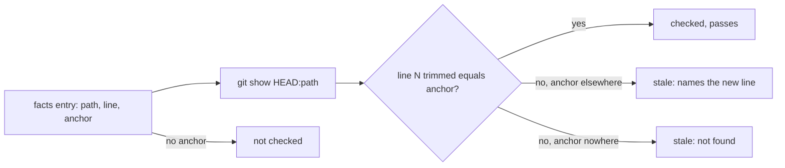

## Summary

A facts-file entry can now carry an `anchor`: the trimmed text of the source line it cites. A stateless check reads `git show HEAD:<path>` and blocks when line `line` no longer holds the anchor, naming the line(s) where the anchor now appears so the fix is a renumber. It needs no previous head, so worker pushes, foreign pushes and base merges are all covered. The check runs in `deno task pr-summary-check` (and so `pr-summary-ci`) and in the completion phase. Closes #4125.

Version bump: no `VERSION` change in this diff; the merged commit records the final version.

## Spec

### Intent and Rationale

- The existing citation check (`branch_outcome_citations.ts`) maps citations through the diff from the previous head, so a foreign push or base merge defeats it. Recording what a citation points at lets the head alone decide whether it is still true.

### Essential Design Decisions

- `anchor` is optional and never rendered, so existing facts files, digests and the prose list are unchanged. An entry without one is reported not checked, never passed.
- Both sides of the comparison go through `anchorKey` (trim, cap at 1,000 chars), so a long line and its capped anchor still match.
- The diff-mapping check is kept for entries without an anchor; it is not retired in this change.

### Undiscoverable Facts

- The review-fleet-prs gate (`.claude/skills/review-fleet-prs/scripts/gate.ts`) does not run this check yet. It reads each PR through the GitHub API and sends PRs back through `post.ts`, which this change does not touch. So fleet target-repo PRs still reach the reviewer unchecked until that wiring lands; the checker is a pure module taking an injected reader, so the gate can reuse it.
- The 91 existing facts files in `docs/archive/pr-summaries/` carry no anchors, so over that corpus the check gives 0 stale and reports every entry not checked (91 files, 0 anchored).

## Evidence

Backend/CLI change; no UI file is touched. Behaviour observed with the real tool: `git show HEAD:nope.txt` exits 128 with `fatal: path 'nope.txt' does not exist in 'HEAD'`; `gitReadAtHead` treats that stderr as an absent file and throws the first stderr line for any other failure. The `gitReadAtHead` tests use a real temporary git repository.

**Docs sweep** — grep: `Branch outcomes facts file`, `renumber`, `facts file`, `line citation`; section: `CODING-STANDARDS.md#branch-outcomes-facts-file`; siblings: `endLine`, `testName`; updated: `CODING-STANDARDS.md`, `prompts/issue/prompt.md`, `prompts/pr_feedback/prompt.md`, `docs/workflows/issue-processing.md`, `docs/workflows/pr-feedback.md`; `prompts/coding_guidelines/prompt.md` — still true because it points to CODING-STANDARDS.md for the schema and does not restate the entry shape.

## Test Plan

- Added `worker/deno/tests/facts_anchor_check_4125_test.ts` (23 tests, passed): match, inserted line, deleted line, unanchored, CRLF/whitespace, absent file, reader throw, one read per path, five-line cap, short file, 200k-char line, hostile message text, size cap, and `gitReadAtHead` against a real git repository.
- Added anchor cases to `worker/deno/tests/summary_facts_3396_test.ts` (89 tests at head, passed) and to `worker/deno/tests/pr_summary_check_test.ts` (33 tests at head, passed).
- Added five cases to `worker/deno/tests/completion_phase_branch_outcomes_facts_3396_test.ts` (14 tests at head, passed), including that a render ownership problem wins over a stale anchor.
- Mutation red-checks: 17 mutations of `facts_anchor_check.ts`, `summary_facts.ts` and `pr_summary_check.ts` each turned a named test red; the completion-phase assignment, its extras list and its `branchOutcomesFactsProblem === null` operand were each flipped red. Mutating `firstStale !== undefined` to `true` turned six existing tests red.
- Full `./quality.sh` ran once: every stage passed except `deno tests` and `completeness checks`. The completeness failure was the missing sweep-ledger entry for the new module, fixed by `docs/audits/lib-sweep-coverage/top-up-4125.json` (`deno task check:manifests` then passed). The `deno tests` stage failed 9 tests that need the codex, gemini or deepseek coding-agent provider, which the container image does not install (`Installed: claude`); one of the 9 was the sweep-coverage test, also fixed. Those provider tests do not touch this change.
- Existing tests needing fixture changes: none.

<!-- vibe-branch-outcomes -->

Not done: the review-fleet-prs gate wiring and retiring the diff-mapping path for facts refs (see Undiscoverable Facts); I did not re-run the full gate after the last test was added.
