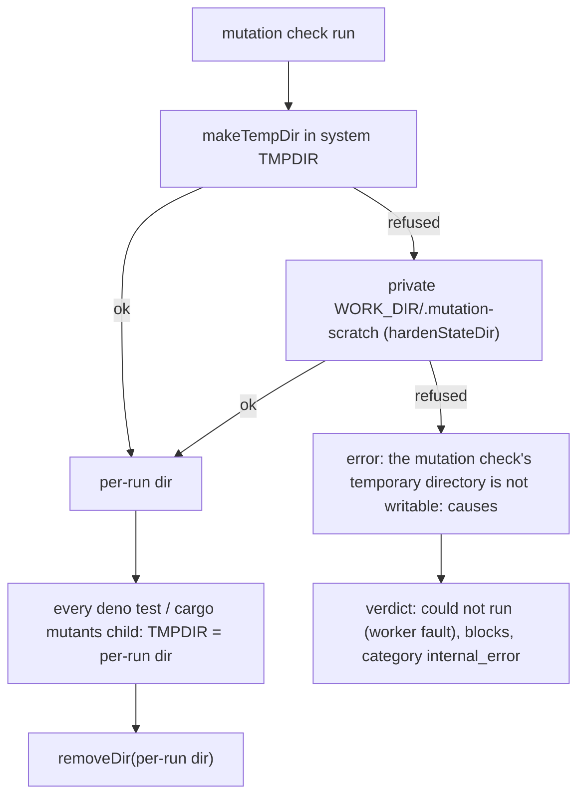

## Summary

The mutation check failed in the agent container with
`Read-only file system (os error 30): tmpdir`. That exact text is
`Deno.makeTempDir()`'s own error when `TMPDIR` is on a read-only mount: the
runner made cargo-mutants' output directory with a bare `Deno.makeTempDir`, and
the Deno mutator gave its `deno test` children no `TMPDIR` at all, so they
inherited the worker's. Now every mutation-check child gets `TMPDIR` set to the
run's own temporary directory, created before the first child and removed
afterwards. That directory is made in the system temp directory first and, when
that refuses, in a private `0700` `.mutation-scratch` root on the work volume.
If neither can be created, the result says the temporary directory is not
writable and is reported as a worker fault (`internal_error`), not as a verdict
on the code. Closes #4127.

## Spec

### Intent and Rationale

- Make the temp directory the check depends on one the container can write, and keep a host fault from being reported as a judgement of the code.
- The system temp directory stays first, so a healthy host behaves exactly as before (tmpfs, cleared every launch). The work volume is only used when the system temp directory refuses, because a leftover from a killed run persists there.

### Essential Design Decisions

- `TMPDIR` is set last in each child's environment, so a `TMPDIR` declared in `quality_credentials` cannot point a child back at a read-only mount.
- An uncreatable directory still blocks the PR (fail closed); only its reason, comment heading and remedy change. The reason opens with the worker-written `MUTATION_TEMP_DIR_UNWRITABLE`, read only by an anchored `startsWith` in `evaluateMutationGate`.
- The fallback root is created and checked by the existing `hardenStateDir` (`private_cache_dir.ts`): a group/other-writable or foreign-owned root is refused, because the work root is group-writable for the untrusted `agent` account.

### Undiscoverable Facts

- Observed in this container: `TMPDIR=/workspace deno eval 'await Deno.makeTempDir()'` throws `Error` with message `Read-only file system (os error 30): tmpdir`. That message matches GRQ-AutoTrader#3782's word for word.
- Which mount was read-only on the host that ran GRQ-AutoTrader#3782 was not observed. The fix covers any read-only system temp directory.

## Evidence

Backend-only change; no UI files touched.

A real end-to-end run in this agent container, with the process `TMPDIR` on the read-only `/workspace` mount (virtiofs `ro`). The checks were throwaway scripts outside the repo that used the real seams and real `cargo mutants` 27.1.0. Results:

| Repo | Base `1a42eb1b` runner | This branch |
| ---- | ---------------------- | ----------- |
| Rust crate (`src/lib.rs`, one test) | `{"kind":"error","reason":"Read-only file system (os error 30): tmpdir"}` | `{"kind":"completed","language":"rust","survivors":[],"killed":5,"total":5}` |
| Deno project (test writes a temp file) | `{"kind":"error","reason":"baseline tests fail before mutation (tests/m_test.ts); cannot judge mutants"}` | `{"kind":"completed","language":"deno","survivors":[],"killed":3,"total":3}` |

The `.mutation-scratch` root was left empty after the runs, so the per-run directories were removed.

Shared callers of the changed `makeTempDir` seam: `coverage_carryover_runner.ts` and `security_fix_discrimination.ts` take the same real seams. On a writable system temp directory they behave exactly as before, and they gain the same fallback. Their tests (`worker/deno/tests/coverage_carryover_runner_test.ts`, `worker/deno/tests/security_fix_discrimination_test.ts`) pass. `mutation_check_invocation.ts` and `pr_feedback_mutation_check.ts` only pass the wired runner, so both the PR-raise and the review-fix paths get the fix without an edit.

**Docs sweep** — grep: `TMPDIR`, "mutation check failed to run", "changed lines are not pinned", `makeTempDir`; section: `docs/mutation-check.md#child-environment`; siblings: `not_applicable`, `budget_exhausted` — no result kind was added (the fault is an `error`), and the Outcomes table gained an "Error (worker fault)" row; updated: `docs/mutation-check.md`; `docs/mutation-check.md:93` — still true because other runner errors still read `mutation check failed to run (…)`; `worker/deno/lib/coverage_carryover_runner.ts:11` — still true because its temporary files are still outside the repository.

Related existing rules checked: none changed. This diff adds no prompt or standards rule.

## Acceptance Criteria

<!-- vibe-spec-review inputs="diff+issue-body" -->

- **met** — The mutation check runs to completion inside the agent container on a Rust repo and a Deno repo. No `os error 30` appears. — evidence: `worker/deno/tests/mutation_runner_test.ts::makeMutationTempDir - falls back to a private work-volume root when TMPDIR refuses`, plus the in-container runs in Evidence (Rust and Deno both `completed` on a read-only `TMPDIR`, base `error`) — reviewer: partial — reason: the reviewer saw only the diff and said a real-container run "cannot be shown from a diff"; both runs were made in this agent container on a real read-only mount and are recorded in Evidence. Its other point, a write failing after the directory is created, was not observed, and creating the directory is itself a write to that filesystem.
- **met** — A unit test shows that every mutation-check subprocess gets a `TMPDIR` (or equivalent) under the writable, per-run directory, not the container default. — evidence: `worker/deno/tests/mutation_runner_test.ts::runMutationCheck deno - every deno child gets TMPDIR set to the run's own temp dir, removed afterwards`, `worker/deno/tests/mutation_runner_test.ts::runMutationCheck rust - cargo-mutants' scratch copy lives under the removed output directory` — reviewer: met
- **met** — If the temp directory cannot be written, the result says that the temp directory is not writable. It is not counted as a `quality-failure` against the issue. — evidence: `worker/deno/tests/completion_phase_mutation_gate_test.ts::completion - an unwritable mutation temp dir blocks as a worker fault, not a quality failure`, `worker/deno/tests/mutation_runner_test.ts::runMutationCheck rust - real seams: an unwritable temp dir is reported as not writable before cargo runs` — reviewer: met
- **unrequested** — the private `.mutation-scratch` fallback on the work volume (`resolveMutationScratchRoot`, `hardenStateDir`) — reviewer: unrequested — reason: the issue asks for a directory that is writable in the container. The fallback is how this diff provides one when the system temp directory is read-only.
- **unrequested** — a `TMPDIR` declared in `quality_credentials` no longer reaches `deno test` children — reviewer: unrequested — reason: the issue requires every child's `TMPDIR` to be the per-run directory, so a declared value must not override it (this was already true for `cargo mutants`).
- **unrequested** — `defaultMutationRunnerSeams(envSource)` also resolves the temp directory from `envSource` — reviewer: unrequested — reason: this is the seam the real-seam tests drive, and production keeps reading the worker's own environment.
- **unrequested** — `docs/mutation-check.md` updated — reviewer: unrequested — reason: the docs-change standard requires it, because the manual described `TMPDIR` as set for `cargo mutants` only.
- **unrequested** — the real-seam and edge-case `makeMutationTempDir` tests — reviewer: unrequested — reason: each new branch outcome needs a test that reaches it (see Branch outcomes).

## Standards Review

<!-- vibe-standards-review inputs="diff+CODING-STANDARDS.md" -->

- **violation** — a new test that passes with no assertions on some hosts (`if (writable) return;` when run as root) — evidence: `worker/deno/tests/mutation_runner_test.ts:1318` — reason: fixed in this diff (an injected `makeTemp` forces the refusal on every host, with a positive control that the fallback was reached)
- **clean** — Australian English; never fail silently (both causes are carried and the gate still blocks); `internal_error` rather than `quality_check` (`completion_phase.ts:3442`, asserted by the completion test); no shared `/tmp` paths in tests; every new member has a production reader; every named test exists. The removed-assertion check found one replaced expectation. Review-enforced rules checked: the removed-assertion check. The reviewer also raised the worker-marker rule for `MUTATION_TEMP_DIR_UNWRITABLE`. The recorded failure reason this fault produces opens with the registered `SUMMARY_RULE_GATE_MARKER` (`reportSummaryRuleBlock`), now asserted by the completion test. The inner marker's only classifier is the anchored `startsWith` in `evaluateMutationGate`, so no quoted OS text can choose the category.

## Test Plan

- Added in `worker/deno/tests/mutation_runner_test.ts`:
  - deno TMPDIR per child, and its removal
  - a caller-declared TMPDIR cannot win
  - deno and rust uncreatable temp dir (no child runs)
  - no runnable mutant makes no temp dir
  - `resolveMutationScratchRoot`
  - `makeMutationTempDir`: TMPDIR, default, fallback, missing fallback, group/other-writable root, refused fallback, both causes
  - real-seams rust run
- Added in `worker/deno/tests/mutation_gate_test.ts`: the worker-fault verdict and heading. The ordinary heading is pinned in `buildMutationGateComment - names each survivor and the remedy`.
- Added in `worker/deno/tests/completion_phase_mutation_gate_test.ts`: the worker-fault block. Its category is not `quality_check`, its categories include `internal_error`, and its reason opens with `SUMMARY_RULE_GATE_MARKER`.
- Removed from `worker/deno/tests/mutation_runner_test.ts`: `assertEquals(c.env, { AWS_ACCESS_KEY_ID: "declared" });`
  Required by: "every mutation-check subprocess gets a `TMPDIR` (or equivalent) under the writable, per-run directory"
  Replaced by: `assertEquals(c.env, { AWS_ACCESS_KEY_ID: "declared", TMPDIR: made });`
- Edited-expectation red check: the credentials test goes red when `TMPDIR` is dropped from the deno child env, and it still asserts exact equality, so no other variable can leak.
- Red checks, each restored afterwards:
  - TMPDIR dropped from the deno env: 3 tests red
  - `makeRunTempDir` rethrows: 3 red
  - fallback skipped: 2 red
  - `workerFault` branch dropped: 2 red
  - deno `removeDir` dropped: 1 red
  - each branch flip in Branch outcomes is listed there
- `deno task test:unit tests/mutation_gate_test.ts tests/mutation_runner_test.ts tests/completion_phase_mutation_gate_test.ts tests/coverage_carryover_runner_test.ts tests/pr_feedback_mutation_check_3750_test.ts tests/security_fix_discrimination_test.ts`: parallel pass `173 passed | 0 failed`, serial pass `67 passed | 0 failed`. The touched files were re-run after the last test edit, and `mutation_gate_test.ts` gave `50 passed | 0 failed`.
- `./quality.sh < /dev/null`: `Result: PASSED (with skipped checks)`, with config integration and checkov skipped by the gate. It ran after the first commit. The later commits changed only a default parameter and test files, and those were re-run as above.

<!-- vibe-branch-outcomes -->
