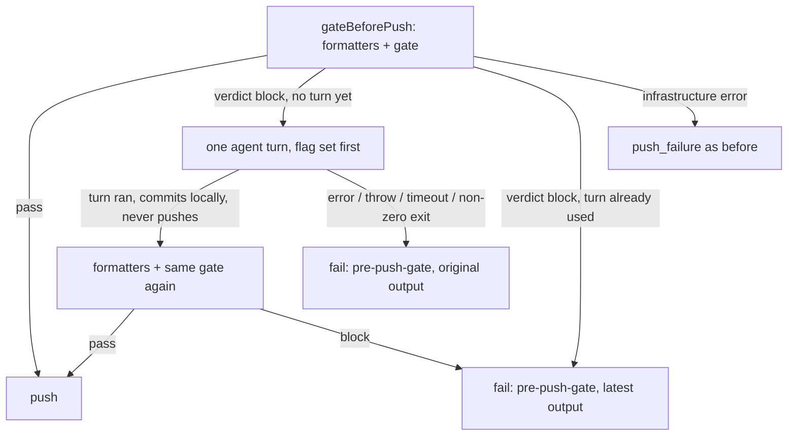

## Summary

A pre-push gate block in the completion phase now gets one in-run agent recovery turn, as the screenshot and PR-summary gates already do. Closes #4128.

The first verdict block of a run resumes the agent session once, with the gate output fenced in the prompt (`worker/deno/lib/pre_push_gate_retry.ts`). The worker then re-runs the formatters and the same whole-branch gate and pushes only if it passes. If it still blocks, the run fails as category `pre-push-gate` quoting the latest gate output. If the turn errors, throws, times out or exits non-zero, the run fails with the original gate output and the gate is not re-run. Version bump: `VERSION` updated for this change; the merged commit records the final version.

## Spec

### Intent and Rationale

- A block fails closed and the agent got no turn to fix a one-line formatting, cspell or `sweptAt` finding, so run 2 failed the same way. One bounded turn fixes the common mechanical cases.
- The turn mirrors `screenshot_gate_retry.ts` / `summary_rule_gate_retry.ts`: flag set before the agent is invoked, configurable timeout, session resumed.

### Essential Design Decisions

- The recovery commit never pushes: `commitAndPushPending` is called with a `beforePush` that always refuses (`PrePushRecoveryPushDeferred`), because its own Step 1b gate has no PR-base ref and is narrower than the completion gate. The only push is the completion phase's, after the re-run.
- Only `verdict` blocks get a turn. A failed git or remote lookup stays an infrastructure `push_failure` and is retried as before.
- The cap is one turn per run (`state.prePushRetryAttempted`), across the first push and the retry push after push recovery.

### Undiscoverable Facts

- WIP checkpoints may already have pushed the agent's commits ungated, so "nothing has been pushed" would be false in the prompt; the prompt says the worker pushes only after the gate passes.
- Three tests (`claude_runner_provider_fallback_4034_test.ts` x2, `external_orchestration_3642_config_test.ts`) fail in this container because the image has no `codex` provider; they fail the same on the base branch.

## Evidence

Backend only; no UI files changed. Tests: `worker/deno/tests/pre_push_gate_retry_test.ts` (unit, plus a real-git test with a bare origin showing the fix commit is local and origin does not move) and `worker/deno/tests/completion_phase_pre_push_gate_3689_test.ts` (full completion phase with the git seams mocked, agent seam scripted).

#4128: Pre-push gate block: give the agent one in-run recovery turn with the gate output.

**Docs sweep** — grep: `never enters push recovery`, `screenshot_retry_timeout_seconds`, `fails closed`, `commitAndPushPending`; section: `docs/CONFIGURATION.md#agent-pre-push-hook-and-the-changed-files-check`; siblings: `screenshot_retry_timeout_seconds`, `screenshotRetryAttempted`; updated: `docs/CONFIGURATION.md`, `docs/INTERNALS.md`, `docs/pre-pr-ci-audit.md`, `docs/audits/security-sweep-4128-pre-push-gate-retry.md`; `worker/deno/lib/phases/completion_phase.ts:2071` — still true because a persistent block still never enters push recovery.

## Acceptance Criteria

<!-- vibe-spec-review inputs="diff+issue-body" -->

- **met** — A run whose first push is blocked gets exactly one extra agent turn with the gate output in the prompt. A second block in the same run does not get another turn. — evidence: `worker/deno/tests/completion_phase_pre_push_gate_3689_test.ts::completion - the pre-push recovery turn runs once per run, across the first and the retry gate calls (Issue #4128)` — reviewer: met
- **met** — If the gate passes after the turn, the branch is pushed and the run continues to PR creation. — evidence: `worker/deno/tests/completion_phase_pre_push_gate_3689_test.ts::completion - a pre-push gate block that the one agent turn fixes passes on the re-run and pushes (Issue #4128)` (asserts `pushes` 1 and `prCreates` 1) — reviewer: met — reason: the reviewer noted the test then asserted only the push; it now also asserts `prCreates` 1
- **met** — If the gate still fails, the run ends with category `pre-push-gate` and the failure comment quotes the latest gate output. — evidence: `worker/deno/tests/completion_phase_pre_push_gate_3689_test.ts::completion - a pre-push gate still blocking after its one agent turn fails closed with the latest output (Issue #4128)` — reviewer: met
- **met** — Tests cover all three paths: pass after recovery, still blocked, and agent invocation error. — evidence: `worker/deno/tests/completion_phase_pre_push_gate_3689_test.ts` (the three tests above plus the agent `error`/`throw` loop) and `worker/deno/tests/pre_push_gate_retry_test.ts` — reviewer: met

## Standards Review

<!-- vibe-standards-review inputs="diff+CODING-STANDARDS.md" -->

- **violation** — the recovery commit pushed through `commitAndPushPending`'s narrower gate before the completion gate decided — evidence: `worker/deno/lib/pre_push_gate_retry.ts:282` — reason: fixed in this diff (refusing `beforePush`; real-git test shows origin does not move)
- **violation** — the completion-test fake hid pushes made by the recovery commit — evidence: `worker/deno/tests/completion_phase_pre_push_gate_3689_test.ts:694` — reason: fixed in this diff (`commitAndPushPending` override counts pushes and honours `beforePush`)
- **violation** — reconcile and commit failure outcomes had no test — evidence: `worker/deno/tests/pre_push_gate_retry_test.ts:358` — reason: fixed in this diff (two tests added)
- **violation** — the production prompt fence was untested and `boundaryId` existed only for tests — evidence: `worker/deno/lib/pre_push_gate_retry.ts:78` — reason: fixed in this diff (parameter removed; tests read the rendered nonce)
- **violation** — the `Number.isFinite` operand of the timeout check had no test — evidence: `worker/deno/lib/config.ts:729` — reason: fixed in this diff (`1e999` test added)
- **clean** — Australian English, no hidden paths staged, no `--no-verify`, named tests exist, sweep slice `docs/audits/lib-sweep-coverage/top-up-4128.json` claims the new module, config key has default/validation/known-key/docs row, untrusted gate output fenced under a per-render nonce

## Test Plan

- New: `worker/deno/tests/pre_push_gate_retry_test.ts` (success and flag-set-first, invocation error, throw, non-zero exit, timeout, reconcile failure, non-sentinel commit failure, timeout default and override, prompt fence/forged fence/nonce, blank output and bad issue number, real-git no-push) and four completion tests plus the agent `error`/`throw` loop in `worker/deno/tests/completion_phase_pre_push_gate_3689_test.ts`; five config tests in `worker/deno/tests/config_test.ts`.
- `deno test -A` over `pre_push_gate_retry_test.ts`, `completion_phase_pre_push_gate_3689_test.ts`, `config_test.ts`, `tool_output_treat_as_data_3046_test.ts`: 180 passed, 0 failed.
- `./quality.sh`: all stages pass except `deno tests`, where 3 tests fail on the missing `codex` provider in this container image (same failure without this change); 29,599 pass. The serial pass did not run because the parallel pass failed.
- Red-checks (each mutation applied, test seen red, restored): removing `!state.prePushRetryAttempted` → once-per-run test red; skipping the re-gate (`turn.ran` forced false) → pass-after-recovery, still-blocked and 3738 tests red; dropping `kind === "verdict"` → infrastructure test red; `beforePush` returning ok → real-git test and the completion still-blocked `pushes` 0 assertion red; removing the flag-set-first line → success test and four failure tests red; dropping `exitCode !== 0` → non-zero-exit test red; unfenced gate output → three fence tests red; deleting the reconcile `return` → reconcile test red; downgrading the commit-error log → commit-failure test red; deleting `!Number.isFinite` → only the `1e999` config test red; weakening `<= 0` to `< 0` → zero-timeout test red.
- Removed from `worker/deno/tests/completion_phase_pre_push_gate_3689_test.ts`: `assertEquals(o.gateCalls, 1);`
  - Required by: "A run whose first push is blocked gets exactly one extra agent turn with the gate output in the prompt."
  - Replaced by: `assertEquals(o.gateCalls, 2)`, `assertEquals(o.agentCalls, 1)`
- Removed from `worker/deno/tests/completion_phase_pre_push_gate_3689_test.ts`: `assertEquals(o.gateCalls, 2);`
  - Required by: "After the turn, push again through the same gate."
  - Replaced by: `assertEquals(o.gateCalls, 3)`, `assertEquals(o.agentCalls, 1)`
- Removed from `worker/deno/tests/completion_phase_pre_push_gate_3689_test.ts`: `o.gateCalls > 1, category === "push_failure", "only the network failure is retried in-run"`
  - Required by: "After the turn, push again through the same gate."
  - Replaced by: `assertEquals(o.gateCalls, 2, …)` for the verdict arm, `assert(o.gateCalls > 1, …)` for the network arm and `assertEquals(o.agentCalls, category === "pre_push_gate" ? 1 : 0, …)`
- Existing-expectation red-checks: the edited `gateCalls`/`agentCalls` expectations go red when the turn or the re-gate is skipped (above). Callers of `gateBeforePush` checked: first push and retry push after push recovery both pass through the same closure and share the once-per-run flag (tested). `completion_phase_repo_formatters_test.ts` and `pre_push_gate_failure_category_test.ts` still reach their assertions (run, passing).
- Twinned rules: the screenshot and summary-rule retries are siblings, not copies of a rule changed here; no twin found. Related existing rules checked: none in prompts/coding standards changed.

<!-- vibe-branch-outcomes -->
