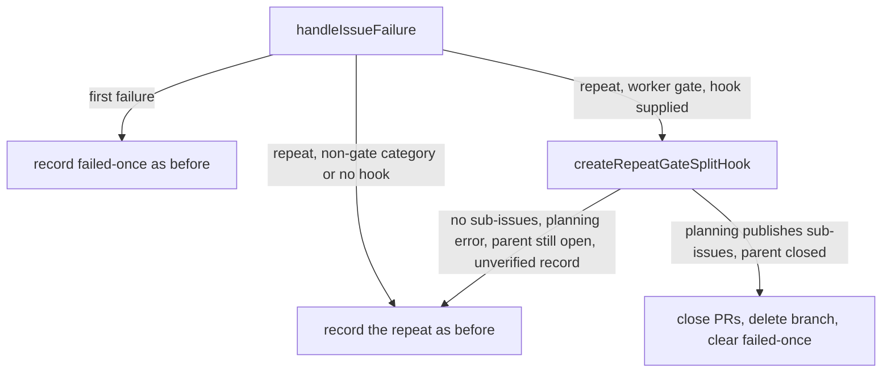

## Summary

When run 2 of an issue is still blocked by a worker gate, the worker splits the issue into sub-issues instead of recording another failure. Closes #4130.

A repeat failure (the issue already has `failed-once`) in category `summary-incomplete`, `quality-failure`, `pre-push-gate` or `security-fix-gate` takes the split path. The worker runs planning on the parent seeded with the gate output and a summary of what the branch got done, tops up each sub-issue with `Part of #N`, the quoted gate output and a "what the branch got done" section, closes any open PR and deletes the remote branch, removes `failed-once` and closes the parent. A timeout, rate limit, provider error, merge conflict or crash never splits, and a first failure is recorded as before. If planning publishes no sub-issues, or the parent cannot be closed, the split refuses and the repeat is recorded as before, with the reason logged.

## Spec

### Intent and Rationale

- The gates were right and the code was not done (GRQ-AutoTrader#3407), so a third attempt at the same branch repeats the failure. Splitting hands each part to a fresh run.
- The "is this a worker gate" test is one exported predicate, `isSplittableWorkerGateCategory`, beside `getFailureCategoryDisplay` (`worker/deno/lib/failure_diagnosis.ts`). It names exactly the four categories in the issue and deliberately leaves out `criteria_unmet`.

### Essential Design Decisions

- The worker never applies `failed` (Issue #4158). "As today" for a non-gate repeat is therefore the repeat record with `failed-once`, and the tests assert exactly that and no `failed` label on either path.
- The split is a hook (`splitOnRepeatGate`) supplied only by callers that hold a branch to clean up (the quality-gate remediation phase and the main loop's coding-failure ladder). Planning and question callers and the manual label CLI never split.
- The split runs `planHeldIssue`, which plans without a second claim or a heartbeat clear. A split run records no cooldown kind (`issueSplit`), because the parent is closed.
- The split never readies, merges or arms auto-merge, and it closes PRs and deletes the branch only after the sub-issues exist and only when the branch is not a base, default or protected one. `failed-once` is cleared only once the parent reads back closed, and only when it is backed by a fleet-authored failure record.

### Undiscoverable Facts

- A merge conflict has no failure category of its own: a rebase-conflict message is detected as `unknown`, which is not splittable.
- Three unrelated tests fail in this container image because it has no `codex` provider; they fail the same on the base branch.

## Evidence

Backend only; no UI files changed. Tests: `worker/deno/tests/repeat_gate_split_4130_test.ts` (hook behaviour and an end-to-end run per gate category), `worker/deno/tests/label_failure_split_4130_test.ts`, `worker/deno/tests/splittable_gate_category_4130_test.ts`, `worker/deno/tests/quality_gate_repeat_split_4130_test.ts`, `worker/deno/tests/planning_held_issue_4130_test.ts` and `worker/deno/tests/run_core_repeat_gate_split_4130_test.ts`.

#4130: Run 2 blocked by a worker gate: split the issue into sub-issues instead of labelling it failed.

**Docs sweep** — grep: `isSplittableWorkerGateCategory`, `splitOnRepeatGate`, "second failure", "Second failure", `failed-once`; section: `docs/workflows/issue-processing.md`, `docs/workflows/label-flows.md`, `docs/INTERNALS.md`, `docs/USAGE.md`, `docs/TROUBLESHOOTING.md`; siblings: `markedAsFailedOnce`, `ladderApplied` (the new `split` result field and `issueSplit` flag are named beside them); updated: `README.md`, `DESIGN-PRINCIPLES.md`, `docs/INTERNALS.md`, `docs/USAGE.md`, `docs/TROUBLESHOOTING.md`, `docs/workflows/issue-processing.md`, `docs/workflows/label-flows.md`. The remaining "second failure" hits (`docs/CONTAINER.md`, `docs/DEPLOYMENT.md`, `docs/workflows/pr-feedback.md`, `docs/INTERNALS.md` PR-feedback sections) describe other subsystems and were read and cleared.

## Acceptance Criteria

<!-- vibe-spec-review inputs="diff+issue-body" -->

- **met** — Run 2 blocked by each of the four worker-gate categories ends with sub-issues filed, the parent closed, the branch and PR deleted, and no `failed` label. — evidence: `worker/deno/tests/repeat_gate_split_4130_test.ts::repeat gate split end to end (summary_incomplete | quality_check | pre_push_gate | security_fix_gate): sub-issues filed, parent closed, PR and branch deleted, no failed label` (one per category, asserting no `failed` label and no ready/merge/auto-merge call) — reviewer: met
- **met** — Each sub-issue body contains `Part of #N`, the quoted gate output, and a "what the branch got done" section. — evidence: `worker/deno/tests/repeat_gate_split_4130_test.ts::repeat gate split: a bare sub-issue gets the missing sections and the label` — reviewer: met — reason: the reviewer noted it is asserted for one scenario, not per category; the section top-up does not depend on the category
- **met** — Run 2 ending in `timeout`, a provider error or a merge conflict still adds `failed`, as today. — evidence: `worker/deno/tests/label_failure_split_4130_test.ts::handleIssueFailure - a repeat timeout | provider error | merge conflict message is detected as <category>, recorded and never split (Issue #4130)` — reviewer: met — reason: "as today" is the repeat record with `failed-once`, since the worker has not applied `failed` since #4158; a merge conflict maps to `unknown`
- **met** — If planning returns no sub-issues, the result is `failed` plus a comment, with the branch left as today. — evidence: `worker/deno/tests/repeat_gate_split_4130_test.ts::repeat gate split: zero published sub-issues refuses and cleans up nothing` and `worker/deno/tests/label_failure_split_4130_test.ts::handleIssueFailure - a refused split records the repeat and warns with the reason (Issue #4130)` — reviewer: met — reason: the result is the repeat record and comment as today, for the same #4158 reason
- **met** — Tests cover each category, the non-gate categories, and the planning-empty fallback. — evidence: `worker/deno/tests/splittable_gate_category_4130_test.ts::isSplittableWorkerGateCategory - true for exactly the four gate categories (Issue #4130)`, `worker/deno/tests/label_failure_split_4130_test.ts::handleIssueFailure - a repeat push_failure failure is recorded, never split (Issue #4130)` and the planning-empty tests above — reviewer: met
- **unrequested** — `planHeldIssue` and `attachPlanningFacts` in `worker/deno/lib/planning_processor.ts` — reviewer: unrequested — reason: the split must plan without a second claim or a heartbeat clear; covered by `worker/deno/tests/planning_held_issue_4130_test.ts`
- **unrequested** — the `issueSplit` flag and split log line in `worker/deno/lib/issue_worker.ts`, `worker/deno/lib/issue_worker_types.ts` and `worker/deno/lib/run_core_production_deps.ts` — reviewer: unrequested — reason: a closed parent must not be given a cooldown kind
- **unrequested** — hardening in `worker/deno/lib/repeat_gate_split.ts` (secret redaction, fleet-authorship check of the failure record, refusing base/default/protected branches, skipping cross-repository PRs and sub-issues, input-size guards) — reviewer: unrequested — reason: the split closes issues and deletes branches from untrusted issue text, so it fails closed; the issue's "invariant" line asks for no weaker handling

## Standards Review

<!-- vibe-standards-review inputs="diff+CODING-STANDARDS.md" -->

- **violation** — the failure-record parser retyped the layout `markIssueAsFailedOnce` writes and no test used the real writer — evidence: `worker/deno/lib/repeat_gate_split.ts:194` — reason: fixed in this diff (`worker/deno/tests/repeat_gate_split_4130_test.ts::the prior run's gate output is recovered from the record markIssueAsFailedOnce writes` feeds the real writer's comment to the hook)
- **violation** — `hasPartOf` re-implemented the exported `hasBackReference` — evidence: `worker/deno/lib/repeat_gate_split.ts:448` — reason: fixed in this diff (now calls `hasBackReference`)
- **violation** — the same split event was logged at INFO from two sites on the quality-gate path — evidence: `worker/deno/lib/phases/quality_gate_remediation_phase.ts:265` — reason: fixed in this diff (the phase no longer logs; `run_core_production_deps.ts` logs once)
- **violation** — two docs still said a second failure applies `failed` — evidence: `docs/workflows/issue-processing.md:720` — reason: fixed in this diff (also `docs/workflows/label-flows.md:340`)
- **clean** — Australian English; no `any`, lint suppressions or `--no-verify`; untrusted gate output redacted, capped and fenced in the planner seed and the sub-issue sections; `failed-once` cleared only with fleet-authored provenance; exhaustive `assertNever` category switch; no new config key; no `VERSION` file to bump; docs and the sweep ledger `docs/audits/lib-sweep-coverage/top-up-4130.json` updated. The reviewer noted `worker/deno/lib/repeat_gate_split.ts` is large (about 1000 lines) but found no enforced cap.

## Test Plan

- New: worker/deno/tests/repeat_gate_split_4130_test.ts (hook behaviour, sub-issue top-up, PR close and branch delete guards, refusals, and an end-to-end run per gate category), worker/deno/tests/label_failure_split_4130_test.ts, worker/deno/tests/splittable_gate_category_4130_test.ts, worker/deno/tests/quality_gate_repeat_split_4130_test.ts, worker/deno/tests/planning_held_issue_4130_test.ts, worker/deno/tests/run_core_repeat_gate_split_4130_test.ts, plus `worker/deno/tests/coding_failure_ladder_test.ts` (hook forwarded or absent) and `worker/deno/tests/issue_worker_test.ts` (`issueSplit` carried to the result).
- No assertion was removed from an existing test. The only removed lines in existing test files are the import lines of `worker/deno/tests/coding_failure_ladder_test.ts` (`import { assertEquals } from "@std/assert";` and the `HandleFailureOptions` type import), which were widened to import more names; every assertion there still runs.
- Mutation check: the one survivor, `worker/deno/lib/failure_diagnosis.ts:890` (the `assertNever` default returning undefined), is killed by `worker/deno/tests/splittable_gate_category_4130_test.ts::isSplittableWorkerGateCategory - an unknown category value throws rather than returning undefined (Issue #4130)`, which went red when the line was changed to `return false`. The 26 further branches the flip run found without a killing test now each have one (listed under Branch outcomes).
- `deno test -A` over the 4130 test files and `coding_failure_ladder_test.ts` and the planning, markdown-anchor and docs tests: all pass; `deno fmt`, `deno lint` and `deno check` are clean.

**Branch outcomes:**
- `worker/deno/lib/failure_diagnosis.ts:869` — success (the four gate categories return true) — `worker/deno/tests/splittable_gate_category_4130_test.ts::isSplittableWorkerGateCategory - true for exactly the four gate categories (Issue #4130)` — flipped each arm to false, test went red
- `worker/deno/lib/failure_diagnosis.ts:888` — fail-closed default (every other category returns false) — `worker/deno/tests/splittable_gate_category_4130_test.ts::isSplittableWorkerGateCategory - timeout and criteria_unmet do not split (Issue #4130)` — flipped to true for `criteria_unmet` and `timeout`, test went red
- `worker/deno/lib/failure_diagnosis.ts:890` — error (an unknown category throws via `assertNever`) — `worker/deno/tests/splittable_gate_category_4130_test.ts::isSplittableWorkerGateCategory - an unknown category value throws rather than returning undefined (Issue #4130)` — flipped to `return false`, test went red
- `worker/deno/lib/label_failure.ts:458` — absent (a first failure, `repeat` false, never splits) — `worker/deno/tests/label_failure_split_4130_test.ts::handleIssueFailure - a first quality_check failure is recorded, never split (Issue #4130)` — flipped `repeat` to true, test went red
- `worker/deno/lib/label_failure.ts:458` — fail-closed (a non-gate category never splits) — `worker/deno/tests/label_failure_split_4130_test.ts::handleIssueFailure - a repeat push_failure failure is recorded, never split (Issue #4130)` — flipped the category test to true, test went red
- `worker/deno/lib/label_failure.ts:459` — absent (no hook supplied records the repeat) — `worker/deno/tests/label_failure_split_4130_test.ts::handleIssueFailure - a repeat gate failure without a split hook records the repeat (Issue #4130)` — flipped the hook test to true, test went red
- `worker/deno/lib/label_failure.ts:466` — success vs refusal (`outcome.split`) — `worker/deno/tests/label_failure_split_4130_test.ts::handleIssueFailure - a refused split records the repeat and warns with the reason (Issue #4130)` — inverted the condition, test went red
- `worker/deno/lib/label_failure.ts:470` — success (split result is not a failed-once record) — `worker/deno/tests/label_failure_split_4130_test.ts::handleIssueFailure - a repeat summary_incomplete failure splits instead of recording (Issue #4130)` — flipped `markedAsFailedOnce` to true, test went red
- `worker/deno/lib/label_failure.ts:471` — success (split result keeps the failure category) — `worker/deno/tests/label_failure_split_4130_test.ts::handleIssueFailure - a repeat summary_incomplete failure splits instead of recording (Issue #4130)` — flipped the category to `unknown`, test went red
- `worker/deno/lib/label_failure.ts:472` — success (split result is not infrastructure) — `worker/deno/tests/label_failure_split_4130_test.ts::handleIssueFailure - a repeat summary_incomplete failure splits instead of recording (Issue #4130)` — flipped `isInfrastructure` to true, test went red
- `worker/deno/lib/label_failure.ts:474` — success (sub-issue URLs carried; :475 notes carried) — `worker/deno/tests/label_failure_split_4130_test.ts::handleIssueFailure - a repeat quality_check failure splits instead of recording (Issue #4130)` — emptied the URL list and then the notes, test went red
- `worker/deno/lib/label_failure.ts:480` — error (a refused split warns and falls through to the repeat record) — `worker/deno/tests/label_failure_split_4130_test.ts::handleIssueFailure - a refused split records the repeat and warns with the reason (Issue #4130)` — replaced the warning with a no-op, test went red
- `worker/deno/lib/label_failure.ts:341` — error (a throwing hook becomes a refusal) — `worker/deno/tests/label_failure_split_4130_test.ts::handleIssueFailure - a split that throws records the repeat and warns with the thrown message (Issue #4130)` — rethrew the error, test went red
- `worker/deno/lib/label_failure.ts:345` — error (a thrown non-Error is named by its string form) — `worker/deno/tests/label_failure_split_4130_test.ts::handleIssueFailure - a split that throws a non-Error records the repeat and warns with the thrown text (Issue #4130)` — used `.message` unconditionally, test went red
- `worker/deno/lib/coding_failure_ladder.ts:305` — success vs absent (the hook is forwarded only when supplied) — `worker/deno/tests/coding_failure_ladder_test.ts::applyCodingFailureLadder - a split hook is forwarded to handleIssueFailure unchanged (Issue #4130)` — flipped the spread to false (and `no split hook is passed when the option is absent` for true), test went red
- `worker/deno/lib/issue_worker.ts:318` — success vs absent (`issueSplit` carried to the result only when set) — `worker/deno/tests/issue_worker_test.ts::workOnIssue carries a repeat gate split to the result (Issue #4130, split=true)` — negated the condition, test went red
- `worker/deno/lib/phases/quality_gate_remediation_phase.ts:232` — absent (no repo path or no branch name supplies no hook) — `worker/deno/tests/quality_gate_repeat_split_4130_test.ts::quality gate split - a state with no branch name supplies no hook (Issue #4130)` — dropped the `branchName` operand, test went red
- `worker/deno/lib/phases/quality_gate_remediation_phase.ts:239` — success (a milestone branch is the comparison base) — `worker/deno/tests/quality_gate_repeat_split_4130_test.ts::quality gate split - the hook compares the branch with a milestone branch as its base (Issue #4130)` — used the default branch, test went red
- `worker/deno/lib/phases/quality_gate_remediation_phase.ts:260` — success vs absent (the hook is spread into the failure call only when built) — `worker/deno/tests/quality_gate_repeat_split_4130_test.ts::quality gate split - a repeat quality failure hands handleIssueFailure a split hook (Issue #4130)` — made the spread false, test went red
- `worker/deno/lib/phases/quality_gate_remediation_phase.ts:265` — success (a split sets `issueSplit`) and error (a failed record does not) — `worker/deno/tests/quality_gate_repeat_split_4130_test.ts::quality gate split - a failed failure record leaves issueSplit unset and does not throw (Issue #4130)` — dropped `failureRecord.ok &&`, test went red
- `worker/deno/lib/planning_processor.ts:1407` — success (`planHeldIssue` attaches the planning facts) — `worker/deno/tests/planning_held_issue_4130_test.ts::planHeldIssue: attaches the CodeGraph facts to a successful round` — returned the raw result, test went red
- `worker/deno/lib/planning_processor.ts:1431` — error (a failed round stays failed) — `worker/deno/tests/planning_held_issue_4130_test.ts::planHeldIssue: a failed round stays failed when it collected CodeGraph facts` — replaced `withGraft.ok &&` with `true &&`, test went red
- `worker/deno/lib/planning_processor.ts:1432` — absent (no facts collected leaves the result untouched) — `worker/deno/tests/planning_processor_codegraph_2159_test.ts::planning_processor - a failed index adds neither half and the round proceeds` — made the condition false, test went red
- `worker/deno/lib/planning_processor.ts:1437` — success (CodeGraph context attached) — `worker/deno/tests/planning_held_issue_4130_test.ts::planHeldIssue: attaches the CodeGraph facts to a successful round` — made the ternary false, test went red
- `worker/deno/lib/planning_processor.ts:1440` — success vs absent (RTK output attached only when present) — `worker/deno/tests/planning_processor_rtk_test.ts::planning_processor - the RTK switch off leaves every spawn of the round untouched (Issue #2384)` — made the ternary false, test went red
- `worker/deno/lib/planning_processor.ts:1445` — absent (`withGraft` returned when there are no facts) — `worker/deno/tests/planning_held_issue_4130_test.ts::planHeldIssue: makes no claim and touches no heartbeat while a round runs` — returned an error result, test went red
- `worker/deno/lib/run_core_production_deps.ts:4880` — absent (a run without a branch supplies no hook) — `worker/deno/tests/run_core_repeat_gate_split_4130_test.ts::main loop - a repeat pre_push_gate failure without a branch supplies no split hook (Issue #4130)` — made the ternary true, test went red
- `worker/deno/lib/run_core_production_deps.ts:4888` — success (a milestone branch is the comparison base) — `worker/deno/tests/run_core_repeat_gate_split_4130_test.ts::main loop - the split hook compares the run branch with a milestone branch as its base (Issue #4130)` — used the default branch, test went red
- `worker/deno/lib/run_core_production_deps.ts:4895` — success (the ladder's split is carried out) — `worker/deno/tests/run_core_repeat_gate_split_4130_test.ts::main loop - a split pre_push_gate failure records no cooldown kind (Issue #4130)` — replaced with undefined, test went red
- `worker/deno/lib/run_core_production_deps.ts:4904` — absent (a split logs no disposition) — `worker/deno/tests/run_core_repeat_gate_split_4130_test.ts::main loop - a ladder split logs the split with its sub-issues and not a disposition (Issue #4130)` — made the else-if true, test went red
- `worker/deno/lib/run_core_production_deps.ts:4917` — success (a split made by the phase counts) — `worker/deno/tests/run_core_repeat_gate_split_4130_test.ts::main loop - a split a phase already made records no cooldown kind and is logged (Issue #4130)` — made the operand false, test went red
- `worker/deno/lib/run_core_production_deps.ts:4918` — success (a split made by the ladder counts) — `worker/deno/tests/run_core_repeat_gate_split_4130_test.ts::main loop - a split pre_push_gate failure records no cooldown kind (Issue #4130)` — made the operand false, test went red
- `worker/deno/lib/run_core_production_deps.ts:4919` — success vs absent (the split is logged only on a split) — `worker/deno/tests/run_core_repeat_gate_split_4130_test.ts::main loop - a ladder split logs the split with its sub-issues and not a disposition (Issue #4130)` — inverted the condition, test went red
- `worker/deno/lib/run_core_production_deps.ts:4923` — success vs absent (log fields only when the ladder split) — `worker/deno/tests/run_core_repeat_gate_split_4130_test.ts::main loop - a split a phase already made records no cooldown kind and is logged (Issue #4130)` — inverted the ternary, test went red
- `worker/deno/lib/run_core_production_deps.ts:4931` — success vs absent (a split records no cooldown kind; a recorded repeat keeps it) — `worker/deno/tests/run_core_repeat_gate_split_4130_test.ts::main loop - a recorded repeat pre_push_gate failure keeps non_transient (Issue #4130)` — inverted the ternary, test went red
- `worker/deno/lib/repeat_gate_split.ts:195` — absent (no `
` opener; :197 no `
`, :200 never closes) — `worker/deno/tests/repeat_gate_split_4130_test.ts::a 
...
 pair with no 
 opener is not a details block` — forced the fallback off, test went red
- `worker/deno/lib/repeat_gate_split.ts:211` — absent (no Error Output heading quotes nothing) — `worker/deno/tests/repeat_gate_split_4130_test.ts::a record with no Error Output heading quotes nothing, whatever else it holds` — skipped the early return, test went red
- `worker/deno/lib/repeat_gate_split.ts:214` — success (a details block is preferred over key lines) — `worker/deno/tests/repeat_gate_split_4130_test.ts::repeat gate split (quality_check): splits and seeds the planner` — made the branch false, test went red
- `worker/deno/lib/repeat_gate_split.ts:218` — success and absent (only quoted lines are key lines; :220 placeholder; :221 empty is unavailable) — `worker/deno/tests/repeat_gate_split_4130_test.ts::only the quoted lines of the Error Output section are the key lines` — replaced the filter with true, test went red
- `worker/deno/lib/repeat_gate_split.ts:241` — error (unreadable comment thread refuses the split) — `worker/deno/tests/repeat_gate_split_4130_test.ts::an unreadable comment thread refuses the split as unverified` — rethrew, test went red
- `worker/deno/lib/repeat_gate_split.ts:253` — success and absent (only failure-record comments count; :262 latest wins; :263 no fleet record refuses) — `worker/deno/tests/repeat_gate_split_4130_test.ts::fleet comments that are not failure records do not back failed-once` — replaced the filter with true, test went red
- `worker/deno/lib/repeat_gate_split.ts:270` — error (a comment that cannot be examined refuses) — `worker/deno/tests/repeat_gate_split_4130_test.ts::a comment that cannot be examined refuses the split as unverified, never throws` — rethrew, test went red
- `worker/deno/lib/repeat_gate_split.ts:288` — error (a failing git read; :289 non-zero exit, :292 stderr line, :293 exit-code fallback) — `worker/deno/tests/repeat_gate_split_4130_test.ts::a git read that fails with no stderr reports the exit code` — replaced the fallback with an empty string, test went red
- `worker/deno/lib/repeat_gate_split.ts:309` — success and absent (remote-tracking ref fallback; :316 and :317 resolution, :319 neither ref) — `worker/deno/tests/repeat_gate_split_4130_test.ts::a branch that exists only as a remote-tracking ref is summarised from that ref` — repeated the local ref, test went red
- `worker/deno/lib/repeat_gate_split.ts:337` — absent (empty commits and diff stat say `(none)`; :340) — `worker/deno/tests/repeat_gate_split_4130_test.ts::an empty branch summary says (none) for the commits and the diff stat` — removed the fallbacks, test went red
- `worker/deno/lib/repeat_gate_split.ts:344` — success vs absent (overflow line only when over 100 files) — `worker/deno/tests/repeat_gate_split_4130_test.ts::a branch summary of exactly 100 files lists them all and no overflow line` — changed the bound to `>= 0`, test went red
- `worker/deno/lib/repeat_gate_split.ts:359` — error (summary unavailable; :368 log, :370 diff stat, :372 names) — `worker/deno/tests/repeat_gate_split_4130_test.ts::a shallow clone where log succeeds and diff fails with no merge base reports the summary unavailable` — negated each `.ok` check, test went red
- `worker/deno/lib/repeat_gate_split.ts:392` — error (git throws while summarising) — `worker/deno/tests/repeat_gate_split_4130_test.ts::a git call that throws reports the summary unavailable and does not throw` — rethrew, test went red
- `worker/deno/lib/repeat_gate_split.ts:157` — error (a thrown non-Error is named by its text) — `worker/deno/tests/repeat_gate_split_4130_test.ts::a git call that throws a non-Error reports its text as the reason` — used `.message` unconditionally, test went red
- `worker/deno/lib/repeat_gate_split.ts:408` — absent (previous output unavailable vs quoted; :963) — `worker/deno/tests/repeat_gate_split_4130_test.ts::says the previous run's output is unavailable when the fleet record quotes none` — inverted the ternary, test went red
- `worker/deno/lib/repeat_gate_split.ts:451` — success and absent (missing sections added; :454, :465, :470, :472) — `worker/deno/tests/repeat_gate_split_4130_test.ts::a bare sub-issue gets the missing sections and the label` — negated each condition, test went red
- `worker/deno/lib/repeat_gate_split.ts:480` — error (a sub-issue URL that is not a GitHub issue is skipped) — `worker/deno/tests/repeat_gate_split_4130_test.ts::an invalid sub-issue URL is skipped with a note and a warning` — negated the check, test went red
- `worker/deno/lib/repeat_gate_split.ts:502` — error (a failed sub-issue read is a warning) — `worker/deno/tests/repeat_gate_split_4130_test.ts::a failed read of one sub-issue is a warning, and the rest still count` — rethrew, test went red
- `worker/deno/lib/repeat_gate_split.ts:511` — absent (null body and labels read back as empty; :528) — `worker/deno/tests/repeat_gate_split_4130_test.ts::a sub-issue whose body and labels read back null is completed` — used non-null assertions, test went red
- `worker/deno/lib/repeat_gate_split.ts:515` — success vs absent (edit only when sections are missing) — `worker/deno/tests/repeat_gate_split_4130_test.ts::a complete sub-issue is not edited at all` — negated the condition, test went red
- `worker/deno/lib/repeat_gate_split.ts:519` — error (a failed sub-issue edit is a note; :534 label failure) — `worker/deno/tests/repeat_gate_split_4130_test.ts::a failed sub-issue edit is a note and a warning, the sub-issue is not completed and nothing is destroyed` — rethrew, test went red
- `worker/deno/lib/repeat_gate_split.ts:556` — fail-closed (a protected, dash-led or base branch is never touched; :557, :560, :563, :623, :687) — `worker/deno/tests/repeat_gate_split_4130_test.ts::leaves the PRs on branch '' (base 'main') alone` — made each guard false, test went red
- `worker/deno/lib/repeat_gate_split.ts:581` — absent and error (PR list guards; :583 non-array, :587 row shape, :590 integer, :595 cross-repo) — `worker/deno/tests/repeat_gate_split_4130_test.ts::an empty pull request list closes nothing and is not an error` — made each guard false, test went red
- `worker/deno/lib/repeat_gate_split.ts:644` — fail-closed (a cross-repository PR is not closed) — `worker/deno/tests/repeat_gate_split_4130_test.ts::a cross-repository PR with the same head name is NOT closed, a same-repo one is` — made the skip false, test went red
- `worker/deno/lib/repeat_gate_split.ts:661` — error (a failed PR close is a note) — `worker/deno/tests/repeat_gate_split_4130_test.ts::a failed PR close leaves its head PR open, which blocks the branch delete, and the rest still runs` — rethrew, test went red
- `worker/deno/lib/repeat_gate_split.ts:696` — fail-closed (an open head PR blocks the branch delete) — `worker/deno/tests/repeat_gate_split_4130_test.ts::a failed PR close leaves its head PR open, which blocks the branch delete, and the rest still runs` — made the guard false, test went red
- `worker/deno/lib/repeat_gate_split.ts:708` — success and error (remote delete; :716 exit zero, :720 ref already gone, :728 stderr, :729 exit-code fallback) — `worker/deno/tests/repeat_gate_split_4130_test.ts::a failed remote delete is a note and a warning` — flipped the exit check, test went red
- `worker/deno/lib/repeat_gate_split.ts:739` — absent (an already-closed parent; :777) — `worker/deno/tests/repeat_gate_split_4130_test.ts::repeat gate split end to end (quality_check): sub-issues filed, parent closed, PR and branch deleted, no failed label` — removed the negation, test went red
- `worker/deno/lib/repeat_gate_split.ts:751` — success and absent (uncovered asks named in the closing comment; :755 repairs, :782 held reasons) — `worker/deno/tests/repeat_gate_split_4130_test.ts::the parent is closed even though planning reported open items, and the comment names them` — made the condition false, test went red
- `worker/deno/lib/repeat_gate_split.ts:799` — error (the parent close throws and refuses the split) — `worker/deno/tests/repeat_gate_split_4130_test.ts::a parent that cannot be closed refuses the split, keeps failed-once, and says what was published` — rethrew, test went red
- `worker/deno/lib/repeat_gate_split.ts:804` — error (a close accepted but reading back open refuses) — `worker/deno/tests/repeat_gate_split_4130_test.ts::a close that is accepted but reads back open refuses the split as still open` — made the guard false, test went red
- `worker/deno/lib/repeat_gate_split.ts:822` — error (a best-effort step failure is a note and the split proceeds) — `worker/deno/tests/repeat_gate_split_4130_test.ts::a PR list that is not an array fails its step with a note and a warning, and the split proceeds` — rethrew, test went red
- `worker/deno/lib/repeat_gate_split.ts:846` — error and success (sub-issue URL skipping; :850 other repository, :858 count, :872 none completed, :909) — `worker/deno/tests/repeat_gate_split_4130_test.ts::an invalid sub-issue URL is skipped with a note and a warning` — made the skip false, test went red
- `worker/deno/lib/repeat_gate_split.ts:915` — success (`failed-once` cleared only for a confirmed-closed parent) — `worker/deno/tests/repeat_gate_split_4130_test.ts::repeat gate split end to end (quality_check): sub-issues filed, parent closed, PR and branch deleted, no failed label` — replaced `removeLabel` with a no-op, test went red
- `worker/deno/lib/repeat_gate_split.ts:954` — error (the client cannot be created and the hook refuses) — `worker/deno/tests/repeat_gate_split_4130_test.ts::a client that cannot be created refuses rather than throwing` — rethrew, test went red
- `worker/deno/lib/repeat_gate_split.ts:959` — fail-closed (a `failed-once` label without a fleet-authored record is refused) — `worker/deno/tests/repeat_gate_split_4130_test.ts::a failed-once label with only a human-authored record is refused, with no planning and no mutation` — made the guard false, test went red
- `worker/deno/lib/repeat_gate_split.ts:962` — absent (no recorded gate output seeds a placeholder) — `worker/deno/tests/repeat_gate_split_4130_test.ts::a failure with no recorded gate output seeds a placeholder` — used the raw output, test went red
- `worker/deno/lib/repeat_gate_split.ts:970` — success (the seed is prepended to existing comments) — `worker/deno/tests/repeat_gate_split_4130_test.ts::the seed is prepended and keeps the existing comments` — made the ternary false, test went red
- `worker/deno/lib/repeat_gate_split.ts:980` — error (planning throws and the split refuses) — `worker/deno/tests/repeat_gate_split_4130_test.ts::a thrown planning round refuses and cleans up nothing` — rethrew, test went red
- `worker/deno/lib/repeat_gate_split.ts:983` — error (planning not ok refuses) — `worker/deno/tests/repeat_gate_split_4130_test.ts::a planning result that is not ok refuses and cleans up nothing` — made the guard false, test went red
- `worker/deno/lib/repeat_gate_split.ts:987` — success (duplicate sub-issue URLs published once) — `worker/deno/tests/repeat_gate_split_4130_test.ts::a sub-issue URL planning reports twice is published once` — removed the Set, test went red
- `worker/deno/lib/repeat_gate_split.ts:990` — success (the parent is dropped from its own sub-issues; :991, :992) — `worker/deno/tests/repeat_gate_split_4130_test.ts::the parent is dropped from the sub-issues in any letter case, an issue of the same number elsewhere is kept` — changed each comparison, test went red
- `worker/deno/lib/repeat_gate_split.ts:995` — absent (no sub-issues published refuses, the planning-empty fallback) — `worker/deno/tests/repeat_gate_split_4130_test.ts::zero published sub-issues refuses and cleans up nothing` — made the guard false, test went red
- `worker/deno/lib/repeat_gate_split.ts:1016` — error (a parent that stays open refuses the split) — `worker/deno/tests/repeat_gate_split_4130_test.ts::a parent that cannot be closed refuses the split, keeps failed-once, and says what was published` — made the guard false, test went red
- `worker/deno/lib/repeat_gate_split.ts:1017` — error (a refused split with an open parent logs the notes) — `worker/deno/tests/repeat_gate_split_4130_test.ts::a refused split with an open parent logs one info line with the notes` — replaced the log with a no-op, test went red
- `worker/deno/lib/repeat_gate_split.ts:1027` — success (a split logs the notes) — `worker/deno/tests/repeat_gate_split_4130_test.ts::a failed PR close warns at the failure, and the hook logs one info line with all the notes` — replaced the log with a no-op, test went red
