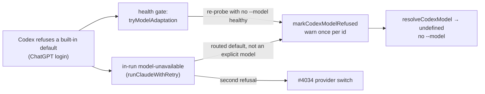

## Summary

On a ChatGPT-login Codex host, a built-in default model the login refuses (today the cheap tier `gpt-6-luna`) no longer fails the phase. The worker marks the id refused for the run and omits `--model`, so the Codex CLI picks its own model; it mirrors DeepSeek's tier adaptation (#2059). Closes #4221.

Version bump: no `VERSION` change in this diff.

## Spec

### Intent and Rationale

- A ChatGPT login refused `gpt-6-luna` and the phase failed, forcing a provider switch; adapting on the same provider keeps the cheap, working path.
- Same shape as DeepSeek's adaptation: a run-scoped refused set consulted by the resolver, driven by the health gate and, new here, by an in-run retry.

### Essential Design Decisions

- "No `--model`" travels through the existing string seam as the sentinel `CODEX_CLI_DEFAULT_MODEL`, which `buildCodexArgs` drops; no new probe parameter.
- The in-run retry is a new optional descriptor hook, `adaptAfterModelRefusal`, implemented only by Codex, so DeepSeek's in-run behaviour is unchanged. It runs only when the model came from phase routing (`!currentOptions.model`): an explicit request model is never dropped.
- ChatGPT detection needs an explicit `CODEX_HOME` (twin of the billing probe `resolveStoredBilling`, kept in agreement by a test); a login in the CLI's default `$HOME/.codex` is not detected, so those hosts keep today's behaviour.
- `tryModelAdaptation` now uses the injected `agentHealthCheck` and `env` (production defaults are unchanged), which is what makes it testable.

### Undiscoverable Facts

- The live confirmation of which ids a ChatGPT login accepts is tracked separately in #4166.
- This sandbox exports `VIBE_IMAGE_AGENT_PROVIDERS=claude`, so Codex runner tests were run with `env -u VIBE_IMAGE_AGENT_PROVIDERS`.

## Evidence

Backend only (no UI file touched). Tests in `worker/deno/tests/codex_model_adaptation_test.ts`; the real `codex exec` refusal shape (`turn.failed`, exit 1) is copied from `worker/deno/tests/claude_runner_provider_fallback_4034_test.ts`.

**Docs sweep** — grep: `alternativeModels`, `applyModelAdaptation`, `gpt-6-luna`, `Refus\w* .*model`, `no-ladder`, `2059`; section: `docs/MODEL-AND-CACHING.md#-codex-per-phase-routing`; siblings: `deepSeekAlternativeModels`, `applyDeepSeekModelAdaptation`, `providerAfterModelRefusal`; updated: `docs/MODEL-AND-CACHING.md`, `docs/PROVIDER-PARITY.md`; `docs/MODEL-AND-CACHING.md:1331` — still true because Model Fallback on Rate Limit concerns the `cheaperModel` ladder, which Codex still lacks.

Related existing rules checked: the #4034 bullet in `docs/MODEL-AND-CACHING.md` and `docs/PROVIDER-PARITY.md` (both updated to say the Codex retry comes first); the DeepSeek adaptation doc on `alternativeModels`/`applyModelAdaptation` in `agent_provider.ts` (widened, still true). Rule applied to this PR's own diff: nothing found.

Issue numbers cited (each looked up with `gh issue view`): #4034: Fall back to agent_provider_fallback when a phase run's model is refused; #2059: Adapt DeepSeek phase routing when a probed tier is unavailable; #4019: Codex ChatGPT account rejects the worker's default models (gpt-5-mini, gpt-6-luna) with 400; #4166: Live Codex subscription validation and PROVIDER-FEASIBILITY.md corrections (follow-up to #3647).

## Reproduction

- **symptom** — `The 'gpt-6-luna' model is not supported when using Codex with a ChatGPT account` fails the phase and forces a provider switch.
- **status** — `partial` — reason: the refusal is simulated with a stub `codex` binary emitting the recorded `turn.failed` JSONL; no real ChatGPT login was available. The new tests were not run against the unfixed base (they import symbols the base lacks), but the stub test goes red on base behaviour by construction: at base the second call never occurs and the run switches provider at once.
- **regression test** — `worker/deno/tests/codex_model_adaptation_test.ts::runClaudeWithRetry - a refused built-in default is retried once without --model (Issue #4221)`

## Acceptance Criteria

<!-- vibe-spec-review inputs="diff+issue-body" -->

- **met** — On a ChatGPT login, once `gpt-6-luna` is marked refused, `resolveCodexModel("health")` returns `undefined` and `buildCodexArgs` emits no `--model`. — evidence: `worker/deno/tests/codex_model_adaptation_test.ts::Codex refused built-in default - a refused id drops --model only for its own phase (Issue #4221)` — reviewer: met
- **met** — An explicit pin to a refused id (`CODEX_MODEL_HEALTH`, `codex_phase_model_overrides`, `codex_model`, `CODEX_MODEL`) is still sent as `--model`. — evidence: `worker/deno/tests/codex_model_adaptation_test.ts::Codex refused built-in default - explicit pins still send a refused id (Issue #4221)` — reviewer: met
- **met** — In api-key mode, the refused set is never consulted, and behaviour is byte-identical to today. — evidence: `worker/deno/tests/codex_model_adaptation_test.ts::Codex refused built-in default - an api-key login never adapts (Issue #4221)` and `::runClaudeWithRetry - an api-key login is not adapted and switches provider (Issue #4221)` — reviewer: met
- **met** — A health probe refused with `model-unavailable` on a Codex built-in default adapts to the CLI default and does **not** trigger the provider fallback when the re-probe is healthy. — evidence: `worker/deno/tests/codex_model_adaptation_test.ts::Codex refused built-in default - the health gate adapts only on a healthy probe (Issue #4221)` — reviewer: met
- **met** — An in-run `model-unavailable` on a built-in default retries once on Codex without `--model` before switching provider. A second refusal falls through to the existing #4034 switch. — evidence: `worker/deno/tests/codex_model_adaptation_test.ts::runClaudeWithRetry - a refused built-in default is retried once without --model (Issue #4221)` and `::runClaudeWithRetry - a second refusal falls through to the provider switch (Issue #4221)` — reviewer: met
- **met** — Exactly one warning per refused id per run, naming the id, the phase and the override knob. — evidence: `worker/deno/tests/codex_model_adaptation_test.ts::Codex refused built-in default - the refusal warning is printed once per model (Issue #4221)`; the in-run retry line is now `info`, not a warning — reviewer: partial — reason: the first spec review counted the retry log as a second warning; it was changed to `info` level afterwards and `::runClaudeWithRetry - a refused built-in default is retried once without --model (Issue #4221)` asserts it is not at `warn`
- **unrequested** — `tryModelAdaptation` uses the injected health check and `env` — reviewer: unrequested — reason: gives the health-gate criterion a test through the real method; production defaults are unchanged
- **unrequested** — new optional descriptor hook `adaptAfterModelRefusal` — reviewer: unrequested — reason: the in-run bullet needs a Codex-only seam so DeepSeek's in-run behaviour is not changed

## Standards Review

<!-- vibe-standards-review inputs="diff+CODING-STANDARDS.md" -->

- **violation** — `clearRefusedCodexModels` read only by tests — evidence: `worker/deno/lib/codex_executor.ts:230` — reason: fixed in this diff (called in `createProductionRunCoreDeps`, tested by "a fresh worker run forgets the refused models")
- **violation** — `isCodexChatgptLogin` twins `resolveStoredBilling` with no agreement test — evidence: `worker/deno/lib/codex_executor.ts:219` — reason: fixed in this diff (agreement test over ChatGPT, api-key, absent and no-home fixtures)
- **violation** — untested branch outcomes (`has(id)` early return, `phase &&` and `size > 0` operands, phase-less guard) — evidence: `worker/deno/lib/codex_executor.ts:189` — reason: fixed in this diff (two removed, the rest covered with red-checked tests)
- **violation** — stale comment "A refusal is terminal for the provider" — evidence: `worker/deno/lib/claude_runner.ts:3407` — reason: fixed in this diff
- **violation** — list item 5 continuation ran on in the rendered doc — evidence: `docs/MODEL-AND-CACHING.md:1101` — reason: fixed in this diff
- **clean** — Australian English, no existing test edited, restated rule agrees across both docs, no persisted-shape change, no workflow change

## Test Plan

- Added `worker/deno/tests/codex_model_adaptation_test.ts` (15 tests); no existing test was edited, so no assertion was removed.
- Ran `env -u VIBE_IMAGE_AGENT_PROVIDERS deno task test:unit` on the new file plus `codex_phase_routing_test.ts`, `claude_runner_provider_fallback_4034_test.ts`, `agent_provider_deepseek_test.ts`, `model_fallback_test.ts`, `run_core_production_deps_test.ts`: 123 passed, 0 failed. `run_core_test.ts`: 79 passed.
- Red checks (each mutation applied then restored): drop `isCodexChatgptLogin(env)` → api-key test red; drop `codexBuiltInDefaultModel(...) === model` → explicit-pins test red; start the retry "already adapted" → retry and second-refusal tests red; drop the warning dedup → once-per-model test red; drop the `"health"` phase in `tryModelAdaptation` → health-gate test red; drop `applyModelAdaptation` there → health-gate test red; drop the factory `clearRefusedCodexModels()` → fresh-run test red; drop `size > 0` → CODEX_HOME-read test red; drop `if (!phase)` → phase-less test red (runtime, `--no-check`); `isCodexChatgptLogin` → `false` → billing-twin test red; drop `!currentOptions.model` → explicit-model test red; retry log back to `warn` → retry test red; refused branch returns the model → drop test red; drop the login check in `codexAlternativeModels` → api-key tests red; drop the built-in comparison there → api-key test red (after adding the `gpt-6.1-sol` assertion); drop the empty-alternatives guard in `adaptCodexAfterModelRefusal` → api-key, phase-less and runner tests red; drop the sentinel operand in `buildCodexArgs` → sentinel test red; drop `if (!home) return false` → "an absent CODEX_HOME reads no auth.json" test red (it scoped-patches `Deno.readTextFileSync` and restores it in `finally`; `parallel_safety_cap_test.ts` still passes).
- Full `./quality.sh`: every stage passed except `deno tests`, where `completion_phase_repo_formatters_test.ts` ("an unformatted Rust change is formatted and committed", "cargo fmt stages only the branch's .rs files") fails; it fails identically on the base commit `ffdc31c9` in a clean worktree, so it is not caused by this change. The serial test pass did not run because of it.
- Twinned rule: `isCodexChatgptLogin` and the Codex `resolveStoredBilling`; the agreement test above fails if they disagree.

<!-- vibe-branch-outcomes -->

## Not done / risks

- A ChatGPT login stored only in the CLI's default `$HOME/.codex` (no `CODEX_HOME`) is not detected, so those hosts are unchanged.
- The health gate calls `tryModelAdaptation` on any non-auth failure, as for DeepSeek; a transient failure followed by a healthy CLI-default probe would also drop `gpt-6-luna` for the run.
- `run_core_production_deps.ts` `checkClaudeHealth`/`recheckAgentAuth` still use the process environment; left alone.
