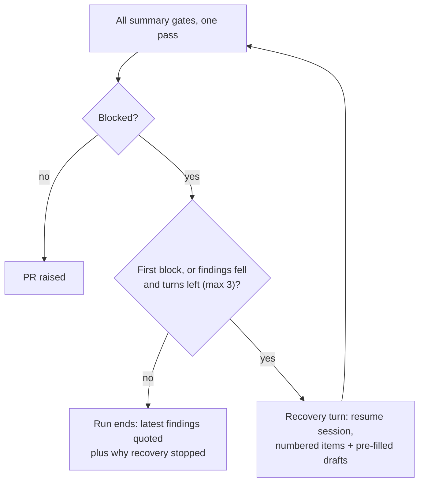

## Summary

Completion-gate findings no longer cost a run its only recovery turn. Every
summary gate is evaluated in one pass and its findings go to the agent together;
the in-run recovery is a bounded loop (up to `OPERATIONAL_DEFAULTS.summaryGateRecoveryTurns`,
default 3) that grants a further turn only while the number of blocking findings
strictly falls, resumes the agent's own session, clamps each turn to the run's
time budget, and hands the agent worker-generated drafts of the boilerplate the
gates demand. The pre-PR verifier is given its earlier findings and the agent's
reply, and a first-time finding on a line the PR did not change is advisory on a
retry unless critical or high. `deno task pr-summary-check` now also runs the
removed-assertion gate and the claim check, with an opt-in `--verifier`, and a
drift test keeps it in step with the completion phase. Fleet telemetry records
first-attempt failures per gate. Closes #4234. Version bump: `VERSION` is not
touched by this change; the merged commit records the final version.

## Spec

### Intent and Rationale

- The base already folded the late verdicts into the first block, but the closure, review and reproduction gates still returned one at a time, and a run got one turn; a rewritten summary then raised new findings on the second pass and the run failed. One pass over all gates plus a bounded, progress-gated loop removes both causes.
- The loop generalises the Issue #4146 unmet-criteria rounds rather than adding a second mechanism: `shouldRunRecoveryTurn` in `worker/deno/lib/gate_recovery_loop.ts` is the single decision, used by `workOnIssueCompletion` and `reportSummaryRuleBlock`.

### Essential Design Decisions

- Progress is the count of blocking findings (each gate's own problem count; unmet criteria and standing violations add to it), strictly falling. Equal stops the run. The first block always gets its turn.
- Retries converge by reusing the existing `earlierFindings` verdict mechanism (previous findings in, a verdict per finding out); demotion to advisory applies only to findings the previous pass did not raise, on unchanged lines, below severity high, and fails closed on any path or diff it cannot place.
- The turn clamp uses the existing supervisor hard-cap ceiling, injected through `InfrastructureDeps.runHardCapCeilingMs` so tests mutate no process state. Issue #4224's 2 h deadline has not landed (`gh issue view 4224`), so it is not described as present.
- Persisted shape: the fleet-telemetry sidecar reads the old shape (absent gate counters read as empty or zero); a test seeds a pre-change file. The key was not bumped.

### Undiscoverable Facts

- A trusted issue comment says Issue #4236 (verifier and claim-check findings treated like a reviewer's requested changes) is separate and still open (`gh issue view 4236`, state OPEN); this PR keeps such findings as run-blocking recovery items.
- The issue body's `## Acceptance` heading does not match the closure gate's heading pattern, so the closure, independent-review and unmet-criteria gates are not applicable to this issue; the two independent reviews were run anyway and their outcome is recorded below.
- Not delivered: a calendar-weekly reset of the gate counters (the fleet-summary and `[gate-failure-rate]` figures cover the current run window; the sidecar totals are cumulative, so a weekly figure is the difference of two readings), and the "under 10 per fortnight" target, which is an outcome measure.

## Evidence

Issue numbers cited in added text, each looked up with `gh issue view`: #4236: Treat pre-PR verifier and claim-check findings like a reviewer requesting changes; #4224: Run timeline: aim for 1 h, finish active work until 2 h; #4146: Unmet acceptance criteria block the PR; #3324: First-run claim check catches a wrong PR-summary sentence but the PR ships with it; #3865: Prose claim check flags a wrong manual sentence on the last pre-PR attempt; #3395: Run an execution-capable pre-PR verifier; #3257: First-run PR summaries describe named code wrongly; #2189: Acceptance-criteria closure gate fails a quarter of this host's runs; #3163: Docs-sweep gate does not stop PRs it rejects; #3131: Removed-assertion rule is prose only; #3795: coverage carry-over; #3393: diff-scoped mutation check; #3382: Standing-violation refusal routed to a turn that may not change code; #3423: give the agent a deno task that runs the PR-summary gates; #4147: stale stream-session resume.

**Docs sweep** — grep: `summaryGateRecoveryTurns`, "recovering once in-run", "removed-assertion gate or the claim check", `MAX_UNMET_CRITERIA_ROUNDS`, "one recovery turn", "single recovery"; section: `docs/workflows/issue-processing.md#the-in-run-recovery-from-a-summary-rule-block`; siblings: `shouldContinueUnmetCriteria`, `securityGateBlocks`; updated: `docs/workflows/issue-processing.md`, `docs/INTERNALS.md`, `DESIGN-PRINCIPLES.md`, `CODING-STANDARDS.md`, `prompts/issue/prompt.md`, `prompts/pr_feedback/prompt.md`, `prompts/ci_fix/prompt.md`, `docs/mutation-check.md`, `docs/coverage-carryover-check.md`; `docs/workflows/issue-processing.md:481` — still true because it names the duplicate-PR recovery path, not this loop; `CODING-STANDARDS.md:2170`, `docs/mutation-check.md:80`, `docs/INTERNALS.md:5680`, `prompts/pr_feedback/prompt.md:189` and `worker/deno/lib/pr_feedback_drift_check.ts:72` — still true because they describe the PR-feedback drift check's one recovery turn (Issue #3143), which this change does not touch; `worker/deno/lib/result_placeholder_gate.ts:28` and `worker/deno/lib/docs_sweep_gate.ts:331` — still true because they say one turn's prompt asks for every folded gate together, which holds per turn; `worker/deno/lib/result_placeholder_gate.ts:348` — still true because it logs a different recovery, the reply-path placeholder retry (Issue #3124).

Rule applied to this PR's own diff: the new prose rules ("one pass", "a further turn only while findings fall", "each blocked gate is one REQUIRED ITEM") were grepped across `git diff dca0de36` and the related existing rules in `CODING-STANDARDS.md`, `DESIGN-PRINCIPLES.md` and the three prompts; the reviewers' findings (a "one pass" claim the code did not yet meet, per-gate rather than per-finding counts, a claim-correction exit that cut the loop short) were fixed in this diff.

Fakes: the completion harness (`worker/deno/tests/support/completion_summary_harness.ts`) stands in for `WorkerDeps`; the scripted verifier and claim check mirror `runPrePrVerifier` and `runSummaryClaimCheck` results, whose real parsing is covered by `worker/deno/tests/pre_pr_verifier_3395_test.ts` and the claim-check tests.

## Reproduction

- **symptom** — a run whose summary gates block in two waves gets one recovery turn; the second block (verifier and claim check after the rewrite) fails the run with `failed-once`.
- **status** — `partial` — the loop tests stub the gates and agent; they could not be run against the unfixed code because they import modules this change introduces, so a red run against the base branch was not observed.
- **reason** — the base behaviour ("a second block ends the run") is pinned by the pre-existing `worker/deno/tests/completion_phase_summary_rule_retry_test.ts` cases, which still pass unchanged, and by `worker/deno/tests/completion_phase_gate_recovery_4234_test.ts::gate recovery - a block whose count did not fall after the first turn fails the run (Issue #4234)`.
- **regression test** — `worker/deno/tests/completion_phase_gate_recovery_4234_test.ts::gate recovery - a count that falls each turn keeps the run going to a PR (Issue #4234)`

## Independent review

Two independent reviewers ran on the diff; their findings were fixed in this diff and the reviewers re-run once.

- Spec reviewer, second round: items 1-4 of Required behaviour and the first four Acceptance bullets `met`; item 5 `partial` (retry was detected only from earlier verifier findings, fixed to include a recovery turn already spent and a failed-attempt label); the weekly tracking line `partial` (no calendar-week reset: stated above, not delivered); the fortnightly target `missing` (outcome measure, not demonstrable from a diff).
- Standards reviewer, second round: 8 violations, all addressed in this diff (parallel-safety env mutation replaced by an injected seam, test-only registry field removed, configured failed-attempt labels, author-guard tests, symlink-safe summary path resolution, single shared fence helper, two stale doc claims, claim-correction exit that cut the loop short). The third pass was not re-run after those fixes; the targeted tests and the quality gate below were.

## Test Plan

- `worker/deno/tests/gate_recovery_loop_test.ts` — the progress, turn-limit and runway-clamp decisions, each boundary with its sibling.
- `worker/deno/tests/completion_phase_gate_recovery_4234_test.ts` — all gates in one prompt (including closure, review and reproduction together), blocks-then-less-then-passes raises the PR in the same run, a count that stops falling ends the run quoting the latest findings and why, the turn limit, an existing PR not finalised while the count falls, per-problem claim counts, the agent reply reaching the verifier, retry detection by each operand, advisory demotion, the label and author guards, the claim-correction exit, prefill reaching the prompt, telemetry and the `[gate-failure-rate]` log line.
- `worker/deno/tests/summary_rule_gate_retry_4234_test.ts` — turn number, fenced pre-filled draft, session resume, clamped timeout, skipped turn.
- `worker/deno/tests/verifier_convergence_test.ts`, `worker/deno/tests/summary_gate_prefill_test.ts` (one hostile-input case per pattern), `worker/deno/tests/pre_pr_verifier_3395_test.ts` (severity, agent reply block).
- `worker/deno/tests/pr_summary_check_test.ts`, `worker/deno/tests/pr_summary_gate_registry_test.ts` (behavioural drift test over a maximal-blocking completion run), `worker/deno/tests/removed_assertion_input_test.ts`.
- `worker/deno/tests/fleet_telemetry_test.ts`, `worker/deno/tests/fleet_telemetry_sidecar_test.ts` (old-shape sidecar), `worker/deno/tests/fleet_telemetry_redaction_test.ts`.
- Edited expectations in existing tests: `worker/deno/tests/pr_summary_check_test.ts::parseArgs - accepts all flags and one summary file` now expects the three new fields and still goes red if parsing breaks; `worker/deno/tests/completion_phase_unmet_criteria_4146_test.ts` reads `OPERATIONAL_DEFAULTS.summaryGateRecoveryTurns` (3) in place of the removed `MAX_UNMET_CRITERIA_ROUNDS` (3) and still fails when the turn limit is not enforced. No assertion was removed from an existing test: the moved helpers in `worker/deno/tests/completion_phase_summary_rule_retry_test.ts` live on in `worker/deno/tests/support/completion_summary_harness.ts` with byte-identical fixtures.
- Twinned rule: `pr_summary_check.ts` and the completion phase share `readRemovedAssertionInput` and the gate registry; the drift test fails when they disagree. Callers checked for the changed `InfrastructureDeps` (production and mock only) and for `recoverFromSummaryRuleBlock` (`workOnIssueCompletion` loop, the one caller).

<!-- vibe-branch-outcomes -->
