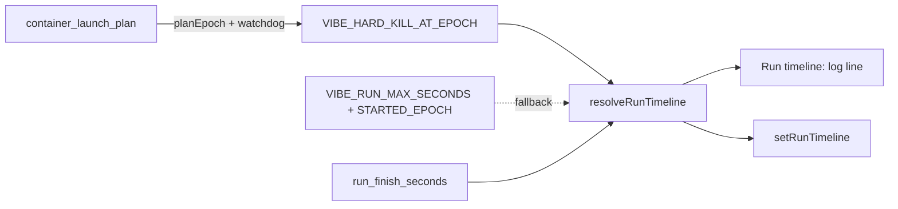

## Summary

Gives the worker one source of truth for the run's three deadlines (1 h target, 2 h finish, 3 h hard kill) and logs all three at run start. Closes #4242.

- New `worker/deno/lib/run_timeline.ts`: pure `resolveRunTimeline`, helpers (`pastTarget`, `pastFinish`, `remainingToFinishMs`, `clampToFinishMs`), `describeRunTimeline`, and a process-wide `setRunTimeline` / `getRunTimeline` / `resetRunTimelineForTests`.
- Hard kill: `VIBE_HARD_KILL_AT_EPOCH`, else the `run_hard_cap.ts` pair, else `null` with a reason. A malformed value is warned about (quoted) and then falls back.
- `buildContainerLaunchPlan` passes `VIBE_HARD_KILL_AT_EPOCH = planEpochSeconds + watchdogSeconds`; `planEpochSeconds` is a required input and `commands/container_launch_plan.ts` supplies the clock.
- New `run_finish_seconds` setting (default 7200); `loadConfig` rejects a non-finite value or one at or below the 3600 s target. Documented in `docs/CONFIGURATION.md`.
- `runCoreLoop` resolves and publishes the timeline and logs `Run timeline: target=<ISO> finish=<ISO> hard-kill=<ISO | none (reason)>`.

Version bump: `VERSION` is not touched by this change.

## Spec

### Intent and Rationale

- Deadlines were scattered (run duration constant, supervisor cap pair, launcher watchdog); one resolver gives later work a single place to read them.
- The hard kill reuses `resolveRunHardCap` for the fallback rather than a second parser; `parsePlausibleEpochSeconds` was extracted from it and both old callers use it.

### Essential Design Decisions

- The finish is clamped at `hardKill − (claude_kill_after + WIP_CHECKPOINT_RESERVE_SECONDS)`, not hardKill minus the WIP reserve alone: it reuses `run_hard_cap.ts`'s existing reserve so the worker's own kill still lands before the launcher's. This is a deliberate departure from the issue's wording.
- `loadConfig` compares against the constant target (3600 s) because `runDurationSeconds` is not configurable today; if it becomes configurable the comparison must follow it.
- The accessor (`getRunTimeline`) and the clamp helpers have no production reader yet: the issue names them as the API, and the issue's "chokepoints read the timeline" is not wired in this change because applying a clamp changes run behaviour that no acceptance criterion asks for. With no timeline set, or with a timeline nobody reads, nothing is clamped (today's behaviour).
- `RunCoreDeps.env` absent means no environment is read, so tests never inherit the host's `VIBE_HARD_KILL_AT_EPOCH`; production passes its real reader.

### Undiscoverable Facts

- The plan-time epoch precedes the watchdog's start (an image build can run in between), so the worker's view of the hard kill is the earliest the kill could land.
- The sandbox the gate ran in has a container image with only the `claude` provider and no Rust toolchain; unrelated deno tests fail there on that (see Test Plan).

## Evidence

Backend/CLI change only; evidence is the tests below.

**Docs sweep** — grep: `VIBE_RUN_STARTED_EPOCH`, `Run hard cap`, `min_claim_runway_seconds`, "five variables", `watchdogSeconds`; section: `docs/CONFIGURATION.md#️-the-cycle-deadline-model` and the `run_finish_seconds` table row; siblings: `min_claim_runway_seconds`, `claude_kill_after` (config keys), `VIBE_RUN_MAX_SECONDS`, `VIBE_RUN_STARTED_EPOCH` (env vars); updated: `docs/CONFIGURATION.md`, `docs/DEPLOYMENT.md`; `docs/audits/security-sweep-1217-env-config-secrets.md` — still true because it is a historical audit record; `docs/CONFIGURATION.md` "Run hard cap" mentions — still true because that log line is unchanged.

Production implementation relied on by the launcher-parity test: `worker/deno/commands/container_launch_plan.ts` (`buildLaunchPlanForCommand`), exercised through `run.sh` and `run.ps1` with the existing stub harness.

## Acceptance Criteria

<!-- vibe-spec-review inputs="diff+issue-body" -->

- **met** — By default `resolveRunTimeline` gives target = start + 3600 s and finish = start + 7200 s. Hard kill comes from `VIBE_HARD_KILL_AT_EPOCH`, else from the run-hard-cap pair, else it is `null` with a stated reason (unit tests for each case). — evidence: `worker/deno/tests/run_timeline_test.ts::resolveRunTimeline - defaults put the target at start+1h and the finish at start+2h`, `…the watchdog variable wins over the supervisor pair…`, `…falls back to the supervisor pair`, `…with neither source the hard kill is null…` — reviewer: met
- **met** — A malformed `VIBE_HARD_KILL_AT_EPOCH` is logged at warn level, quoting the value, and is never silently ignored (unit test). — evidence: `worker/deno/tests/run_timeline_test.ts::resolveRunTimeline - a malformed watchdog value is warned, quoted, and falls back to the pair`; `worker/deno/tests/run_core_run_timeline_test.ts` — reviewer: met
- **met** — The container launch arguments carry `VIBE_HARD_KILL_AT_EPOCH`; a launch-plan test asserts it. — evidence: `worker/deno/tests/container_launch_test.ts::buildContainerLaunchPlan - hands the launcher watchdog's kill instant to the worker`; `worker/deno/tests/launcher_parity_test.ts` (both launchers pass it through the command) — reviewer: partial — reason: the reviewer saw that `buildLaunchPlanForCommand`'s call site had no test; `planEpochSeconds` is now a required input (a dropped call fails the type check) and `launcher_parity_test.ts` asserts each launcher's real command output carries the arg
- **met** — `loadConfig` rejects `run_finish_seconds` ≤ `runDurationSeconds` (unit test). — evidence: `worker/deno/tests/config_test.ts::config - run_finish_seconds equal to the one-hour target is rejected (Issue #4242)` — reviewer: met
- **met** — The run-start log names all three deadlines (test with an injected clock). — evidence: `worker/deno/tests/run_core_run_timeline_test.ts::run_core - run timeline logs target, finish and the watchdog hard kill (Issue #4242)` — reviewer: met
- **partial** — `deno task test:unit` for the new and touched tests passes; `./quality.sh` passes. — evidence: touched tests pass under `deno task test:unit`; the full gate's remaining failures are environmental (see Test Plan) — reviewer: missing — reason: CI not yet verified — remaining: merge-verification-only (the read-only reviewer said it "did not run" the gate)
- **unrequested** — `docs/DEPLOYMENT.md` row, `vibe_env_registry.ts` entry, `claudeKillAfterSeconds`/`env` plumbing on `RunCoreConfig`/`RunCoreDeps`, `parsePlausibleEpochSeconds` extraction — reviewer: unrequested — reason: each is required by an existing check or by the resolver's inputs (env registry test, deployment env table, kill-grace input, no ambient env)

## Standards Review

<!-- vibe-standards-review inputs="diff+CODING-STANDARDS.md" -->

- **violation** — `RunCoreDeps.env` optional fell back to the host environment — evidence: `worker/deno/lib/run_core.ts:5764` — reason: fixed in this diff (absent means no environment is read)
- **violation** — timeline warnings fell back to `logError` — evidence: `worker/deno/lib/run_core.ts:5766` — reason: fixed in this diff (falls back to `deps.log`)
- **violation** — `commands/container_launch_plan.ts` call site untested — evidence: `worker/deno/commands/container_launch_plan.ts:339` — reason: fixed in this diff (`planEpochSeconds` now required; `launcher_parity_test.ts` checks the real output)
- **violation** — production wiring of `runFinishSeconds`, `claudeKillAfterSeconds`, `env` untested — evidence: `worker/deno/lib/run_core_production_deps.ts:1598` — reason: fixed in this diff (two tests in `run_core_production_deps_test.ts`, each red when its line is reverted)
- **violation** — non-finite `run_finish_seconds` branch untested and refusal test not rule-specific — evidence: `worker/deno/lib/config.ts:674` — reason: fixed in this diff (1e999 test, specific message assertions)
- **violation** — docs overstated "none" and "3 h" — evidence: `docs/CONFIGURATION.md:1891` — reason: fixed in this diff
- **violation** — accessor and helpers without a production reader — evidence: `worker/deno/lib/run_timeline.ts:54` — reason: required by #4242 (the issue names `pastTarget`, `pastFinish`, `remainingToFinishMs`, `clampToFinishMs`, `setRunTimeline`/`getRunTimeline` and a test-only reset as the API)
- **clean** — no assertion removed from an existing test; Australian English; no hidden paths staged; check-where-you-insert (no hunk splits a doc comment from its item)

## Test Plan

- `worker/deno/tests/run_timeline_test.ts` (new, 19 tests), `worker/deno/tests/run_core_run_timeline_test.ts` (new, 7), `worker/deno/tests/config_test.ts` (5 added), `worker/deno/tests/container_launch_test.ts` (2 added), `worker/deno/tests/run_core_production_deps_test.ts` (3 added), `worker/deno/tests/launcher_parity_test.ts` (hard-kill arg checked per launcher, then normalised for the comparison; no assertion removed), plus `planEpochSeconds` added to the input helpers of 7 container test files.
- Removed assertions: none. The "five variables" wording changed in a comment of `worker/deno/tests/claim_runway_config_test.ts`.
- Red checks (each break applied alone, test run, then restored): planEpochSeconds `isFinite` operand removed → container_launch refusal test red; `<=` → `<` target check → config rejection test red; finite check forced false → Infinity test red; `logWarn ?? logError` → run_core warn test red; clamp comparison disabled → timeline clamp test red; production `runFinishSeconds`, `claudeKillAfterSeconds` and `env` lines each reverted → production-deps tests red. The `deps.env` absent fallback is exempt (see facts file): proving it needs `Deno.env` mutation, which `parallel_safety_cap_test.ts` forbids.
- Callers and siblings of the new required `planEpochSeconds` checked: `commands/container_launch_plan.ts` (clock), `lib/tabletop_container_runner.ts` (clock), seven test input helpers (fixed epoch). New `RunCoreConfig` fields: `createDefaultRunCoreConfig`, `run_core_production_deps.ts`; test literals spread the default.
- Gate: `./quality.sh` on the final head: every stage passed except `deno tests` (29751 passed, 10 failed) and the skipped `config integration` and `checkov` stages (tool not available in the sandbox). The same 10 tests fail identically on the unmodified milestone branch (run in a detached worktree of the base: `FAILED | 85 passed | 10 failed`): they report the `codex`/`deepseek` provider not installed in the sandbox image, or need a Rust toolchain. This change had introduced three other failures (lib-sweep ledger, parallel-safety cap, launcher parity); all fixed.

<!-- vibe-branch-outcomes -->
