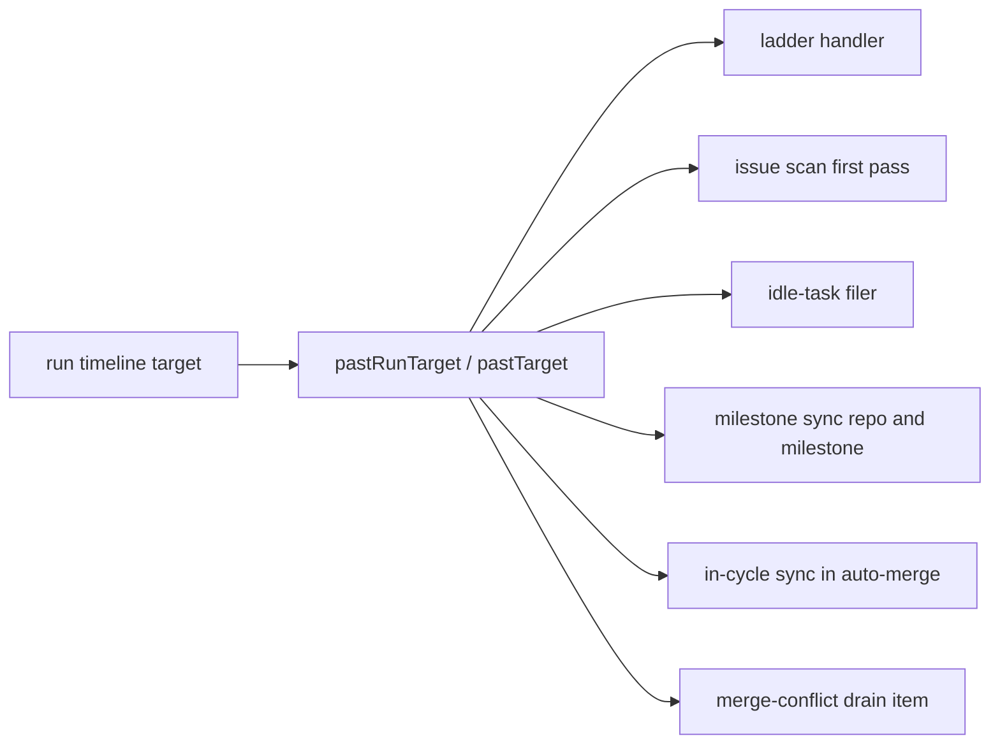

## Summary

After the run's one-hour target nothing new starts: no ladder handler, slot claim, idle task, milestone-sync attempt or merge-conflict drain item. Work already running is not interrupted. Closes #4243.

- `run_timeline.ts`: new `pastRunTarget(now)`, which reads the process-wide timeline and is `false` when none is set (nothing refuses).
- `run_core.ts`: the Priority ladder checks `timeline.pastTarget(deps.now())` before each dispatch and, past it, logs one `stop reason=deadline — <handler> and any after it defer to the next cycle.` line and stops. The issue scan's deadline gate now applies on the first pass too, because the ladder can cross the target between the outer loop's check and the scan. The idle-task filer is refused past the target (one `reason=past_run_target` line, no permit spent, no hooks run) on both the outer-cycle and slot paths.
- `merge_conflict_drain.ts`: the drain starts no further resolution past the target, with one line, reported as a `deadline` stop so the deferral tracking treats it like a deadline.
- `milestone_branch_sync.ts`: no further repository or milestone is started past the target, with one line; the sync cursor still resumes there next cycle, and the #2215 "pass incomplete" line is not repeated for a target stop.
- `pr_auto_merge.ts`: the Auto-Merge sweep's in-cycle milestone sync is deferred past the target (one line); the PR is still armed. `EnableAutoMergeOptions` gained a `now` clock seam.
- Three existing tests had an injected watchdog clock that ran past the target; they now stop it one millisecond short (or, where the wedged handler is the subject, let only that handler cross it).
- Docs: `docs/CONFIGURATION.md`, `docs/workflows/merge-conflicts.md` and `docs/IDLE-TASK-FRAMEWORK.md`.

Version bump: `VERSION` is not touched by this change.

## Reproduction

- **symptom** — past the run's one-hour target the ladder, issue scan, idle-task filer, milestone sync and merge-conflict drain still started new work
- **status** — `partial` — each new gate was observed red by disabling it in place (see Branch outcomes: `if (false)`, restoring the old `iteration > 0 &&` skip, deleting the log call); the new tests were not run against a checkout of the base commit, where they cannot compile because `pastRunTarget` does not exist
- **reason** — the fail-before observation was by in-place gate mutation, not against the unfixed commit
- **regression test** — `worker/deno/tests/run_core_after_target_test.ts::run_core after target - a ladder handler reached past the target is never dispatched and one deadline line names it (Issue #4243)`

## Spec

### Intent and Rationale

- The target is a start gate only. Every gate sits between units of work, never inside one, so a handler, claim, sync or resolution already running is left to finish under its own budget.
- Past the target each refusal logs one line that says what was deferred, so an operator can tell a refusal from an empty queue.

### Essential Design Decisions

- The Priority 2 slot pool already refuses past `endTime`, which equals the target for the default run, so it is pinned by the one-slot and two-slot tests rather than changed. The maintenance lane has the same `endTime` check (`cycle deadline reached`, `run_core.ts:3512`); it is unchanged and no test added here pins it.
- The issue scan's first-pass skip was dropped: the first pass is no longer in time by construction once the ladder can cross the target.
- A milestone-sync target stop reuses the #2215 cursor rather than a second mechanism.
- The drain's target stop reuses the `deadline` outcome, as the issue asks, instead of a new stop reason.

### Undiscoverable Facts

- Existing watchdog tests modelled a timer by adding its whole budget to the clock, which now carries the clock past the target and defers every handler after the first agent-backed one; that is why three existing test files changed.

## Evidence

Backend change only; evidence is the tests below.

**Docs sweep** — grep: `too little of the cycle`, `stopped for lack of budget`, `Milestone sync pass incomplete`, `In-cycle milestone sync`, `past_run_target`, `idle_capacity_used`, "Three bounds keep the drain"; section: `docs/CONFIGURATION.md#️-the-cycle-deadline-model`, `docs/workflows/merge-conflicts.md` (drain bounds table and pass-level stops), `docs/MERGE.md` (merge-conflict drain bullets), `docs/IDLE-TASK-FRAMEWORK.md` (filer latch); siblings: `idle_capacity_used` and `week_pace_engaged` (filer refusal reasons), the `cap` and `deadline` stop reasons of the drain; updated: `docs/CONFIGURATION.md`, `docs/workflows/merge-conflicts.md`, `docs/IDLE-TASK-FRAMEWORK.md`; `docs/MERGE.md` carries no change — still true because its drain bullet is about ruleset refusals; `docs/INTERNALS.md` mentions of "too little of the cycle" — still true because they describe the cycle budget, which is unchanged.

## Test Plan

- New: `worker/deno/tests/run_core_after_target_test.ts` (8 tests), `worker/deno/tests/milestone_sync_after_target_test.ts` (6), `worker/deno/tests/merge_conflict_drain_after_target_test.ts` (5), and two `pastRunTarget` tests in `worker/deno/tests/run_timeline_test.ts`.
- Removed assertions: none. The edits to `worker/deno/tests/agent_run_termination_test.ts`, `worker/deno/tests/handler_watchdog_scope_test.ts` and `worker/deno/tests/run_core_watchdog_test.ts` replace `now += ms;` clock lines (not assertions) with a clock that stops short of the target, add `shutdown?.()` in one `processIssue` stub, and reword comments.
- Gate: `./quality.sh` on the final head (run before the last summary-only edit): every stage passed except `deno tests` (parallel pass 29773 passed, 10 failed, 4 ignored; serial pass not run) and the skipped `config integration` and `checkov` stages. The 10 failures are in the seven files named under the last acceptance criterion; none mentions `run_timeline`, `pastRunTarget`, the drain, the milestone sync or `enableAutoMerge`. With `VIBE_IMAGE_AGENT_PROVIDERS` unset those files run 93 passed, 2 failed (the two `cargo fmt` tests; no Rust toolchain in the sandbox). The new and touched files (`run_core_after_target_test.ts`, `milestone_sync_after_target_test.ts`, `merge_conflict_drain_after_target_test.ts`, `run_timeline_test.ts`, `agent_run_termination_test.ts`, `handler_watchdog_scope_test.ts`, `run_core_watchdog_test.ts`) pass.

**Branch outcomes:**
- `worker/deno/lib/run_core.ts:6892` — ladder gate past the target: defers the handler and the rest with one line — `worker/deno/tests/run_core_after_target_test.ts::run_core after target - a ladder handler reached past the target is never dispatched and one deadline line names it (Issue #4243)` — flipped to `if (false)`, three tests went red
- `worker/deno/lib/run_core.ts:6892` — ladder gate before the target: handler dispatched — `worker/deno/tests/run_core_after_target_test.ts::run_core after target - a crossing mid-ladder lets the running handler finish and dispatches nothing after it (Issue #4243)` — the dispatched-once assertion; flipped past-target gate to `if (false)`, red
- `worker/deno/lib/run_core.ts:2856` — issue scan first pass past the target: no claim — `worker/deno/tests/run_core_after_target_test.ts::run_core after target - with one slot no new claim is taken past the target (Issue #4243)` — restored the old `iteration > 0 &&` skip, test went red
- `worker/deno/lib/run_core.ts:5287` — idle filer before the target: not refused — `worker/deno/tests/run_core_after_target_test.ts::run_core after target - the idle-task filer neither fires nor claims past the target, outer-cycle path (Issue #4243)` — flipped to always refuse (past-target outcome inverted to `return false`), both idle tests red
- `worker/deno/lib/run_core.ts:5288` — idle filer past the target: one `past_run_target` line — `worker/deno/tests/run_core_after_target_test.ts::run_core after target - the idle-task filer neither fires nor claims past the target, slot path (Issue #4243)` — deleted the log call, both idle tests red
- `worker/deno/lib/run_core.ts:4281` — slot idle path refuses past the target — `worker/deno/tests/run_core_after_target_test.ts::run_core after target - the idle-task filer neither fires nor claims past the target, slot path (Issue #4243)` — branch replaced with `false &&`, test went red
- `worker/deno/lib/run_core.ts:7100` — outer-cycle idle path refuses past the target — `worker/deno/tests/run_core_after_target_test.ts::run_core after target - the idle-task filer neither fires nor claims past the target, outer-cycle path (Issue #4243)` — branch replaced with `false`, test went red
- `worker/deno/lib/merge_conflict_drain.ts:431` — drain past the target: stops as a deadline, one line, no resolution — `worker/deno/tests/merge_conflict_drain_after_target_test.ts::merge-conflict drain after target - a clock past the target at drain start starts nothing` — flipped to `if (false)`, three tests went red
- `worker/deno/lib/merge_conflict_drain.ts:442` — no cycle deadline set: remaining time reported as 0 — `worker/deno/tests/merge_conflict_drain_after_target_test.ts::merge-conflict drain after target - a clock past the target at drain start starts nothing` — flipped `: 0` to `: 12345`; it stayed green, so the pass-summary assertion on `remainingMs` was added, and it then went red
- `worker/deno/lib/merge_conflict_drain.ts:431` — drain before the target and with no timeline: unchanged — `worker/deno/tests/merge_conflict_drain_after_target_test.ts::merge-conflict drain after target - before the target both PRs are resolved (control)` and `…with no timeline set the drain is unchanged (control)` — flipped the gate to `if (true)`, controls would resolve nothing; covered by the same gate flip going red on the in-flight test
- `worker/deno/lib/milestone_branch_sync.ts:1571` — repository gate past the target: no repository started, cursor saved at it — `worker/deno/tests/milestone_sync_after_target_test.ts::syncMilestoneBranches - past the run target no repository is started: no sync, no API call, one line, and the cursor resumes at the first repository (Issue #4243)` — flipped to `if (false)`, red
- `worker/deno/lib/milestone_branch_sync.ts:1669` — milestone gate mid-pass: in-flight sync finishes, next not started — `worker/deno/tests/milestone_sync_after_target_test.ts::syncMilestoneBranches - a sync already under way finishes when the target passes mid-pass, and the next milestone is not started (Issue #4243)` — flipped to `if (false)`, red
- `worker/deno/lib/milestone_branch_sync.ts:2577` — a target stop skips the #2215 line; a budget stop keeps it — `worker/deno/tests/milestone_sync_after_target_test.ts::syncMilestoneBranches - a budget stop with a cursor still logs the pass-incomplete line, and no target line (Issue #4243 control, Issue #2215)` — flipped `!stoppedForTarget` to `true`, the target-stop tests went red
- `worker/deno/lib/pr_auto_merge.ts:872` — in-cycle sync past the target: hook not called, one line, PR still armed — `worker/deno/tests/milestone_sync_after_target_test.ts::enableAutoMerge - past the run target the in-cycle sync is not called, one line is logged, and the child is still armed (Issue #4243)` — flipped to `if (false)`, red
- `worker/deno/lib/pr_auto_merge.ts:872` — in-cycle sync before the target: hook called once, no target line — `worker/deno/tests/milestone_sync_after_target_test.ts::enableAutoMerge - before the run target the in-cycle sync is called once and no target line is logged (Issue #4243 control)` — flipped to `if (true)`, red
- `worker/deno/lib/run_timeline.ts:218` — no timeline set: nothing is past the target — `worker/deno/tests/run_timeline_test.ts::pastRunTarget - with no timeline set, nothing has passed the target for any clock reading` — flipped `?? false` to `?? true`, red
- `worker/deno/lib/run_timeline.ts:218` — timeline set: true at and after the target, false before — `worker/deno/tests/run_timeline_test.ts::pastRunTarget - false just before the target, true at it and just after` — flipped the expression to `return false`, red

## Acceptance Criteria

<!-- vibe-spec-review inputs="diff+issue-body" -->

- **met** — With an injected clock past the target, each of these is tested separately and none starts: a ladder handler; a slot claim; an idle task; a milestone-sync attempt; a merge-conflict drain item. — evidence: `worker/deno/tests/run core after target test.ts::run core after target - a ladder handler reached past the target is never dispatched and one deadline line names it (Issue #4243); worker/deno/tests/run core after target test.ts::run core after target - with one slot no new claim is taken past the ta` — reviewer: met
- **met** — An iteration that starts before the target and crosses it mid-ladder dispatches no further handler (injected-clock test). — evidence: `worker/deno/tests/run core after target test.ts::run core after target - a crossing mid-ladder lets the running handler finish and dispatches nothing after it (Issue #4243)` — reviewer: met
- **met** — A handler or claim already running when the target passes is not interrupted (injected-clock test). — evidence: `worker/deno/tests/run core after target test.ts::run core after target - a handler already running when the target passes is not interrupted (Issue #4243); worker/deno/tests/run core after target test.ts::run core after target - a claim already running when the target passes finishes and its slot ta` — reviewer: met
- **met** — Each refusal logs exactly one line naming what was deferred. — evidence: `worker/deno/tests/run core after target test.ts::run core after target - with two slots no new claim is taken and each slot stops once (Issue #4243); worker/deno/tests/merge conflict drain after target test.ts::merge-conflict drain after target - with deferral tracking the refusal logs once and name` — reviewer: met
- **partial** — Tests and ./quality.sh pass. — evidence: `worker/deno/tests/run core after target test.ts, worker/deno/tests/milestone sync after target test.ts, worker/deno/tests/merge conflict drain after target test.ts, worker/deno/tests/run timeline test.ts` — reviewer: partial — reason: All new and touched test files pass, and fmt and lint are clean on the changed files. The full ./quality.sh run had 10 deno tests failures in 7 files this diff does not touch (sandbox: VIBE IMAGE AGENT PROVIDERS=claude , no Rust toolchain; they fail the same on main ), and the config integration and

## Standards Review

<!-- vibe-standards-review inputs="diff+CODING-STANDARDS.md" -->

- **clean** — Checked and found compliant: Australian English, TDD (a new test file per behaviour: run core, drain, milestone sync, timeline), fail-loud handling (a malformed hard-kill value is warned and quoted, not swallowed), the docs and the PR summary updated alongside the code, and an issue-numbered commit
