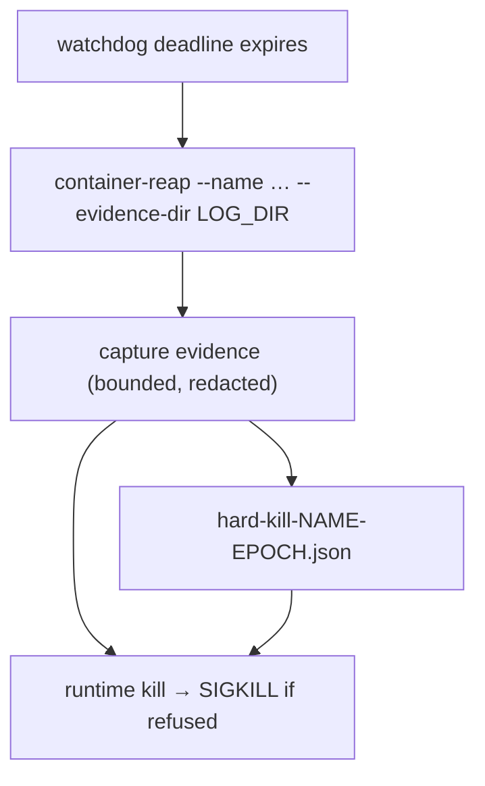

## Summary

Before the launcher watchdog reaps a wedged container, `container-reap` now
captures bounded, redacted evidence into `hard-kill-<container>-<epoch>.json` in
the host-visible worker log directory. `run.sh`'s `watchdog_reap_on_deadline`
passes that directory as the new `--evidence-dir` flag. Capture never fails the
reap. Closes #4253.

Version bump: not applicable; no `VERSION` file is touched by this change.

## Spec

### Intent and Rationale

- A hard-killed container destroyed the only record of why it wedged (#4225);
  the evidence has to be taken before the kill and written where the next launch
  can read it.
- The logic lives in a new `worker/deno/lib/hard_kill_evidence.ts` driven
  through injected seams, so the reaper's fake `ReapDeps` can simulate a wedge
  without a runtime.

### Essential Design Decisions

- Text is redacted (`redactGhBodyText`) **before** it is cut to a line, field or
  tool-call cap (SECURITY.md "redact before you truncate"), and the whole record
  is redacted again before the write.
- Collection is capped at 60 s (10 s per `exec`, 15 s per other step); the write
  then takes up to 15 s more. So capture can delay the kill by about 75 s but
  never fails it: any capture error is logged and the kill goes ahead.
- `exec` into the guest is attempted only after a probe `exec <name> true`
  answers; a failed probe marks all five guest fields
  `unavailable: container exec did not answer: <cause>`.
- Only `run.sh` passes the flag; `run.ps1`'s deadline reap is unchanged (the
  issue names `run.sh` only).

### Undiscoverable Facts

- The worker log in the real log directory is `worker-<pid>.log` (retention
  pattern in `worker_log_cleanup.ts`), so the newest `worker(-N).log` is read
  rather than a literal `worker.log`.
- Boot logs use `logs --boot` on Apple `container`; Docker/Podman have no
  `--boot`, so they get `logs --tail 200`.

## Evidence

Backend/CLI change; no UI files. Targeted runs on the final head:
`deno task test:unit tests/hard_kill_evidence_test.ts tests/container_watchdog_test.ts tests/container_reap_command_test.ts`
passed (74 tests);
`deno test -A --filter "run.sh - " tests/run_sh_launcher_test.ts` passed (104
tests). `./quality.sh` on the final head, run with the image stamp
`VIBE_IMAGE_AGENT_PROVIDERS=claude,codex,gemini,deepseek` (this sandbox's own
stamp lists only `claude`, so eight provider-fallback tests that need the
codex/gemini/deepseek providers fail here identically on the base commit
`ffdc31c9`, whatever the branch holds): `Result: PASSED (with skipped checks)`;
fmt, lint, type check, deno tests, mermaid, markdownlint, semgrep, chokepoints
and source targets all passed; only config integration and checkov were skipped.

**Docs sweep** — grep: `container-reap`, `--client-pid`, `watchdog`,
`never blocks`, `wedged`; section:
`docs/workflows/resilience-and-concurrency.md#-wedged-container-watchdog`;
siblings: `reason`, `trigger` (existing fields of the `container_wedged`
self-heal event details, which gained `evidenceFile`); updated:
`docs/workflows/resilience-and-concurrency.md`, `docs/TROUBLESHOOTING.md`;
`docs/CONTAINER.md`, `docs/INTERNALS.md`, `docs/DEPLOYMENT.md` — still true
because they mention the watchdog without listing reaper flags.

## Reproduction

- **symptom** — a wedged container is killed by the launcher watchdog and leaves
  no record of why it wedged
- **status** — `partial` — the regression tests drive the reaper with fake
  `ReapDeps` and a stub runtime; a real VM wedge was not recreated. reason: a
  real wedge needs a live runtime lock-up that cannot be staged in CI.
- **regression test** —
  `worker/deno/tests/container_watchdog_test.ts::reapWedgedContainer - writes one evidence file with every field, before the kill`

## Acceptance Criteria

<!-- vibe-spec-review inputs="diff+issue-body" -->

- **met** — With fake `ReapDeps`, a simulated wedge (the worker stops logging
  and does not exit) produces exactly one evidence file with every field, and
  the container is then reaped (test). — evidence:
  `worker/deno/tests/container_watchdog_test.ts::reapWedgedContainer - writes one evidence file with every field, before the kill`
  — reviewer: met
- **met** — A hung `container exec` is abandoned within its cap and recorded as
  unavailable, and the reap still happens (test). — evidence:
  `worker/deno/tests/container_watchdog_test.ts::reapWedgedContainer - a hung container exec is abandoned and the reap still happens`
  — reviewer: met
- **met** — A token-shaped string in the log tail is redacted in the evidence
  file (test). — evidence:
  `worker/deno/tests/container_watchdog_test.ts::reapWedgedContainer - a token in the log tail is redacted in the evidence file`
  — reviewer: met
- **met** — The `run.sh` launcher tests cover the new `--evidence-dir` flag. —
  evidence:
  `worker/deno/tests/run_sh_launcher_test.ts::run.sh - reaps a container that outlives the watchdog deadline`
  — reviewer: met
- **met** — Tests and `./quality.sh` pass. — evidence: `./quality.sh` on the
  final head, with all four providers stamped, reports
  `Result: PASSED (with skipped checks)` and `deno tests PASSED` (see Evidence)
  — reviewer: met
- **unrequested** — `docs/TROUBLESHOOTING.md` pointer to the record — reviewer:
  unrequested — reason: operators reading the exit-87 section need to know where
  the record is
- **unrequested** — `docs/audits/lib-sweep-coverage/top-up-4253.json` —
  reviewer: unrequested — reason: the repo's sweep ledger test fails for any new
  lib module without a slice
- **unrequested** — `evidenceFile` on `ReapResult` and the self-heal event
  details — reviewer: unrequested — reason: lets the event point at the record
- **unrequested** — Docker/Podman `logs --tail 200` fallback and
  `--allow-sys=hostname` — reviewer: unrequested — reason: `logs --boot` exists
  only on Apple `container`; the host field needs the permission

## Standards Review

<!-- vibe-standards-review inputs="diff+CODING-STANDARDS.md" -->

- **violation** — source-grep test of `run.sh` — evidence:
  `worker/deno/tests/run_sh_launcher_test.ts:731` — reason: fixed in this diff
  (deleted; the wedge test asserts the real host is not `unknown`/`unavailable`,
  red-checked by dropping `--allow-sys=hostname`)
- **violation** — "60 seconds in all" claim overstated — evidence:
  `docs/workflows/resilience-and-concurrency.md:169` — reason: fixed in this
  diff (reworded: 60 s collection plus up to 15 s write)
- **violation** — swallowed errors and bare `unknown` host — evidence:
  `worker/deno/lib/hard_kill_evidence.ts:591` — reason: fixed in this diff
  (failures name their cause; two tests added)
- **violation** — dead `execTimeoutMs`/`stepTimeoutMs`/`totalCapMs` options —
  evidence: `worker/deno/lib/hard_kill_evidence.ts:107` — reason: fixed in this
  diff (removed)
- **violation** — command test header claimed nothing signals a process —
  evidence: `worker/deno/tests/container_reap_command_test.ts:10` — reason:
  fixed in this diff (header reworded; random probe name with a nonexistent
  runtime path)
- **violation** — `run.ps1` deadline reap does not pass `--evidence-dir` —
  evidence: `run.ps1:1469` — reason: required by #4253 (the issue names `run.sh`
  only); stated in the docs
- **clean** — redact-before-truncate, Australian English, mermaid, docs updated,
  no hidden files staged; review-enforced rules checked: no source-grep tests,
  "nothing exists only for a test to read", "check where you insert"

## Test Plan

- Added `worker/deno/tests/hard_kill_evidence_test.ts` (32 tests), 8 tests in
  `worker/deno/tests/container_watchdog_test.ts`, 2 in
  `worker/deno/tests/container_reap_command_test.ts`, and wedge/healthy-run
  assertions in `worker/deno/tests/run_sh_launcher_test.ts`.
- Removed from `worker/deno/tests/run_sh_launcher_test.ts`: none (the
  source-grep test added earlier in this branch was deleted before the PR; it is
  not on base).
- Red-checks (each production change broken on purpose, then restored): see the
  Branch outcomes list; the hostname test goes red without
  `--allow-sys=hostname`; the straddling-token tests go red when redaction runs
  after truncation.
- Callers/siblings checked: `reapWedgedContainer` callers `reap` (watchdog,
  passes `evidenceDir`) and `reapStaleContainers` (passes none; test
  `reapStaleContainers - a pre-launch reap captures no evidence`); `run.ps1`
  does not pass the flag (stated above).
- Fakes: the evidence seams stand in for `createEvidenceSeams` (real
  fs/runtime); the production seams are exercised by
  `container-reap - --evidence-dir writes exactly one hard-kill file…` and the
  `run.sh` wedge test.
- Persisted shape: new file, no existing persisted shape changed.
- Existing tests needing fixture changes: `stubDeps` gained an inert `evidence`
  seam; no existing test stops short because evidence is skipped without
  `evidenceDir`.

<!-- vibe-branch-outcomes -->
