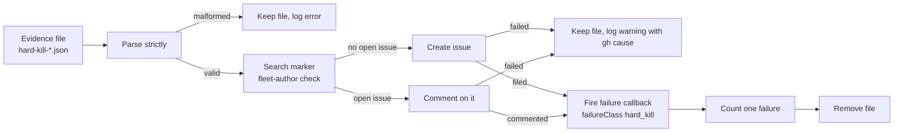

## Summary
Reports a hard-kill evidence file (#4253) on the next worker start: one deduplicated `stSoftwareAU/VibeCoder` issue per signature (label `bug`) or a comment on the open one, the `failure` run callback fires once with `hard_kill`, and the kill is counted in the next cycle callback's `fleetSummary.failures`. Closes #4254.

Version bump: not applicable — no `VERSION` file change in this PR.

## Spec

### Intent and Rationale
- The launcher kills a wedged container and leaves an evidence file, but nothing turned that kill into a tracked failure. This reuses the `run_failure_issue.ts` machinery (marker, fleet-author dedup, follow-up) so the dedup rules stay in one place: steps 1-3 of `fileRunFailureIssue` were extracted into exported helpers (`findOpenRunFailureIssue`, `createRunFailureIssue`, `postRunFailureFollowUp`) used by both callers.

### Essential Design Decisions
- The signature is `hard-kill-<trigger>-<phase>`: the handler is the evidence's `trigger`, the phase is read from the evidence's last worker-log lines, and it is `unknown` when none names one. It is filed under the existing `VIBE_RUN_FAILURE:<class>` marker.
- Reporting runs once inside the first scan cycle, AFTER that cycle's fleet snapshot, so the count lands in that cycle's summary.
- The callback fires only after filing has succeeded, and the file is deleted last. A failed filing is therefore retried and reports once. If the delete fails, the kill can be reported again, and that is logged.
- The evidence has no repo or issue, so they are read from the last `owner/repo#N` in the log tail, else `unknown`/0. They are never guessed from elsewhere. `durationSeconds` is 0 because the start time is unknown.
- Label `bug` only, NOT `needs-failure-detection-repair`: `find_failure_detection_repair_issues.ts` treats that label as a planning-parent label.

### Undiscoverable Facts
- The health board state "failed (hard kill)" lives in `stSoftwareAU/GRQ-health`, fed by `stSoftwareAU/GRQ-VibeCoder` `callbacks/failure.sh`. Both are outside this repo and were not touched; they consume the `hard_kill` class.
- The 8 provider-image test failures in `./quality.sh` also fail on the unmodified milestone branch, because the sandbox image lacks the codex, gemini and deepseek providers. Three of the six files were re-run on a base worktree of the milestone branch and fail the same way (4 tests): `claude_runner_provider_fallback_4034_test.ts`, `execute_phase_assignment_3718_test.ts` and `external_orchestration_3642_config_test.ts`. The other three files share the same error text and were not individually run on base.

## Evidence
- The redaction test assembles its synthetic PAT at run time. `.github/gitleaks.toml` exempts only the exact historical fixture declaration, because the PR history scan still sees the original literal. Gitleaks 8.24.3 passes the six-commit PR range; a negative control confirms another PAT-shaped value is still detected. No path-wide exclusion was added.
- Fake-`gh` tests: `worker/deno/tests/hard_kill_report_test.ts`. Wiring: `worker/deno/tests/run_core_hard_kill_test.ts` and `worker/deno/tests/run_core_production_deps_hard_kill_test.ts` (real production deps with an injected gh runner, recorder and real hook scripts).
- Fake `gh` mirrors the `gh issue list` / `issue create` / `api …/comments` shapes that `fileRunFailureIssue` already consumes (same helpers). Production implementation each load-bearing fake stands in for: `runGhCommandRaw` (`github.ts`) is replaced by the injected `hardKillGhFn`; `recordSelfDiagnosticFiling` is replaced by the injected `hardKillRecordFiling`.
- Observed with the real tool: not run against live GitHub, so no real issue was filed. The fake follows the fake in `run_failure_issue_test.ts`, which mirrors the gh output the helpers parse (the `/issues/<n>` URL from `issue create`).
- Issue numbers cited as provenance: #4254 "Hard kill: file one deduplicated VibeCoder issue per signature and fire the failure hook with hard_kill"; #4253 "Hard kill: capture redacted evidence before the launcher watchdog reaps a wedged container". #1277 and #1216 appear only inside comments moved verbatim by the extraction (titles: #1277 "Self-scheduled diagnostics trust a body marker the agent writes — the gate reduces to the signal its own docstring calls insufficient"; #1216 "Security sweep chunk 12c: untrusted GitHub-data ingestion across worker/deno/lib/").
- Start-up flow:

- Callers and siblings checked for the shared extraction: `fileRunFailureIssue` is the only other caller of the three helpers. Its behaviour is unchanged; `tests/run_failure_issue_test.ts` is green (12 tests) and gains a stranger-author test and a fleet-author control.
- `TerminalIssueRun.runId` is a new optional field, set only by `hardKillTerminalRun` and read by `runIssueCallbacks` (`run.runId ?? getRunId()`). Other callers (the `run_core.ts` dispatch) leave it absent, so they use the current run id as before.
- Guards kept and excluded: the new reporter does not use the per-class, per-host rate limit or state file of `fileRunFailureIssue`. A hard kill is rare and must be filed, and dedup is by marker, so this is excluded on purpose. The fleet-author verification, label guard (`guardedLabelArgs`), attestation, redaction and `neutraliseCommentDelimiters` are all kept.
- Early exits above the insertion in `run_core.ts`: none between the `while` and the call. Exits below it (root filesystem, trust refresh, spend ceiling) cannot skip it.
- Persisted data: the evidence file shape (version 1, #4253) is read strictly. Another version, a missing or mistyped field, or an unparseable `capturedAt` is rejected naming the cause, and the file is kept. There is no shape change, so no key bump is needed.
- Messages re-read: the statements in `docs/CALLBACKS.md` and `docs/INTERNALS.md` that failure classes are phases, and that the evidence file is only for humans, were updated.
- **Docs sweep** — section: `docs/CALLBACKS.md#a-hard-killed-run--failureclass-hard_kill`; updated: `docs/CALLBACKS.md`, `docs/INTERNALS.md`, `docs/TROUBLESHOOTING.md`, `docs/workflows/resilience-and-concurrency.md`; grep: `failureClass`, `failure classes`, `hard-kill`, `hard_kill`, `evidence file`, `fleetSummary`, `once per`; siblings: `success`, `always` (hooks: the new run reports through the same `failure`/`always` pair), `condition` (host_failure), none of which gained a member beyond the documented `hard_kill` class.
  - Remaining hits on the head, each still true: `docs/CALLBACKS.md:1014` (module row for `hard_kill_report.ts`); `docs/TROUBLESHOOTING.md:462` (frozen host, unrelated to hard kills); `docs/INTERNALS.md:521`, `:920`, `:1054`, `:2588`, `:3625`, `:4281`, `:4747`, `:4768`, `:4815`, `:5064`, `:5313` and `docs/CALLBACKS.md:231`, `:970` (`once per` in other subsystems, unchanged); `docs/SPEC-KIT-COMPARISON.md:101` and `docs/security/vulnhunter-methodology-evaluation.md:26` (`failure classes` in other subjects); `docs/BEST-PRACTICES-SCAN.md:257`, `:274`, `docs/AGENT-ACCOUNTABILITY.md:370`, `docs/CONFIGURATION.md:3075` (`evidence file` for other artefacts).

## Reproduction
- **symptom**: a hard-killed container left only an evidence file; no issue, no `failure` hook, no failure counted.
- **status**: `partial` — reason: the regression tests drive the real reporter, the real `runCoreLoop` and the real production deps with a fake gh and real hook scripts, but no real container was wedged and no live GitHub issue was filed.
- **regression test**: `worker/deno/tests/hard_kill_report_test.ts::AC1: one evidence file files exactly one bug issue with the facts and no secret`.

## Acceptance Criteria
<!-- vibe-spec-review inputs="diff+issue-body" -->
- One evidence file produces exactly one issue carrying the evidence fields (test with a fake `gh`). — **met** — evidence: `worker/deno/tests/hard_kill_report_test.ts::AC1: one evidence file files exactly one bug issue with the facts and no secret` — reviewer: met
- A second evidence file with the same signature adds a comment to that issue and files no new issue (test). — **met** — evidence: `worker/deno/tests/hard_kill_report_test.ts::AC2: a repeat signature comments on the open issue and never files a second` — reviewer: met
- The `failure` callback fires with `hard_kill`, and the next cycle's fleet summary counts one failure (test). — **met** — evidence: `worker/deno/tests/run_core_production_deps_hard_kill_test.ts::reportHardKills - files one issue, runs the failure hook with hard_kill, counts one failure and removes the evidence (Issue #4254)`; `worker/deno/tests/run_core_hard_kill_test.ts::run_core hard kills - the first cycle callback counts the kill in its failures (Issue #4254)` — reviewer: partial — reason: the reviewer saw no test through the production wiring; added after its review (run_core_production_deps_hard_kill_test.ts), red-checked
- When `gh` fails, the evidence file is kept and the cause is logged (test). — **met** — evidence: `worker/deno/tests/hard_kill_report_test.ts::AC4: a failing create keeps the file, fires nothing, and warns with the gh cause`; `worker/deno/tests/hard_kill_report_test.ts::AC4: a failing search keeps the file, fires nothing, counts nothing, and warns with the gh cause` — reviewer: met
- The callback payload change is additive: a test pins that every existing field is still present and unchanged, so the hooks in stSoftwareAU/GRQ-VibeCoder keep parsing it. — **met** — evidence: `worker/deno/tests/hard_kill_report_test.ts::AC5: a hard-kill callback document keeps every ordinary key with an identical value` — reviewer: met
- Tests and `./quality.sh` pass. — **partial** — evidence: `./quality.sh` run on this head: every stage passed or was skipped (config integration, checkov) except `deno tests`; its only 8 failures are the provider-image tests in `claude_runner_provider_fallback_4034_test.ts` (2), `execute_claude_phase_rtk_test.ts`, `execute_claude_phase_test.ts` (2), `execute_phase_assignment_3718_test.ts`, `external_orchestration_3642_config_test.ts` and `external_orchestration_3642_phase_test.ts` (error: the running container image did not install the codex/gemini/deepseek provider); the serial test pass did not run because the parallel pass failed — reviewer: missing — reason: the reviewer saw only the diff and could not run the gate; the 8 environmental provider-image failures also fail on the unmodified base branch (3 of the 6 files were re-run on a base worktree and fail identically) and are not fixable in this change

Unrequested changes, each listed by the Spec reviewer:
- `docs/INTERNALS.md`, `docs/TROUBLESHOOTING.md` and `docs/workflows/resilience-and-concurrency.md` edits — **unrequested** — reviewer: unrequested — reason: stale statements the change made false.
- Routing allowlist (`worker/deno/lib/issue_create_routing_check.ts`) and sweep top-up `docs/audits/lib-sweep-coverage/top-up-4254.json` — **unrequested** — reviewer: unrequested — reason: required by repo gates.
- `recordSelfDiagnosticFiling` attestation — **unrequested** — reviewer: unrequested — reason: same as run-failure issues (tier-2b provenance).
- Strict parse keeping bad files — **unrequested** — reviewer: unrequested — reason: fail-loud parsing of a persisted file, so a malformed file is kept and named rather than read loosely.
- Source repo and issue best-effort from the log — **unrequested** — reviewer: unrequested — reason: the evidence has no repo or issue, so they come from the last `owner/repo#N` in the log tail, else `unknown`/0.
- `TerminalIssueRun.runId` — **unrequested** — reviewer: unrequested — reason: needed for "for the killed run" in the failure hook.
- Keep-on-removal-failure policy — **unrequested** — reviewer: unrequested — reason: a file that cannot be removed after the report stays and may be reported again, rather than being dropped silently.

## Standards Review
<!-- vibe-standards-review inputs="diff+CODING-STANDARDS.md" -->
Nine violations were reported; all are fixed in this diff, one bullet each:
- **violation** — Log Levels Are a Promise About What the Reader Must Do — evidence: `worker/deno/lib/run_core.ts:6192`, `worker/deno/lib/run_core_production_deps.ts:5511` — reason: fixed in this diff (warn for handled or retried conditions)
- **violation** — Coding Principles (KISS/DRY) — evidence: `worker/deno/lib/hard_kill_report.ts:38-41`, `:465`, `:475`, `:490` — reason: fixed in this diff (hand-copied steps 1 and 2 of `run_failure_issue.ts` are now the shared helpers)
- **violation** — Coding Principles (no options only tests set) — evidence: `worker/deno/lib/hard_kill_report.ts:554` — reason: fixed in this diff (`targetRepo` and `followUpWindowSeconds` removed; the summary is now logged by production)
- **violation** — Test-Driven Development (TDD) — evidence: `worker/deno/lib/run_core_production_deps.ts:5484` — reason: fixed in this diff (end-to-end production-deps tests now exist)
- **violation** — Test-Driven Development (TDD) — evidence: `worker/deno/tests/hard_kill_report_test.ts:774`, `:781`, `:788` — reason: fixed in this diff (hostile cases added for the three PHASE_PATTERNS)
- **violation** — Coding Principles (accuracy of comments) — evidence: `worker/deno/lib/hard_kill_report.ts` (the "disjoint classes" safety comment is no longer present) — reason: fixed in this diff
- **violation** — Never Fail Silently — Fail Loud (accuracy of comments) — evidence: `worker/deno/lib/hard_kill_report.ts:552` — reason: fixed in this diff (the `fileHardKillIssue` doc now says it returns `failed` for GitHub failures and throws only for a refused label; `reportPendingHardKills` catches per file and around the listing, which is what its 'Never throws' rests on)
- **violation** — A Code Change Owes a Docs Change (absolute "once") — evidence: `docs/CALLBACKS.md:78`, `worker/deno/lib/hard_kill_report.ts:14` — reason: fixed in this diff ("once per evidence file", with the exception stated)
- **violation** — Coding Principles (stale doc comment) — evidence: `worker/deno/lib/fleet_telemetry.ts:551` — reason: fixed in this diff (stale `recordOutcome` doc comment)

**clean** — redaction on every outbound sink, marker neutralisation and the fleet-author check, fail-loud parsing, additive contract, no labels removed, evidence deleted only after filing, extraction behaviour-preserving, insertion points checked, registrations present, temp dirs via `makeTempDir`, no path traversal, Australian English, Mermaid present. Review-enforced rules checked: Log Levels, over-engineering and DRY, check-where-you-insert.

No existing test file had an assertion removed or an expectation changed. `worker/deno/tests/run_failure_issue_test.ts` was edited: two fake-`gh` helper lines were changed (the `issues` seed gains an optional `author`, defaulting to the fleet login as before) and two tests were added. No assertion line was removed.

## Test Plan
- Maintenance validation: all 57 tests in `hard_kill_report_test.ts`, `run_core_hard_kill_test.ts`, `run_core_production_deps_hard_kill_test.ts` and `run_failure_issue_test.ts` pass with Deno 2.9.6 after the fixture correction. The runtime token value and every assertion are unchanged. Gitleaks 8.24.3 passes the PR history scan and its negative control.
- Added `worker/deno/tests/hard_kill_report_test.ts` (AC1–AC5 and parser, signature and body tests), `worker/deno/tests/run_core_hard_kill_test.ts` and `worker/deno/tests/run_core_production_deps_hard_kill_test.ts`. Extended `worker/deno/tests/run_failure_issue_test.ts` with a stranger-author test and a fleet-author control, as described above.
- Results on the head (`deno task test:unit <file>`, stdin from /dev/null): `hard_kill_report_test.ts` 38 passed, 0 failed; `run_core_hard_kill_test.ts` 3 passed, 0 failed; `run_core_production_deps_hard_kill_test.ts` 4 passed, 0 failed; `run_failure_issue_test.ts` 12 passed, 0 failed; `issue_create_routing_check_test.ts` 25 passed, 0 failed; `lib_sweep_coverage_test.ts` 39 passed, 0 failed; `lib_sweep_top_up_files_test.ts` 9 passed, 0 failed.
- ./quality.sh on this head: all stages passed or were skipped except `deno tests` (config integration and checkov were skipped; 8 environmental provider-image failures, files listed under Acceptance Criteria; the serial pass did not run). The earlier run on the previous head additionally failed the issue-create routing and sweep-coverage tests, fixed by the allowlist entry removal (the helper now lives in run_failure_issue.ts) and `docs/audits/lib-sweep-coverage/top-up-4254.json`.
- Red checks (each flip run on this head unless marked "earlier run"; each one restored byte-identical):
  - `hard_kill_report.ts:185` version check dropped: `parseHardKillEvidence rejects a wrong version, naming it` red.
  - `hard_kill_report.ts:213` capturedAt check dropped: `parseHardKillEvidence names a missing nested field and a bad timestamp` red.
  - `hard_kill_report.ts:474` create branch disabled: `AC1: one evidence file files exactly one bug issue with the facts and no secret` red (earlier run).
  - `hard_kill_report.ts:490` always `issue create`: `AC2: a repeat signature comments on the open issue and never files a second` red (earlier run).
  - `run_failure_issue.ts:404` plain marker filter: the AC2 stranger test and the `run_failure_issue_test.ts` stranger test red (earlier run).
  - `hard_kill_report.ts:588` malformed file removed in the catch: `AC4: a file missing a field is kept and the log names the field` red; the malformed-file sibling also red.
  - `hard_kill_report.ts:606` keep-on-failure branch dropped: three AC4 tests red (earlier run).
  - `hard_kill_report.ts:568` NotFound warning made unconditional: `AC4: a missing evidence directory reports nothing and logs nothing` red.
  - `hard_kill_report.ts:622` callback throw rethrown: `AC4: a throwing callback is logged as a warning and the kill still counts` red.
  - `hard_kill_report.ts:642` removal failure swallowed silently: `AC4: a removal failure is logged as a warning, the file stays, and the kill still counts` red.
  - `hard_kill_report.ts:619` callback before filing: seven tests red (earlier run).
  - `run_core.ts:6187` once-flag removed: `run_core hard kills - the first cycle callback counts the kill in its failures (Issue #4254)` red (earlier run); moved above the `cycleFleetStart` snapshot: red, failures 0 vs 1 (earlier run).
  - `run_core.ts:6189` try/catch around `deps.reportHardKills()` removed: `run_core hard kills - a throwing hook is logged and the loop still fires its cycle callback (Issue #4254)` red.
  - `run_core_production_deps.ts:5496` pass-through: empty callback, empty `countFailure` and dropped `recordFiling` each red (earlier runs).
  - `run_core_production_deps.ts:5486` no-HOME guard removed: `reportHardKills - no HOME skips with an info line and does not throw (Issue #4254)` red.
- Wiring entry points checked: `run_core.ts` loop call and `run_core_production_deps.ts` `reportHardKills`, each reverted in a red check.
- Existing tests re-run after the helper extraction: `tests/run_failure_issue_test.ts` (12 tests, all green).
- Persisted evidence shape: old and new read strictly; see Evidence.

<!-- vibe-branch-outcomes -->
