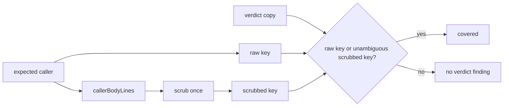

## Summary

`callerGapFindings` now matches a verdict that copies the symbol and caller as
the fenced caller list shows them, the same way `closureGapFindings` matches a
raw key and a once-scrubbed key. The verdict is never scrubbed again, and a
scrubbed form shared by two different callers matches neither.
`caller_checks.ts` moves from the echo allowlist to the echo round-trip table.
Closes #4269.

Version bump: no `VERSION` change is part of this fix.

## Spec

### Intent and Rationale

- The brief tells the model to copy the symbol and caller exactly as the fence
  lists them, but the match used only the raw text, so a faithful copy of any
  scrubbed text counted as "no verdict" and sent the change back.
- Mirrors `closureGapFindings` (`worker/deno/lib/closure_met_check.ts`): raw key
  always matches; the scrubbed key matches only when exactly one raw entry owns
  it.

### Essential Design Decisions

- The scrubbed key is read back from the whole list body scrubbed once
  (`callerBodyLines`, shared by the renderer and the matcher), because the scrub
  can cross a field or line boundary. Scrubbing each field alone (the first
  version of this fix) differs from the fence for such input.
- Falls back to scrubbing the two fields when the scrubbed line cannot be read
  back; that only adds a second key.
- The `inlineSafe` caps are shared constants so render and match cannot drift.

### Undiscoverable Facts

- None.

## Evidence

Reproduction from the issue: symbol `{{X}}` is listed as `｛｛X｝｝`; before the
fix a verdict with that symbol reported
`no verdict was reported for 1 of 1 caller(s)`.

**Docs sweep** — grep: `callerGapFindings`, `callerKey`, "Existing callers of
changed"; section: `docs/workflows/issue-processing.md#pre-pr-verifier`;
siblings: none — no existing set gained a member; updated:
`docs/workflows/issue-processing.md`;
`worker/deno/tests/echo_consumer_completeness_test.ts` (allowlist row and its
comment removed); `docs/workflows/issue-processing.md:1274` — still true because
the listing rules are unchanged.

Provenance:
`#4269: callerGapFindings treats a scrubbed copy of a fenced caller as no verdict`
(the issue this PR closes); `#3779` and `#4211` appear only as existing
citations.

## Reproduction

- **symptom** — a verifier reply copying the fenced (scrubbed) symbol or caller
  was reported as `no verdict was reported for 1 of 1 caller(s)`
- **status** — `verified` — the new tests were observed failing against the
  unfixed `caller_checks.ts` (HEAD before the fix: 17 failures across the caller
  and echo test files) and pass after the fix
- **regression test** —
  `worker/deno/tests/caller_checks_3779_test.ts::callerGapFindings: a copy of the once-scrubbed symbol matches its entry, and so does the raw copy`

## Acceptance Criteria

<!-- vibe-spec-review inputs="diff+issue-body" -->

- **met** — A verdict that copies the fenced symbol and caller produces the same
  findings as a verdict that copies the raw symbol and caller. — evidence:
  `worker/deno/tests/echo_round_trip_test.ts::caller echo template-braces: fenced and raw copies match the plain control`
  and
  `worker/deno/tests/caller_checks_3779_test.ts::callerGapFindings: a copy of a caller whose scrub depends on the rest of the fenced list matches`
  — reviewer: partial — reason: the reviewer found the key was scrubbed per
  field while the fence scrubs the whole body; fixed in this diff by reading the
  key back from the whole-body scrub, with a test whose copy comes from the real
  fence
- **met** — The plain-text control still reports no missing verdict. — evidence:
  `worker/deno/tests/echo_round_trip_test.ts::caller echo plain-text: fenced and raw copies match the plain control`
  — reviewer: met
- **met** — Two callers that scrub to the same placeholder do not match each
  other. — evidence:
  `worker/deno/tests/caller_checks_3779_test.ts::callerGapFindings: two callers whose symbols scrub to the same placeholder do not match each other's copy`
  — reviewer: met

## Standards Review

<!-- vibe-standards-review inputs="diff+CODING-STANDARDS.md" -->

- **violation** — the once-scrubbed key was computed per field while the fence
  scrubs the joined body (compare like with like) — evidence:
  `worker/deno/lib/caller_checks.ts:564` — reason: fixed in this diff
- **clean** — Australian English; no removed assertions in existing tests (the
  allowlist row for `caller_checks.ts` is data, replaced by the
  `ECHO_TABLE_MODULES` row); new members are read by production code; "Check
  where you insert" and the over-engineering rules were checked

## Test Plan

- Added in `worker/deno/tests/caller_checks_3779_test.ts`: once-scrubbed symbol,
  shared-placeholder ambiguity, and a fenced copy whose scrub depends on the
  rest of the list.
- Added in `worker/deno/tests/echo_round_trip_test.ts`: caller rows of the
  corpus (`caller echo <row>`) and
  `caller echo secret row: the redaction placeholder is not an identifier`;
  `caller_checks.ts` joins `ECHO_TABLE_MODULES`.
- `worker/deno/tests/echo_consumer_completeness_test.ts`: the `caller_checks.ts`
  allowlist entry is removed.
- Removed from `worker/deno/tests/echo_consumer_completeness_test.ts`: `module: "caller_checks.ts",`
  Required by: "Match a verdict that copies the fenced symbol and caller"
- Removed from `worker/deno/tests/echo_consumer_completeness_test.ts`: `"renderCallerCheckSection fences the caller list and tells the model to copy the symbol and caller exactly. callerGapFindings matches that copy with callerKey against the raw expected entries only, so a scrubbed copy is a missing verdict. Tracked in #4269 and not fixed in this change.",`
  Required by: "Match a verdict that copies the fenced symbol and caller"
- Red checks: the new match tests fail against the per-field and the unfixed lib
  (17 failures; the cross-field test fails against the per-field version). The
  ambiguity operand, the `reported.has` operands, the raw early return and the
  whole-body read-back were each flipped; each turned tests red (see facts
  file). Ambiguity and shared-placeholder tests pass on the unfixed lib by
  design (they guard against over-matching).
- Results on the final head: caller_checks_3779_test.ts,
  echo_round_trip_test.ts, echo_consumer_completeness_test.ts,
  pre_pr_verifier_3395_test.ts, completion_phase_pre_pr_verifier_3395_test.ts —
  242 passed, 0 failed (run with `VIBE_IMAGE_AGENT_PROVIDERS` unset).
- Full `./quality.sh`: FAILED in this container, on `deno tests` and
  `completeness checks`. The failures are `VIBE_IMAGE_AGENT_PROVIDERS=claude`
  image-stamp errors, `cargo fmt` unavailable, and
  `phase_executor_tiers_4174_test.ts` (phase `completion` has no default model);
  none touch these files. Format, lint, type check, semgrep, markdownlint and
  mermaid passed.

<!-- vibe-branch-outcomes -->
