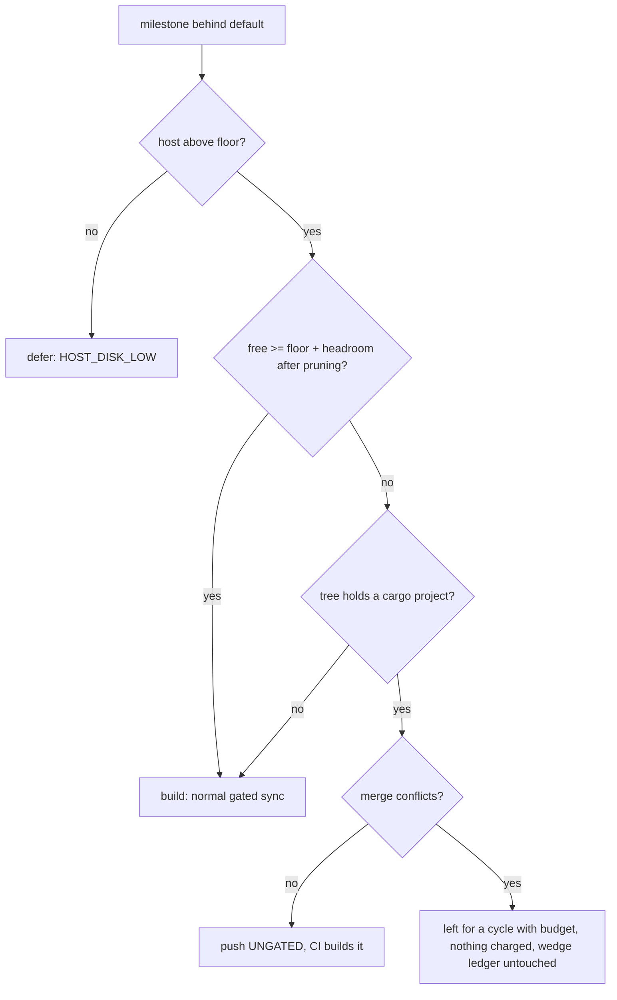

## Summary

When the host is above its disk floor but the ephemeral cargo root is over its
budget (floor + 25 GB headroom) and nothing is prunable, a milestone sync no
longer defers every cycle. `heavyBuildAdmission` (replacing
`heavyBuildDeferral`) now returns `build`, `defer` (host below its floor,
unchanged) or the new `merge-only`. In `merge-only`, a tree that holds a cargo
project is merged **without** the repository's cargo type-check: a conflict-free
merge is pushed with the existing `UNGATED:` note and the milestone PR's CI
builds it. A tree with no cargo project keeps its own check and the normal
agent. A merge that conflicts is not landed that cycle, is charged nothing and
never feeds the gate-wedge ledger, so it lands in the first cycle whose budget
admits a build. Closes #4326.

Version bump: no `VERSION` change was made by hand in this change.

## Spec

### Intent and Rationale

- GRQ-23 refused every cargo-needing milestone sync for days (55.3 GB free vs
  71 GB needed, nothing prunable), holding 27 issues. The issue's second option
  ("run the sync without the ephemeral cargo build where the sync is only a
  merge") was chosen: no build runs, so host free space cannot approach the floor.
- No extra reclaim step was added: on a trim-refused runtime, deleting artefacts
  inside the guest returns nothing to the host (`ephemeral_build_cache.ts`
  header, `judgeGuestReclaim` in `work_volume_ratchet.ts`), so the idle target
  dirs already pruned first are all the worker can hand back.
- Sizing the headroom from a measured target was not taken: a repository that
  is never built has no measurement, so the first cycle would still be refused.

### Essential Design Decisions

- Reuses existing paths: the merge gate reports `skipped` (pushed `UNGATED`,
  Issue #974 precedent); the resolution gate reports `failed` (concluded
  `not-charged`); the agent stub reports the provider unavailable (concluded
  `disrupted`). The agent log therefore reads "agent provider was unavailable —
  no agent run, the host cannot afford a build…".
- The merge-only resolution refusal carries `MERGE_ONLY_NO_BUILD`;
  `concludeGateRefusal` (shared by the sweep and the pre-cut sync) returns the
  entry unchanged for it, so two cycles cannot wedge the branch or file a false
  diagnostic.
- Cargo vs not is decided from the tree at call time (`findTypeCheckProjects`);
  a tree whose projects cannot be listed is treated as cargo (nothing built).
- Accepted trade-off: a conflict-free cargo merge is pushed unverified. Issue
  #974 showed unchecked merges can drop wiring, and `milestone/*` has no
  required checks; the milestone PR's CI is the backstop.

### Undiscoverable Facts

- The `deno tests` stage of `./quality.sh` fails 15 tests on this container
  with and without this change; they need the `codex` provider, which the
  image did not install (`Installed: claude`). Not touched.

## Evidence

Backend-only change (no UI files). Production-behaviour evidence is the tests
below. Real tool observed: the end-to-end tests run real `git` against a bare
origin in a temporary directory.

## Reproduction

- **symptom** — `deferred: milestone behind default branch (30 commits) — ephemeral cargo root over budget (55.3 GB free, floor 46.0 GB + headroom 25.0 GB) — pruned 0.0 GB of idle target dirs and 15.8 GB is still short, so the build is refused (Issue #3178)`
- **status** — `partial` — reason: the base-branch behaviour is pinned by the old `heavyBuildDeferral - above the floor but over the cargo budget defers` test (a deferral at the same figures), but the new tests were not run against unfixed base code because they use the new `heavyBuildAdmission` API; each was instead seen red by breaking only its production change (below). The GRQ-23 host was not reproduced.
- **regression test** — `worker/deno/tests/heavy_build_gate_3178_test.ts::heavyBuildAdmission - above the floor but over the cargo budget lands merge-only, not deferred (Issue #4326)`

## Acceptance Criteria

<!-- vibe-spec-review inputs="diff+issue-body" -->

- **met** — Run the sync without the ephemeral cargo build where the sync is only a merge, letting the repo's CI build it — evidence: `worker/deno/tests/milestone_merge_only_4326_test.ts::merge-only e2e - a conflict-free merge lands unverified: UNGATED, and the milestone carries main's commit (Issue #4326)` — reviewer: met
- **met** — Whatever is chosen, a milestone may not stay behind for more than one cycle on disk budget alone — evidence: `worker/deno/tests/milestone_merge_only_4326_test.ts::merge-only e2e - a conflict-free merge lands unverified: UNGATED, and the milestone carries main's commit (Issue #4326)` — reviewer: partial — reason: the reviewer holds that a merge that conflicts still waits while the budget is short; it is departed from because the issue scopes the chosen option to "where the sync is only a merge" and a conflicted merge's resolution cannot be verified without the build (it is retried uncharged every cycle and lands in the first cycle with budget, `worker/deno/tests/milestone_gate_wedge_merge_only_4326_test.ts`)
- **met** — With free space between the floor and floor + headroom, and nothing prunable, a milestone sync still lands within one cycle (stubbed disk figures) — evidence: `worker/deno/tests/heavy_build_gate_3178_test.ts` acceptance tests at 50.9, 55.3 and 55.8 GB free (`merge-only`, nothing removed) and `syncMilestoneBranches - over the cargo budget the sync lands without its build, carrying the reason (Issue #4326)` — reviewer: met — reason: for conflict-free merges; see the previous entry for conflicts
- **met** — The host's real free space never drops below the floor because of it — evidence: no build runs in `merge-only`; `heavyBuildAdmission - below the floor defers without touching the root` still defers and the nothing-prunable tests assert no dir is removed — reviewer: met
- **unrequested** — `docs/audits/lib-sweep-coverage/top-up-4326.json` claims the new module in the sweep ledger — reviewer: unrequested — reason: required by the repository's completeness check for a new `lib/` module
- **unrequested** — an unreadable ephemeral root now lands `merge-only` instead of refusing — reviewer: unrequested — reason: follows from the chosen option; no build runs blind

## Standards Review

<!-- vibe-standards-review inputs="diff+CODING-STANDARDS.md" -->

- **violation** — merge-only conflict attempts were written to the gate-wedge ledger and never cleared — evidence: `worker/deno/lib/milestone_merge_only.ts:58` — reason: fixed in this diff (`concludeGateRefusal` skips refusals carrying `MERGE_ONLY_NO_BUILD`)
- **violation** — docs mixed up the two conflict outcomes and overstated "never waits" — evidence: `docs/CONTAINER.md:1333` — reason: fixed in this diff (also `docs/INTERNALS.md`, `worker/deno/lib/heavy_build_gate.ts`)
- **violation** — the two `mergeOnlyBindings` call sites had no test that goes red without them — evidence: `worker/deno/lib/milestone_presync.ts:863` — reason: fixed in this diff (`milestone_presync_merge_only_4326_test.ts`); the sweep site `worker/deno/lib/run_core_production_deps.ts:6769` is `exempt (untestable)`: `syncMilestoneBranchesFn` is not exported and `grep -rln "syncMilestoneBranchesFn" worker/deno/tests` finds no test file
- **clean** — no assertion removed from existing tests; every edited expectation still goes red without its guard; Australian English; no persisted shape changed; no field without a production reader; review-enforced rules checked: edited-expectation, negative-test, named-test-exists, new-argument-reaches-every-caller

## Test Plan

- `worker/deno/tests/heavy_build_gate_3178_test.ts` (migrated to `heavyBuildAdmission`; 13 added): acceptance figures 50.9/55.3/55.8 GB with nothing prunable, own-and-recent dirs only, prune-then-build, unreadable root, sweep and presync hand-off, agent rung not offered.
- `worker/deno/tests/milestone_merge_only_4326_test.ts`: bindings for Deno and cargo trees, unlistable tree, real-git end-to-end (clean merge `UNGATED`, control with failing gate, Deno-only tree keeps its gate, conflict not pushed and not charged, remote unchanged, no `MERGE_HEAD`).
- `worker/deno/tests/milestone_gate_wedge_merge_only_4326_test.ts`: a merge-only refusal is never counted; an ordinary refusal wedges (control); a real refusal on the entry is untouched and still reports wedged.
- `worker/deno/tests/milestone_presync_merge_only_4326_test.ts`: the real `presyncMilestoneBranchForIssueRun` hands the merge-only gates and agent on a cargo tree, and none on `build`.
- Removed from `worker/deno/tests/heavy_build_gate_3178_test.ts`: nothing. Changed: `assertEquals(…, null)` became `{ mode: "build" }`, and `assert(reason !== null)` became a mode assertion (stricter); `heavyBuildDeferral` was replaced by `heavyBuildAdmission` because the issue changes the over-budget outcome from a deferral to a merge.
- Red-checks (production change broken, test seen red, restored): `heavyBuildAdmission` always `build` → 8 admission tests red; `mergeOnly` spread removed at both sweep variants → 2 sweep tests red; presync grant forced to plain `grant` → presync hand-off test red; presync `undefined, undefined, agentFn` restored → `presync - a merge-only admission hands the sync the merge-only gates and agent on a cargo tree (Issue #4326)` red; merge gate returning `passed` → `UNGATED` e2e red; early return in `concludeGateRefusal` disabled → wedge test red; cargo detection always true → 5 Deno-tree tests red; always false → cargo tests red. One inconclusive probe: resolution gate returning `skipped` instead of `failed` is not observable, because `git_pull.ts` already refuses a skipped resolution gate; returning `passed` does turn the conflict e2e red.
- Callers of the changed helper checked: `heavyBuildAdmission` — sweep (`run_core_production_deps.ts` via `heavyBuildGateFn`), pre-cut sync (`milestone_presync.ts`), and `commands/milestone_branch_sync.ts` (wires no gate, unaffected); `concludeGateRefusal` — the sweep and the pre-cut sync, both reading only `.entry`. Twin copies of the rule: none found.
- Results: `deno test -A` on the files above plus `milestone_branch_sync_test.ts`, `milestone_presync_test.ts`, `milestone_presync_git_test.ts` passed (151 passed, 0 failed); `lib_sweep_coverage_test.ts` passed (39); `deno task check:manifests` passed (853).
- `./quality.sh`: every stage passed except `deno tests`, which fails the same 15 `codex`-provider tests it fails on the untouched tree (`The running container image did not install the "codex" coding-agent provider`); the serial pass did not run because the parallel pass failed. Not checked: a live GRQ-23 run.
