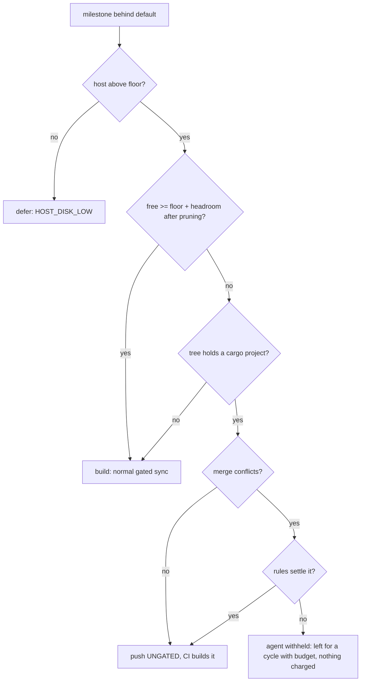

## Summary

When the host is above its disk floor but the ephemeral cargo root is over its
budget (floor + 25 GB headroom) and nothing is prunable, a milestone sync no
longer defers every cycle. `heavyBuildAdmission` (replacing
`heavyBuildDeferral`) now returns `build`, `defer` (host below its floor,
unchanged) or the new `merge-only`. In `merge-only`, a tree that holds a cargo
project is merged **without** the repository's cargo type-check: a conflict-free
merge, and a merge whose conflicts the deterministic rules settle, are pushed
with the existing `UNGATED:` note and the milestone PR's CI builds them. A tree
with no cargo project keeps its own check and the normal agent. A conflict that
needs the resolution agent is not landed that cycle (the agent could run the
very cargo build the host cannot afford); it is charged nothing and lands in the
first cycle whose budget admits a build. Closes #4326.

Version bump: no `VERSION` change was made by hand in this change.

## Spec

### Intent and Rationale

- GRQ-23 refused every cargo-needing milestone sync for days (55.3 GB free vs 71
  GB needed, nothing prunable), holding 27 issues. The issue's second option
  ("run the sync without the ephemeral cargo build where the sync is only a
  merge") was chosen: no build runs, so host free space cannot approach the
  floor.
- No extra reclaim step was added: on a trim-refused runtime, deleting artefacts
  inside the guest returns nothing to the host (`ephemeral_build_cache.ts`
  header, `judgeGuestReclaim` in `work_volume_ratchet.ts`), so the idle target
  dirs already pruned first are all the worker can hand back.
- Sizing the headroom from a measured target was not taken: a repository that is
  never built has no measurement, so the first cycle would still be refused.

### Essential Design Decisions

- Reuses existing paths: the merge gate reports `skipped` (pushed `UNGATED`,
  Issue #974 precedent); the resolution gate reports `skipped` with the new
  `MergeGateOutcome.landUnverified` flag, which `judgeResolutionVerdict` lets
  through (a plain `skipped` resolution is still a refusal, Issue #1559), so a
  conflict the deterministic rules settled is pushed `UNGATED` as well; the
  agent stub reports the provider unavailable (concluded `disrupted`, nothing
  charged, and no wedge ledger entry because no gate refused). The agent log
  therefore reads "agent provider was unavailable — no agent run, the host
  cannot afford a build…".
- The agent stays withheld on a cargo tree: it runs in the clone with full tool
  access and may run `cargo`, which writes to the ephemeral root the budget
  protects. A conflict only the agent can settle therefore waits for a cycle
  with budget; this is the one case that still can.
- One binding path: `syncWithMergeOnlyBindings` (in `milestone_merge_only.ts`)
  is the single place the gates and agent are swapped, called by the pre-cut
  sync and, through the exported `syncMilestoneBranchForSweep`, by the sweep.
- Cargo vs not is decided from the tree at call time (`findTypeCheckProjects`);
  a tree whose projects cannot be listed is treated as cargo (nothing built).
- Accepted trade-off: a conflict-free cargo merge is pushed unverified. Issue
  #974 showed unchecked merges can drop wiring, and `milestone/*` has no
  required checks; the milestone PR's CI is the backstop.

### Undiscoverable Facts

- The `deno tests` stage of `./quality.sh` fails 15 tests on this container with
  and without this change; they need the `codex` provider, which the image did
  not install (`Installed: claude`). Not touched.

## Evidence

Backend-only change (no UI files). Production-behaviour evidence is the tests
below. Real tool observed: the end-to-end tests run real `git` against a bare
origin in a temporary directory.

## Reproduction

- **symptom** —
  `deferred: milestone behind default branch (30 commits) — ephemeral cargo root over budget (55.3 GB free, floor 46.0 GB + headroom 25.0 GB) — pruned 0.0 GB of idle target dirs and 15.8 GB is still short, so the build is refused (Issue #3178)`
- **status** — `partial` — reason: the base-branch behaviour is pinned by the
  old `heavyBuildDeferral - above the floor but over the cargo budget defers`
  test (a deferral at the same figures), but the new tests were not run against
  unfixed base code because they use the new `heavyBuildAdmission` API; each was
  instead seen red by breaking only its production change (below). The GRQ-23
  host was not reproduced.
- **regression test** —
  `worker/deno/tests/heavy_build_gate_3178_test.ts::heavyBuildAdmission - above the floor but over the cargo budget lands merge-only, not deferred (Issue #4326)`

## Acceptance Criteria

<!-- vibe-spec-review inputs="diff+issue-body" -->

- **met** — Run the sync without the ephemeral cargo build where the sync is
  only a merge, letting the repo's CI build it — evidence:
  `worker/deno/tests/milestone_merge_only_4326_test.ts::merge-only e2e - a conflict-free merge lands unverified: UNGATED, and the milestone carries main's commit (Issue #4326)`
  and
  `worker/deno/tests/milestone_merge_only_4326_test.ts::merge-only e2e - a conflict the worker resolves lands unverified: UNGATED, the milestone carries main's lines (Issue #4326)`
  — reviewer: met
- **partial** — Whatever is chosen, a milestone may not stay behind for more
  than one cycle on disk budget alone — evidence: the two end-to-end tests
  above, and
  `worker/deno/tests/milestone_merge_only_4326_test.ts::merge-only e2e - a conflict the agent would have to resolve is not pushed and not charged (Issue #4326)`
  — reviewer: partial — reason: a conflict that only the resolution agent can
  settle still waits for a cycle with budget, because the agent is free to run
  the cargo build the host cannot afford; the reviewer would close it by capping
  the uncharged merge-only cycles and escalating, by running the agent with
  cargo disabled, or by sizing the headroom from a measured target. Each is a
  larger change than the issue's chosen option and is left for the issue owner's
  agreement
- **partial** — With free space between the floor and floor + headroom, and
  nothing prunable, a milestone sync still lands within one cycle (stubbed disk
  figures) — evidence: `worker/deno/tests/heavy_build_gate_3178_test.ts`
  acceptance tests at 50.9, 55.3 and 55.8 GB free (`merge-only`, nothing
  removed), `worker/deno/tests/milestone_sweep_merge_only_4326_test.ts`,
  `worker/deno/tests/milestone_presync_merge_only_4326_test.ts` and the real-git
  end-to-end tests above — reviewer: partial — reason: the chain from stubbed
  figures to a landed push is pinned in four tests rather than one, and a
  conflict that needs the agent does not land in that cycle
- **met** — The host's real free space never drops below the floor because of it
  — evidence: no build runs in `merge-only` (`milestone_merge_only_4326_test.ts`
  asserts no check or verification is called);
  `heavyBuildAdmission - below the floor defers without touching the
  root`
  still defers and the nothing-prunable tests assert no dir is removed —
  reviewer: met
- **unrequested** — `docs/audits/lib-sweep-coverage/top-up-4326.json` claims the
  new module in the sweep ledger — reviewer: unrequested — reason: required by
  the repository's completeness check for a new `lib/` module
- **unrequested** — an unreadable ephemeral root now lands `merge-only` instead
  of refusing — reviewer: unrequested — reason: follows from the chosen option;
  no build runs blind
- **unrequested** — `syncMilestoneBranchForSweep` is exported from
  `run_core_production_deps.ts` and `syncWithMergeOnlyBindings` added to the
  merge-only module — reviewer: unrequested — reason: the one binding path both
  the sweep and the pre-cut sync use, exported so a test can fail without it

## Standards Review

<!-- vibe-standards-review inputs="diff+CODING-STANDARDS.md" -->

- **violation** — the escalation comment and the merge commit message told the
  reader an unverified resolution had passed the repository's checks — evidence:
  `worker/deno/lib/milestone_sync_conflict.ts:365` and
  `worker/deno/lib/milestone_conflict_triage.ts:757` — reason: fixed in this
  diff (`MilestoneSyncConflict.unverified` selects a comment that says the tree
  was not checked; the commit message names the `UNGATED` exception)
- **violation** — docs and comments still said every automatic resolution is
  verified before the push — evidence: `docs/INTERNALS.md:4218`,
  `docs/workflows/milestones.md:469`, `worker/deno/lib/git_pull.ts:491` —
  reason: fixed in this diff
- **violation** — `judgeResolutionVerdict` has a second caller,
  `repairGatedResolution`, where a later `landUnverified` verdict could let a
  repaired tree whose real check failed land unchecked — evidence:
  `worker/deno/lib/milestone_gate_repair.ts:459` — reason: fixed in this diff
  (only the first verdict may land unverified;
  `repairGatedResolution - a later
  verification marked landUnverified is still a refusal, not a pass`)
- **violation** — a Deno-only tree whose agent rung was withheld was handed a
  stub that blamed the host's build budget — evidence:
  `worker/deno/lib/milestone_merge_only.ts:144` — reason: fixed in this diff
  (the stub says the rung was not granted)
- **violation** — the "fail-closed" comment on the unlistable-tree guard
  overstated it — evidence: `worker/deno/lib/milestone_merge_only.ts:111` —
  reason: fixed in this diff (the comment says the guard is reachable only
  through the injected listing and that the push says `UNGATED`)
- **violation** — docs understated what a cargo tree skips (only "the cargo
  type-check") — evidence: `docs/CONTAINER.md:1330`, `docs/INTERNALS.md:4455` —
  reason: fixed in this diff
- **violation** — the audit ledger entry said the module "reads nothing, spawns
  nothing" — evidence: `docs/audits/lib-sweep-coverage/top-up-4326.json:7` —
  reason: fixed in this diff
- **violation** — the sweep call site had no test that goes red without it —
  evidence: `worker/deno/lib/run_core_production_deps.ts:6646` — reason: fixed
  in this diff (`syncMilestoneBranchForSweep` is exported and driven by
  `milestone_sweep_merge_only_4326_test.ts`)
- **clean** — `MERGE_ONLY_NO_BUILD` and the `concludeGateRefusal` guard were
  dead once no merge-only gate refuses, and are removed (the reviewer confirmed
  nothing produces the marker; `milestone_gate_wedge.ts` is identical to main);
  `landUnverified` has a production setter and reader; `heavyBuildAdmission`
  reaches the sweep, the pre-cut sync and the arming pre-sync; no assertion
  removed from existing tests; Australian English; review-enforced rules
  checked: edited-expectation, negative-test, named-test-exists,
  new-argument-reaches-every-caller

## Test Plan

- `worker/deno/tests/heavy_build_gate_3178_test.ts` (migrated to
  `heavyBuildAdmission`; 15 added): acceptance figures 50.9/55.3/55.8 GB with
  nothing prunable, own-and-recent dirs only, prune-then-build, unreadable root,
  an `unknown` level and an `ok` reading with no free figure both build without
  reading the root, sweep and presync hand-off, agent rung not offered.
- `worker/deno/tests/milestone_merge_only_4326_test.ts`: bindings for Deno and
  cargo trees, unlistable tree, real-git end-to-end (clean merge `UNGATED`,
  control with failing gate, Deno-only tree keeps its gate, a conflict the rules
  settle lands `UNGATED` with no verification run, control: a plain `skipped`
  resolution is still refused, a conflict the agent would have to settle is not
  pushed and not charged, remote unchanged, no `MERGE_HEAD`); the gate outcomes
  are asserted whole, including `output` and `landUnverified`.
- `worker/deno/tests/milestone_sweep_merge_only_4326_test.ts`: the sweep's own
  `syncMilestoneBranchForSweep` hands the merge-only gates and agent on a cargo
  tree for a merge-only grant, and none (the real agent) without one.
- `worker/deno/tests/milestone_gate_repair_land_unverified_4326_test.ts`:
  `judgeResolutionVerdict` refuses a plain `skipped`, passes a `landUnverified`
  one through, and does not soften a failure; the escalation comment says the
  tree was not checked when `unverified` is set and that it passed otherwise.
- `worker/deno/tests/milestone_gate_repair_test.ts` (one added): a later
  `landUnverified` verdict inside `repairGatedResolution` is still a refusal.
- `worker/deno/tests/milestone_presync_merge_only_4326_test.ts`: the real
  `presyncMilestoneBranchForIssueRun` hands the merge-only gates and agent on a
  cargo tree, and none on `build`.
- Removed from `worker/deno/tests/heavy_build_gate_3178_test.ts`: nothing.
  Changed: `assertEquals(…, null)` became `{ mode: "build" }`, and
  `assert(reason !== null)` became a mode assertion (stricter);
  `heavyBuildDeferral` was replaced by `heavyBuildAdmission` because the issue
  changes the over-budget outcome from a deferral to a merge.
- Red-checks (production change broken, test seen red, restored):
  `heavyBuildAdmission` always `build` → 8 admission tests red; `mergeOnly`
  spread removed at both sweep variants → 2 sweep tests red; presync grant
  forced to plain `grant` → presync hand-off test red; presync
  `undefined, undefined, agentFn` restored →
  `presync - a merge-only admission hands the sync the merge-only gates and agent on a cargo tree (Issue #4326)`
  red; merge gate returning `passed` → `UNGATED` e2e red; early return in
  `landUnverified` ignored in `judgeResolutionVerdict` → the resolved-conflict
  e2e red; the sweep's `mergeOnly` dropped in `syncMilestoneBranchForSweep` →
  the sweep merge-only test red; `free === undefined` operand dropped from
  `heavyBuildAdmission` → the no-free-figure test red; `level !== "ok"` operand
  dropped → the `unknown` level test red; cargo detection always true → 5
  Deno-tree tests red; always false → cargo tests red. The `output: ""` property
  of both cargo-tree gate outcomes is now asserted whole.
- Callers of the changed helper checked: `heavyBuildAdmission` — sweep
  (`run_core_production_deps.ts` via `heavyBuildGateFn`), pre-cut sync
  (`milestone_presync.ts`), and `commands/milestone_branch_sync.ts` (wires no
  gate, unaffected); `judgeResolutionVerdict` — its two callers,
  `runGateWithRepair` (first verdict, may land unverified) and
  `repairGatedResolution` (later verdicts, never); `syncWithMergeOnlyBindings` —
  the sweep (via `syncMilestoneBranchForSweep`) and the pre-cut sync. The
  `MERGE_ONLY_NO_BUILD` marker and the `concludeGateRefusal` guard were removed:
  no merge-only gate refuses any more. Twin copies of the rule: none found.
- Results: `deno test -A` on the files above plus
  `milestone_branch_sync_test.ts`, `milestone_presync_test.ts`,
  `milestone_presync_git_test.ts`, `milestone_gate_repair_test.ts`,
  `milestone_sync_conflict*_test.ts`, `milestone_conflict_triage*_test.ts` and
  `git_pull*_test.ts` passed (233 passed, 0 failed);
  `lib_sweep_coverage_test.ts` passed (39); `deno task check:manifests` passed
  (853); `deno lint` clean.
- `./quality.sh`: every stage passed except `deno tests`, which fails the same
  15 `codex`-provider tests it fails on the untouched tree
  (`The running container image did not install the "codex" coding-agent provider`);
  the serial pass did not run because the parallel pass failed. Not checked: a
  live GRQ-23 run.

## Merge with `main` (#4338)

`main` landed a parallel fix for #4326 (`shouldSkipEphemeralCargoBuild`,
`CargoBudgetVerdict.skipCargoBuild`, the gates' cargo skip). Both survive: the
sweep follows `heavyBuildAdmission` (`merge-only` carries the reason as
`mergeOnly`), while `main`'s gate-level cargo skip stays as a second guard in
`milestone_merge_gate.ts` and `milestone_resolution_gate.ts`. The merge-only
sweep log names both the ephemeral cargo build and the repository's build.
