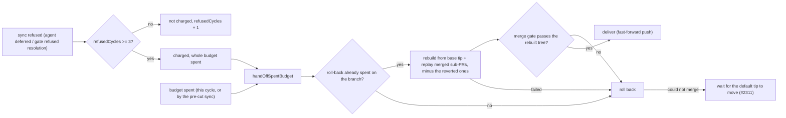

## Summary

A refused milestone sync can no longer stall for ever: a branch refused a
conflict resolution on `MILESTONE_REFUSAL_CEILING` (3) consecutive cycles climbs
to the roll-back on the next cycle; a spent budget is handed off from one place
whoever spent it; and a new rebuild rung follows a spent roll-back. The merge
gate also stops failing on the worker host's image stamp. Closes #4328.

Version bump: `VERSION` is not edited by this change; the merged commit records
the final version.

## Spec

### Intent and Rationale

- Three `VibeCoder` milestones were refused every cycle and nothing climbed past
  the refusal. Found in the code: `judgeSyncFailure` concludes an agent-deferred
  conflict and a gate-refused resolution as `not-charged`, so the budget is
  never spent; the roll-back ran only in the same-cycle failure branch, so a
  budget spent by the child run's pre-cut sync hit the "is the roll-back's now"
  skip and nothing ever ran it; and there was no rung after the roll-back.
- Cause of the two "merged tree does not pass the repo's check" refusals, read
  from `~/logs/self-heal.jsonl` on the host: `deno task test:unit` failed 13
  provider tests with
  `The running container image did not install the "codex" coding-agent provider. Installed: claude.`
  `lib/unit_test_passes.ts` forwarded the host's
  `VIBE_IMAGE_AGENT_PROVIDERS=claude` into the test child, and CI (no stamp) is
  green. Without this fix those branches would have been rolled back (children
  reverted) for a fault that is not theirs.
- The ladder reuses the existing owners: the budget, `executeRollback` and
  `abandonAndRebuildMilestone` (Issue #3035) rather than adding a new
  close-and-requeue path.

### Essential Design Decisions

- Refusal ceiling of 3 consecutive refused cycles, matching
  `MILESTONE_SYNC_ESCALATION_THRESHOLD`. Refusal N+1 is charged as exhausting
  the whole budget (not one attempt) so it reaches the roll-back on cycle N+1,
  as the issue's acceptance says. Applied to both twins: the sweep and
  `milestone_presync.ts`, through the shared `escalateRepeatedRefusal`.
- Only the two not-charged conflict conclusions are refusals. Disrupted runs
  (provider unavailable, ended by the worker), ruleset push rejections and
  non-conflict git failures keep their own handling and are not counted, so an
  outage is not charged to a branch.
- The rebuild rung runs only after a roll-back has been spent on the branch
  (`rollbacks + rollbackFailures > 0`), and falls through to the roll-back when
  it fails or is not wired. It leaves out the sub-PRs that roll-back reverted
  (`revertedPrs`, whose issues are already re-queued for a redo) and runs the
  rebuilt tree through the sync's own merge gate (`checkMergedTree`, wired as
  `rebuildGateFn`) before pushing or re-queuing anything; a refused tree is a
  failed rebuild at step `milestone-gate`, and an unwired gate means no rebuild
  (PR #4344 review). The issue's fourth option (close the milestone and
  requeue its open issues) is not built: the rebuild already re-queues issues
  whose sub-PRs do not replay, and closing a milestone is a larger decision than
  this change makes.
- New ledger fields (`refusedCycles`, `rollbackFailures`, `rebuilds`) are
  optional and additive; old ledgers read them as 0, and `readConflictLedger`
  keeps them across a load. No key bump is needed.
- The test child no longer inherits the image stamp (it was added to the
  allowlist deliberately in an earlier change so the suite saw the same host).
  The DENO_JOBS container bound is still decided from the parent env, so it is
  unaffected.

### Undiscoverable Facts

- The production symptom is only in the host's `~/logs/self-heal.jsonl`
  (`milestone_branch_sync sync_failed`); the live ledger
  (`milestone_sync_failures.json`) and the three branches' state could not be
  read from this checkout, so the acceptance that each branch is level, rebuilt
  or retired within a cycle of deploying is not observed here.
- A `GRQ-AutoTrader` roll-back failed in production with
  `error: you need to resolve your current index first`;
  `prepareRollbackWorktree` now retries once after `git reset --hard HEAD` (the
  worker's own maintenance clone; no ref or untracked file is touched).

## Evidence

Backend only (no UI file touched). Behaviour is shown by
`worker/deno/tests/milestone_sync_refusal_ladder_4328_test.ts`, whose acceptance
tests
(`syncMilestoneBranches - an agent-deferred refusal climbs to the roll-back on cycle N+1`,
and the gate-refused twin) stub a sync refused 3 cycles in a row and assert
`rollbackFn` is not called on cycles 1 to 3 (with the sync call count as the
positive control) and is called once on cycle 4.

Observed production input (quoted from `~/logs/self-heal.jsonl`,
2026-10-25T04:31:41Z):
`Refusing to resolve the merge of 'main' into 'milestone/4058-stop-issues-failing-on-worker-gates-fix-the-r': 1 of 1 conflicted file(s) need a human — every rung of the ladder left them undecided ... and no resolution agent was available to this sync (Issue #1777)`.
The `deno task test:unit` failure was reproduced locally with the stamp set (3
of 9 failed in two files; 9 of 9 pass with `env -u VIBE_IMAGE_AGENT_PROVIDERS`),
and the full suite is green with the stamp set after the change.

## Reproduction

- **symptom** — milestone branches refused a conflict resolution (agent not
  offered, or gate refused it) every cycle stayed behind `main` and nothing
  rolled back or rebuilt them
- **status** — `partial` — each guard was shown red by removing it (see Test
  Plan), but the new tests were not run against an unmodified base checkout, and
  the live host state was not reproduced
- **regression test** —
  `worker/deno/tests/milestone_sync_refusal_ladder_4328_test.ts::syncMilestoneBranches - an agent-deferred refusal climbs to the roll-back on cycle N+1 (Issue #4328)`

reason: the base-branch run is not claimed; the acceptance test imports
`escalateRepeatedRefusal`, which the base does not export, so it cannot be run
there unchanged.

## Test Plan

- Added `worker/deno/tests/milestone_sync_refusal_ladder_4328_test.ts` (35
  tests at head): `judgeSyncFailure` refusal flags (set on the two, not set on
  disrupted, ruleset, non-conflict and merge-gate verdicts);
  `escalateRepeatedRefusal` below/at ceiling and non-refusals; the sweep
  acceptance tests (agent and gate) ; the presync twin; spent-elsewhere hand-off
  with a negative control (`fallbackDefaultSha` set still skips); rebuild after
  a spent roll-back, roll-back first when none is spent, failed rebuild falls
  through, `rollbackFailures` counted; `prepareRollbackWorktree` retry and its
  failure cause; old-shape ledger and save/load round trip;
  `concludeConflictAttempt` and `resetConflictLedgerOnSuccess` rules.
- Same file, added for the pre-PR verifier and the mutation check:
  - `a refusal climbs to the roll-back on a branch with an open head PR`: gh
    returns an open milestone PR with an empty tally; the roll-back is not
    called on cycles 1..ceiling and is called once on ceiling+1, so only the
    `verdict.exhaust === true ||` operand can end it. Red-checked: that operand
    replaced by `false ||` → red.
  - Five tests that run `syncMilestoneBranches` with no `rebuildFn`, so the
    production `defaultRebuildFn` runs: a stub git and a ledger with
    `rollbacks: 1` → one `issue comment <parent> --repo --body <notice>` and no
    `pr comment`, `rebuilds` is 1; a tracker-less milestone finds its oldest
    child through the milestone number; a failed child lookup posts nothing and
    logs both lines (and the lookup's own line reaches the sweep log); a refused
    checkout logs `failed at step milestone-rebuild: Could not check
    out …`
    and falls through to the roll-back; no git runner logs
    `rebuild not
    available` and falls through to the roll-back.
  - `a checkout that succeeded is not reset even if its output names the index`
    pins the `checkout.code !== 0` operand of the retry.
  - Red-checked: `checkout.code !== 0` dropped → red; `milestoneNumber` removed
    from the escalation lookup → red; the lookup's `log` dropped → red; the
    announce `--body` argument changed → red.
  - `milestone_branch_sync.ts` `defaultRebuildFn`: the
    `|| target.kind === "already-escalated"` operand was dead (no
    `alreadyEscalated` is passed to the lookup, so that target never occurs); it
    is removed, leaving `target.kind === "none"`.
  - exempt (untestable): `worker/deno/lib/milestone_branch_sync.ts:546` and
    `:551` — `refusal?: true` and `exhaust?: true` are TypeScript type
    annotations on `ConflictConclusion`; they are erased at runtime, so swapping
    `true` for `false` changes no behaviour. The runtime fields are pinned by
    the `refusal` and `exhaust` tests above.
- Added `worker/deno/tests/conflict_abandon_restart_test.ts` test for `announce`
  (posts through it, no `pr comment`).
- PR #4344 review, in the two files above: (a) sweep test with
  `rollbacks: 1, revertedPrs: [7]` and sub-PRs 7 and 8 listed → only 8's merge
  is cherry-picked and `revertedPrs` survives; its control replays both with no
  reverted PR; the unit test on `abandonAndRebuildMilestone` with
  `excludePrNumbers` asserts the excluded PR is neither replayed, skipped nor
  re-queued. (b) Spent budget from `mergeGateFailureError` with a failing gate →
  no `push`, no `rebuilds`, roll-back runs, log names `milestone-gate` and the
  gate's output; the same budget with a passing gate pushes and rebuilds
  (control); no `rebuildGateFn` → no cherry-pick or push, roll-back runs;
  unit tests: gate refusal and gate throw return `milestone-gate` with no push
  and no re-queue, gate `passed`/`skipped` deliver (`skipped` logs `UNGATED`).
  Red-checks (each guard broken, tests went red, guard restored): gate call
  disabled → 4 red; exclude filter dropped → 2 red; `revertedPrs` not passed
  from `handOffSpentBudget` → 1 red; not passed to the rebuild in
  `defaultRebuildFn` → 1 red; `gate` not wired in `defaultRebuildFn` → 1 red;
  unwired-gate refusal removed → 1 red.
  exempt (untestable): `run_core_production_deps.ts` `rebuildGateFn` — the
  production wiring needs the worker's real clone and `deno`; searched
  `grep -rn rollbackGitFn worker/deno/tests` for a harness that builds the
  production deps, none reaches it.
- Added `worker/deno/tests/unit_test_passes_test.ts` "the container image stamp
  is not forwarded to the test child (Issue #4328)".
- Red-checks (guard broken on purpose, tests went red, guard restored):
  `judgeSyncFailure` not setting `refusal` → 7 red; `escalateRepeatedRefusal`
  returning the verdict unchanged → 4 red; skip-site hand-off deleted → 8 red;
  rebuild gate never firing → 2 red (`a failed rebuild falls through`,
  `a spent roll-back is followed by a rebuild`); `reset --hard` retry dropped →
  1 red; `exhaust` dropped in `concludeConflictAttempt` → 4 red; stamp re-added
  to `TEST_STAGE_EXTRA_ENV_NAMES` →
  `unit passes - the container image stamp is not forwarded to the test child`
  red.
- Compound-condition operands: `verdict.refusal` and `refusedBefore < ceiling`
  in `escalateRepeatedRefusal` are covered by the "not a refusal never
  escalates" and "below the ceiling" tests;
  `rollbackWired && entry.fallbackDefaultSha === undefined` by the hand-off test
  and its negative control; `rollbacks + rollbackFailures > 0` by the rebuild
  and roll-back-first tests.
- Removed from `worker/deno/tests/milestone_branch_sync_test.ts`:
  `rollbacks == []` in "a branch past its budget is not merged again (Issue
  #1778)"
  - Required by: "the conflict resolver declines ... escalates through the
    existing ladder within a bounded number of cycles"
  - Replaced by: `[owner/repo|<branch>|3]` in the same test; a spent budget with
    a roll-back wired is now handed off once. The no-merge assertion and the
    "conflict budget is spent" log assertion still hold.
- Removed from `worker/deno/tests/quality_gate_test_env_test.ts`:
  `assertEquals(env.VIBE_IMAGE_AGENT_PROVIDERS, "claude")` in "what the suite
  genuinely needs is kept (Issue #1281)"
  - Required by: "merged tree does not pass the repo's check" (the stamp
    forwarded to the test child is what failed the gate)
  - Replaced by: `Object.hasOwn(env, "VIBE_IMAGE_AGENT_PROVIDERS") === false` in
    the same test, which goes red if the stamp is re-added to the allowlist
    (red-check above).
- Callers checked: `judgeSyncFailure`/`concludeConflictAttempt` are called from
  the sweep and `milestone_presync.ts` only; both pass `refusal`/`exhaust` and
  use `escalateRepeatedRefusal`. `abandonAndRebuildMilestone` has one other
  caller (`pr_merge_conflict_processor.ts`), which passes no `announce` and
  keeps `gh pr comment`, runs no gate and excludes nothing. `rebuildFn`'s
  other callers (`handOffSpentBudget`, from the same-cycle failure and the skip
  site) both pass `revertedPrs` from the ledger.
- Twinned rules: the pre-cut sync and the sweep share the verdict; no other copy
  found.
- Docs updated: `docs/workflows/milestones.md`, `docs/INTERNALS.md`,
  `docs/MERGE.md`, `docs/workflows/merge-conflicts.md`, `README.md`,
  `docs/EXTENDING.md`. Siblings grepped: `fallback_flagged`, `rollbacks`,
  `fallbackDefaultSha`.
- `./quality.sh < /dev/null` on the head: passed (with skipped checks: config
  integration, checkov); `deno tests` stage passed with
  `VIBE_IMAGE_AGENT_PROVIDERS=claude` set.

## Known gaps

- Not done: the issue's "close the milestone and requeue its open issues" rung.
- Not checked: the live state of the three branches; whether the host runs this
  code; `docs/MERGE.md` L1036-1040 still says "two concluded attempts" and names
  a constant that no longer exists (pre-existing, not touched); the comment near
  `milestone_branch_sync.ts` "offered its two runs again" (pre-existing wording,
  budget is three).
