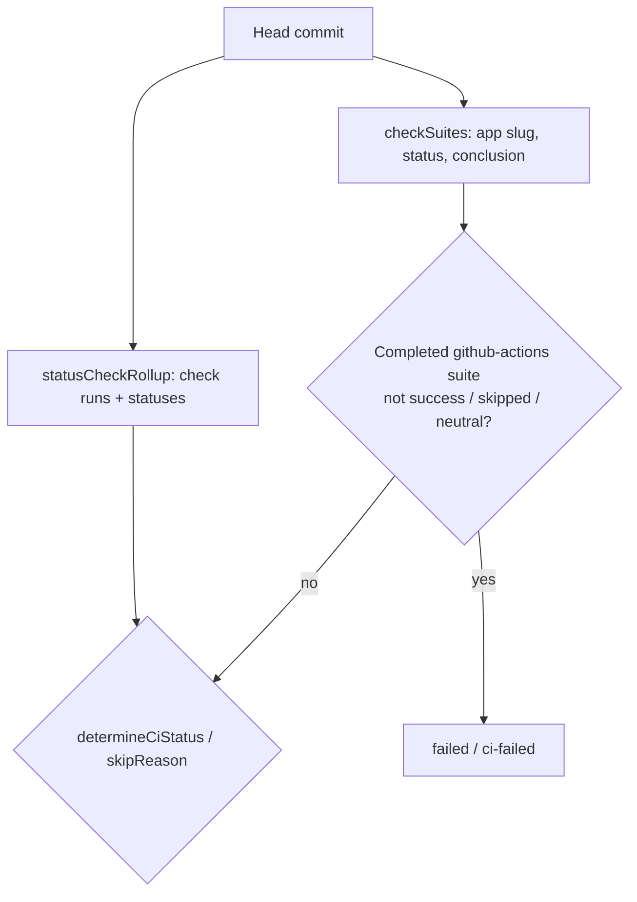

## Summary

A PR whose new workflow is rejected at startup no longer reads as green CI. GitHub records such a workflow as a GitHub Actions **check suite** with conclusion `startup_failure` and zero check runs, which is not a `statusCheckRollup` context, so neither the worker nor the review gate saw it. Both now read the head commit's check suites and treat a completed `github-actions` suite with a non-allowlisted conclusion as failed. Closes #4347.

Version bump: no `VERSION` change in this diff; the merged commit records the final version.

## Spec

### Intent and Rationale

- `docs/MERGE.md` already says a `startup_failure` fails closed, but only a check **run** carried it, and a workflow rejected at startup creates none. The fix reads the suite itself, in the two places that judge CI: `checkCiStatus`/`determineCiStatus` and the gate's `skipReason`.

### Essential Design Decisions

- The suite rule runs **before** the `no_checks` return in `determineCiStatus`, so a commit holding only a failed suite is `failed`, not `no_checks`, and `--allow-no-checks` cannot relax it.
- A missing `checkSuites` key (GraphQL selects it; its empty state is `nodes: []`) is a malformed response: the batch fetch returns `ok:false` (REST fallback) and the gate throws. A missing key is never read as "no suites". The REST fallback likewise errors when the `check-suites` call fails or returns no array.
- Only `github-actions` suites count, and only when completed with a conclusion off `success`/`skipped`/`neutral`, so a queued zero-run suite from a review or notification app keeps today's verdict. The gate keeps its own copy of the allowlist because it is a standalone script (a comment names the worker twin).
- In the gate, a failed suite makes `ci-cancelled` impossible unless every failed suite is also `CANCELLED`; a failed suite on a green or absent rollup is `ci-failed` and is checked before `waiting-ci`.
- The suite list is read with `first: 100` and not paginated; a commit with more than 100 suites could hide a failed one.

### Undiscoverable Facts

- The issue's third step says the CI-fix scan then receives the failure. This diff does not change the CI-fix scan: it reads check runs (`rollupToFailedCheckRuns`), and a suite with no check run has no check-run id for annotations or reruns. The gate now skips the PR as `ci-failed`, and `determineCiStatus` blocks auto-merge. Surfacing the suite to the CI-fix agent is not done here.

## Evidence

Backend/CLI change; no UI files. Observed behaviour comes from the unit tests below, run on the final head: 302 passed, 0 failed across `lifecycle_pr_observation`, `merge_head_pin`, `milestone_merge_behaviour`, `milestone_route_restore`, `pr_maintenance`, `blocking_pr_stall_detector`, `milestone_ruleset_reported_checks`, `check_runs_batch`, `direct_merge` and the new gate test.

The GraphQL fixtures come from `worker/deno/tests/support/github_graphql_fake.ts`, which now models `Commit.checkSuites` (app slug, status, conclusion, honouring `first:`) as GitHub resolves it. The REST fallback stub returns what the `--jq` filter in `checkCiStatus` would produce. I did not query live GitHub for a `startup_failure` suite; the shape comes from the issue (completed / `startup_failure` / 0 runs) and GitHub's `checkSuites` GraphQL fields.

`./quality.sh` on the final head: every static stage passed (lint, type check, fmt, markdownlint, semgrep, mermaid, spawn timeout, workflow hygiene and the rest). The `deno tests` stage failed with 15 failures, none in files this diff touches: 13 are "The running container image did not install the codex/gemini/deepseek coding-agent provider" (this container has only `claude`) and 2 are `completion_phase_repo_formatters_test.ts` ("formatter should commit the Rust fix"). I did not run those tests on the base branch to confirm they fail there too.

## Test Plan

- New `worker/deno/tests/review_fleet_prs_gate_4347_test.ts` (8 tests, passed): startup_failure suite on green rollup is `ci-failed`; other-app, unfinished, passing/skipped/neutral suites do not block; `ACTION_REQUIRED`/`TIMED_OUT` suites are `ci-failed`; absent rollup plus failed suite is `ci-failed` (control: no suites is `waiting-ci`); cancelled-only is `ci-cancelled`, cancelled plus startup_failure is `ci-failed`; a commit lacking `checkSuites` rejects.
- `worker/deno/tests/direct_merge_test.ts` (passed): `checkCiStatus` with one green run plus a completed `github-actions` `startup_failure` suite is `failed` (headline; `passed` on base); queued other-app suite stays `passed`; failed other-app suite stays `passed`; startup_failure with no runs or statuses is `failed` not `no_checks`; `ACTION_REQUIRED` is `failed`; REST fallback fails on a startup_failure suite, errors when the check-suites call fails, and errors on a reply with no array; `determineCiStatus` unit tests flip each operand (app slug, status, null conclusion, allowlisted conclusion).
- `worker/deno/tests/check_runs_batch_test.ts` (passed): suites decoded lowercased; missing `checkSuites` and `checkSuites` without `nodes` give `ok:false`; empty `nodes` and no commit node are the documented empty states; `rollupToCheckRunsResponse` carries `check_suites`.
- `worker/deno/tests/lifecycle_pr_observation_test.ts` (passed): a startup-failed suite under a green rollup records the `quality` gate as `fail`, with the no-suite control `pass`.
- Existing hand-built GraphQL fixtures in `worker/deno/tests/{lifecycle_pr_observation,merge_head_pin,milestone_merge_behaviour,milestone_route_restore,pr_maintenance,check_runs_batch,direct_merge}_test.ts` and `worker/deno/tests/review_fleet_prs_{backlog_3225,checklists_3594,dependabot,gate_2675,gate_audit_3116,upkeep_failure_2891}_test.ts` gained `checkSuites` (plus a `/check-suites` answer in REST stubs); `blocking_pr_stall_detector_test.ts` and `milestone_ruleset_reported_checks_test.ts` use `gh pr view`/`list` JSON and needed no change.
- Removed from `worker/deno/tests/direct_merge_test.ts`: `assertEquals(restCalls, 3)` (REST fallback call count).
  - Replaced by: `assertEquals(restCalls, 4)`.
  - Required by: "Do the same in the REST fallback (`commits/{sha}/check-suites`)". The fallback makes a fourth call; the test still guards that GraphQL is tried once and the REST path runs.
- Red-checks (production code broken on purpose, tests re-run, code restored):
  - Worker: suite check removed from `determineCiStatus` → 5 tests red; `app_slug ===` operand deleted → 2 red; `status === "completed"` operand deleted → 1 red; missing `checkSuites` defaulted to `[]` → 2 red. Headline test fails against the base-branch `direct_merge.ts`/`check_runs_batch.ts` (`AssertionError` at `direct_merge_test.ts:559`, run with `--no-check` because the new fixtures do not type-check against base).
  - Gate: red-suite branch removed → 3 red; slug line dropped → 1 red; status line dropped → 1 red; `every(... === "CANCELLED")` replaced by `true` → 1 red.
- Shared-helper callers checked: `determineCiStatus` has three callers: `checkCiStatus` (both paths) and `lifecycle_pr_observation.ts` via `rollupToCheckRunsResponse`; each covered above. `PrRollup` literals exist only in tests. `rollupToFailedCheckRuns`/the CI-fix scan are deliberately unchanged (see Spec).
- Docs updated: `docs/MERGE.md` (allowlist section, mermaid, zero-checks section), `DESIGN-PRINCIPLES.md` (CI verdict bullets), `.claude/skills/review-fleet-prs/SKILL.md` (rule 2), doc comments in `check_runs_batch.ts`, `direct_merge.ts` and `gate.ts`. Not edited: `docs/workflows/ci-fix.md:194` still says the gate reports cancelled PRs as `ci-failed` until #2916 lands, which was already stale before this change. `docs/MERGE.md` and `DESIGN-PRINCIPLES.md` fail `deno fmt --check` on the base branch as well; they were not reformatted.
- Rule applied to this diff: no new prompt or standards rule was added; the doc claims above were read against `determineCiStatus` and `skipReason`. Twinned rule: the passing allowlist exists in `direct_merge.ts` (`PASSING_CONCLUSIONS`) and `gate.ts` (`PASSING_SUITE_CONCLUSIONS`); both are changed together and each has tests, but no test fails if they disagree.

## Deno regression avoided

No Node tooling added; all work uses `deno test`, `deno lint`, `deno fmt` and `deno check`. `deno.lock` is unchanged.
