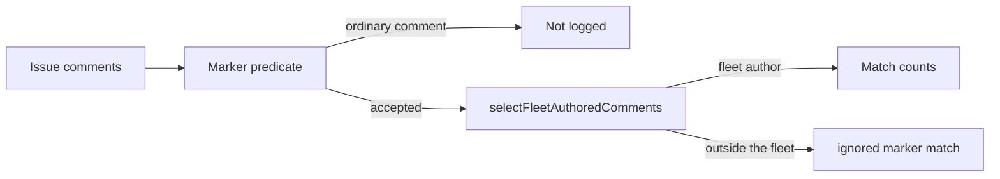

# PR Summary — Issue #4357

## Summary

`selectFleetAuthoredComments` logs every non-fleet row it is given as a
forged marker. The host-fault release, the milestone-branch refusal release
and the repo fast-failure tally passed the whole comment thread and applied
their marker predicate afterwards, so an ordinary owner comment on a labelled
issue was counted as a forged failure record. Each caller now keeps only the
rows its existing predicate accepts, then author-verifies those rows. The
warning fires only for a non-fleet comment the predicate accepts. Closes #4357.

## Spec

### Intent and Rationale

- The discard log is defined to name genuine marker matches. Passing every
  comment made the host-fault and milestone-refusal warnings fire on ordinary
  human comments, which buried a real forged failure record.
- The predicates already existed (`isFailureRecord`, `FAILURE_RECORD_RE`,
  `parseFastFailureCommentMarker`). Applying them before the author check
  leaves the release and tally decisions the same: only a fleet-authored
  match still counts, and an unresolved fleet still discards every match.

### Essential Design Decisions

- The time window on a fast-failure marker stays after the author check. A
  forged marker outside the window is still a marker match, so it is still
  logged.
- `idle_task_freshness.ts` is unchanged. It has no marker predicate: the
  newest fleet comment is the close summary, and filtering it first would
  change which comment is read.
- Every other `selectFleetAuthoredComments` caller already applied its
  predicate before the author check. Those call sites were not reordered.

### Undiscoverable Facts

- On GRQ-23 the host-fault line was the most frequent WARNING: about 600 in
  the last 10 launch logs, in 47 of 50 launches. The milestone-refusal line
  added about 85. One private issue that triggered it had 28 fleet comments
  and 2 ordinary owner comments, and neither owner comment contained a
  failure-record marker.

## Evidence

Backend-only change; no UI files touched.

The three regression tests failed on the unfixed callers, then passed after
each caller's predicate was restored. Reverting only
`host_fault_release.ts` failed the host-fault test and left the other two
green (2 passed, 1 failed). Reverting only
`milestone_branch_refusal_release.ts` failed its test. Reverting only
`repo_fast_failure_issue.ts` failed its test with `ignored 2 marker match(es)`
where the assertion requires `ignored 1`.

**Docs sweep** — grep: `selectFleetAuthoredComments`, "every comment is
filtered"; section: the milestone-branch refusal release and the host-fault
release in `docs/INTERNALS.md`; siblings: `docs/workflows/planning-and-questions.md`
already describes callers that filter first and was left as written; updated:
`docs/INTERNALS.md`.

## Reproduction

- **symptom** — a fleet failure record plus an ordinary owner comment logged `ignored N marker match(es) authored outside the fleet`, and the same line was the most frequent WARNING on the host-fault and milestone-refusal releases
- **status** — `verified` — the regression tests failed against the unfixed callers and pass after the fix
- **regression test** — `worker/deno/tests/host_fault_release_test.ts::releaseHostFaultFailureLabels - an ordinary owner comment is not a forged marker; a non-fleet failure record still is (Issue #4357)`

## Test Plan

- Added `worker/deno/tests/host_fault_release_test.ts::releaseHostFaultFailureLabels - an ordinary owner comment is not a forged marker; a non-fleet failure record still is (Issue #4357)`. Against the unfixed `releaseHostFaultFailureLabels` it failed: `#4357` logged `ignored 1 marker match(es)` for the owner comment. With only that caller's filter removed, the same assertion failed and the other two Issue #4357 tests passed.
- Added `worker/deno/tests/milestone_branch_refusal_release_test.ts::releaseMilestoneBranchRefusalLabels - an ordinary owner comment is not a forged marker; a non-fleet failure record still is (Issue #4357)`. Same failure on the unfixed refusal release (`#4357` logged the owner comment). With only that caller's filter removed, the test failed.
- Added `worker/deno/tests/repo_fast_failure_issue_test.ts::recordRepoFastFailureTally - an ordinary owner comment is not a forged marker; a non-fleet marker still is (Issue #4357)`. On the unfixed tally it failed because the log said `ignored 2 marker match(es)` (the owner comment plus the forged marker). With only that caller's filter removed, the test failed the same way.
- No existing assertion was removed.
- `deno test` on `tests/host_fault_release_test.ts`, `tests/milestone_branch_refusal_release_test.ts` and `tests/repo_fast_failure_issue_test.ts`: 74 passed, 0 failed.
- `deno lint` on the six changed TypeScript files: checked, no problems.
- `deno fmt` on those files: applied, then the suite above was re-run.

Callers of `selectFleetAuthoredComments`, and the order each one uses:

- `worker/deno/lib/host_fault_release.ts` — fixed. `isFailureRecord` runs first.
- `worker/deno/lib/milestone_branch_refusal_release.ts` — fixed. `FAILURE_RECORD_RE` runs first.
- `worker/deno/lib/repo_fast_failure_issue.ts` — fixed. `parseFastFailureCommentMarker` runs first.
- `worker/deno/lib/milestone_branch_sync.ts` — already filters on the escalation-marker prefix first.
- `worker/deno/lib/issue_run_stats_comment.ts` — already filters with `hasIssueRunStatsComment` first.
- `worker/deno/lib/plan_milestone_groups.ts` — already keeps table comments first.
- `worker/deno/lib/plan_coverage_gate.ts` — already keeps coverage-table comments first.
- `worker/deno/lib/planning_carrier.ts` — already keeps nothing-to-do comments first.
- `worker/deno/lib/planning_processor.ts` — already keeps comments that carry sub-issue URLs first.
- `worker/deno/lib/pr_branch_lock.ts` — both calls. `fetchLockComments` already selects `BRANCH_UPDATE_LOCK` comments.
- `worker/deno/lib/claim_pr_comment.ts` — three calls. `fetchClaimComments` already selects `PR_COMMENT_CLAIM` comments, and the own-marker and claim-id filters run before the author check.
- `worker/deno/lib/idle_task_activity.ts` — the `gh` query already selects `CLAIM_MARKER_PREFIX`.
- `worker/deno/lib/failure_detection_resume.ts` — already filters with `ATTEMPT_MARKER_TEST` first.
- `worker/deno/lib/milestone_children_gate.ts` — already keeps comments that contain the gate marker first.
- `worker/deno/lib/shared_cooldown.ts` — both calls. `parseCooldownComment` runs first.
- `worker/deno/lib/milestone_conflict_dedup.ts` — already keeps comments that contain the escalation marker first.
- `worker/deno/lib/stale_workflow_detector.ts` — already keeps comments that contain the diagnostic marker first.
- `worker/deno/lib/run_failure_issue.ts` — already filters with `parseRunFailureFollowUpMarker` first.
- `worker/deno/lib/issue_comment_pages.ts` — `markerCommentAuthors` runs first.
- `worker/deno/lib/milestone_tracker_identity.ts` — `hasMilestoneTrackingMarker` runs first.
- `worker/deno/lib/needs_human_escalation.ts` — the marker substring filter runs first.
- `worker/deno/lib/idle_task_freshness.ts` — no marker predicate. The newest fleet comment is the close summary, so this caller was left unchanged.
