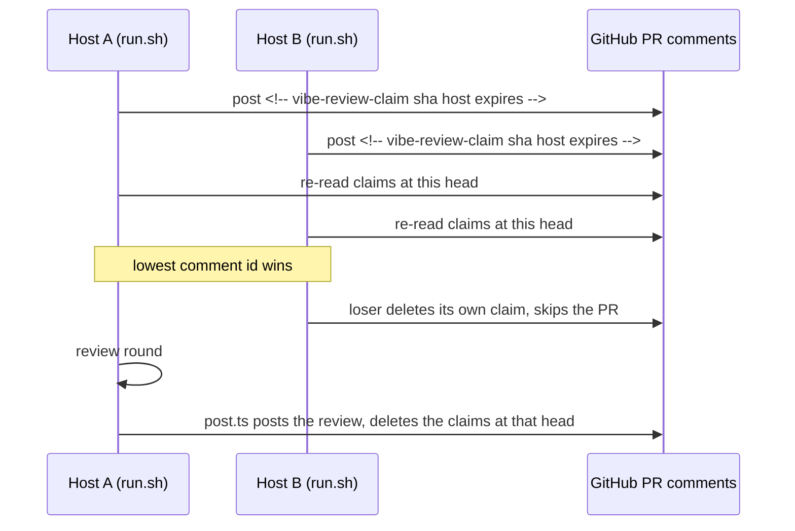

## Summary

Several hosts can now run the `review-fleet-prs` loop without reviewing the same
PR twice. A host claims a PR with a hidden PR comment before its round starts;
the gate skips a PR another host has claimed; the claim is deleted when the
round ends. Closes #4398.

- `scripts/claim.ts` (new): claim marker format, strict whole-body parse,
  `claimPr` (post, re-read, lowest id wins, loser deletes its own),
  `releaseClaims`, and a small CLI (`claim` / `release`).
- `gate.ts`: `--host`, and a `claimed-elsewhere` skip for a live claim at the
  PR's current head by another host. It sits after `in-flight` and before the
  `over-limit` cap, so a claimed PR never takes a slot.
- `post.ts`: after posting, deletes the claims at the reviewed head
  (`releaseClaimAtHead`).
- `run.sh`: claims each ready PR before its round (`--ttl` = round timeout); a
  lost claim starts no round and is not an error; a failed or malformed claim is
  an error; the claim is released when the round finishes, fails or times out,
  when its container cannot start, and when the runner stops. `runner.lock` is
  unchanged.
- Docs: `SKILL.md`, `references/running-unattended.md` (new "Several hosts"
  section), `references/notes.md`.

Version bump: not applicable; this change touches no versioned manifest.

## Spec

### Intent and Rationale

- Hosts only avoided a duplicate review through the `already-reviewed` skip,
  which applies after a review has posted. Two hosts started together would both
  review every ready PR. A per-PR claim on GitHub removes that window across any
  number of hosts.
- A comment rather than a commit status, as the issue says: the reviewer App has
  `statuses: read` only, and a pending status would make the gate's rollup read
  the PR as `waiting-ci`. The App already holds `issues: write` and
  `pull_requests: write` (`app_token.ts` `REQUIRED_PERMISSIONS`), which covers
  PR comments.

### Essential Design Decisions

- The marker is parsed only when it is the whole trimmed comment body, so a
  human comment quoting it is not a claim. A claim's life is also capped at
  `MAX_CLAIM_SECONDS` (7200) after its comment was created, whatever `expires=`
  says, so a forged far-future expiry holds a PR off for at most two hours. Any
  account that can comment on the PR can still post a forged claim; claims are
  not restricted to known logins because hosts run as different identities (the
  gh user or the App) and the App's login is not known to the other hosts.
- The gate ignores its own host's claims (its own rounds are already
  `in-flight`); `claimPr` first deletes the host's own earlier claims on the PR,
  so a crashed round's claim cannot linger.
- A claim failure (GitHub error, malformed output) is an error that is escalated
  like a failed round start. A failed release is logged
  (`could not release the claim`) but does not change the round's result; a
  failed delete in `post.ts` is logged to stderr and never fails an
  already-posted review.
- `post.ts` deletes the claims at the reviewed head from any host (it does not
  know the host inside the container); a moved head leaves its claim at the old
  sha, which the gate ignores and which expires.

### Undiscoverable Facts

- Residual race: if GitHub does not yet show the other host's lower-id claim to
  a host's re-read (read-after-write lag), both hosts review; the cost is
  today's duplicate review.
- The learning round does not claim anything, since it reviews no PR
  (`start_learn` is unchanged).

## Evidence

Backend/CLI change; no UI file is touched. Tests:

- `worker/deno/tests/review_fleet_prs_claim_4398_test.ts` (29 tests): marker
  round trip and strict parse, expiry, the `MAX_CLAIM_SECONDS` clamp, the race
  (both post, lowest id wins, both interleavings and three hosts), release
  filters.
- `worker/deno/tests/review_fleet_prs_gate_claim_4398_test.ts` (7 tests):
  `claimed-elsewhere`, own-host ignore, expiry, old head, no slot used, failed
  read rejects, and a `gate.ts --host` subprocess.
- `worker/deno/tests/review_fleet_prs_post_claim_4398_test.ts` (5 tests): helper
  tests and a `post.ts` subprocess that asserts the claim comment at the head is
  deleted after the review is posted.
- `worker/deno/tests/review_fleet_prs_runner_test.ts` (12 new tests): claim
  before the round and before the gate-listed container, lost / failed /
  malformed claim, release after a finished, failed and timed-out round, on a
  container failure and on the EXIT trap.
- Fakes mirror real `gh`: `gh api --paginate` prints a JSON array (`[]` for no
  comments), a created comment returns `id`, `body`, `created_at`, `user.login`,
  and a missing comment on DELETE is `Not Found (HTTP 404)`. `claim.ts` reads
  multi-page output as concatenated arrays and rejects empty output; it was not
  run against live `gh` in this sandbox.

## Test Plan

- Existing fake `gh` functions gained a `/comments` answer of `[]` (additions
  only, no assertion changed): `review_fleet_prs_backlog_3225_test.ts`,
  `_checklists_3594_`, `_dependabot_`, `_gate_audit_3116_`,
  `_upkeep_failure_2891_`, and `capability_security_review_4366_test.ts`.
  `READY`, `TWO_READY` and the audit-prompt entry in
  `review_fleet_prs_runner_test.ts` gained a `headSha`.
- Red checks (each break made on purpose, test seen red, then restored):
  - `claim.ts` lowest-id rule → highest id: 5 tests red (both race tests, three
    hosts, lower-id loses, delete refused).
  - `claim.ts` expiry filter removed: 4 red. MAX clamp removed: 1 red. Anchoring
    loosened: 2 red. Loser no longer deletes its own claim: 5 red.
  - `gate.ts` skip removed: 4 red; skip moved after the `over-limit` cap: 1 red
    (slot test, free PR first); host forced to "": 3 red; wrong sha in the
    check: 5 red.
  - `post.ts` call removed from `main`: subprocess test red; wrong sha filter: 4
    red; helper rethrows: 2 red.
  - `run.sh` `false` treated as a win: lost-claim test red; claim moved after
    `launch`: ordering, lost, error and garbage tests red; no release in
    `round_job`: 4 red; no release on container failure: 1 red; `--host` dropped
    from the gate call: 1 red; EXIT-trap release no-op: 1 red. (Moving the claim
    after `round_container` stays green by design: the container only starts in
    `launch`.)
- Callers checked for the new `host` parameter: `gate.ts` `main` passes
  `arg("host")` (covered by the `gate.ts --host` subprocess test) and `run.sh`
  `gate_pass` passes `--host` (runner test); `pass` called without `host` treats
  every live claim as held elsewhere (documented in the gate header).
- Related skip-reason lists checked for the new reason: gate.ts `Skip` type and
  header, SKILL.md "The loop" list, notes.md. `SKILL.md` "already-reviewed ...
  over-limit" retry list is not a skip-reason list (`in-flight` is absent from
  it too) and is left alone.
- Gate, on the final head: the ten test files this diff adds or edits pass (171
  passed, 0 failed, via `deno task test`); `deno fmt --check`, `deno lint` and
  `deno check` pass on the changed `.ts` files, and `shellcheck` passes on
  `run.sh`. A full `./quality.sh` run passed its static stages, markdownlint and
  mermaid, but hit the 590 s command limit in the deno-tests stage, so its
  tests, lint and type stages did not report; semgrep failed because the sandbox
  cannot reach the rule registry, and checkov was skipped. CI is authoritative
  for those stages. `tests/completion_phase_repo_formatters_test.ts` (two
  failures seen in an earlier gate run, a Rust formatter assertion this diff
  does not touch) was not re-run or checked on the base branch.
