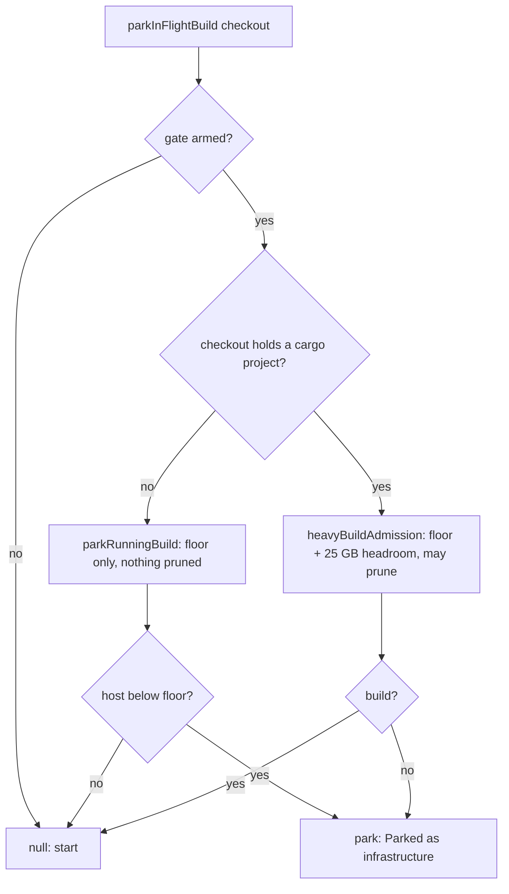

## Summary

An agent, mutation, discrimination or quality-fix step in a checkout with no
cargo project is no longer parked for the ephemeral cargo root's 25 GB headroom.
It is held to the host floor only, and no idle sibling target directories are
pruned for it. A checkout that holds a cargo project behaves exactly as before.
Closes #4413.

Version bump: no `VERSION` change is part of this diff; the merged commit
records the final version.

## Spec

### Intent and Rationale

- Released claims read
  `Claude execution failed: ephemeral cargo root over
  budget (67.6 GB free, floor 46.0 GB + headroom 25.0 GB) … cargo builds wait
  for CI`.
  The host was above its 46 GB floor, but `parkInFlightBuild` required floor +
  25 GB before every agent start, so a Deno-only repo (this one) could never
  start an agent on a host holding 52-67 GB. Each refusal was recorded as
  `disk-full` with no PR (about 25 recurrences in the issue thread).
- The headroom exists because only cargo writes to the ephemeral cargo root.
  `docs/CONTAINER.md` and `docs/INTERNALS.md` already said a repository with no
  cargo project keeps the normal agent; the in-flight park contradicted that.
  The fix makes the code agree with the documented contract rather than
  loosening the budget for cargo trees.

### Essential Design Decisions

- The cargo check comes first in `parkInFlightBuild`: a tree with no cargo
  project goes straight to `parkRunningBuild()` (floor only). That keeps the
  below-floor stop for every checkout and avoids pruning other checkouts' idle
  target directories for work that will never write there.
- "Holds a cargo project" reuses `findProjectManifests` (depth 2, the same
  search the milestone merge gate uses). It moved to the new
  `worker/deno/lib/project_manifests.ts` because `milestone_merge_gate.ts`
  already imports `heavy_build_gate.ts`; `milestone_merge_gate.ts` re-exports
  every name it exported before, so no importer changed.
- `heavyBuildAdmission`, `parkRunningBuild`, the milestone sync paths and the
  failure classifiers are unchanged. A cargo-project checkout that is short of
  the headroom is still parked and still classified `disk-full`.
- An unreadable checkout holds no manifest, so it is treated as non-cargo; the
  agent could not run there either.

### Undiscoverable Facts

- The released messages were read from the release comments on #4398 and #4409
  (the issue body carries none). Hosts hold 50-67 GB free against a 71 GB
  requirement, so the refusal was permanent on them, not transient.
- The pre-existing
  `merge-only e2e - root Cargo cannot hide a failing nested
  Deno resolution suite (PR #4343)`
  test in `worker/deno/tests/milestone_merge_only_4326_test.ts` fails on a clean
  checkout (its fixture's unformatted `web/deno.json` is rejected by the
  pre-push `deno fmt --check`). This diff does not touch it.

## Evidence

Backend-only; no UI files.

Tests (run from `worker/deno`):
`deno task test tests/heavy_build_gate_3178_test.ts tests/heavy_build_gate_in_flight_4413_test.ts tests/host_disk_inflight_4360_test.ts tests/claude_runner_host_disk_4390_test.ts tests/lib_sweep_coverage_test.ts`.

## Test Plan

New tests in `worker/deno/tests/heavy_build_gate_in_flight_4413_test.ts`:
Deno-only merge-only reading not parked; cargo merge-only parked with the budget
text; Deno-only below floor still parked (names 46.0 GB); nested
`rust/Cargo.toml` counts as a cargo project; empty and missing checkouts not
parked; Deno-only checkout leaves an idle sibling target dir unpruned (cargo
checkout prunes it); call site through `runClaudeWithTimeout` — Deno-only cwd at
67.6 GB starts the agent, cargo cwd below the floor is refused with the park
note.

One existing test edited: `worker/deno/tests/heavy_build_gate_3178_test.ts`
"build-step admission parks both deferred and merge-only builds" — only the
fixture changed (the non-existent `CHECKOUT` became a temp dir holding a
`Cargo.toml` for the first loop); every assertion is kept. No assertion is
removed.

Red checks (each restored, byte-identical; the ephemeral root constant was
pointed at a non-existent path during the mutations so none could delete real
cache directories):

- cargo condition deleted → "Deno-only merge-only not parked" and "empty
  checkout" tests red
- merge-only never parked → cargo merge-only, nested cargo and the 3178
  merge-only assertion red
- cargo detection root-only → nested cargo test red
- defer path skipped for non-cargo trees → Deno-only below-floor, "not parked"
  and "empty checkout" tests red
- cargo-first order removed (admission first) → the "no prune" test red
- every merge-only parks (cargo-first removed) → Deno call-site, "not parked",
  "empty checkout" and "no prune" tests red

Results on the final head of the code: required set 100 passed, 0 failed;
`deno check`, `deno fmt --check` and `deno lint` clean on the touched files.
Milestone suites (14 files) earlier: 266 passed, 1 failed (the pre-existing
failure above, identical on a clean export of the base).

Callers of `parkInFlightBuild` checked: `claude_runner.ts` (agent start, covered
by the call-site test), `mutation_check_invocation.ts`,
`security_fix_discrimination.ts`, `phases/quality_gate_remediation_phase.ts` —
all get the same rule; the three non-agent callers have no separate new test.
Twinned rules: `docs/CONTAINER.md` (section "In-flight builds stop at the same
floor", bullet "The root has a budget") and `docs/INTERNALS.md` (~3080) updated;
`docs/INTERNALS.md` ~4478 and the HOST_DISK_BUDGET section already stated the
rule.

## Not done

- A merge-only cargo call-site test through `runClaudeWithTimeout`: it would
  read and possibly prune the real `/var/tmp/vibe-cargo-target`, and the
  production path takes no injected root. The cargo merge-only case is covered
  at `parkInFlightBuild` with an injected root.
- No change to the `disk-full` classification or to the claim gate: cargo
  checkouts on a host short of the headroom are still parked and still filed.
