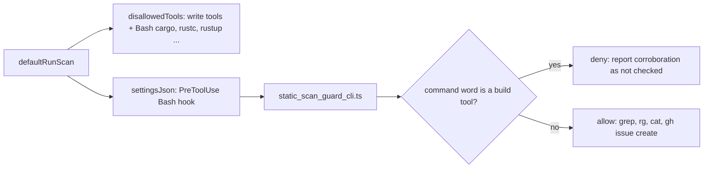

## Summary

The static best-practices scan no longer permits `cargo check` or
`cargo clippy`. Both commands run build scripts and procedural macros (including
ones a dependency supplies when the top-level crate has no `build.rs`) and write
`target/`; `--offline` limits registry access only and does not confine a build
script. The permission is removed from `prompts/best_practices/prompt.md` (Hard
Constraint 2) and `prompts/best_practices/buckets/rust.md`, and the scan session
now refuses Rust build tools in its tool decisions: `Bash(<tool>:*)` deny rules
on every provider, plus a `PreToolUse` hook on Bash
(`worker/deno/lib/static_scan_guard.ts`, entry point
`static_scan_guard_cli.ts`). Missing compiler corroboration is reported as "not
checked (static scan)" and never blocks a static finding. Closes #4415.

Version bump: no `VERSION` change is part of this diff; the merged commit
records the final version.

## Spec

### Intent and Rationale

- A prompt that says "do not run cargo" is advice, and the old prompt said the
  opposite for cargo. The fix removes the contradiction and adds a refusal in
  the scan's own tool decisions.
- The hook sits on the best-practices session only, so implementation and CI
  `cargo` use is untouched and no sandbox platform is built.

### Essential Design Decisions

- Two layers, one source: `STATIC_SCAN_BUILD_TOOLS` drives both the deny rules
  and the hook classifier. The hook classifies command words only (wrappers,
  `;`/`&&`/`|`, `sh -c`, `env -S`, path prefixes), so `grep cargo Cargo.toml`
  and `gh issue create --title "cargo clippy …"` stay allowed.
- Fail closed: a Bash payload the guard cannot read, or a classifier error, is
  denied. `rustup` is denied outright.
- Honest limit: this is command-text classification, not an OS sandbox. Words
  built at run time (`X=cargo; $X check`, `eval`, `$(which cargo)`) are not
  resolved. The module, prompt and docs say so.
- Under the DeepSeek provider `agent_provider.ts` drops `settingsJson`, so there
  only the deny rules apply; `docs/BEST-PRACTICES-SCAN.md` says so.
- `readStdin` is reused from `issue_edit_guard_cli.ts` (made `export`) rather
  than copied.

### Undiscoverable Facts

- Other idle-task prompts carry their own analyser permissions
  (`prompts/dead_code/prompt.md`, `prompts/format_drift/prompt.md` permit
  `cargo` analysis). The issue is scoped to the best-practices scan, so they are
  unchanged; they are separate contracts, not covered by this fix.
- `completion_phase_repo_formatters_test.ts` fails 2 tests identically on the
  base commit `6c3202f8` in this environment (verified in a detached worktree);
  this diff touches nothing it reads.

## Evidence

Backend-only change; no UI files. Command run on the head:
`deno task test tests/static_scan_guard_test.ts tests/static_scan_cargo_build_script_test.ts tests/best_practices_template_test.ts tests/issue_executor_enforcement_test.ts tests/console_redaction_entrypoint_check_test.ts tests/lib_sweep_coverage_test.ts tests/references_doc_test.ts`
from `worker/deno`.

Observed tool behaviour relied on: `agent_provider.ts:1135-1166` (DeepSeek
`buildInvocation`) drops `settingsJson` and keeps `disallowedTools`;
`claude_runner.ts:1310-1315` merges `settingsJson` into the invocation.

## Acceptance Criteria

<!-- vibe-spec-review inputs="diff+issue-body" -->

- **met** — Both contradictory permissions are removed, with a short explanation
  covering transitive build scripts and proc macros. — evidence:
  `prompts/best_practices/prompt.md` (Hard Constraint 2),
  `prompts/best_practices/buckets/rust.md` ("No tooling assist.") — reviewer:
  met
- **met** — A scan-path behavioural fixture requests Cargo corroboration on a
  minimal offline Rust project containing a harmless build-hook sentinel: the
  static scan does not execute the hook or create build outputs, and still
  returns a supported static finding. — evidence:
  `worker/deno/tests/static_scan_cargo_build_script_test.ts::static scan fixture - the scan refuses cargo, runs grep, and reports the finding`;
  `worker/deno/tests/static_scan_guard_test.ts` (CLI process test) — reviewer:
  partial — reason: the reviewer noted the fake agent calls
  `decideStaticScanHook` in-process instead of running the installed hook
  command; the fixture asserts the installed hook's matcher and command point at
  the guard CLI, and the CLI process test spawns that same entry point and
  asserts the deny output, so the two halves are covered; the "supported
  finding" is the `src/lib.rs:<line>` grep evidence plus `ok: true`
- **met** — Normal implementation validation can still run the same fixture
  inside its authorised test environment; no production credentials or live
  attack is involved. — evidence:
  `worker/deno/tests/static_scan_cargo_build_script_test.ts::static scan fixture control - cargo check without the guard writes the sentinel and target/`
  — reviewer: partial — reason: the control is `ignore`d on a host without
  cargo; it ran and passed here (cargo 1.99.1 on PATH), and the guard is
  imported only by the best-practices template
- **met** — Unavailable corroboration is reported honestly; relevant existing
  quality checks pass. — evidence: `prompts/best_practices/prompt.md` ("not
  checked (static scan)"), denial reason in
  `worker/deno/lib/static_scan_guard.ts`; `./quality.sh` run on the head —
  reviewer: partial — reason: the reviewer saw no gate evidence; the gate passed
  every stage except `deno tests`, whose only 2 failures
  (`completion_phase_repo_formatters_test.ts`) fail identically on base
  `6c3202f8`; the semgrep, completeness (lib-sweep top-up
  `docs/audits/lib-sweep-coverage/top-up-4415.json`), lint, type-check and fmt
  stages pass; checkov skipped (not installed)

## Standards Review

<!-- vibe-standards-review inputs="diff+CODING-STANDARDS.md" -->

- **violation** — new lib modules claimed by no sweep slice — evidence:
  `worker/deno/lib/static_scan_guard.ts` — reason: fixed in this diff
  (`docs/audits/lib-sweep-coverage/top-up-4415.json`)
- **violation** — `env -S 'cargo check'` bypassed the classifier;
  `rustup run stable <other>` allowed — evidence:
  `worker/deno/lib/static_scan_guard.ts` — reason: fixed in this diff (`env -S`
  payload is re-scanned; `rustup` denied outright; evasion cases added)
- **violation** — docs said the hook always applies although DeepSeek drops it —
  evidence: `docs/BEST-PRACTICES-SCAN.md` — reason: fixed in this diff
  (two-layer wording; also `prompts/best_practices/prompt.md`)
- **violation** — CLI module doc claimed no other defence — evidence:
  `worker/deno/lib/static_scan_guard_cli.ts` — reason: fixed in this diff
- **violation** — `readStdin` copied instead of reusing the owner — evidence:
  `worker/deno/lib/static_scan_guard_cli.ts` — reason: fixed in this diff
  (exported from `issue_edit_guard_cli.ts` and imported)
- **violation** — CLI entry point never run; event operand, catch, `denoDir` pin
  and regex hostile cases untested — evidence:
  `worker/deno/tests/static_scan_guard_test.ts` — reason: fixed in this diff
  (tests added, each red-checked)
- **violation** — fixture test path named relative to `worker/deno` — evidence:
  `worker/deno/lib/idle_task_templates/best_practices_template.ts` — reason:
  fixed in this diff
- **clean** — Australian English, no hidden or forbidden paths staged,
  `makeTempDir` for all fixtures, console redaction in the new entry point,
  existing helpers reused (`renderIssueEditHookOutput`, `posixSingleQuote`,
  `resolveGuardModulePath`, `resolveGuardDenoDir`); review-enforced rules
  checked: call-the-existing-owner, SIMPLE-ON-PURPOSE (marker added),
  apply-rule-to-own-diff

## Test Plan

New tests: `worker/deno/tests/static_scan_guard_test.ts` (classifier table with
evasion cases and look-alikes, hook decision, CLI `runStaticScanGuard`, CLI
process spawn, settings builder, hostile-regex cases) and
`worker/deno/tests/static_scan_cargo_build_script_test.ts` (fixture through
`defaultRunScan`, and a live-cargo control). No existing test assertion is
removed; one existing classifier expectation I wrote earlier in this PR
(`rustup run stable cargo check` reported as `rustup`) changed with the fix to
deny `rustup` outright.

Red checks (each mutation restored; results from the guard executor's run):

- decision forced to allow → fixture fails at "the build script must not have
  run" (sentinel exists) and 4 guard tests fail
- `settingsJson` removed from `defaultRunScan` → fixture fails at the hook
  matcher assertion
- `...STATIC_SCAN_DISALLOWED_BASH_TOOLS` removed → fixture fails at "cargo must
  be disallowed"
- `event !== undefined &&` operand deleted → no-event-name cargo test fails
- `denoDir` branches swapped → both `denoDir` tests fail
- classifier `catch` returns allow → throwing-classifier test fails
- `import.meta.main` block disabled in `static_scan_guard_cli.ts` → CLI process
  test fails
- mutation-check survivors (`static_scan_guard.ts` lines 80, 83–85, 101,
  103–107, 123–131, 141–145: separators `|` `)` `{` `}`, shell keywords, `sudo`
  and `xargs` option arguments) → each element deleted in turn; the new `DENIED`
  entries in `static_scan_guard_test.ts` fail for every one, and the suite
  passes unmutated (109 passed)

Callers checked for `defaultRunScan` (now takes `runClaudeFn`):
`best_practices_template.ts` is the only caller; the other templates keep their
own private runners. Related existing rules checked:
`prompts/best_practices/prompt.md` dead-dependency "static evidence only" bullet
(reworded to agree), `docs/BEST-PRACTICES-SCAN.md` CI-gate rows about
`cargo clippy` (CI configuration review, still true). Siblings grepped for the
doc sweep: `analyser`, `corroborat`, `cargo check`, `cargo clippy`.

Results: the seven test files named under Evidence passed on the final head (234
passed, 0 failed); the full `./quality.sh` run on the head: all stages pass
except `deno tests` (2 failures, both in
`worker/deno/tests/completion_phase_repo_formatters_test.ts`, identical on the
base commit); semgrep passed; checkov skipped.

## Not done

- `prompts/dead_code/prompt.md` and `prompts/format_drift/prompt.md` still
  permit `cargo` analysis; out of scope for this issue.
- Commands whose tool name is built at run time are not classified (documented
  in `static_scan_guard.ts`).
