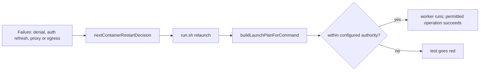

## Summary

Recovery after a failure now has regression coverage that it never broadens a
worker's configured authority, plus a guidance entry and a coverage-scan check
for the same contract. Closes #4417.

- `worker/deno/tests/recovery_authority_4417_test.ts` drives the real
  per-launch plan path (`buildLaunchPlanForCommand`) after a denial, an
  authentication failure with credential refresh, and an egress or
  network-unavailable failure, and checks the relaunch against the authority
  configured before the failure (mounts, credential sub-directories, network,
  egress enforcement, allow-hosts, privilege flags, config-file hash). It also
  covers provider rotation inside the configured pool, an explicit authorised
  allow-host change, a missing credential directory failing closed, the
  persisted restart streak and work volumes, and Apple retries keeping the
  explicit mode.
- `worker/deno/tests/run_sh_launcher_test.ts` runs the real `run.sh` through a
  failed egress sidecar (network create, proxy listen, proxy connect), then a
  retry, and through a denied worker run, then a retry. The worker never starts
  on an open network, the retry's worker argv equals a clean launch's, and no
  volume is deleted.
- `prompts/coding_guidelines/capability-security.json` gains one entry,
  `capsec-recovery-boundary` (revision `2026-10-27.1`).
- `worker/deno/lib/capability_coverage_scan.ts` gains a fourth coverage
  contract, `capsec-recovery-boundary`: a retry, restart or fallback line near a
  credential, mount or identity alteration with no boundary test is a
  best-practices finding (not an exploit claim).
- `worker/deno/commands/container_launch_plan.ts` passes its injected `env` to
  `readConfiguredAgentProviderSet` (default is still the process environment),
  so the recovery tests need no process-environment mutation.
- Docs: `docs/CAPABILITY-SECURITY-GUIDANCE.md`, `docs/BEST-PRACTICES-SCAN.md`,
  `prompts/best_practices/prompt.md` and the existing Wiz CIRT row in
  `docs/REFERENCES.md` (updated, not duplicated).

Version bump: no `VERSION` change is part of this diff; the merged commit
records the final version.

## Spec

### Intent and Rationale

- DESIGN-PRINCIPLES.md already requires recovery within existing authority. The
  gap was proof across failure, then retry or restart, then resumption, so the
  work adds tests against landed paths (#4047 egress sidecar, #4051 Apple mode)
  rather than a second policy engine.
- The plan builder takes no failure input, so authority cannot widen through it
  by construction. The tests therefore pin the paths that do read state on every
  launch (`buildLaunchPlanForCommand`, `run.sh`) and fail if a failure-reactive
  widening is added there.

### Essential Design Decisions

- `withinAuthority` and `authorityOf` are test-local checkers. Tests named "the
  authority check flags …" prove the checker, not a production refusal; the
  production boundary is exercised by "the production guards refuse widened
  launch arguments" and the `run.sh` tests.
- The scan reads the recovery contract as a coverage gap only. The marker
  `recovery-scope-change: authorised` (comment only) is how a file declares an
  explicit authorised change; `best-practice-ignore: <id>` still suppresses.
- Repository and operation scope is checked indirectly: the plan has no
  repository field, so the config file hash, the checkout mount and the egress
  allow-hosts stand in for it.
- Assumption: the sixth guidance entry is credited to the Wiz CIRT lesson, not
  CodeGuard, so the CodeGuard rows say "five" for the CodeGuard-derived set.

### Undiscoverable Facts

- This sandbox is itself a worker image, so provider selection read the image
  stamp from the process environment; the injected-env seam removes that
  dependency from the tests.
- `evals/capability_security/dry-run.json` still records the older guidance
  revision; it is a recorded run and no test reads it, so it was not
  regenerated.

## Evidence

Production implementations the fakes stand in for: the `run.sh` tests use the
existing launcher harness stubs (`STUB_NETWORK_CREATE_EXIT`, `STUB_PROXY_*`,
`STUB_NETWORK_CONNECT_EXIT`, `STUB_RUN_EXIT`) and the real
`container-launch-plan` command; Apple tests use the real `appleMode`,
`appleLaunch`, `retryAppleEgress` and `appleControlFailures`.

Not checked: the real Apple `container` CLI and runtime on macOS (no Apple
runtime in this container); Apple coverage is the pure-function evidence above.

Issue numbers cited as provenance: #4051: Apple container containment (explicit
modes); #4047: egress sidecar startup; #4365: capability guidance; #4366:
review use of the guidance; #4367: behavioural coverage scan; #4415: static
scan Cargo fix (existing Wiz row).

## Acceptance Criteria

<!-- vibe-spec-review inputs="diff+issue-body" -->

- **met** — Deterministic failure-injection tests show a denial cannot trigger broader repository access, new credential mounts or a weaker network mode; also show a permitted operation succeeds after ordinary recovery. — evidence: `worker/deno/tests/recovery_authority_4417_test.ts::recovery authority - a denied operation relaunches within the configured authority (Issue #4417)`, `worker/deno/tests/run_sh_launcher_test.ts` 4417 tests — reviewer: met
- **met** — Restart exercises the real production plan/recovery path and preserves durable work. Tests fail when the relevant boundary check is deliberately removed in a test mutation; no new generic production gate. — evidence: `worker/deno/tests/recovery_authority_4417_test.ts::recovery authority - the production guards refuse widened launch arguments (Issue #4417)`, run.sh mutation red checks recorded in Test Plan — reviewer: partial — reason: the reviewer saw only the diff, which holds no record of the mutation runs; they were run here and are listed under Test Plan
- **met** — Apple partial/advisory containment remains a supported explicit choice under #4051. — evidence: `worker/deno/tests/recovery_authority_4417_test.ts::recovery authority - Apple retries keep the selected mode and report the advisory gap (Issue #4417)` — reviewer: partial — reason: the reviewer found no in-diff record of the unavailable Apple runtime tests as not checked; the Evidence section records them as not checked
- **met** — Guidance/scan fixtures distinguish unsafe widening, legitimate same-scope refresh, fully covered recovery, explicit authorised configuration changes and unrelated retries. — evidence: `worker/deno/tests/capability_coverage_scan_recovery_4417_test.ts`, `worker/deno/tests/capability_security_recovery_4417_test.ts` — reviewer: met
- **met** — No new recovery scheduler, blanket resource limits, manual approval step or denial-only implementation that prevents legitimate work. — evidence: diff touches no scheduler or quota; rotation and refresh tests pass — reviewer: met

## Standards Review

<!-- vibe-standards-review inputs="diff+CODING-STANDARDS.md" -->

- **violation** — unit tests must not mutate process environment — evidence: `worker/deno/tests/recovery_authority_4417_test.ts:478` — reason: fixed in this diff (injected `env` seam in `worker/deno/commands/container_launch_plan.ts`)
- **violation** — gate over source text must blank comments and literals and exclude look-alikes — evidence: `worker/deno/lib/capability_coverage_scan.ts:150` — reason: fixed in this diff (shared comment stripper, string blanking, word boundaries, look-alike tests)
- **violation** — hand-rolled comment stripper duplicated an in-repo helper — evidence: `worker/deno/lib/capability_coverage_scan.ts:150` — reason: fixed in this diff (calls `stripLineAndBlockComments`)
- **violation** — operands of a compound condition had no tests — evidence: `worker/deno/lib/capability_coverage_scan.ts:150` — reason: fixed in this diff (condition removed; marker cases tested for `//`, `/* */`, string)
- **violation** — hostile-input test did not reach its pattern — evidence: `worker/deno/tests/capability_coverage_scan_recovery_4417_test.ts:457` — reason: fixed in this diff (each hostile run asserted to be rejected and the same run with a trigger accepted)
- **violation** — prose trigger lists shorter than the code — evidence: `docs/CAPABILITY-SECURITY-GUIDANCE.md:40` — reason: fixed in this diff (lists reworded as examples pointing to `docs/BEST-PRACTICES-SCAN.md`)
- **clean** — Australian English, regex safety (no overlapping quantifiers, one hostile case per pattern), named tests exist, no stubs of other repositories' binaries, no persisted-shape change, temp directories from `Deno.makeTempDir`

## Test Plan

- Added `worker/deno/tests/recovery_authority_4417_test.ts` (18 tests),
  `worker/deno/tests/capability_coverage_scan_recovery_4417_test.ts`,
  `worker/deno/tests/capability_security_recovery_4417_test.ts`; appended four
  "(Issue #4417)" tests to `worker/deno/tests/run_sh_launcher_test.ts` and gave
  `assertEgressSidecarOrder` an optional `from` offset (existing callers keep
  `0`; no existing assertion removed or changed).
- Run on the final head: `deno test -A` over the three new files plus
  `capability_coverage_scan_4367_test.ts`, `capability_security_guidance_4365_test.ts`,
  `capability_security_review_4366_test.ts`, `references_doc_test.ts`,
  `container_launch_plan_command_test.ts`, `parallel_safety_cap_test.ts`,
  `container_launch_test.ts`: 195 passed, 0 failed. `run_sh_launcher_test.ts`
  whole file: 111 passed, 0 failed (run before the later test-only edits that
  did not touch `run.sh`). `deno fmt --check` on touched files and `deno lint`
  clean.
- Red checks (new tests go red with only their guard broken):
  - failure-reactive widening added to `commands/container_launch_plan.ts` → denied, auth-refresh and permitted-operation tests red
  - command ignores the config `egress_allow_hosts` edit → authorised-change test red
  - command stops passing `env` to provider selection → provider-rotation test red
  - `run.sh` falls through after a failed network create → the sidecar-failure tests red; `run.sh` drops `--network` on a retry → argv-equality tests red
  - `assertRunArgumentsContained` host-namespace, forbidden-flag and `assertMountSourcePermitted` home-directory checks removed → "the production guards refuse widened launch arguments" red
  - scan: remove same-line alteration requirement, remove comment stripping, allow the marker from a string, restore the old failure term, restore bare `preserves?`, break the window direction → the named scan tests red
  - guidance: empty the entry's task signals → selection test red; add bare `retry` → backoff negative test red
- The plan-level denial and network-unavailable log/state injections are not
  read by `buildLaunchPlanForCommand`; those tests pin current behaviour (expected
  green on base) and go red only under a failure-reactive change like the first
  red check above.
- Callers/siblings: the new `env` argument to `readConfiguredAgentProviderSet`
  is the only changed call site; `tests/recovery_authority_4417_test.ts` goes
  red when it is reverted.
- Twinned rules: the best-practices prompt (`prompts/best_practices/prompt.md`),
  `docs/BEST-PRACTICES-SCAN.md` and the scan code list the coverage contracts;
  all now say four. `Three contracts` grep: one unrelated hit
  (`worker/deno/setup/prerequisite_installer.ts`).
- Full `./quality.sh` ran its static stages green (benchmark audit, chokepoints,
  completeness, mermaid, markdownlint, semgrep, release-tag ruleset) and then
  hit the 580 s command limit inside the Deno test stage, so the whole-suite
  result is not observed here.

<!-- vibe-quality-gate-skipped: full ./quality.sh test stage exceeded the 580 s command limit; targeted tests listed above passed; CI runs the same checks -->
