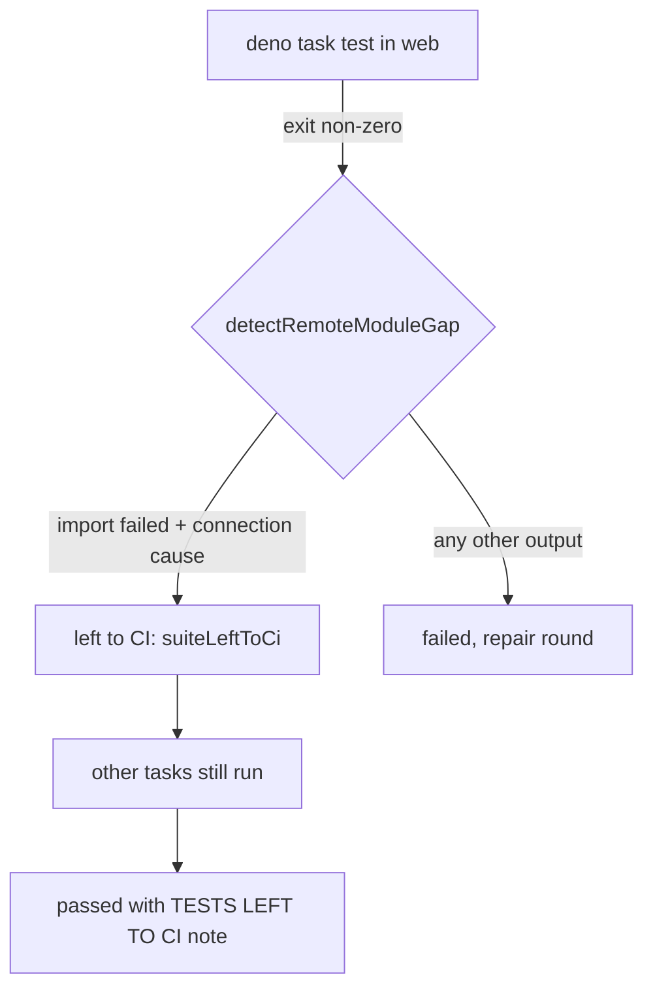

## Summary

The milestone resolution gate no longer refuses a resolution because the host
cannot reach a module host. A Deno task whose output is an import failure plus a
connection-class cause (`error sending request for url`, `unsuccessful tunnel`,
`dns error`) is now left to the milestone PR's CI, named in the outcome and the
report as not run, instead of being failed, repaired and refused every cycle.
Closes #4422.

Version bump: `VERSION` is not part of this diff; the merged commit records the
final version.

## Spec

### Intent and Rationale

- GRQ-AutoTrader's `web` project imports `https://esm.sh/...`; the sync host had
  no route to it, so `deno task test` exited 1, a repair round "changed
  nothing", and the identical resolution was refused for every issue of the
  milestone.
- Chosen over refusing with no repair (the #3255 toolchain-gap shape): that
  would keep the wedge. Chosen over a retry: the host's route does not change
  between attempts.

### Essential Design Decisions

- Only an import-failure line plus a connection-class cause line after it is a
  gap (`detectRemoteModuleGap`). A 404, certificate, checksum or type error
  still fails, and a Cargo task is never treated as a gap.
- The task is not counted as passed. Other tasks still run, so a real failure
  elsewhere still fails the resolution; `quality.sh` is not a substitute for an
  unreachable unit suite because it runs the same suite.
- The resolution lands with `suiteLeftToCi` and a `TESTS LEFT TO CI:` push note;
  the escalation comment says the task did not run. This trades a pre-push unit
  run for CI on the milestone PR, as #4326 does for cargo.

### Undiscoverable Facts

- The refusal text was recorded in GRQ-AutoTrader's wedge report (this issue);
  the host's proxy answered `unsuccessful tunnel` for esm.sh.
- `tests/milestone_merge_only_4326_test.ts` ("root Cargo cannot hide a failing
  nested Deno resolution suite") fails on the unchanged base with
  `PRE_PUSH_BLOCKED` (its own `deno.json` fixture is unformatted); not touched
  here.

## Evidence

Observed tool output: the failing output quoted in the issue is the fixture for
`detectRemoteModuleGap`; the first cause line after the import line is
`0: error sending request for url (...)`, which the code quotes.

## Reproduction

- **symptom** — `deno task test` failing to download
  `https://esm.sh/react@19.2.8/es2022/jsx-runtime.mjs` (`unsuccessful tunnel`)
  made the gate refuse the resolution and spend a repair round
- **status** — `partial` — reason: reproduced with the exact output as an
  injected runner result, not against a real offline host; the new gate tests go
  red with the detector call removed
- **regression test** —
  `worker/deno/tests/milestone_resolution_gate_test.ts::verifyResolvedTree - a test task that cannot fetch its remote modules is left to CI, and quality.sh does not stand in for it (Issue #4422)`

## Test Plan

- Added to `worker/deno/tests/milestone_merge_gate_test.ts` (7
  `detectRemoteModuleGap` tests incl. 200000-char line and 50000-line hostile
  inputs), `worker/deno/tests/milestone_resolution_gate_test.ts` (5),
  `worker/deno/tests/milestone_sync_conflict_resolution_test.ts` (real-git flow:
  `suiteLeftToCi` reaches the conflict and the `TESTS LEFT TO CI:` push note),
  `worker/deno/tests/milestone_gate_repair_land_unverified_4326_test.ts`
  (comment text). No existing assertion removed.
- Run: `deno test -A` over those four files plus
  `milestone_gate_repair_test.ts`: 100 passed, 0 failed; fmt, lint, check clean.
- Red checks (each break applied, test red, restored): detector call disabled,
  `continue` removed, unit-suite flag removed, quality.sh skip removed,
  skipped-guard removed, comment case removed, `git_pull` spread removed,
  `gateNote` branch removed, cause-before-import accepted. 404, certificate and
  cargo tests pin unchanged behaviour (green on base).
- Callers checked: `verifyResolvedTree` is called by the milestone sync
  resolution path only; `gateThenPushMilestoneBranch` and the conflict builder
  gained the new field through the single conflict object.
- Docs: `docs/INTERNALS.md` and `docs/workflows/milestones.md` updated
  (markdownlint 0 issues, mermaid check passed).
- Full `./quality.sh` run on the head: every static stage passed (lint, type
  check, fmt, mermaid, markdownlint, semgrep). The parallel Deno test pass ran
  30563 passed, 2 failed; the 2 failures are
  `worker/deno/tests/completion_phase_repo_formatters_test.ts` ("an unformatted
  Rust change is formatted and committed" and "cargo fmt stages only the
  branch's .rs files"), which fail identically on the unchanged base `6423e467`
  (checked in a detached worktree) and touch no file in this diff. The serial
  pass did not run because the parallel pass failed; CI runs it.
