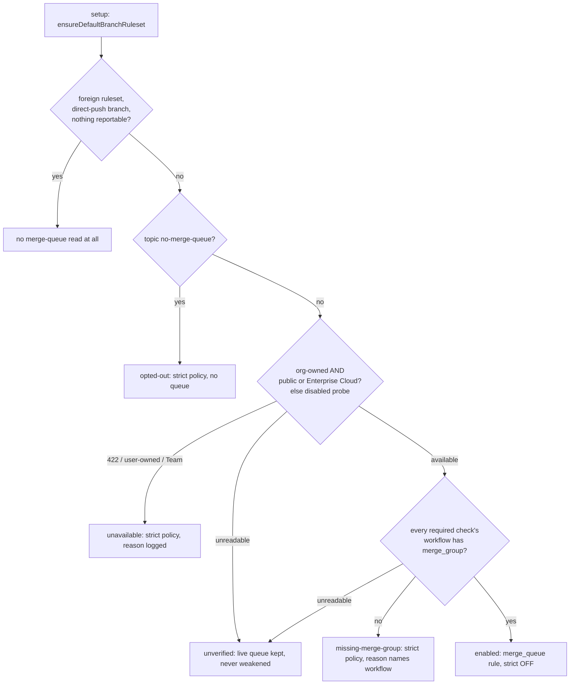

## Summary

The default-branch ruleset configurator now enables a GitHub **merge queue**
where GitHub allows one, replacing the strict "branch up to date" churn, and
falls back to today's behaviour everywhere else. The merge path is queue-aware:
the branch-update loops stop updating PRs just for being behind, the
direct-merge fallback never lands a PR on a queued base, and a PR the queue
removes becomes a red check for the CI-fix lane. Closes #4424.

Version bump: `VERSION` updated for this change; the merged commit records the
final version.

## Spec

### Intent and Rationale

- Every merge into a strict-policy default branch makes every other PR stale and
  re-runs its CI; a queue tests PRs once, against the real future head. GitHub
  allows the rule only on org-owned public repos and Enterprise Cloud private
  repos, so it is detected per repository and the old behaviour stays the
  fallback.
- The configurator owns the queue rule the way it already owns the status-checks
  rule: it is rebuilt from a decision on every setup run, so enabling, tuning
  drift and withdrawal all converge through the one full-document PUT.

### Essential Design Decisions

- **Opt-out is a repository topic, `no-merge-queue`**, beside the existing
  `direct-push` topic, not a key in `.config.json` (the worker config is a flat
  list of `owner/repo` slugs with no per-repository settings). The detection
  result is not persisted in `.config.json`: it is recomputed each setup run and
  the live ruleset is the record; the verdict and reason are carried on the
  plan/`SyncResult` and printed by setup.
- **An unverified read never weakens enforcement.** A definitive refusal (opted
  out, unavailable, a required check lacks `merge_group`) removes a queue rule
  on the worker's own ruleset and restores
  `strict_required_status_checks_policy: true`. An unreadable read keeps a live
  queue. A human-tuned queue's parameters are kept only while the verdict is
  `enabled`.
- **The audit sweep stays read-only**: `planBranchProtectionForRepo` passes
  `readOnly: true`, so it never creates the probe ruleset (an inconclusive
  answer is `unverified`). Setup may create the disabled probe and always
  attempts to delete it; a failed delete is reported with the leftover id.
- **Merge method** is SQUASH (the fleet's `--squash`) unless the repository
  disallows it, then MERGE, then REBASE. A required context that no workflow
  reports on every PR is treated as lacking `merge_group` (fail closed: the
  queue would wait for it).

### Undiscoverable Facts

- Observed against the live GraphQL API: `RemovedFromMergeQueueEvent` has
  `reason`, `createdAt` and `beforeCommit`, and
  `timelineItems(itemTypes: [REMOVED_FROM_MERGE_QUEUE_EVENT])` is accepted. The
  `merge_queue` REST parameters follow GitHub's ruleset documentation; a 422 on
  a probe could not be reproduced here (no Team-plan private org repo to hit)
  and is covered by a fake.
- This repository's own workflows and `infra/rulesets/main.json` are unchanged:
  VibeCoder's own `main` ruleset keeps the strict policy.

## Evidence

Purely backend/CLI and docs; no UI file changed.

Command output (Deno, from `worker/deno`):

- `deno task test:unit` over the new and affected files: see Test Plan.
- Real-API observation, run before writing the removal reader:
  `gh api graphql -f query='{ __type(name:"RemovedFromMergeQueueEvent"){ fields { name } } }'`
  returned
  `actor, beforeCommit, createdAt, enqueuer, id, mergeQueue, pullRequest, reason`,
  and a `timelineItems(last:1, itemTypes:[REMOVED_FROM_MERGE_QUEUE_EVENT])`
  query shaped as the reader sends it returned `nodes: []` without error.

What each production entry point changed, and the fake it is tested with:

| Entry point                                                                                                                                            | Change                                                                                                                  | Production implementation the fake stands in for                                                  |
| ------------------------------------------------------------------------------------------------------------------------------------------------------ | ----------------------------------------------------------------------------------------------------------------------- | ------------------------------------------------------------------------------------------------- |
| `planDefaultBranchRuleset` / `ensureDefaultBranchRuleset` (`lib/default_branch_ruleset.ts`)                                                            | merge-queue decision, queue rule, drift update, `readOnly`                                                              | the REST rulesets API; fakes answer `repos/<slug>`, `orgs/<owner>`, workflow contents, `rulesets` |
| `decidePrUpdateAction`, `scanPrBranchUpdates` (`lib/pr_branch_update.ts`), wired in `commands/pr_maintenance.ts` and `lib/run_core_production_deps.ts` | behind-only PRs on a queued base are not updated; conflicts still are                                                   | `repos/<repo>/rules/branches/<base>` (types list)                                                 |
| `sweepAutoMerge` (`lib/auto_merge_sweep.ts`)                                                                                                           | armed + behind on a queued base: no `update-branch`, no re-arm                                                          | same                                                                                              |
| `directMergePr` (`lib/direct_merge.ts`)                                                                                                                | queued base → `blocked: "merge_queue"`, no gate, no merge call                                                          | same                                                                                              |
| `findFailedCiChecks` (`lib/pr_maintenance.ts`), `enableAutoMerge` (`lib/pr_auto_merge.ts`), `lib/pr_ci_processor.ts` guards                            | removal at the current head → synthetic `merge queue` failed check; not re-armed; no Actions call with the synthetic id | GraphQL `timelineItems`; request shape observed above                                             |

Cost: setup reads, per repo with a worker-owned ruleset, the topics, the repo
(and org if private), the workflow listing and each workflow file; each scan
makes one GraphQL read per open PR on a queued base.

## Acceptance Criteria

None stated in the issue (it lists "What to build" and "Tests"); the four
"Tests" groups are covered in the Test Plan.

## Test Plan

New test files (all run on the final head):

- `worker/deno/tests/merge_queue_test.ts` — availability: public org,
  user-owned, Team org (metadata and 422 probe), Enterprise, unreadable
  plan/metadata → probe, probe always deleted, failed delete named, 500 is not
  called 422, read-only never probes, opt-out topic.
- `worker/deno/tests/merge_queue_workflows_test.ts` — `merge_group` trigger
  shapes, gate attribution, path-filtered context, remote reader (404, error,
  > 100 files, hostile names).
- `worker/deno/tests/default_branch_ruleset_merge_queue_test.ts` — queue rule
  present with strict off; unchanged ruleset where unavailable; refusal while a
  workflow lacks `merge_group` (and withdrawal of a live queue); opt-out; drift
  update; human-tuned parameters kept; unverified keeps a live queue; no
  merge-queue reads on foreign/direct-push/no-reported-checks exits; audit path
  makes no non-GET call; setup line wording.
- `worker/deno/tests/merge_queue_runtime_test.ts`,
  `pr_branch_update_merge_queue_test.ts`,
  `auto_merge_sweep_merge_queue_test.ts`, `direct_merge_merge_queue_test.ts` —
  queued vs unqueued with the same fixture (only the queue answer differs),
  conflicts still updated, memo TTL, `null` not memoised, fail-loud warnings,
  direct merge never reaches the merge call.
- `worker/deno/tests/merge_queue_removal_test.ts`,
  `merge_queue_check_id_test.ts`, `pr_maintenance_merge_queue_test.ts`,
  `pr_auto_merge_merge_queue_test.ts`, `pr_ci_processor_merge_queue_test.ts` —
  removal applies only to the current head, malformed responses name the field,
  synthetic check carries no Actions call, not re-armed, no unprotected wording
  on the merge-queue hold.
- `worker/deno/tests/pr_maintenance_command_test.ts` — the
  `update-open-pr-branches` command takes no action on a behind-only PR behind a
  queue.

Existing tests edited: fixtures answer the new `repos/<slug>` read
(`default_branch_ruleset_test.ts`, `branch_protection_sync_test.ts`,
`default_branch_ruleset_audit_test.ts`, `pr_auto_merge_test.ts` injects a
not-queued answer in one test that asserts an exact call count);
`decidePrUpdateAction` and the scan/sweep deps gained required parameters, so
call sites in `pr_branch_update_test.ts`, `auto_merge_sweep_test.ts`,
`milestone_merge_behaviour_test.ts`, `pr_branch_update_integration_test.ts`,
`pr_branch_update_bot_prs_test.ts` pass `false` / a not-queued dep. No assertion
was removed from any existing test (the only removed lines are the old
`decidePrUpdateAction(...)` calls, replaced by the same call plus the new
argument with the same assertions).

Red-checks (each branch broken on purpose, a test went red, then restored):
runtime memo of `null`, memo expiry, `decidePrUpdateAction` queue guard, scan
passing `false`, scan cache, sweep skip, direct-merge queue check, command
wiring, fail-loud warnings (scan and sweep), probe delete, 422 detection, strict
flag, live-rule drop, opt-out, unverified-as-definitive, drift clause,
live-detail read, early-exit ordering, `readOnly`, removal head applicability,
synthetic id to rerun, re-arm hold, no-unprotected wording.

Callers and siblings checked for the new required parameters:
`decidePrUpdateAction` (scan only), `scanPrBranchUpdates`
(`lib/run_core_production_deps.ts`, `commands/pr_maintenance.ts`), sweep deps
(`lib/run_core_production_deps.ts`),
`detectMergeQueueAvailability`/`decideMergeQueue` (`allowProbe` required;
configurator and audit). Production wiring of the two
`run_core_production_deps.ts` call sites is type-checked and tested through the
shared `makeIsMergeQueueBase` builder; the `commands/pr_maintenance.ts` caller
is driven end to end.

Quality gate: `./quality.sh < /dev/null` passed on the head ("Result: PASSED
(with skipped checks)"; `config integration` and `checkov` skipped by the
script). An earlier run failed only on `lib_sweep_coverage_test` and the
completeness check for the six new modules;
`docs/audits/lib-sweep-coverage/top-up-4424.json` now registers them (`sweptAt`
is `origin/main`, checked with `verifySweptAtsOnDefaultBranch`).

Not checked: a real merge-queue repository (no such repo is reachable here); the
422 probe response text is from the issue and a fake. The issue states no
acceptance criteria, so the Spec and Standards reviewer sub-agents were not
dispatched.
