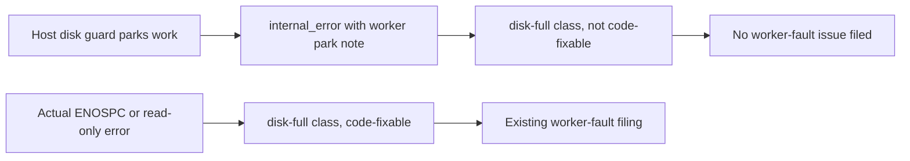

## Summary

Intentional host-disk parks keep the `disk-full` diagnostic class but are no
longer treated as code-fixable worker faults. Genuine ENOSPC and read-only
filesystem failures remain code-fixable. Closes #4429.

## Spec

### Intent and Rationale

- The worker's in-flight disk guard deliberately releases work when the host
  crosses its floor; filing that protective release as a worker defect creates
  a false diagnostic.
- Keep the existing host-disk protection and no-retry behaviour. Change only
  how the intentional park affects run-failure auto-filing.

### Essential Design Decisions

- The exact worker park note is read from worker-authored text after agent
  narration is removed, and only for an `internal_error` outcome.
- Keep the stable `disk-full` class for diagnosis and deduplication, while
  setting intentional parks to `not_code_fixable`; genuine disk exhaustion
  remains `code_fixable`.
- No disk measurements, cleanup or recovery state changed, so this fix does
  not alter the floor, require a new recovery reading or touch issue retry
  counts.

### Undiscoverable Facts

- The issue comments provide timestamps and host IDs, but the corresponding
  worker logs, host-disk snapshots and agent transcripts were not available in
  this checkout. The change is based on the confirmed classifier gap; it does
  not attribute each reported recurrence to a protective park.
- Issue #4360 describes the host-floor park note used by the worker.

## Evidence

Backend-only change. `inFlightParkReason` in
`worker/deno/lib/heavy_build_gate.ts` appends the park note; the regression tests
show the classifier's prior `code_fixable` result triggered the auto-filer.

## Test Plan

- `worker/deno/tests/run_outcome_classifier_test.ts::classify #4429 - intentional host-disk parking is not code-fixable` — the new case failed against the unchanged classifier (`code_fixable` instead of `not_code_fixable`), then passed after the fix. It also checks that genuine ENOSPC remains code-fixable, agent-quoted park text does not select the park result, and a different failure category retains its disk-fault classification.
- `worker/deno/tests/run_failure_issue_test.ts::run failure issue - intentional host-disk park is not auto-filed` — passed; changing the park classification back to `code_fixable` made the test fail by filing an issue.
- Condition mutation checks: forcing the category operand true made the different-category assertion fail; forcing the park-note operand true made the quoted-agent assertion fail.
- `worker/deno/tests/host_disk_inflight_4360_test.ts` — passed; confirms the protective park remains a host fault and not a gate verdict.
- `worker/deno/tests/issue_worker_infra_retry_test.ts` — passed; the disk stop does not sleep or increment `infraRetryCounts`.
- `worker/deno/tests/host_disk_live_reading_test.ts`, `worker/deno/tests/host_disk_test.ts` and `worker/deno/tests/heavy_build_gate_in_flight_4423_test.ts` — passed; existing host measurement and build-admission behaviour remains covered.
- Targeted command `deno task test:unit tests/run_outcome_classifier_test.ts tests/run_failure_issue_test.ts tests/host_disk_inflight_4360_test.ts tests/issue_worker_infra_retry_test.ts tests/host_disk_live_reading_test.ts tests/host_disk_test.ts tests/heavy_build_gate_in_flight_4423_test.ts` — 126 passed, 0 failed.
- `deno fmt --check`, `deno lint` and `deno check` on the changed classifier and test files — passed.
- The full `./quality.sh` gate and `deno task pr-summary-check` are recorded after execution below.

## Deno regression avoided

- Used the repository's Deno test, format, lint and check tools; no Node tooling or dependency was added.
