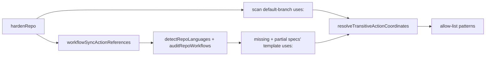

## Summary

Setup's Actions allow-list now admits the third-party actions of the
workflow-sync templates workflow sync would file for the repository, and the
Markdown Lint template no longer carries its dead Deno steps. A verbatim
Gitleaks or Markdown Lint workflow therefore starts on a repository whose
default branch has no third-party action yet. Closes #4448.

Version bump: `VERSION` is not touched by this change.

## Spec

### Intent and Rationale

- Setup extended the allow-list only from the default branch, and a new workflow
  cannot reach the default branch while the list rejects it. Adding the
  templates' actions up front breaks the cycle and keeps "copy verbatim" true.
- Removing the Markdown Lint Deno steps (skipped in every repository but this
  one, whose own `.github/workflows/markdown-lint.yml` keeps the Mermaid check)
  stops `denoland/setup-deno` entering every allow-list for nothing.

### Essential Design Decisions

- The specs come from the same `detectRepoLanguages` + `auditRepoWorkflows` path
  workflow sync uses (missing and partial), via `lib/workflow_sync_actions.ts`;
  no second copy of the "which templates" rule.
- A failure reading the templates never aborts hardening and is never silent: it
  is added to `outcome.unreadable` as `workflow-sync templates: <cause>`.
- Template references are SHA-pinned, so they go through
  `resolveTransitiveActionCoordinates` exactly like default-branch references.

### Undiscoverable Facts

- The private repository's Actions policy could not be read, so the link between
  the allow-list and the `startup_failure` is inferred (see the issue).

## Evidence

Backend-only change; no UI files. Verification is by tests (below).

## Test Plan

- Added `worker/deno/tests/workflow_sync_actions_test.ts` (references
  sorted/unique/SHA-pinned; detection fault and audit fault each assert the
  cause text).
- Added three `hardenRepo` tests in
  `worker/deno/tests/repo_settings_harden_test.ts`: a repository with no
  workflows gets `gitleaks/gitleaks-action@*` in `patterns_allowed`; a present
  Gitleaks workflow adds nothing from the sync side; an audit fault is named in
  `unreadable` while the other steps still apply.
- Added a Markdown Lint test in
  `worker/deno/tests/workflow_definitions_test.ts`: only `actions/*` `uses:` and
  no `setup-deno` / `check-mermaid`.
- Red check: with the new call in `hardenRepoInto` skipped, the regression test
  and the fault test fail (`allow-list written: undefined`); restored
  afterwards.
- No existing assertion was removed or edited.
- `deno task test:unit` over the five touched/related test files: 255 passed, 0
  failed.
- Docs: `docs/SETUP.md` (Settings bullet, `repo-settings-harden` row) and
  `docs/GITHUB-ACTIONS-AUDIT-SCAN.md` (allow-list paragraph) updated; doc
  comments in `lib/repo_settings_harden.ts` and
  `commands/repo_settings_harden.ts` updated.
- Not changed: the `commands/repo_settings_harden.ts` output line "from N
  workflow reference(s) on the default branch" still counts default-branch
  references only, as the `referenceCount` doc comment now says.
