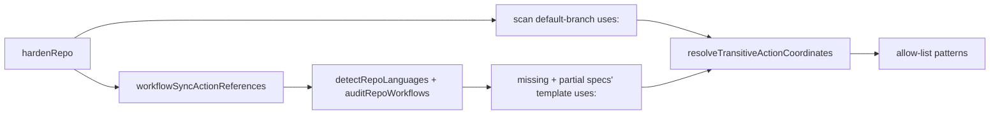

## Summary

Setup's Actions allow-list now admits the third-party actions of the
workflow-sync templates workflow sync would file for the repository, and the
Markdown Lint template no longer carries its dead Deno steps. A verbatim
Gitleaks or Markdown Lint workflow therefore starts on a repository whose
default branch has no third-party action yet. Closes #4448.

Version bump: `VERSION` is not touched by this change.

## Spec

### Intent and Rationale

- Setup extended the allow-list only from the default branch, and a new workflow
  cannot reach the default branch while the list rejects it. Adding the
  templates' actions up front breaks the cycle and keeps "copy verbatim" true.
- Removing the Markdown Lint Deno steps (skipped in every repository but this
  one, whose own `.github/workflows/markdown-lint.yml` keeps the Mermaid check)
  stops `denoland/setup-deno` entering every allow-list for nothing.

### Essential Design Decisions

- The specs come from the same `detectRepoLanguages` + `auditRepoWorkflows` path
  workflow sync uses (missing and partial), via `lib/workflow_sync_actions.ts`;
  no second copy of the "which templates" rule.
- A failure reading the templates never aborts hardening and is never silent: it
  is reported as `outcome.templateFault` (apart from `outcome.unreadable`, which
  stays action manifests): setup warns on the repository's line and the CLI
  prints its own `Could not read the workflow-sync templates` line, also when
  nothing is planned.
- Template references are SHA-pinned, so they go through
  `resolveTransitiveActionCoordinates` exactly like default-branch references.

### Undiscoverable Facts

- The private repository's Actions policy could not be read, so the link between
  the allow-list and the `startup_failure` is inferred (see the issue).

## Evidence

Backend-only change; no UI files. Verification is by tests (below).

## Test Plan

- Added `worker/deno/tests/workflow_sync_actions_test.ts` (references
  sorted/unique/SHA-pinned; detection fault and audit fault each assert the
  cause text).
- Mutation-check follow-up: `ghRunner` and `templateActionReferences` are now
  exported and tested directly in `workflow_sync_actions_test.ts` (non-gh
  command refused with exact result; success and thrown Error / non-Error
  results asserted whole; local `./` and `docker://` references skipped, rest
  sorted and unique), plus two `workflowSyncActionReferences` tests asserting
  the exact fault text and the `could not read the templates:` catch path
  (response `null` from the contents endpoint).
- Added three `hardenRepo` tests (review round: the fault test now asserts
  `templateFault` with `unreadable` empty, and the first asserts
  `templateReferenceCount > 0`) in
  `worker/deno/tests/repo_settings_harden_test.ts`: a repository with no
  workflows gets `gitleaks/gitleaks-action@*` in `patterns_allowed`; a present
  Gitleaks workflow adds nothing from the sync side; an audit fault is named in
  `templateFault` while the other steps still apply.
- Added a Markdown Lint test in
  `worker/deno/tests/workflow_definitions_test.ts`: only `actions/*` `uses:` and
  no `setup-deno` / `check-mermaid`.
- Red check: with the new call in `hardenRepoInto` skipped, the regression test
  and the fault test fail (`allow-list written: undefined`); restored
  afterwards.
- No existing assertion was removed. One was edited: the drifted-repo test in
  `setup_repo_settings_harden_test.ts` now expects `gitleaks/gitleaks-action@*`
  in the written allow-list (the template reference joins it). The new
  `templateReferenceCount === 0` assertion sits in the existing
  unreadable-workflow-directory test in `repo_settings_harden_test.ts` (red with
  the `templateReferenceCount: 0` initialiser deleted).
- `deno task test:unit`, one file at a time on the head:
  `worker/deno/tests/setup_repo_settings_harden_test.ts` (40 tests at head),
  `worker/deno/tests/repo_settings_harden_test.ts` (116 tests at head),
  `worker/deno/tests/workflow_sync_actions_test.ts` (10 tests at head),
  `worker/deno/tests/workflow_definitions_test.ts` (70 tests at head),
  `worker/deno/tests/admin_only_finding_test.ts` (30 tests at head),
  `worker/deno/tests/setup_repo_settings_audit_close_test.ts` (27 tests at head)
  and `worker/deno/tests/issue_worker_test.ts` (128 tests at head): all passed,
  0 failed.
- PR #4473 review round tests: `workflow_sync_actions_test.ts` partial-spec test
  (Deno repo, only `deno lint`, asserts the codecov reference; red with the
  `audit.value.partial` spread deleted); `setup_repo_settings_harden_test.ts`
  template-fault test (warning on the faulty repo's line only; red with the
  setup warning disabled). The setup fake GitHub now answers the detection and
  workflow-audit reads, so the drifted-repo test expects
  `gitleaks/gitleaks-action@*` in the written list.
- PR #4473 review round 2: the CLI now appends the
  `Could not read the
  workflow-sync templates` line and the
  unreadable-manifest line after the plan/no-plan branch (like the skip notes),
  so they print when nothing is planned. Tested through
  `repoSettingsHardenCommand.execute` with `_setGhSpawnRunner` over the stateful
  fake, on a converged repository: a positive control (no fault,
  `nothing to harden`, no warning), a failing `languages` read (template line
  and cause), and a failing `action.yml` read (manifest line and cause). Red
  check: with `commands/repo_settings_harden.ts` at its previous version the
  test fails (`nothing to harden …` does not contain
  `Could not read the workflow-sync templates`). The manifest phase's own red
  run was not separately isolated (the template assertion fails first).
- Docs: `docs/SETUP.md` (Settings bullet, `repo-settings-harden` row) and
  `docs/GITHUB-ACTIONS-AUDIT-SCAN.md` (allow-list paragraph) updated; doc
  comments in `lib/repo_settings_harden.ts` and
  `commands/repo_settings_harden.ts` updated.
- PR #4473 review round: the CLI `Allow-list source:` line now reads "from N
  workflow reference(s) on the default branch plus K workflow-sync template
  reference(s)" (`templateReferenceCount`); the two allow-list plan step titles
  name "the workflow-sync templates"; `docs/EXTENDING.md` no longer describes
  the removed Mermaid step.
