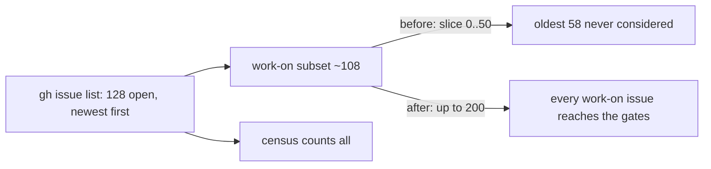

## Summary

The claim scan now considers every labelled issue in the open-issue listing it
already reads, not only the newest 50 per label. The idle-decision census
counted GRQ-AutoTrader's three oldest `work-on` issues (#3382, #3381, #3315) as
claimable while the scan never looked at them. Closes #4464.

Version bump: `VERSION` is not touched by this change.

## Spec

### Intent and Rationale

- The census and the scan disagreed because the scan was the one that was
  wrong. Each collector called `fetchIssuesByLabel(repo, label, cache, 50, …)`,
  which does `.filter(label).slice(0, 50)` over a newest-first listing. With
  about 108 open `work-on` issues in GRQ-AutoTrader, the oldest were dropped
  before any gate ran, so the scan recorded no skip reason for them (the empty
  "scan skips" section in the issue) while the census, which reads every open
  issue, counted them.
- Raising the cap is preferred to teaching the census the same cap: modelling
  the cap would silence the alert while the oldest work stayed unclaimed behind
  newer, mostly blocked issues.

### Essential Design Decisions

- One constant, `SCAN_LABELLED_ISSUE_LIMIT` (200) in `lib/issue_query.ts`, is both
  the width of the listing `findOldestIssue` fetches and the per-label cap, so
  the two cannot drift apart again.
- `fetchIssuesByLabel` now requests its listing at `Math.max(100, limit)`, so a
  limit above 100 is not cut to 100 on a cold cache. Callers with limit 50 are
  unchanged (still `--limit 100`).
- Applied to the label, work-on, low-priority and idle-task collectors and to
  `blocking_pr_stall_detector.ts`, which carried the same `50` for `work-on`.
  `find_issues_by_label.ts` and `commands/diagnose_repo.ts` keep their own limit.

### Undiscoverable Facts

- Reproduced against live GitHub data. With the one conflict-redo candidate
  (#4588) held back, `findOldestIssue` returned "No eligible issues found" with
  `totalConsidered=65`, none of the three issues among them, while the census
  built from the same data listed `claimableIssues: [3382, 3381, 3315]`.
- Not done: the merged-PR gate reads only the latest 100 closed PRs per author,
  so PRs #3609, #3610 and #3354 (the merged PRs naming these issues) have also
  slid out of that window. That is why the census's `merged_pr_blocked` no longer
  covers them. Here claiming them is correct (the milestone rollback re-queued
  #3381 and #3382, and the owner reopened #3315), but it is a separate window
  that can let a genuinely merged issue back in.

## Evidence

Backend only, no UI. From `worker/deno`:
`deno task test:unit` over the new and touched test files plus the
`find_oldest_issue*`, `issue_finder`, `collect_work_on_candidates_suppression`,
`stale_workflow_issue_cache`, `escalation_cleanup` and stall-detector suites:
308 passed, 0 failed. `deno fmt --check`, `deno lint` and `deno check` on every
changed `.ts` file exit 0.

Docs sweep: `docs/GH-API-OPTIMISATION.md` (the `fetchIssuesByLabel` bullet)
updated. Grepped `docs/` (excluding `docs/archive/`), `README.md` and
`DESIGN-PRINCIPLES.md` for a 50-issue scan cap and found none.
`docs/CONFIGURATION.md:3201` (`GH_ISSUE_LIST_LIMIT`, default 50) is read by no
scan code, so it stays true. `docs/workflows/issue-processing.md:787` ("newest 50
comments") is the escalation comment scan, unrelated.

## Test Plan

- `worker/deno/tests/find_oldest_issue_label_window_test.ts` (new):
  - `findOldestIssue - 60 work-on issues: a blocked newest 57 does not hide the 3 oldest claimable issues (Issue #4464)`:
    the 57 newest depend on an open issue, the 3 oldest are plain; asserts the
    result is one of the 3 oldest.
  - `findOldestIssue - 60 plain work-on issues: the oldest eligible one is selected (Issue #4464)`.
- `worker/deno/tests/issue_query_test.ts`: `fetchIssuesByLabel at SCAN_LABELLED_ISSUE_LIMIT returns all 120 labelled issues from a cold cache (Issue #4464)`
  (also asserts the `--limit` passed is `200`) and a test that the default
  limit still returns 50 and requests `--limit 100`. Nothing removed from any
  existing test.
- Red checks (each break applied alone, then restored):
  - the four collector call sites and the stall detector set back to `50`: both
    new `findOldestIssue` tests red (first one: `found` false, expected true).
  - only `collect_work_on_candidates.ts` set back to `50`: both new
    `findOldestIssue` tests red.
  - only `Math.max(100, limit)` set back to `100`: the 120-issue
    `fetchIssuesByLabel` test red (`100` against `120`); the default-limit test
    stays green, as it should.
- Callers of `fetchIssuesByLabel` checked: the four collectors and the stall
  detector pass the constant; `find_issues_by_label.ts`, `commands/diagnose_repo.ts`
  and `run_core_production_deps.ts` keep their limit and are unaffected because
  `Math.max(100, limit)` is 100 for them.
- Related twinned rule: the census reads the same cached listing as the scan, so
  no census change is needed; found no second copy of the 50 cap.
- `./quality.sh < /dev/null`: see the result recorded below once run.
