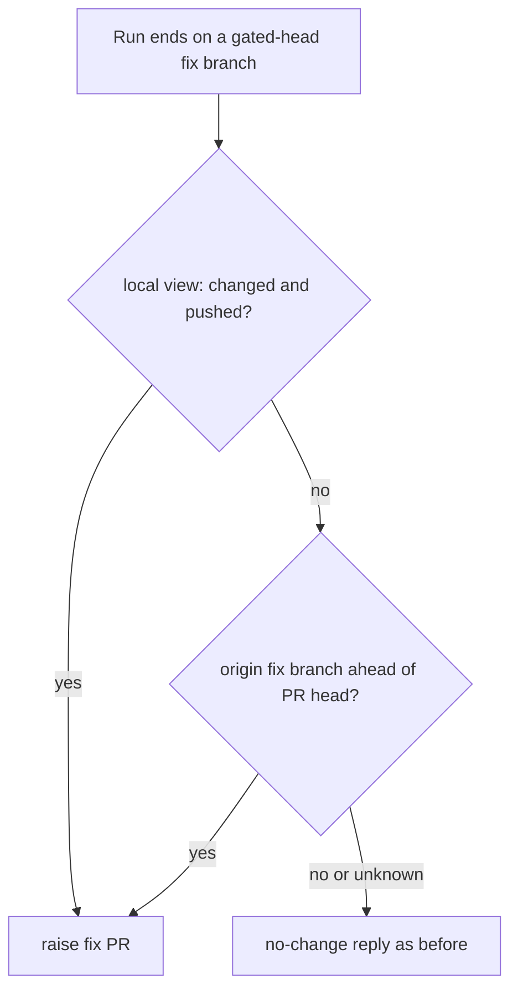

## Summary

On a ruleset-gated milestone head, PR feedback now decides delivery from the
remote. If `origin/<fixBranch>` holds commits that `origin/<PR head>` lacks, the
fix PR is raised (or reused) and the reply goes through the "fix delivered
through PR #…" path, however the local change/push view read. This stops a fix
the agent pushed itself from being stranded behind a no-change reply. Closes
#4466.

Version bump: not applicable; no `VERSION` change.

## Spec

### Intent and Rationale

- The local view (`hasChanges`, `finalUnpushedCount`, `branchHeadChanged`) can
  read "nothing pushed" after the agent's own pushes, so the fix PR was never
  raised. Origin is the authority, so the new check asks it.
- A new helper, `findCommitsAheadOnRemote`, keeps the git work out of the
  already large processor.

### Essential Design Decisions

- The remote check runs only on the gated path (`fixBranch` set) and only when
  the local view did not already say changed-and-pushed, so the existing success
  path is untouched.
- A fix branch absent from origin (`couldn't find remote ref`) means nothing is
  stranded. Any other fetch, count or resolve failure is logged as an error and
  leaves the local view as it was; it is never read as "nothing ahead" or as
  delivered. The existing #4304 handling is unchanged: if raising the PR fails,
  the feedback stays outstanding.
- The merge base is ensured with `ensureHistoryDepth` first, because monitored
  clones are shallow and the count would otherwise include commits the PR head
  already holds.
- The synthetic `PushVerification` sets `landed: true` with the remote tip and
  no `localSha`; its doc comment in `push_claim_verification.ts` was reworded to
  say so.

### Undiscoverable Facts

- None.

## Evidence

Backend-only change; no UI files touched. Tests are in
`worker/deno/tests/pr_feedback_processor_milestone_fix_test.ts`.

## Test Plan

- Added to `worker/deno/tests/pr_feedback_processor_milestone_fix_test.ts` (all
  four named "(Issue #4466)"): self-pushed fix with count "2" raises the fix PR
  and posts the "Verified on the remote" fix-PR reply, with no no-change reply;
  the same setup with count "0" raises nothing; a fix branch absent from origin
  raises nothing; an unreachable origin on the fix fetch raises nothing and the
  processor still returns ok.
- Red-check: with the new processor block's condition forced to `false`, the
  self-pushed test fails ("expected a pr create call") and the other 12 stay
  green; restored, 13 pass. The count-"0" test is the control that goes red if
  the "ahead" condition is ignored.
- Ran `deno task test:unit tests/pr_feedback_processor_milestone_fix_test.ts`:
  13 passed. With `tests/owner_direction_3205_test.ts` and
  `tests/pr_feedback_processor_test.ts`: 72 passed.
  `tests/push_claim_verification_test.ts`: 7 passed.
- Callers of `processPrFeedback` with a gated head: the three test files above;
  the non-gated path is skipped by `fixBranch !== undefined`.
- Docs: `docs/MERGE.md` "Review feedback" row updated. Related-rule grep of
  `docs/workflows/pr-feedback.md` found no sentence contradicting it.
- Not checked: a real git run against a shallow clone with a moved PR head; the
  shallow-clone path relies on `ensureHistoryDepth`'s own tests.
- Added `docs/audits/lib-sweep-coverage/top-up-4466.json` so the new lib module
  is claimed by a sweep slice;
  `deno task test:unit tests/lib_sweep_coverage_test.ts` (39 passed) and
  `deno task check:manifests` (846 passed) pass.
- Full `./quality.sh` ran once before that slice was added: lint, type check,
  fmt, semgrep and markdownlint passed; the only failure tied to this change was
  the missing sweep slice (now fixed). Two other failures, in
  `tests/completion_phase_repo_formatters_test.ts` ("formatter should commit the
  Rust fix"), come from this host having no rustup default toolchain
  (`cargo fmt` errors "rustup could not choose a version"), not from this
  change. The full gate was not re-run after the slice was added; CI runs it on
  the PR.
