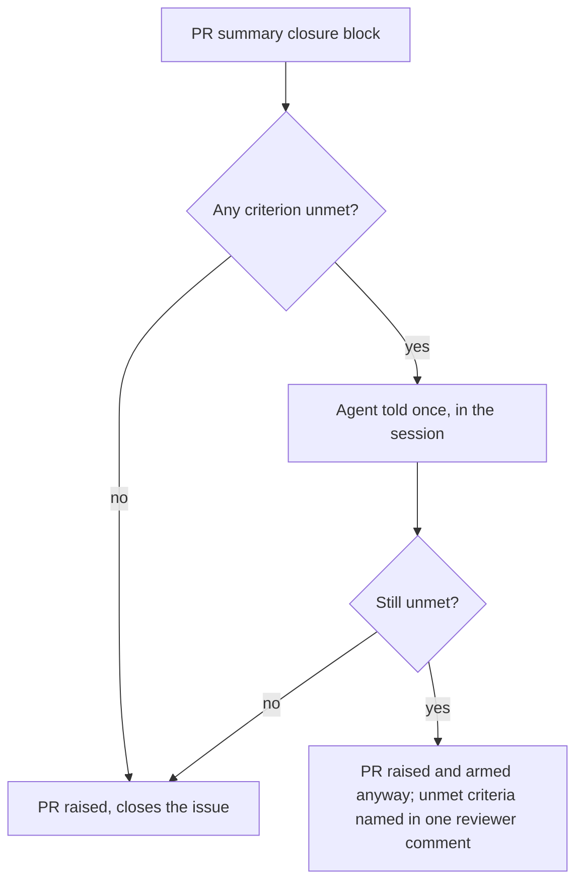

## Summary

The unmet-criteria gate's words now match what the completion phase does since
Issue #4234: unmet criteria are told to the agent once, and the pull request is
raised and armed anyway, with whatever remains named in one
`## Notes for the reviewer` comment. A `missing` entry makes the body
`Part of #N`. Closes #4469.

Version bump: `VERSION` is not touched by this change.

## Spec

### Intent and Rationale

- `unmetCriteriaReason`, `buildUnmetCriteriaGateComment` and the module header
  still described the pre-#4234 flow ("no PR is raised", "the run fails"). The
  note is posted on the raised PR directly under the sentence "They did not
  block this pull request", so the record contradicted itself and told agents
  that a partial PR is never raised.
- Only the wording changes; no gate decision, ordering or category moves.

### Essential Design Decisions

- One neutral wording serves both uses of the note (shown to the agent in the
  session, posted on the PR), so it states the outcome ("raised and armed
  anyway") and the instruction ("finish what you can") together.
- The `⛔` heading is dropped: the note no longer stops anything.
- Docs that repeated the old claim were corrected in the same change:
  `DESIGN-PRINCIPLES.md` (section renamed to "Unmet acceptance criteria are
  named, never a follow-up issue"; nothing in the repo links its old anchor),
  `docs/MODEL-AND-CACHING.md`, and the doc comments in `degraded_delivery.ts`
  and `phases/completion_phase.ts` (`SummaryRuleBlock.unmetCriteria`).

### Undiscoverable Facts

- None.

## Evidence

Backend only, no UI. No existing test pinned the old strings. From
`worker/deno`: `deno task test:unit` over `tests/unmet_criteria_gate_test.ts`
(new), `degraded_delivery_test.ts`, `completion_phase_unmet_criteria_4146_test.ts`,
`completion_phase_advisory_gates_4234_test.ts` and
`summary_rule_gate_retry_test.ts`: 47 passed, 0 failed. `deno fmt`, `deno lint`
and `deno check` on the changed `.ts` files exit 0.

Docs sweep: grepped `README.md`, `docs/` (excluding `docs/archive/`),
`prompts/`, `DESIGN-PRINCIPLES.md` and `CODING-STANDARDS.md` for
`unmet.criteri`, `criteria_unmet`, `criteria not met` and `until every
criterion`. `docs/workflows/issue-processing.md:1073` already describes the
advice flow; `docs/workflows/issue-processing.md:1417` and
`prompts/issue/prompt.md:1003` are already true. Behaviour cited against
`worker/deno/lib/phases/completion_phase.ts` (the `unmetCriteriaVerdict.blocked`
branch and `postCompletionAdvisory`) and `assemblePrBody` for the `Part of #N`
rewrite.

## Test Plan

- `worker/deno/tests/unmet_criteria_gate_test.ts` (new):
  - `unmetCriteriaReason - counts the criteria and says the PR is raised anyway`
    (singular and plural counts, "raised anyway", and no withheld-PR phrase).
  - `buildUnmetCriteriaGateComment - names each criterion and does not claim the PR is withheld`
    (each criterion with its status, "raised and armed anyway", `Part of #N`, no
    withheld-PR phrase, no `⛔`).
- `worker/deno/tests/degraded_delivery_test.ts`: header comment only; no
  assertion changed or removed.
- Red check: restoring the base `lib/unmet_criteria_gate.ts` with the new test
  kept turns both new tests red (0 passed, 2 failed); restored afterwards.
- Callers of the changed functions: only `phases/completion_phase.ts` (the
  verdict's `reason` and `comment`); both strings flow into the in-session note
  and `postCompletionAdvisory` unchanged in shape.
- `./quality.sh < /dev/null` on the final code: Result PASSED (with skipped
  checks: config integration, checkov).
