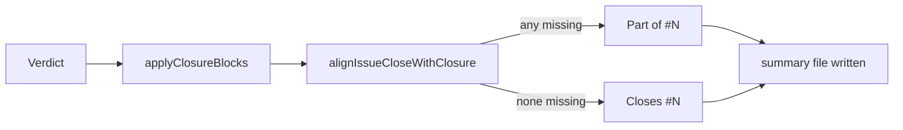

## Summary

The closure-verdict recovery now aligns the summary's closing keyword with the
`## Acceptance Criteria` block it renders, so the committed `pr-summary-N.md`
and the PR body (`assemblePrBody`) agree. A `missing` entry turns `Closes #N`
into `Part of #N`; a block with no `missing` entry turns a bare `Part of #N`
back into `Closes #N`. Closes #4472.

## Spec

### Intent and Rationale

- `renderClosureBlocksFromVerdict` swapped the block into the summary but never
  touched the keyword, while `assemblePrBody` rewrites the PR body by the block.
  The agent gets no turn after the render, so the worker has to align the file
  itself.
- The rule lives in `missing_criterion_close_guard.ts` beside
  `withholdIssueClose`, so the summary and the PR body share one definition of
  "missing means Part of".

### Essential Design Decisions

- The empty-summary base stays `Closes #N.`; the alignment step turns it into
  `Part of #N.` when the verdict has a `missing` entry, instead of a second code
  path building two bases.
- Only keywords naming this issue are rewritten; `Closes #other` and
  `Part of #other` are untouched. A summary with no keyword is left as it is (PR
  creation still appends `Closes #N` when nothing is missing).

### Undiscoverable Facts

- None.

## Evidence

Backend-only change; no UI files touched. Tests exercise the real render
function against a temp repository and a mocked model reply.

Docs: `docs/workflows/issue-processing.md` (section "The worker renders the
block, from a verdict given as data", new item 5 and the Implementation
paragraph). Sibling surfaces grepped for the rule (`withholdIssueClose`,
`findMissingCriteria`): `pr_body_sync.ts`, `draft_continuation_pr.ts`,
`completion_phase.ts`, `pr_issue_linking.ts`, `issue_lifecycle.ts` — all read
the block or the PR body, none render the summary, so none needs the new call.
Twinned rule: `assemblePrBody` (PR body) and `alignIssueCloseWithClosure`
(summary) both use the shared `withholdsIssueClose` predicate;
`restoreIssueClose` is the summary-only inverse. An agreement test also covers
missing, met and partial criteria with closing, partial and absent keywords.

## Test Plan

- After the shared-predicate review fix,
  `deno task test:unit
  tests/missing_criterion_close_guard_3177_test.ts`
  passed: 23 tests, 0 failed. Its agreement test compares summary and PR-body
  keywords across all nine criterion-status and starting-keyword combinations.
- `worker/deno/tests/closure_verdict_recovery_test.ts`: four new cases —
  `Closes #N` summary plus a `missing` verdict becomes `Part of #N` with no
  closing keyword and the `missing` entry kept; no summary file plus a `missing`
  verdict writes `Part of #N.`; `Part of #N` summary plus an all-met verdict
  becomes `Closes #N`; keywords for a different issue untouched in all four
  combinations.
- `worker/deno/tests/missing_criterion_close_guard_3177_test.ts`:
  `restoreIssueClose` (only this issue, case-insensitive, other issues
  untouched), a 50,000-fragment hostile-input case for the new `PART_OF_RE`, and
  `alignIssueCloseWithClosure` (missing withheld, none missing restored, no
  keyword unchanged).
- Result: `deno task test:unit` over those two files plus
  `completion_phase_closure_render_test.ts` and
  `completion_phase_summary_rule_retry_test.ts`: 53 passed, 0 failed.
- Red-checks: reverting the `alignIssueCloseWithClosure` call in
  `closure_verdict_recovery.ts` to plain `applyClosureBlocks` turned the three
  render cases red (3 failed); disabling only the restore branch turned the
  all-met render case and the restore unit test red; disabling only the withhold
  branch turned both missing-criterion render cases and the withhold unit test
  red. The different-issue control stays green by design (it guards a rewrite
  that is too broad).
- No existing assertion was removed or edited.
- New exports `restoreIssueClose` and `alignIssueCloseWithClosure` are used in
  production by `closure_verdict_recovery.ts`.
- `./quality.sh` on the final head: every stage passed (deno lint, type check,
  fmt, markdownlint, mermaid, semgrep and the chokepoint checks) except
  `deno tests`: 31091 passed, 2 failed, both in
  `worker/deno/tests/completion_phase_repo_formatters_test.ts` ("an unformatted
  Rust change is formatted and committed, then passes the gate" and "cargo fmt
  stages only the branch's .rs files": `formatter should commit the Rust fix`).
  Re-run alone, the same 2 fail. The same 2 also fail on a clean checkout of the
  base commit (run in a throwaway worktree), and the diff touches no formatter
  or Rust code, so they are pre-existing and unrelated. The serial test pass did
  not run because the parallel pass failed.
