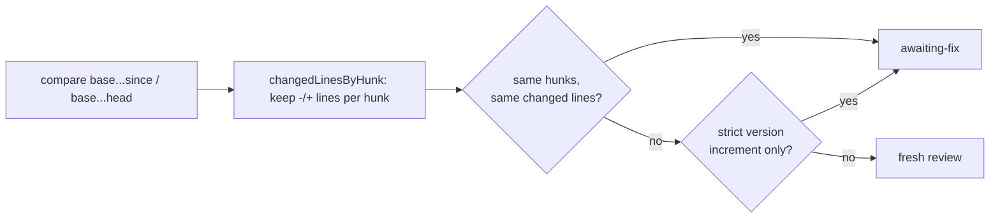

## Summary

`ownDiffUnchanged` (review-fleet-prs gate) now compares each file's added and
removed lines instead of its whole patch, so a clean base merge that only moves
the context around a sent-back PR's CHANGELOG entry leaves the PR `awaiting-fix`
instead of triggering another full xhigh review. Closes #4476.

## Spec

### Intent and Rationale

- `normalisePatch` blanked only the `@@` headers, so context lines were still
  compared; another PR's CHANGELOG entry landing on the base changes the context
  above this PR's entry and made every base merge look like a change.
- The reduction keeps the `-`/`+` lines of each hunk in order, so the check
  stays strict about what the PR itself edits and only stops caring about what
  surrounds it.

### Essential Design Decisions

- Same hunk count, same order and byte-identical changed lines are required; an
  extra hunk, a changed added/removed line, reordered lines, or a changed
  `\ No newline at end of file` marker after a changed line still gets a fresh
  review (fail closed).
- Everything else in `ownDiffUnchanged` is unchanged: file list, names,
  statuses, previous names, the version-increment exception (reads the raw
  patches), the earlier-finding guard and the fallbacks.
- Cannot approve anything: `awaiting-fix` applies only while the latest review
  requests changes, and the next push that changes any added or removed line
  gets a full review.

### Undiscoverable Facts

- Evidence of the defect is in NEAT-AI#4102 and NEAT-AI#4065 (re-reviewed after
  a context-only CHANGELOG shift), as recorded in the issue.

## Evidence

Backend/skill-script change; no UI files touched. Tests drive the real
`ownDiffUnchanged` and `skipReason` through a fake `gh`.

Docs updated: rule 8 in `.claude/skills/review-fleet-prs/SKILL.md` and the
"Version-only re-bumps" section of
`.claude/skills/review-fleet-prs/references/edge-cases.md`. Grepped the skill's
Markdown for `own diff`, `own-diff`, `patch` and `hunk-position`; the remaining
hits ("own diff" in rule 8, the fresh-review list) stay true under the new rule.
Twinned rule: none found (`normalisePatch` had no other caller).

## Test Plan

Added to `worker/deno/tests/review_fleet_prs_gate_2675_test.ts` (8 tests, all
named "(Issue #4476)"; no existing test or assertion edited or removed):

- Context a base merge moved, added lines identical → `awaiting-fix` via
  `skipReason`.
- Changed trailing context only → unchanged.
- One added line changed → fresh review (control: identical lines → unchanged).
- Extra hunk at head → fresh review (with control).
- Changed removed line → fresh review (with control).
- `\ No newline` marker added after a changed line → fresh review (with
  control).
- Reordered added lines → fresh review (with control).
- 50,000-line patch pair: identical changed lines → unchanged, one changed line
  → fresh review.

Red checks (each break applied alone, then restored):

- Old `normalisePatch` equality restored → 8 failed (context-moved test red).
- Hunk-count check dropped → extra-hunk test red.
- `-` lines dropped from the reduction → removed-line test red.
- `\` marker handling dropped → marker test red.

Result: `deno task test:unit tests/review_fleet_prs_gate_2675_test.ts` — 33
passed, 0 failed; `deno fmt --check`, `deno lint`, `deno check` clean on the two
code files. The five tests that read the skill docs (23 tests) pass.

`./quality.sh` was not run on this head: it takes about 15 minutes, which is
longer than the 10-minute cap on a foreground command here, and it may not be
started in the background. CI and the worker's pre-PR run cover it.

<!-- vibe-quality-gate-skipped reason="gate (~15m) exceeds the 10-minute foreground command cap; targeted tests, fmt, lint and type check passed" -->
