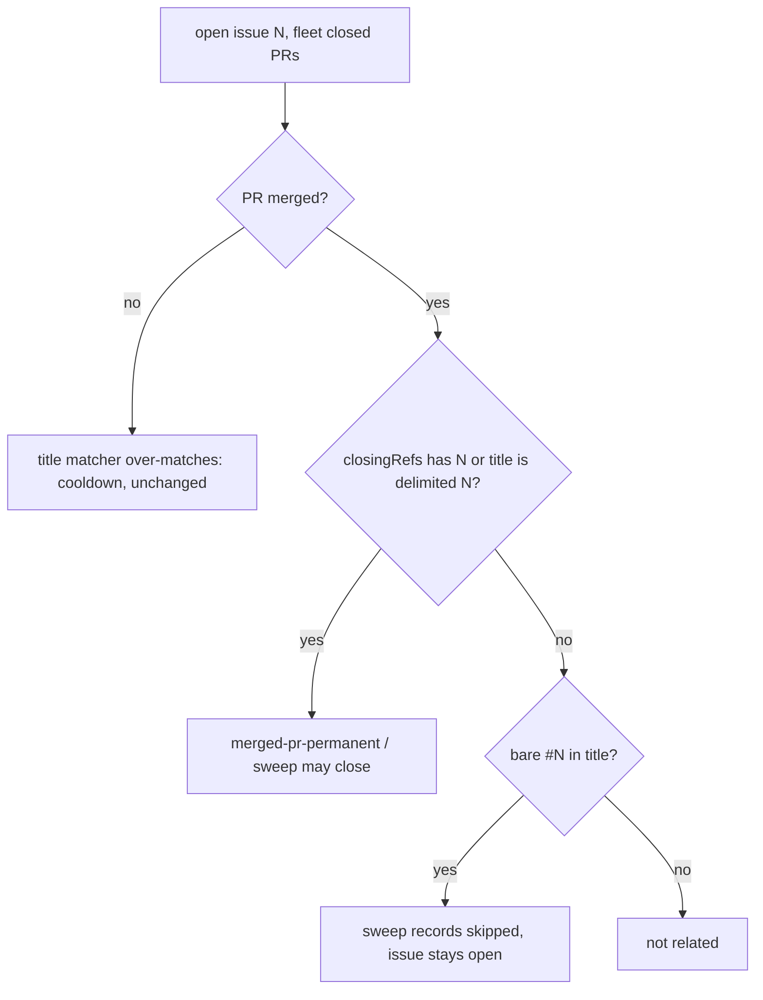

## Summary

A merged PR whose title only mentions a bare `#N` no longer counts as the PR for
issue N. `isBlockedByRecentlyClosedPR` (the claim scan's permanent
`merged-pr-permanent` verdict) and the housekeeping `sweepMergedPrIssues` now
need a positive identification of a merged PR: its body's closing keywords name
the issue, or its title carries `(Issue #N)`, `(#N)` or `[#N]`. A bare mention is
recorded by the sweep as `skipped` and the issue stays open. Closes #4478.

## Spec

### Intent and Rationale

- NEAT-AI-Discovery#2464 ("…, file #2463, add …", body `Closes #2271`) *filed*
  #2463; the sweep closed #2463 as completed because the over-matching title
  matcher read `#2463` as a fix. One over-match, harmless for the duplicate-PR
  guard, became an irreversible close on a path that is permanent for merged PRs.
- The fix narrows only the merged verdict. The over-matching
  `prTitleReferencesIssue` stays for open and closed-unmerged PRs, where the
  header says over-matching is the safe side.

### Essential Design Decisions

- `mergedPrNamesIssue` (closing refs OR `prTitleMatchesIssue`) is exported from
  `issue_query.ts` and is the single owner of the merged test; the sweep calls it
  rather than copying it. The body-closing-refs rule of Issue #1528 is folded in,
  so the sweep no longer has a separate `byBody` pick.
- The sweep picks only a merged PR that names the issue. Before, it took the first
  match of any kind and then dropped a closed-unmerged one, so an earlier
  closed-unmerged bare mention could hide a later merged fix; that masking is gone.
- A merged-PR bare mention is written to `records` as `skipped` (settled: not held
  back, not counted as a candidate) and skipped when its PR is already processed.
- A merged title such as "(Issue #42 Defect 3)" is not a canonical form, so it no
  longer blocks unless its body closes the issue; the issue asks for the canonical
  forms.

### Undiscoverable Facts

- Evidence is the public NEAT-AI-Discovery#2463 / #2464 / #2471 / #2472 history
  recorded in the issue.

## Evidence

Backend change; no UI files touched. Tests call the real `isBlockedByRecentlyClosedPR`
and `sweepMergedPrIssues` (through the existing fake-`gh` world).

Twinned rules checked: `idle_decision_census`, `idle_detect_diagnostics`, the
`collect_*` candidates and `new_work_eligibility` all call
`isBlockedByRecentlyClosedPR`, so they follow the same verdict. `closeIssuesForMergedPrs`
(`pr_issue_linking.ts`) already uses the strict `prTitleMatchesIssue`.

Docs updated: `docs/INTERNALS.md` (sweep paragraph), `docs/IDLE-TASK-FRAMEWORK.md`
(merged-PR gate), `docs/workflows/issue-processing.md` (escalating row, claim-scan
table row, permanent merged-lock step), plus the header and doc comments in
`issue_query.ts`, `pr_title_issue_ref.ts` and `merged_pr_issue_sweep.ts`.
Left as history: `docs/IDLE-TASK-FRAMEWORK.md` and `docs/workflows/issue-processing.md`
accounts of the NEAT-AI-Rebase#48 incident (Issue #499), which describe the
earlier matcher.

## Test Plan

Added to `worker/deno/tests/issue_query_test.ts` (all "(Issue #4478)"): bare
mention in a merged title with `Closes #2271` does not block 2463 (controls: same
PR still blocks 2271; blocks 2463 via closing refs, `(Issue #2463)`, `[#2463]`,
`(#2463)`); merged bare "Cleanup #44" does not block; closed-unmerged bare still
blocks; `merged` omitted with a bare title still blocks; closing refs without a
title mention block; an earlier merged bare mention does not mask a later merged
PR that names the issue.

Added to `worker/deno/tests/merged_pr_issue_sweep_test.ts`: the chunk-13 title
with `Closes #2271` is not closed and is recorded `skipped` ("bare mention");
body `Closes #2463` closes; `(Issue #2463)` title closes; an already-processed PR
adds no record and closes nothing; an earlier closed-unmerged bare mention does
not hide the merged fix.

Edited in `worker/deno/tests/issue_query_test.ts`: the fixture of PR 3 in
"matches (#N), Issue #N and trailing #N without partial matches" changed from
`merged: true` to `merged: false` (the title "Cleanup #44" is a bare mention).
No assertion was removed or changed; the `#44` assertion still guards the bare
match of the cooldown path, and breaking the closed-unmerged branch (using
`mergedPrNamesIssue` there) turns it red.

Red checks (each break applied alone, then restored): merged branch uses
`prTitleReferencesIssue` → 4 new `issue_query_test.ts` tests red; sweep pick uses
`prTitleReferencesIssue` → bare-mention test red (a close for 2463 recorded);
skipped-record push deleted → record assertion red; old `byBody ??
isBlockedByRecentlyClosedPR` pick restored → masking test red (`closed` 0 not 1).

Results: `deno task test:unit` over 18 test files that use the merged-PR verdict
(sweep, query, census, diagnostics, collectors, skip-reason clearing and others):
528 passed, 0 failed. `deno fmt --check`, `deno lint`, `deno check` clean on the
changed code and test files.

`./quality.sh` on this head: every stage passed except `deno tests`, which failed
only on two tests in `worker/deno/tests/completion_phase_repo_formatters_test.ts`
("an unformatted Rust change is formatted and committed, then passes the gate" and
"cargo fmt stages only the branch's .rs files, not an unrelated uncommitted edit").
Both are Rust-formatter tests unrelated to this change (31,099 other tests passed);
I did not run them against the base branch here, and the serial pass did not run
because the parallel pass failed. `deno task pr-summary-check`: 0 gates blocked.
