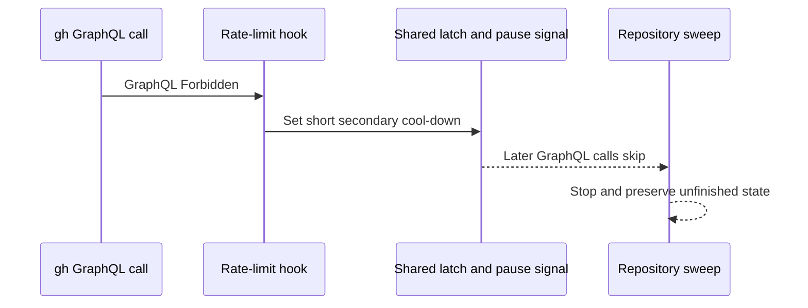

## Summary

Recognise a bare GitHub GraphQL `Forbidden` as a secondary-limit refusal, latch the existing short cool-down and shared pause signal, stop repository sweeps at the first refusal, and log deliberate quota-latch skips at INFO. Closes #4494.

Version bump: none in this change; the merged commit records the final version.

## Spec

### Intent and Rationale

- Avoid repeated GraphQL calls and error logs after the API refuses a call for a quota or secondary limit.
- Reuse the shared rate-limit classifier, existing process latch, and pause signal so all GraphQL callers observe the same cool-down.

### Essential Design Decisions

- Only the reported `Post "https://api.github.com/graphql": Forbidden` form is newly classified; unrelated 403 responses and ordinary permission errors remain distinct.
- A bare GraphQL Forbidden uses the existing 60-second secondary cool-down. Primary-quota refusals still use the GraphQL quota probe and its reset handling.
- A sweep preserves its unfinished repository state when it stops for a rate limit; ordinary observation failures continue to be logged at ERROR.

### Undiscoverable Facts

- The issue supplied the observed GraphQL error text and reported that the quota probe received the same refusal. This run used that exact text in deterministic tests; it did not make a live API request.

## Evidence

Backend and CLI behaviour; no visual surface changed. Regression tests exercise the shared classifier, `gh` spawn hook and probe, lifecycle logging, PR retry, merged-PR sweep and branch cleanup.

## Reproduction

- **symptom** — The sweep logs `[merged-pr-issue-sweep] could not scan <repo>: … Post "https://api.github.com/graphql": Forbidden` and continues through later repositories; deliberate latch skips are logged at ERROR.
- **status** — `verified` — the regression test failed against the unfixed `origin/main` production code and passed after the fix.
- **regression test** — `worker/deno/tests/merged_pr_issue_sweep_test.ts::sweepMergedPrIssues - a GraphQL Forbidden stops the sweep without recording a repo failure`

## Deno regression avoided

- Used Deno-native `deno task test:unit`, `deno fmt`, `deno lint`, and `deno check`; no Node tooling or dependency changes were added.

## Test Plan

- `deno task test:unit tests/secondary_rate_limit_test.ts tests/gh_spawn_test.ts tests/pr_creation_retry_test.ts tests/merged_pr_issue_sweep_test.ts tests/lifecycle_pr_observation_test.ts tests/github_primary_quota_latch_test.ts tests/branch_cleanup_test.ts` — passed, 161 tests.
- `deno fmt --check` on the 13 changed TypeScript files — passed.
- `deno lint` on the 13 changed TypeScript files — passed, 13 files checked.
- `deno check --frozen --lock=deno.lock` on the 13 changed TypeScript files, run from `worker/deno` — passed. An initial invocation from the repository root selected the wrong Deno lock context and reported an out-of-date lock; rerunning from `worker/deno` passed without changing a lockfile.
- `timeout 900 ./quality.sh < /dev/null` — timed out with exit 124 during the serial Deno test stage. The gate had reported completeness checks, Markdown lint, Semgrep and release-tag ruleset checks passed; the remaining full-gate checks were not verified.
- Base-branch red checks used the new tests with unfixed `origin/main` production code: the GraphQL Forbidden classifier and PR retry test failed; the merged-PR sweep continued to the next repository; the lifecycle skip logged at ERROR; the quota-probe Forbidden did not engage the short cool-down; `spawnGh` did not invoke its rate-limit hook; and both merged and stale branch-cleanup sweeps continued after the refusal. Restoring the fixed production files made each regression test pass.
- `worker/deno/tests/merged_pr_issue_sweep_test.ts`: forcing the secondary-limit log label or summary back to the primary-quota label made the regression test fail.
- `worker/deno/tests/branch_cleanup_test.ts`: restoring `branch_cleanup.ts` from `origin/main` made both new secondary-limit stop tests fail because they made a second repository call.
- `worker/deno/tests/pr_creation_retry_test.ts`: restoring `secondary_rate_limit.ts` from `origin/main` made the exact GraphQL Forbidden retry test fail.
- Existing primary-quota expectations were retained; no existing test assertion was removed.
- Changed callers checked: `spawnGh` in `worker/deno/lib/gh_spawn.ts`; `runGhCommandRaw` and the quota probe hook in `worker/deno/lib/github.ts`; the merged-PR sweep in `worker/deno/lib/merged_pr_issue_sweep.ts`; merged and stale branch cleanup in `worker/deno/lib/branch_cleanup.ts`; and the shared-classifier PR creation retry caller. Tests cover each caller's relevant changed behaviour.
- Documentation reviewed and updated: the “The primary-quota latch” section of `docs/GH-API-OPTIMISATION.md`; related source comments in the changed modules were reviewed. Remaining hits are still accurate: `docs/GH-API-OPTIMISATION.md:462,468,475,484,582,584,636` describe primary-quota-specific details or the shared latch; `docs/IDLE-TASK-FRAMEWORK.md:148` describes the primary-quota effect on its GraphQL-backed subcommands; `docs/RELEASE-NOTES.md:301,309,346,433` are historical records; `docs/workflows/issue-processing.md:1555` documents PR creation backoff, a separate retry path.
- `git diff --check` — passed. No `deno.lock` changes.
