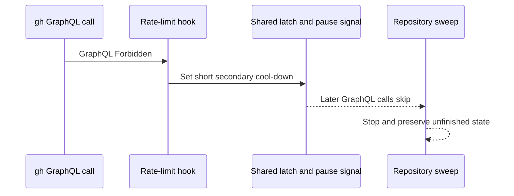

## Summary

Recognise a bare GitHub GraphQL `Forbidden` as a secondary-limit refusal, latch
the existing short cool-down and shared pause signal, stop repository sweeps at
the first refusal, and log deliberate quota-latch skips at INFO, including
errors wrapped by the production runner. A standalone quota probe also latches
the cool-down; healthy REST fallback quota cannot resume the sweep. Closes
#4494.

Version bump: none in this change; the merged commit records the final version.

## Spec

### Intent and Rationale

- Avoid repeated GraphQL calls and error logs after the API refuses a call for a
  quota or secondary limit.
- Reuse the shared rate-limit classifier, existing process latch, and pause
  signal so all GraphQL callers observe the same cool-down.

### Essential Design Decisions

- Only the reported `Post "https://api.github.com/graphql": Forbidden` form is
  newly classified; unrelated 403 responses and ordinary permission errors
  remain distinct.
- A bare GraphQL Forbidden uses the existing 60-second secondary cool-down.
  Primary-quota refusals still use the GraphQL quota probe and its reset
  handling.
- A sweep preserves its unfinished repository state when it stops for a rate
  limit; ordinary observation failures continue to be logged at ERROR.
- Cached stale-cleanup lookups opt into request-error propagation from
  `fetchPRsByBranch`; its other callers retain their existing error result. The
  cleanup stops on a rate-limit refusal; any other lookup failure skips that
  branch (as the uncached path does) rather than escaping the Result-returning
  sweep.

### Undiscoverable Facts

- The issue supplied the observed GraphQL error text and reported that the quota
  probe received the same refusal. This run used that exact text in
  deterministic tests; it did not make a live API request.

## Evidence

Backend and CLI behaviour; no visual surface changed. Regression tests exercise
the shared classifier, `gh` spawn hook and probe, lifecycle logging, PR retry,
merged-PR sweep and branch cleanup. The completion-check regressions also drive
`defaultGhCommand`, the merge-cleanup lifecycle caller and the real
`merged-pr-issue-sweep` command through the injected subprocess seam.
Later-stage refusals leave subsequent branches, issues and repositories
untouched, and leave the unfinished issue-sweep watermark unchanged.

## Reproduction

- **symptom** — The sweep logs
  `[merged-pr-issue-sweep] could not scan <repo>: … Post "https://api.github.com/graphql": Forbidden`
  and continues through later repositories; deliberate latch skips are logged at
  ERROR.
- **status** — `verified` — the regression test failed against the unfixed
  `origin/main` production code and passed after the fix.
- **regression test** —
  `worker/deno/tests/merged_pr_issue_sweep_test.ts::sweepMergedPrIssues - a GraphQL Forbidden stops the sweep without recording a repo failure`

## Deno regression avoided

- Used Deno-native `deno task test:unit`, `deno fmt`, `deno lint`, and
  `deno check`; no Node tooling or dependency changes were added.

## Test Plan

- `deno task test:unit` targeting
  `tests/{secondary_rate_limit,gh_spawn,pr_creation_retry,merged_pr_issue_sweep,lifecycle_pr_observation,github_primary_quota_latch,branch_cleanup,issue_query_branch_cache,branch_cleanup_cache,branch_cleanup_merged_telemetry,github_rate_limit_preflight,graphql_quota_probe,pr_issue_linking_cache,pr_issue_linking,primary_quota_latch}_test.ts`
  — passed, 331 tests across 15 files. The brace list abbreviates the explicit
  paths passed to the task.
- `deno task check:manifests` — passed, 846 tests and 1 ignored.
- `deno fmt --check` on all 16 changed TypeScript files — passed.
- `deno lint` on all 16 changed TypeScript files — passed.
- `deno check --frozen --lock=deno.lock` on all 16 changed TypeScript files, run
  from `worker/deno` — passed. An initial invocation from the repository root
  selected the wrong Deno lock context and reported an out-of-date lock;
  rerunning from `worker/deno` passed without changing a lockfile.
- Earlier attempt: `timeout 900 ./quality.sh < /dev/null` timed out with exit
  124 during the serial Deno test stage. The gate had reported completeness
  checks, Markdown lint, Semgrep and release-tag ruleset checks passed; the
  remaining full-gate checks were not verified. The full gate was not rerun
  during this follow-up; the worker reruns it after completion.
- Base-branch red checks used the new tests with unfixed `origin/main`
  production code: the GraphQL Forbidden classifier and PR retry test failed;
  the merged-PR sweep continued to the next repository; the lifecycle skip
  logged at ERROR; the quota-probe Forbidden did not engage the short cool-down;
  `spawnGh` did not invoke its rate-limit hook; and both merged and stale
  branch-cleanup sweeps continued after the refusal. Restoring the fixed
  production files made each regression test pass.
- `worker/deno/tests/merged_pr_issue_sweep_test.ts`: forcing the secondary-limit
  log label or summary back to the primary-quota label made the regression test
  fail.
- `worker/deno/tests/branch_cleanup_test.ts`: restoring `branch_cleanup.ts` from
  `origin/main` made both new secondary-limit stop tests fail because they made
  a second repository call.
- `worker/deno/tests/pr_creation_retry_test.ts`: restoring
  `secondary_rate_limit.ts` from `origin/main` made the exact GraphQL Forbidden
  retry test fail.
- Existing primary-quota expectations were retained; no existing test assertion
  was removed.
- Completion-check reproductions against the incoming head: both primary and
  secondary skips through `defaultGhCommand` logged at ERROR, including the
  merge-cleanup lifecycle caller; a standalone Forbidden probe set no latch; the
  real sweep command made eight calls, reaching both repositories despite the
  probe refusal and healthy REST quota. Each new test passed after its fix.
- The cached stale-cleanup per-branch refusal initially continued to the next
  branch and repository because `fetchPRsByBranch` swallowed the request error.
  Cleanup now requests propagation; the helper regression also verifies its
  default error result and that neither mode caches a failed request.
- PR #4536 review round: the cached stale lookup no longer rethrows a
  non-rate-limit error (`branch_cleanup.ts` `continue`), covered by
  `worker/deno/tests/branch_cleanup_test.ts` (a 502 on the first lookup still
  resolves `ok` and reaches `issue-2-later` and `org/next`; rethrowing made it
  fail). `cleanupMergedPrBranches` has eight stage-specific cases (primary and
  secondary × ref probe, head safety query, base safety query, deletion) over
  two repositories and two branches; turning each of the probe, assessment and
  deletion `break reposLoop` into `continue` failed its cases, and so did
  turning the fetch stop into `continue reposLoop`. `recordClosedLifecyclePrs`
  now shares `isLatchSkipMessage` with `recordLifecyclePrFromGithub`, logging
  latch skips (bare or `gh command failed (exit N):`-wrapped) at INFO and
  genuine faults, even those quoting the skip text, at ERROR; disabling that
  branch failed `worker/deno/tests/lifecycle_pr_observation_test.ts`.
- All five reported condition-negation mutants were applied individually and
  killed by `worker/deno/tests/branch_cleanup_test.ts`: `branch_cleanup.ts:714`
  (cached merged prefetch), `:740` (safety query), `:777` (cached merged branch
  lookup, now `:778`), `:809` (uncached merged branch lookup, now `:810`) and
  `:834` (deletion, now `:835`). No exemptions. Nine stage-specific cases cover
  cached and uncached safety queries, merged lookups and deletion, plus cached
  prefetch; earlier requests succeed before the injected refusal. The initial
  REST branch-list test now uses a REST secondary-limit response instead of
  claiming to reach a GraphQL query.
- `worker/deno/tests/merged_pr_issue_sweep_test.ts`: three later-stage cases
  inject secondary refusals at the actual timeline, comment and close requests.
  Each fails when its own stop is restored to primary-only handling; no later
  issue or repository is contacted and the watermark stays byte-for-byte intact.
- `worker/deno/tests/lifecycle_pr_observation_test.ts`: both latch kinds run
  through `defaultGhCommand` and the merge-cleanup caller; wrapped skips log at
  INFO without spawning, while genuine wrapped faults, even those quoting the
  skip text, stay ERROR.
- `worker/deno/tests/github_primary_quota_latch_test.ts`: a standalone probe
  refusal takes one spawn with no recursive probe, then skips later GraphQL
  calls. The real sweep command's first probe refusal followed by healthy REST
  quota publishes a 60-second signal in its configured work directory, reports
  the secondary cool-down and skips both repositories before any repo call. An
  ordinary probe failure still accepts healthy REST fallback quota and reaches
  both repositories without setting a rate-limit signal.
- Changed callers checked: `spawnGh` in `worker/deno/lib/gh_spawn.ts`;
  `runGhCommandRaw` and the quota probe hook in `worker/deno/lib/github.ts`; the
  merged-PR sweep in `worker/deno/lib/merged_pr_issue_sweep.ts`; merged and
  stale branch cleanup in `worker/deno/lib/branch_cleanup.ts`; and the
  shared-classifier PR creation retry caller; the command's preflight; and
  `fetchPRsByBranch`'s cleanup caller and default error result. Tests cover each
  caller's relevant changed behaviour.
- Documentation reviewed and updated: the “The primary-quota latch” section of
  `docs/GH-API-OPTIMISATION.md`; related source comments in the changed modules
  were reviewed. Remaining hits are still accurate: the quota-accounting,
  chokepoint and truthful-probe paragraphs in `docs/GH-API-OPTIMISATION.md`
  describe primary-quota-specific details or the shared latch;
  `docs/IDLE-TASK-FRAMEWORK.md:148` describes the primary-quota effect on its
  GraphQL-backed subcommands; `docs/RELEASE-NOTES.md:301,309,346,433` are
  historical records; `docs/workflows/issue-processing.md:1555` documents PR
  creation backoff, a separate retry path.
- `git diff --check` — passed. No `deno.lock` changes.
