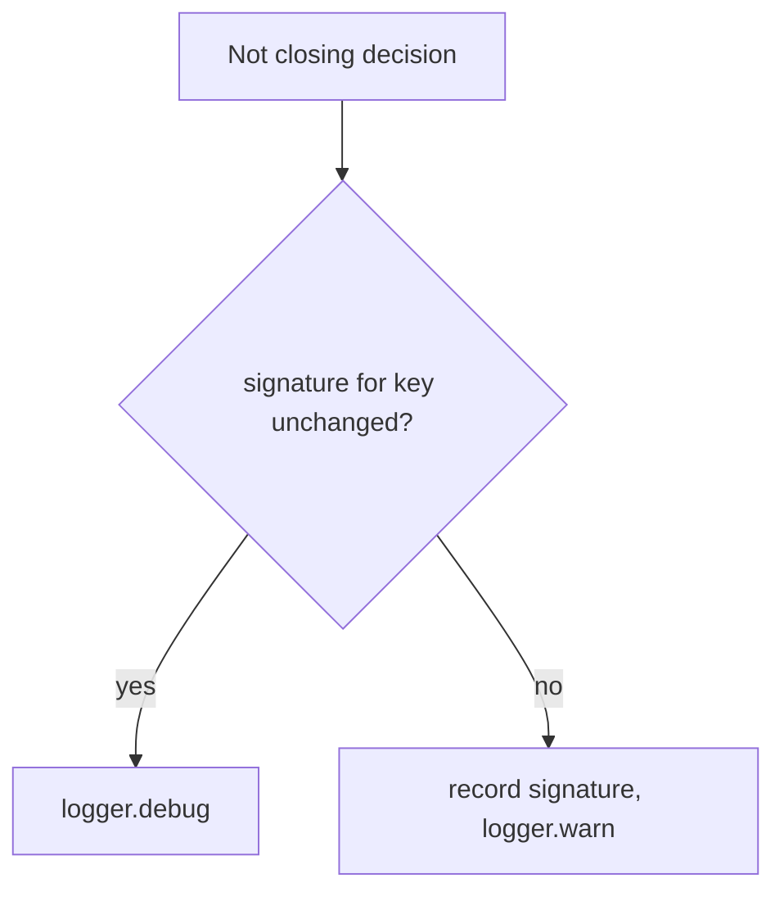

## Summary

The "Not closing" decisions for a merged PR (did not land, Issue #4396; marks
acceptance criteria missing, Issue #3177) were logged at WARNING on every cycle
for the same issue/PR pair. They now warn when the decision first applies or its
inputs change, and log an unchanged repeat at DEBUG. Closes #4495.

## Spec

### Intent and Rationale

- A repeated identical decision is not actionable; ~380 of ~985 WARNING/ERROR
  lines a day buried the warnings that need action. The decision itself
  (issue stays open) is unchanged.
- A small process-lifetime signature map follows the existing pattern in
  `pr_branch_update.ts` (`shouldWarnPrConflictOnce`) rather than adding
  persisted state.

### Essential Design Decisions

- `shouldWarnDecision(key, signature)` in `lib/decision_warn_dedup.ts` warns when
  the signature for a key is new or differs. Keys include the PR number, so a
  different PR warns again. The did-not-land signature is `landing.reason` (the
  verdict, not the free-text `detail`); the missing-criteria signature is the
  sorted `missing` set.
- `ensureIssueClosedIfPrMerged` and `closeIssuesForMergedPrs` share the
  did-not-land key, so one pair warns once whichever path sees it first.
- State is process-lifetime: a worker restart reports each pair once again.
  An A→B→A change warns on each change.

### Undiscoverable Facts

- Figures (338 and 41 lines, 15 and 2 pairs on GRQ-23) are from the issue and
  were not re-measured.

## Evidence

Backend logging change; no UI files touched.

Docs: grepped `README.md` and `docs/` (excluding `docs/archive/`) for
`Not closing`, `did not land`, `Issue #4396`, `Issue #3177`. No sentence says
these warn each cycle, so no doc edit. Related sentence read and still true:
`docs/workflows/issue-processing.md:1073-1076` ("log the missing criteria").

Callers of the changed functions: both warn sites in `ensureIssueClosedIfPrMerged`
(callers pass through unchanged return values) and the did-not-land site in
`closeIssuesForMergedPrs` are covered by tests that call the real function.

## Reproduction

- **symptom** — `Not closing issue #N: PR #N merged but did not land …` and
  `Not closing the issue: the merged PR marks acceptance criteria missing …`
  logged at WARNING again on every cycle with unchanged inputs.
- **status** — `verified` — with `lib/issue_lifecycle.ts` and `lib/pr_maintenance.ts`
  restored to the base commit and the new tests kept, 6 of the new site tests
  fail (140 run: 134 passed, 6 failed); they pass on the fix.
- **regression test** —
  `worker/deno/tests/issue_lifecycle_test.ts::ensureIssueClosedIfPrMerged - an unchanged did-not-land verdict warns once across two cycles (Issue #4495)`

## Test Plan

Added:

- `worker/deno/tests/decision_warn_dedup_test.ts`: 4 helper tests (first
  sighting, changed signature, independent keys, reset).
- `worker/deno/tests/issue_lifecycle_test.ts`: unchanged did-not-land verdict
  warns once across two cycles; a changed reason or PR number warns again.
- `worker/deno/tests/missing_criterion_close_guard_3177_test.ts`: unchanged
  missing-criteria verdict warns once; a changed missing set or PR number warns
  again.
- `worker/deno/tests/pr_maintenance_test.ts`: `closeIssuesForMergedPrs` warns
  once across two cycles for an unlanded merge; a changed reason warns again.

Edited: the existing #4396 did-not-land test in `issue_lifecycle_test.ts` now
calls `resetDecisionWarnings()` first (module state is shared within a file); no
assertion was removed or changed.

Red checks: `shouldWarnDecision` forced to return true → the 4 helper tests and
the 6 site tests go red (two identical warn lines instead of one). Base-branch
production files with the new tests → 6 site tests red (above).
Results on the final head: `deno task test:unit` over 9 files (the three above,
`issue_lifecycle_cache_test.ts`, `pr_maintenance_issue_state_cache_test.ts`,
`merged_pr_issue_sweep_test.ts`, `merged_pr_precheck_phase_test.ts`,
`completion_phase_merged_pr_closure_test.ts`, `decision_warn_dedup_test.ts`):
211 passed, 0 failed. `deno fmt`, `deno lint`, `deno check` clean on the 7 files.

Twinned copies: the did-not-land message is logged at two sites
(`issue_lifecycle.ts`, `pr_maintenance.ts`); both changed and share a key.

`./quality.sh` on this head: every stage passed except `deno tests`, which failed
only on two tests in `worker/deno/tests/completion_phase_repo_formatters_test.ts`
("an unformatted Rust change is formatted and committed, then passes the gate"
and "cargo fmt stages only the branch's .rs files, not an unrelated uncommitted
edit"; 31,133 other tests passed). That file does not import any module this PR
changes; I did not run those two tests against the base branch, and the serial
pass did not run because the parallel pass failed. The first gate run also
flagged the new module as unclaimed by the lib sweep ledger; fixed by
`docs/audits/lib-sweep-coverage/top-up-4495.json` (`lib_sweep_coverage_test.ts`
39 passed, `deno task check:manifests` passed).
