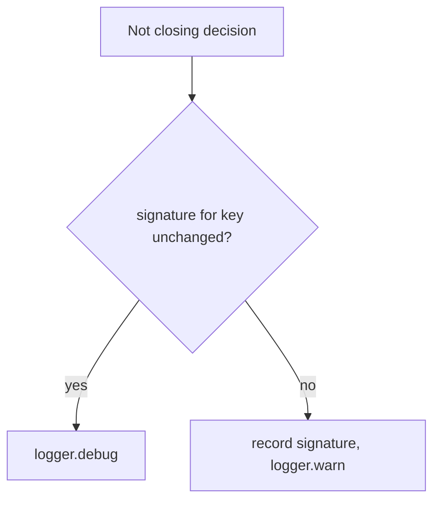

## Summary

The "Not closing" decisions for a merged PR (did not land, Issue #4396; marks
acceptance criteria missing, Issue #3177) were logged at WARNING on every cycle
for the same issue/PR pair. They now warn when the decision first applies or its
inputs change, and log an unchanged repeat at DEBUG. Closes #4495.

## Spec

### Intent and Rationale

- A repeated identical decision is not actionable; ~380 of ~985 WARNING/ERROR
  lines a day buried the warnings that need action. The decision itself (issue
  stays open) is unchanged.
- A worker process lasts about an hour (`runDurationSeconds`, default 3600) and
  every start re-runs the merged-PR issue sweep, which re-checks each held-open
  pair once. An in-memory map alone would therefore warn once per process, i.e.
  roughly once per pair per hour — the repeat rate the issue reports (PR #4535
  review). The last signature per key is kept in a small JSON file on the work
  volume, so the first sighting in a new process is a DEBUG repeat.

### Essential Design Decisions

- `shouldWarnDecision(key, signature)` in `lib/decision_warn_dedup.ts` warns
  when the signature for a key is new or differs. Keys include the PR number, so
  a different PR warns again. The did-not-land signature is `landing.reason`
  (the verdict, not the free-text `detail`); the missing-criteria signature is
  the sorted `missing` set.
- `ensureIssueClosedIfPrMerged` and `closeIssuesForMergedPrs` share the
  did-not-land key, so one pair warns once whichever path sees it first.
- State survives a restart: `configureDecisionWarnStore(workDir)` (called from
  `runStartupHousekeeping` in `lib/run_housekeeping.ts`, before the sweep)
  loads `<workDir>/decision_warn_signatures.json`; a signature change rewrites
  it tempfile-then-rename. The directory is passed in, never read from
  `WORK_DIR`, so a suite that does not configure it cannot touch the live file
  (Issue #1177); with no store configured the map is memory-only. An A→B→A
  change warns on each change.
- Bounded: an entry not seen for 7 days is dropped (on load and on every write);
  an unchanged sighting re-stamps its entry once a day, so a pair still being
  re-checked is kept and a closed issue's pair ages out.
- A missing file reads as empty; a corrupt or unreadable one, or a failed write,
  is logged at WARNING and degrades to memory-only — it never throws.

### Undiscoverable Facts

- Figures (338 and 41 lines, 15 and 2 pairs on GRQ-23) are from the issue and
  were not re-measured.

## Evidence

Backend logging change; no UI files touched.

Docs: grepped `README.md` and `docs/` (excluding `docs/archive/`) for
`Not closing`, `did not land`, `Issue #4396`, `Issue #3177`. No sentence says
these warn each cycle; the one doc edit is `docs/INTERNALS.md:402-405`, which
now describes the held-open-pair WARNING/DEBUG behaviour and the
`decision_warn_signatures.json` file. Related sentence read and still true:
`docs/workflows/issue-processing.md:1073-1076` ("log the missing criteria").

Callers of the changed functions: both warn sites in
`ensureIssueClosedIfPrMerged` (callers pass through unchanged return values) and
the did-not-land site in `closeIssuesForMergedPrs` are covered by tests that
call the real function.

## Reproduction

- **symptom** — `Not closing issue #N: PR #N merged but did not land …` and
  `Not closing the issue: the merged PR marks acceptance criteria missing …`
  logged at WARNING again on every cycle with unchanged inputs.
- **status** — `verified` — with `lib/issue_lifecycle.ts` and
  `lib/pr_maintenance.ts` restored to the base commit and the new tests kept, 6
  of the new site tests fail (140 run: 134 passed, 6 failed); they pass on the
  fix.
- **regression test** —
  `worker/deno/tests/issue_lifecycle_test.ts::ensureIssueClosedIfPrMerged - an unchanged did-not-land verdict warns once across two cycles (Issue #4495)`

## Test Plan

Added:

- `worker/deno/tests/decision_warn_dedup_test.ts`: 9 tests (first sighting,
  changed signature, independent keys, reset; restart with an unchanged then a
  changed signature; no store means a restart warns again; 7-day age-out and
  daily refresh; corrupt store; prototype-key and malformed entries).
- `worker/deno/tests/issue_lifecycle_test.ts`: unchanged did-not-land verdict
  warns once across two cycles; the same verdict warns once across a simulated
  worker restart (memory reset, store reloaded) and a changed reason after the
  restart warns again; a changed reason or PR number warns again; the WARNING
  and its DEBUG repeat carry `repo`, `issueNumber`, `prNumber` and `reason` in
  their context.
- `worker/deno/tests/missing_criterion_close_guard_3177_test.ts`: unchanged
  missing-criteria verdict warns once; a changed missing set or PR number warns
  again.
- `worker/deno/tests/pr_maintenance_test.ts`: `closeIssuesForMergedPrs` warns
  once across two cycles for an unlanded merge; a changed reason warns again;
  the WARNING context and the DEBUG repeat (message and context) carry `repo`,
  `issueNumber`, `prNumber` and `reason`.

Edited: the existing #4396 did-not-land test in `issue_lifecycle_test.ts` now
calls `resetDecisionWarnings()` first (module state is shared within a file); no
assertion was removed or changed.

Mutation follow-up: the surviving mutants (the four context properties at
`issue_lifecycle.ts:348-351` and `pr_maintenance.ts:2646-2649`, and the deleted
`logger.debug` call at `pr_maintenance.ts:2659`) are killed by the two new
context tests; each was re-applied by hand and the matching test went red.

Persistence red checks (PR #4535 review), each reverted after: skipping
`loadStore` → 5 tests red; skipping the write on a changed signature → 3 red;
disabling `pruneStale` → the age-out test red; disabling the daily re-stamp →
the age-out test red. Production wiring is covered by
`run_housekeeping_test.ts`: two startup sweeps with fresh in-memory state
produce one warning. Before the call moved into housekeeping, the new test
failed because the store file was absent.

Red checks: `shouldWarnDecision` forced to return true (re-run on the head) →
`decision_warn_dedup_test.ts` 8 of 9 tests red, `issue_lifecycle_test.ts` 4 red,
`missing_criterion_close_guard_3177_test.ts` 2 red, `pr_maintenance_test.ts` 3
red (two identical warn lines instead of one). Base-branch production files with
the new tests → 6 site tests red (above). Results on the final head (after the
PR #4535 review fix), `deno task test:unit` per file, 0 failed in each:
`issue_lifecycle_test.ts` (37 tests at head),
`missing_criterion_close_guard_3177_test.ts` (19), `pr_maintenance_test.ts`
(87), `issue_lifecycle_cache_test.ts` (7),
`pr_maintenance_issue_state_cache_test.ts` (7), `merged_pr_issue_sweep_test.ts`
(37), `merged_pr_precheck_phase_test.ts` (9),
`completion_phase_merged_pr_closure_test.ts` (7), `decision_warn_dedup_test.ts`
(9), `run_worker_test.ts` (35); 254 in total. `deno fmt --check`, `deno lint`,
`deno check` clean on the 4 changed `.ts` files this round.

Twinned copies: the did-not-land message is logged at two sites
(`issue_lifecycle.ts`, `pr_maintenance.ts`); both changed and share a key.

`./quality.sh`: the earlier head's run (before the PR #4535 review fix) passed
every stage except two unrelated tests in
`worker/deno/tests/completion_phase_repo_formatters_test.ts`; it was not re-run
on this head. The lib sweep ledger entry is
`docs/audits/lib-sweep-coverage/top-up-4495.json`.
