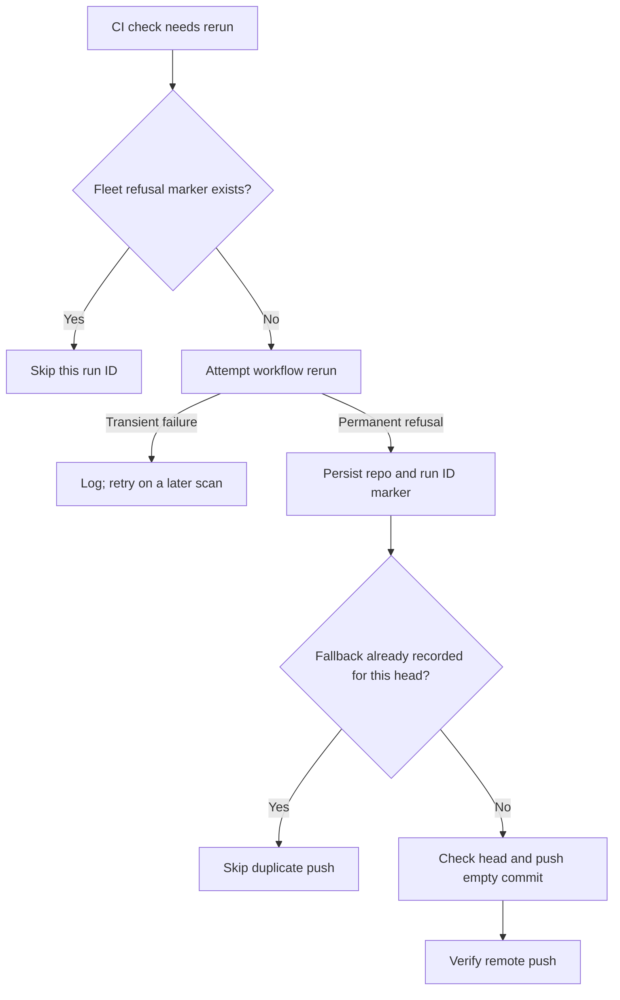

## Summary

Recorded GitHub's permanent workflow rerun refusals by repository and run ID in fleet-authored PR markers, and skip those runs on later scans. When a no-change CI fix gets that refusal, it attempts a guarded, deduplicated empty-commit push to request fresh CI. Closes #4497.

Version bump: none for this change.

## Spec

### Intent and Rationale

- GitHub's `This workflow run cannot be retried` refusal is permanent for that run ID; repeating it adds warnings without producing a new CI signal.
- A fleet-authored PR comment makes the refusal visible to later scans and hosts, while the existing empty-commit nudge can request fresh CI after a no-change fix.

### Essential Design Decisions

- Refusal markers are keyed by repository and run ID, independent of head SHA. Fallback markers are keyed by repository and head so a failed or successful push is attempted once per head.
- If marker state cannot be read, the worker stands down from rerunning; read or persistence failures are logged. Other rerun failures remain retryable.
- The empty-commit path uses `nudgeCi`, checks the checked-out head, and does not run for gated heads or without a worktree.

### Undiscoverable Facts

- The reported error was `gh command failed (exit 1): run 40637798711 cannot be rerun; This workflow run cannot be retried`.
- With `origin/main`'s rerun helper and the regression test retained, the test observed two rerun calls where one was expected; the issue implementation then passed the same regression test.

## Evidence

Backend-only change. Refusal persistence and fresh-CI fallback flow:

The workflow uses Deno-native tooling; no Node manifests or dependency locks changed.

## Reproduction

- **symptom** — GitHub refused an old workflow run with `This workflow run cannot be retried`, and later scans retried it and warned again.
- **status** — `verified` — the regression test failed against the unfixed `origin/main` rerun helper with two attempts, then passed with the fix.
- **regression test** — `worker/deno/tests/ci_infrastructure_rerun_2914_test.ts::rerunFailedJobsOfCheck - permanent GitHub refusal is attempted once across freshly loaded marker scans`

## Test Plan

- `deno task test:unit tests/ci_fix_attempt_markers_test.ts` — passed, 37 tests. Covers repo/run ID scoping, fleet author checks, malformed markers, and fallback repo/head deduplication.
- `deno task test:unit tests/ci_infrastructure_rerun_2914_test.ts` — passed, 27 tests. Covers permanent and transient failures, repeated scans, fresh marker reads, distinct run IDs, and the maintenance callers.
- `deno task test:unit tests/pr_ci_processor_no_changes_test.ts` — passed, 16 tests. Covers successful fresh-CI fallback, accurate push failure reporting, and duplicate fallback suppression.
- `deno task test:unit tests/pr_ci_processor_test.ts` — passed, 45 tests. Covers the max-retry caller with both empty and persisted refusal markers.
- The max-retry processor caller and maintenance exhausted-check caller tests went red when their refusal marker was removed from the caller's marker state; both were restored and passed.
- Targeted `deno fmt --check`, `deno lint`, and `deno check` across the changed TypeScript files — passed.
- `./quality.sh < /dev/null` — failed. The Deno suite reported 8 failures in untouched areas: six scanner/ledger failures attributed to `worker/deno/commands/fleet_pr_babysitter.ts`, `createFallbackFlagFiler` in `worker/deno/tests/merge_fallback_issue_test.ts`, and the Issue #4424 test in `worker/deno/tests/pr_maintenance_command_test.ts`. The same two latter test files failed when run individually. The gate also reported the corresponding spawn/ref/completeness checks against `fleet_pr_babysitter.ts`. Deno lint, type check, formatting, Markdown lint, Mermaid validation, and Semgrep passed; config integration and Checkov were skipped by the gate.

### Deno regression avoided

- Used Deno-native tasks and kept `deno.lock` unchanged; no Node tooling was introduced.
