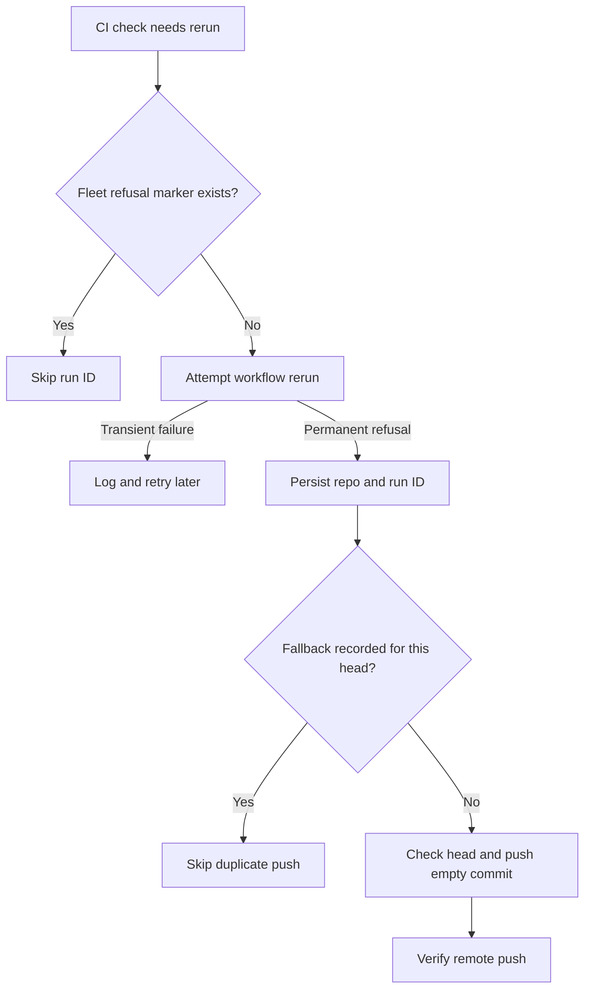

## Summary

Remember GitHub's permanent rerun refusals by repository and run ID, skip them on later scans, and request fresh CI with one guarded empty commit after a refused no-change rerun. Closes #4497.

Version bump: none for this change.

## Spec

### Intent and Rationale

- A run GitHub says cannot be retried remains refused, so repeating the rerun request adds warnings without producing a new CI signal.
- A fleet-authored PR marker makes that refusal visible across later scans and hosts; the existing empty-commit nudge requests fresh CI after a no-change fix.

### Essential Design Decisions

- Refusals are keyed by repository and run ID, independent of PR head. Fallback attempts are keyed by repository and head.
- Marker reads must resolve the fleet identity; an unreadable marker thread stands reruns down. Failed marker writes are logged and do not claim persistence.
- The no-change fallback uses `nudgeCi`, confirms the checked-out branch still has the captured head, skips gated heads, records its attempt before pushing, and verifies the remote push.
- A failed or unverified fallback is reported with its cause. A transient rerun failure remains retryable.

### Undiscoverable Facts

- The reported refusal was `gh command failed (exit 1): run 40637798711 cannot be rerun; This workflow run cannot be retried (Issue #2914)`.
- The regression test was run against `origin/main`'s rerun helper and observed two rerun requests where the test expected one.

## Evidence

Backend-only change. The refusal marker is read from fleet-authored PR comments; the no-change CI-fix caller uses the existing empty-commit nudge after a refusal.

The change uses Deno-native tooling and leaves `deno.lock` unchanged; no Node tooling was added.

## Reproduction

- **symptom** — GitHub refused run `40637798711` with `This workflow run cannot be retried`, and later scans requested the same rerun again.
- **status** — `verified` — the regression test failed against the unfixed `origin/main` helper with two rerun requests, then passed with this change.
- **regression test** — `worker/deno/tests/ci_infrastructure_rerun_2914_test.ts::rerunFailedJobsOfCheck - permanent GitHub refusal is attempted once across freshly loaded marker scans (Issue #4497)`

## Test Plan

- `worker/deno/tests/ci_fix_attempt_markers_test.ts` — `deno task test:unit tests/ci_fix_attempt_markers_test.ts`: passed, 37 tests. Checks repo/run scoping, fleet authorship, malformed markers and repo/head fallback keys.
- `worker/deno/tests/ci_infrastructure_rerun_2914_test.ts` — `deno task test:unit tests/ci_infrastructure_rerun_2914_test.ts`: passed, 28 tests. The refusal test loads fresh marker state for a second pass; transient errors remain retryable and failed refusal-marker writes are logged.
- `worker/deno/tests/pr_ci_processor_no_changes_test.ts` — `deno task test:unit tests/pr_ci_processor_no_changes_test.ts`: passed, 18 tests. Covers the fallback, duplicate suppression, refused-marker and fallback-marker write failures, rejected pushes, and unverified remote pushes; persisted refusals produce no repeat warning.
- `worker/deno/tests/pr_ci_processor_test.ts` — `deno task test:unit tests/pr_ci_processor_test.ts`: passed, 45 tests. Covers the exhausted-check processor caller with and without a refusal marker.
- Mutation check: disabling the refused-run guard made the fresh-scan test issue a second rerun and fail; disabling fallback dedup made the persisted-marker test push a duplicate empty commit and fail. Both source guards were restored.
- `deno fmt --check`, `deno lint`, and `deno check` on the changed TypeScript files — passed.
- After merging current `origin/main`, the four touched test files passed together (128 tests) and `deno fmt --check` passed on the changed files.
- `./quality.sh`: every stage passed (chokepoints, completeness checks, markdownlint, semgrep, deno lint, type check, fmt) except `deno tests`, whose parallel pass had 3 failures out of 31170 passed; the serial pass did not run. The same three fail when run on a clean detached `origin/main` checkout, so they are not caused by this change: `completion_phase_repo_formatters_test.ts` ("an unformatted Rust change is formatted and committed…", "cargo fmt stages only the branch's .rs files…") and `pr_maintenance_command_test.ts` ("update-open-pr-branches takes no action on a behind-only PR behind a merge queue (Issue #4424)").

<!-- vibe-quality-gate-skipped reason="full gate run; deno tests parallel pass failed on 3 tests that also fail on origin/main (completion_phase_repo_formatters_test.ts x2, pr_maintenance_command_test.ts x1)" -->

### Deno regression avoided

- Kept the implementation Deno-native; no Node manifests or dependency locks changed.
