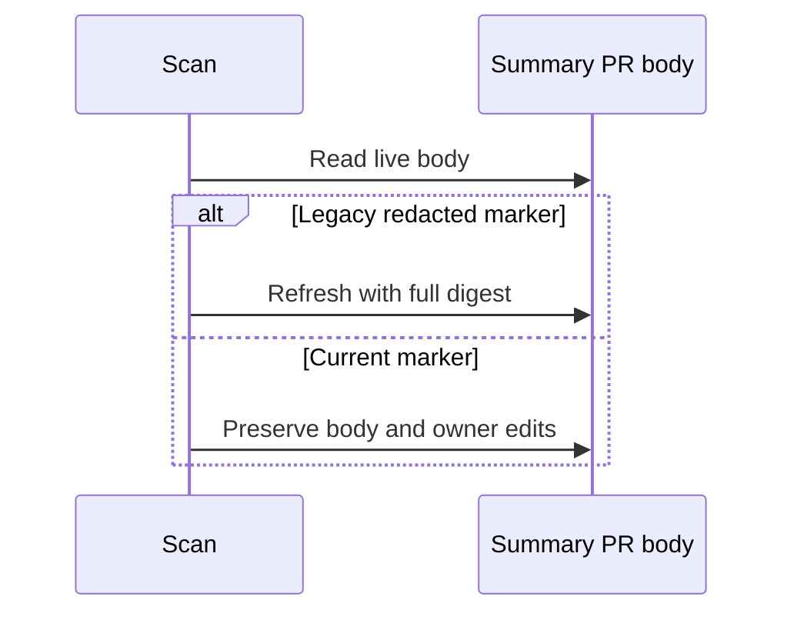

## Summary

Milestone rollup fingerprints now use the full 64-hex SHA-256 digest, which survives outbound body redaction. Regression coverage models the redacted GitHub body, preserves owner text while the fingerprint is current, and verifies one refresh for legacy markers. Credential redaction is unchanged. Closes #4505.

Version bump: no version change was needed for this fix.

## Spec

### Intent and Rationale

- The former 32-hex fingerprint was redacted in the published PR body, so scans could not recognise an unchanged rollup and rewrote owner edits.
- The full SHA-256 digest avoids the credential-shaped redaction rule without weakening it.

### Essential Design Decisions

- Keep credential redaction unchanged.
- A legacy redacted marker triggers a body refresh once. That initial refresh can replace owner edits; later scans preserve edits while the current marker remains in the body.

### Undiscoverable Facts

- None.

## Evidence

- `summaryPrFingerprint` in `worker/deno/lib/milestone_completion.ts` returns all 32 digest bytes.
- `spawnGh` applies `redactGhBodyArgs` to outbound arguments, which masks `--body` through the same `maskBody` logic used by `redactGhBodyText` (`worker/deno/lib/gh_spawn.ts`, `worker/deno/lib/gh_body_redaction.ts`). The `completedMilestoneWithRollupGhFn` test double uses `redactGhBodyText` and returns the stored body on later `pr view` calls.
- With the base production source at `3f7927d4`, the head regression test file produced 146 passes and four failures: unchanged-scan owner text, legacy marker refresh, changed-classification stability, and incomplete-milestone body redaction. With the fix, all 150 milestone tests pass.
- Backend-only change; no browser evidence applies.

## Test Plan

- `worker/deno/tests/milestone_completion_test.ts`: added checks that owner-added text survives an unchanged scan, a legacy redacted marker refreshes once, and an incomplete milestone round-trips through body redaction. The existing changed-classification refresh check remains in place.
- Regression red check: `deno task test:unit tests/milestone_completion_test.ts` with base production source `3f7927d4` and the head test file → 146 passed, 4 failed in the four cases named above. The same command on the final source → 150 passed, 0 failed.
- No assertions were removed. The existing owner-edit assertion was moved ahead of the edit-count assertion so the base run directly detects the erased text.
- `deno fmt --check tests/milestone_completion_test.ts` → passed.
- `deno lint tests/milestone_completion_test.ts lib/milestone_completion.ts` → passed.
- `deno check --frozen --lock=deno.lock tests/milestone_completion_test.ts lib/milestone_completion.ts` → passed.
- `deno run --frozen --lock=deno.lock --allow-read --allow-env mod.ts check-mermaid --script-dir ../.. < /dev/null` → passed (1,544 Markdown files and 1,344 Mermaid blocks).
- `deno task pr-summary-check --base origin/main --issue-body-file /tmp/vibecoder-4505-issue-body.md --labels work-on ../../docs/archive/pr-summaries/pr-summary-4505.md` → passed, 0 blocked and 0 not checked.
- `./quality.sh < /dev/null` after merging `origin/main` (e2c6c4c9) → every stage passed except `deno tests`: 31,304 passed, 2 failed, 5 ignored. The two failures are `completion - an unformatted Rust change is formatted and committed, then passes the gate` and `completion - cargo fmt stages only the branch's .rs files, not an unrelated uncommitted edit` (`worker/deno/tests/completion_phase_repo_formatters_test.ts:480`, `:567`). They fail because `cargo fmt` is unusable on this host (rustup has no default toolchain), not because of this change. The serial pass did not run after the parallel pass failed. The earlier chokepoint failures are gone after the merge. `config integration` and `checkov` were skipped by the gate for missing local prerequisites.
- Documentation reviewed and updated: `docs/workflows/milestones.md`, “Decision points and exceptions” → “Final PR already exists”. `README.md` and non-archive documentation searches found no further current-behaviour text to update. Remaining hits: `docs/pre-pr-ci-audit.md:212` records the historical finding on the prior rollup implementation and remains accurate for the source reviewed then; `docs/INTERNALS.md:3209` describes the tracker-close line, not fingerprint behaviour.
