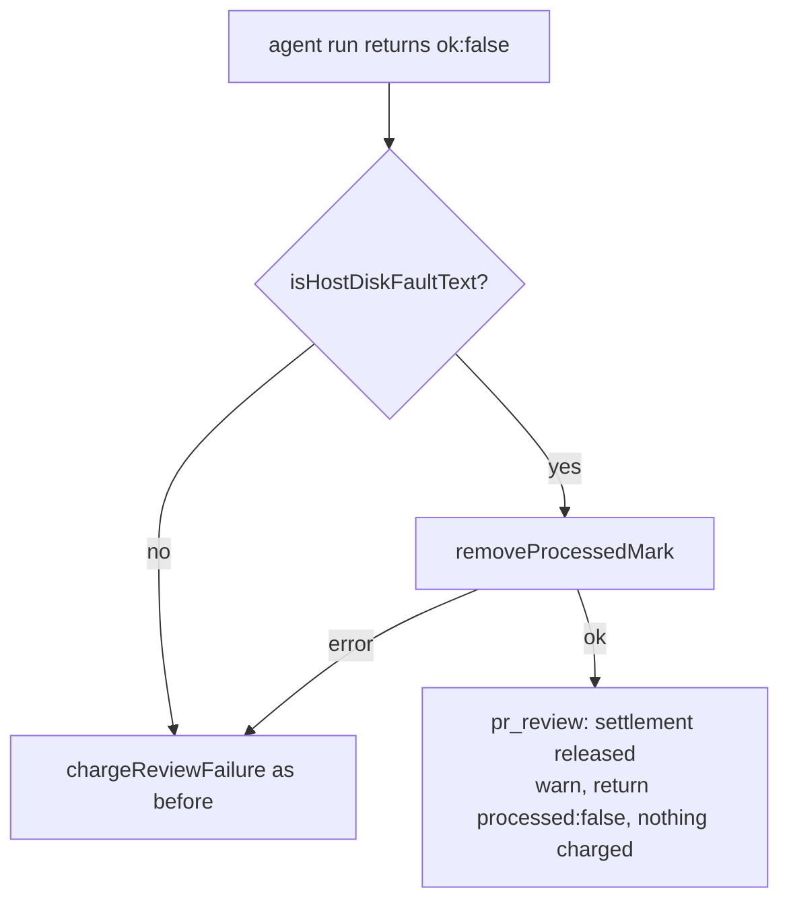

## Summary

The PR-feedback lane no longer charges a host-disk park (Issue #4360) as a
failed review fix. When the agent invocation fails with a host-disk fault, the
lane logs a warning and releases the comment: no "Automated Processing Failed"
reply, no strike, so two parks can no longer close the PR and redo its issue
(Issue #4304). Closes #4511.

## Spec

### Intent and Rationale

- A park is the worker's own infrastructure refusal and the issue path never charges for one; the PR-feedback path charged it, so a few hours of low disk threw away a reviewed fleet PR.
- The fix reuses the existing classifier `isHostDiskFaultText` and the existing release shape of the branch-held/checkout-failed path; it adds no new check.

### Essential Design Decisions

- Only the first `!claudeResult.ok` branch is changed, as the issue proposes. Timeouts, other agent failures and the in-run retry/recovery invocations are charged as before.
- Assumption: if `removeProcessedMark` fails for a non-review comment, the comment would never be rediscovered, so the attempt is charged after all rather than left unanswered. A `pr_review` has no mark, so it always releases.
- The release returns `ok: true, processed: false` (the same shape as the branch-prepare release), not an error.

### Undiscoverable Facts

- None.

## Evidence

Backend change; no UI. Tests: `worker/deno/tests/pr_feedback_review_dismissal_3383_test.ts` (five new `Issue #4511` tests; the harness gains a `park` agent behaviour built from the real `HOST_DISK_PARK_NOTE`).

Docs updated: `docs/CONTAINER.md` (section "In-flight builds stop at the same floor"), `docs/workflows/pr-feedback.md` and `docs/INTERNALS.md` (the two sentences saying every agent error is charged). Callers of the shared classifier are unchanged; only the new call site uses it.

Doc-sentence greps for the two-strike claim (`two-strike`, `Automated Processing Failed`, `failed attempt`) were re-read; the remaining hits describe verifier blocks and no-fix outcomes, not agent errors.

## Test Plan

- `deno task test:unit tests/pr_feedback_review_dismissal_3383_test.ts` — 31 passed, 0 failed.
- `deno task test:unit tests/pr_feedback_processor_test.ts` — 43 passed, 0 failed.
- Red check: with only `lib/pr_feedback_processor.ts` restored to base, 4 of the new tests fail (pr_review park, parked `issue` comment, parked `review` comment, mark-removal failure fall-through); restored fix passes.
- Release outcome → `pr_review` park returns ok, no `handlePrCommentFailure`, no PR comment; non-review park → reaction DELETE issued, nothing charged. Mark-removal error outcome → charged once. Non-park failure → still charged (existing "agent error charges a failed attempt" test, plus a new plain `issue` failure test).
- `./quality.sh`: every stage passed except `deno tests`, which failed only on two Rust formatter tests in `tests/completion_phase_repo_formatters_test.ts` (lines 480 and 567). This host's `cargo fmt` is unusable (rustup has no default toolchain) while its skip guard probes only `rustfmt`; the failure is on the base branch and unrelated to this change (31301 other tests passed). Issue #4547 tracks it.
- Not run: the serial test pass, because the parallel pass failed before it.
